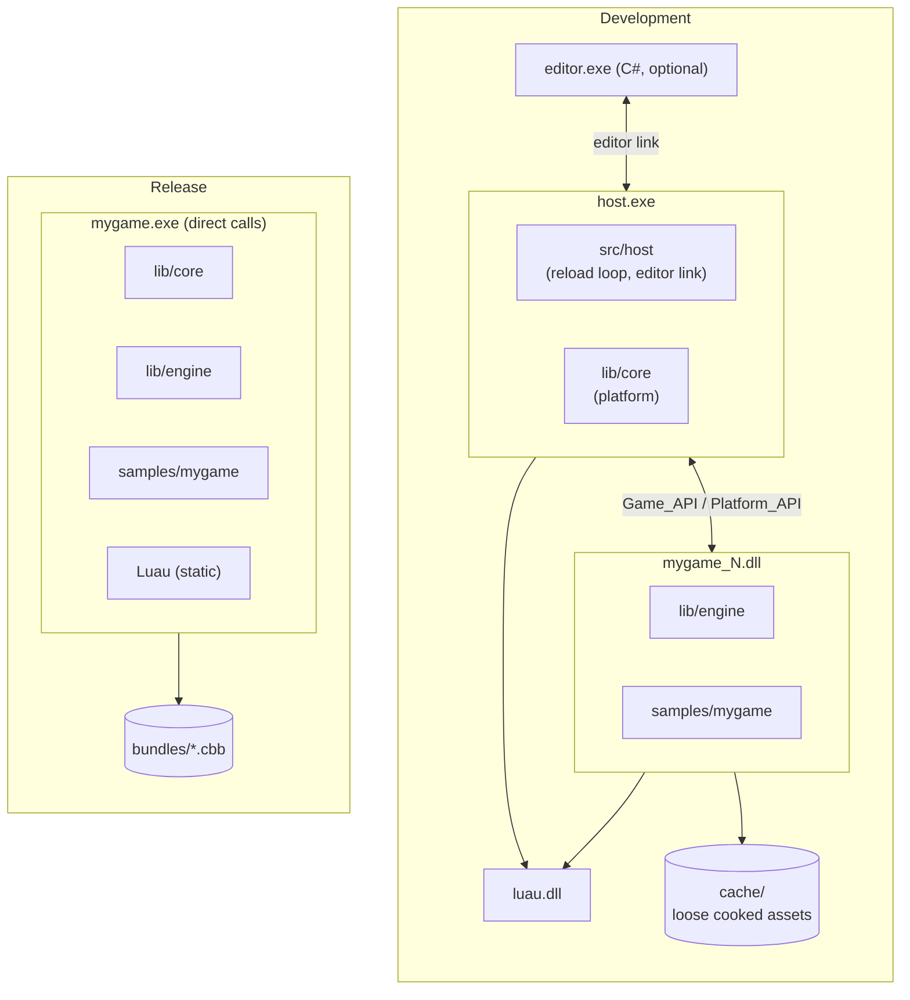
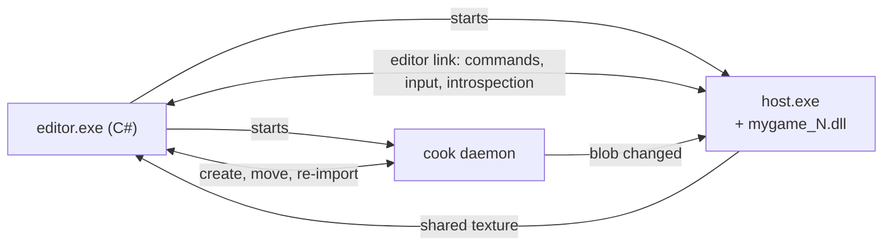
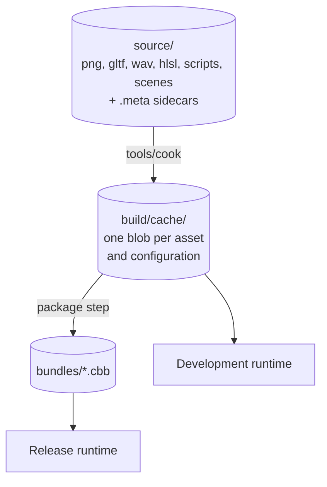

# Architecture

This document describes the high-level modules of cinnabar and how they interact. Each module's internal rules and details are in its own document, linked from the relevant section.

## Overview

A shipped game is one executable and a set of content bundles.

- The **executable** contains the engine and the game code, compiled together. In release builds they are statically linked. In development, they are built as a DLL that a host process loads and hot-reloads.
- The **bundles** contain all content data. The asset pipeline compiles them from source assets.

## Modules

| Module | Side | Responsibility |
|---|---|---|
| `lib/core` | Host | Platform services and every OS or device resource: window, input, GPU device, audio device, worker threads, fiber scheduler, virtual memory, file I/O, file watching, dynamic library loading. |
| `lib/core/gpu` | Shared | Backend-agnostic GPU interface: handles and the command list format. Backends execute the command lists that the engine records. |
| `lib/core/luau` | Shared | Odin bindings to the Luau C API. |
| `lib/core/script` | Host | The script VM's allocator, and every function pointer that Luau stores. |
| `lib/core/layout` | Shared | Type layout hashing, used to detect `Game_State` and command format changes across a reload. |
| `lib/core/gpu/d3d12` | Host | The D3D12 backend. |
| `lib/core/gpu/null` | Host | A backend that validates command lists and executes nothing. Used for headless tests. |
| `lib/engine` | Game | Everything that does not own an OS resource: world, render frontend, asset runtime, script bindings, gameplay systems. |
| `lib/engine/script` | Game | Script bindings, behaviours, the coroutine scheduler and script hot reload. |
| `lib/engine/asset` | Game | The asset runtime: loading by GUID, handles and the sources of blobs. |
| `lib/engine/asset/format` | Shared | GUIDs, `.meta` files and blob layouts. `tools/cook` and the runtime both import it. |
| `samples/<game>` | Game | A game. Each game has a game package and a small `main_release` package that links everything statically. |
| `src/host` | Host | The generic development host. It loads the game DLL, runs the frame loop, drives hot reload and serves the editor link. One host serves every game. |
| `src/editor` | — | The C# editor application. It runs `host.exe` as a child process. |
| `tools/cook` | — | The asset compiler and its watch daemon. |
| `vendor/luau` | Shared | The Luau VM and compiler. |
| `vendor/dxc` | Tools | The DXC shader compiler. Only `tools/cook` uses it. |
| `vendor/` | — | Other third-party code. |

"Host side" code is in the executable during development and is not hot-reloaded. Changing it means restarting. "Game side" code is in the DLL during development and is hot-reloaded. In release builds both sides are in one executable and the distinction disappears.

### The boundary

The two sides communicate only through two structs of procedures:

- **`Platform_API`** (host → game): what `core` provides to the engine.
- **`Game_API`** (game → host): `init`, `update`, `shutdown`, `on_reload`, `state_size`, `layout_hash`, plus the editor procedures described in [Editor](#editor).

In development, the host gets `Game_API` from the DLL's exports. In release, `main_release` fills both structs with direct procedure references, so the code paths are the same in both configurations. Code must not branch on `HOT_RELOAD` outside `src/host` and the per-game `main_release` stubs.

## Hot reload

The host keeps all persistent state. The game DLL keeps only code.

- All persistent game-side state lives in one root `Game_State`, in memory that the host owns.
- Persistent state never contains pointers into the DLL image. It uses handles and IDs instead, and `on_reload` rebuilds all registrations.
- The host reloads the DLL at the end of a frame, after the job system is drained. If the layout of `Game_State` changed, the host restarts the game with fresh state. The window, the GPU device and the loaded assets stay up.

Details: [Hot reload](hot-reload.md).

## Platform layer

All platform-specific and graphics-backend-specific code lives in `lib/core`. Windows and D3D12 are the first targets. A later port must only add files to `core`. It must not require changes to `engine` or to games. The procedures in `Platform_API` are the complete porting surface.

`core` also provides the two services that everything else is built on:

- **Jobs:** a fiber-based job system. Jobs are frame-scoped. Logic that spans frames runs in [scripts](#scripting).
- **Memory:** arenas with distinct lifetimes. The host owns all of them, so they survive code reload.

Details: [Core](core.md).

## Frame

One frame runs these phases in order:

1. Poll platform events and input.
2. Run the fixed ticks that are due (zero or more). Each tick runs the `Fixed` systems (parallel jobs), applies their structural changes and propagates transforms.
3. Run the `Update` systems (parallel jobs).
4. Apply queued structural changes to the world.
5. Run the script phase (serial): behaviour lifecycle callbacks, events, opt-in `update` calls and due coroutines.
6. Apply queued structural changes to the world.
7. Run the `Late` systems, then transform propagation (parallel jobs).
8. Record render command lists. Render extraction interpolates between the last two ticks.
9. Drain the job system. This is the hot-reload point.

## World model

All world data lives in a native ECS in `lib/engine/ecs`. Native systems run on the job system, at a fixed tick rate or once per frame. World positions are fixed-point. Scripts see an object-style API on top of the ECS: entity handles, component access through those handles, and behaviour components that hold script objects.

Component types have stable IDs. Cooked scenes, the editor link and scripts all identify component types by these IDs.

Details: [World](world.md).

## Rendering

The render frontend is in `lib/engine`. The GPU device and the backend are in `lib/core/gpu`.

- Every frame, the engine records **backend-agnostic command lists** into frame memory.
- `core/gpu` translates and submits them.
- GPU resources (buffers, textures, pipelines) are handles that `core/gpu` owns. They survive code reload.

With this boundary, rendering does not call across the DLL once per draw. The boundary is plain data, and porting means writing a new consumer of the command lists.

Resource binding is bindless, and barriers come from a render graph in `lib/engine`. The backend translates commands and does not track state.

Details: [GPU](gpu.md).

## Scripting

Gameplay logic that spans frames runs in sandboxed Luau.

- The host and the game DLL share one copy of Luau. It is `luau.dll` in development and linked statically in release.
- The VM heap lives in host-owned memory, so scripts and their suspended coroutines survive code reload. Every function pointer that Luau stores is host code, which forwards to the game's bindings by stable ID.
- The API follows Unity's: entities, behaviours with serialized fields, `get`, `spawn`, `destroy` and coroutines.
- Scripts are content. `tools/cook` compiles them to bytecode, and they hot-reload through the asset system.

Details: [Scripting](scripting.md).

## Editor

The editor is a separate C# application. It is not part of the engine, and games never link it.

- The editor runs `host.exe` as a child process. The host also runs without the editor, in its own window.
- The editor controls the host through the **editor link**, a message protocol. The host serves it by calling the editor procedures in `Game_API`. Type info for game-side types exists only in the DLL, so all introspection goes through those procedures.
- The host renders the game into a shared GPU texture, which the editor displays in its viewport.

Details: [Editor](editor.md).

## Content pipeline

- Every source asset has a GUID. Content refers to other content only by GUID.
- `tools/cook` compiles source assets into a cache of blobs. `tools/cook` and the runtime share the asset type definitions from `lib/engine`.
- In development, the runtime reads blobs from the cache. In release, it reads them from bundles. The blob format is the same in both.
- In development, the cook daemon watches the source files and tells the running game when a blob changes. The game swaps the asset in place.

Details: [Content pipeline](content-pipeline.md).
