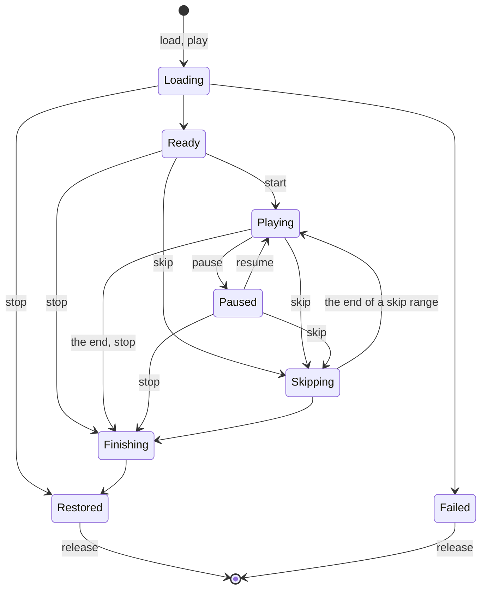

# Player

A player runs one cutscene from its load to the moment the world is given back. Its lifecycle is one state machine, as [Conventions: State with a lifecycle](../overview/conventions.md#state-with-a-lifecycle) requires. Callers hold a handle and ask the player; they never set its state.

This document describes `lib/engine/cutscene/player.odin`. Read [Bindings](bindings.md) and [Evaluation](evaluation.md) first. [Skipping](skipping.md) describes the `Skipping` state.

**In this document:** [The states](#the-states) · [Handles](#handles) · [Commands](#commands) · [The frame](#the-frame) · [Loading and failures](#loading-and-failures) · [Conflicts](#conflicts) · [Reset](#reset) · [Hot reload](#hot-reload) · [Procedures](#procedures)

## The states

Ready, Playing, Paused, Skipping and Finishing can also go to `Failed`.

A player's state is one union, `Player_State`. The data of each state is in its variant:

| State | Data | Meaning |
|---|---|---|
| `nil` | | A free slot. A handle to it is stale. |
| `Player_Loading` | The cutscene's GUID, what to do when ready, whether a skip came, and the caller's overrides | The next `update` loads the cutscene and what it references, and resolves the bindings. |
| `Player_Ready` | `Player_Live` | Everything is loaded and resolved. The spawned entities are hidden. The first frame can be evaluated at once, so `start` plays without a hitch. |
| `Player_Playing` | `Player_Live` | The time moves on the cutscene's clock, and both phases evaluate. |
| `Player_Paused` | `Player_Live` | The time stands still. Both phases still evaluate at the time, so the cutscene holds the world, and fires no events. |
| `Player_Skipping` | `Player_Live`, the target, the part of the fade and how long it has run | The time stands still behind a fade out. Then the player jumps to the target, and goes to `Finishing` at the end or fades in and plays on ([Skipping: The state](skipping.md#the-state)). |
| `Player_Finishing` | `Player_Live` | The last evaluation is done. The fades out ([#546](https://github.com/aszecsei/cinnabar/issues/546)) will run here. Until then, the same `update` gives the world back. |
| `Player_Restored` | | The world is given back: the fields are restored, the input and the HUD are back, nothing is suspended, the spawned entities are gone and the assets are unloaded. The handle can be dropped. |
| `Player_Failed` | A `Failure` | The player could not go on. What it had changed is given back, as for `Restored`. |

`Player_Live` is the data from `Ready` to `Finishing`:
- the [evaluation](evaluation.md#the-evaluation), which holds the time and the time of each phase's last evaluation;
- the assets that the cutscene references, which the player holds loaded;
- the overrides, by binding ID;
- a hash of the blob's bindings ([Hot reload](#hot-reload));
- the hold: the token of its input context's push and the documents that it hides, empty until the player first plays or skips ([Possession: The whole cutscene](possession.md#the-whole-cutscene)).

**One writer.** `change_cutscene(state, world, slot, to)` is the only procedure that sets a player's state. `game.Sublevel_State` and `change_sublevel` are the model.
- It refuses a change that the diagram does not allow, and logs it.
- It frees the data of the state that the player leaves. A loading player's overrides are freed. A live player that goes to `Restored` or `Failed` gives the world back (`give_back`): its tracks' fields are restored, its camera cut track releases its claim on the views ([Tracks: Camera cut tracks](tracks.md#camera-cut-tracks)), its input context and documents come back, its bindings resume what they suspended, its spawned entities are despawned and its assets are unloaded ([Possession: Giving it back](possession.md#giving-it-back)).
- A `Ready` player that goes to `Playing` or `Skipping` shows its spawned entities (`reveal_bindings`), pushes its input context and hides its documents (`take_hold`, [Possession: The whole cutscene](possession.md#the-whole-cutscene)).
- It records each change as a `Player_Event`. `player_events` gives the frame's events, and `end_frame` clears them.

A change from one live state to another carries the live data. `moved(player, to)` makes the new variant from the data that the player holds at the moment of the change, so the change carries what the last evaluation saved. `skipping(player, target)` makes the `Skipping` variant, which has data of its own.

**Code reload.** The state holds no procedures, `typeid`s or string literals. An override by name holds a copy of the name on the heap. A failure holds a GUID or a binding's index, not a string.

## Handles

`load` and `play` return a `Player_Handle`: the player's slot and the slot's generation.
- The players are in fixed slots in `State.players`, which is in `Game.cutscenes`. There are `MAX_PLAYERS` (32) slots. A player does not move, so a track's `Track_Context` can hold its evaluation.
- A new player takes a free slot and adds 1 to its generation. A generation of 0 is no handle's, so the zero handle is always stale.
- A handle is stale when its slot is free or holds a newer player. A call through it does nothing and returns `Gone`.
- A `Restored` or `Failed` player keeps its slot, so `status` reports it, until `release` frees it. When every slot is taken, a new player takes the slot of the earliest player that ended.

## Commands

Each command takes a handle and returns a `Command_Result`:
- `Done`: the command did what it asks, or the player was already there.
- `Gone`: the handle is stale, or the player is `Restored` or `Failed`. Nothing happens.
- `Refused`: the player's state does not take the command. The writer logs it.
- `Not_Skippable`: a skip at a time that the cutscene's skip policy does not let a player skip ([Skipping: The policy](skipping.md#the-policy)). Nothing happens, and nothing is logged.

| Command | From | To |
|---|---|---|
| `start` | `Ready` | `Playing`. A loading player plays once it is ready. |
| `pause` | `Playing` | `Paused` |
| `resume` | `Paused` | `Playing` |
| `stop` | `Ready`, `Playing`, `Paused`, `Skipping` | `Finishing`, at the current time, without the rest of the cutscene. A loading player goes to `Restored` at once, because it has changed nothing. |
| `skip` | `Ready`, `Playing`, `Paused` | `Skipping`, to the target that the skip policy gives at the player's time. A loading player skips from its start once it is ready. A second skip does nothing. |
| `set_time` | `Ready`, `Playing`, `Paused` | The same state, at a new time, for a debugger and for the editor ([#551](https://github.com/aszecsei/cinnabar/issues/551)). It seeks, so no event between the two times fires. |
| `release` | `Restored`, `Failed` | A free slot. The handle is stale after it. |

`status`, `player_time`, `player_failure`, `player_evaluation`, `can_skip` and `skip_fade` ask about a player through its handle.

## The frame

`update(state, Player_Context{world, scenes, scripts, dt})` moves the players on. `dt` is the frame's real duration, which a skip's fades run on. `game_update` calls it once a frame, after the scene requests and the streaming, and before the ticks. So it runs outside the systems and outside the script phase, when the frame's scenes are in place. Scripts call the commands in the script phase, and only `update` loads, spawns, despawns and restores. The one change to the world that a command makes is to show the spawned entities, when `start` or `skip` takes a `Ready` player on. In each slot, in order:

1. A loading player loads ([Loading and failures](#loading-and-failures)). It is then `Ready`, `Playing` or `Skipping`, or `Failed`. A player that goes to `Skipping` here runs the next step in the same `update`.
2. A live player whose bindings changed in a reload resolves them again ([Hot reload](#hot-reload)).
3. A skipping player moves its fade on by `dt`. At the end of the fade out, it jumps to its target and goes to `Finishing` at the range's end, or starts its fade in. At the end of the fade in, it is `Playing` ([Skipping: The state](skipping.md#the-state)).
4. A playing player at the range's end evaluates both phases there, and goes to `Finishing`. An evaluation fires only the events after its phase's last time. So an event at the end fires once, whether a tick and the `Late` stage reached the end first or not. On the real clock, a cutscene can reach its end while the game is paused, with no `Late` stage. Its last events then fire here.
5. A finishing player gives the world back and is `Restored`.

`update` returns how many spawned roots it despawned. The game then calls `forget_despawned`, as after a scene unloads.

The systems ([Evaluation: The order in the frame](evaluation.md#the-order-in-the-frame)) evaluate the players that are `Playing`, `Paused` or `Skipping`. They advance only the `Playing` ones. A `Skipping` player's evaluations fire no events and leave each phase's last time, so its jump fires what it skips.

`update_skip` runs just before `update`, and reads the skip action ([Skipping: Input](skipping.md#input)).

## Loading and failures

In `Loading`, `update`:
1. Loads the cutscene's blob. A blob that does not load is `Asset_Failure{guid, .Missing}`. A blob that is not a cutscene is `.Not_A_Cutscene`.
2. Loads every asset that the blob references (`format.blob_references`): the spawned bindings' prefabs, and the sections' clips, sounds and sub-sequences. An asset that does not load is `Asset_Failure{its guid, .Reference_Missing}`.
3. Resolves each override's binding, by ID or by name, to the binding's ID.
4. Resolves the bindings ([Bindings: Resolving](bindings.md#resolving)). A failure is the `Binding_Failure`.

On a failure, the player unloads what it loaded, despawns what it spawned, and goes to `Failed`. Nothing is left changed. `player_failure` gives the reason, and the log names it.

## Conflicts

Two players can write the same field of the same entity.
- **Order.** The systems evaluate the players by priority, low first, and then by start order. So the player with the higher priority writes last and wins. Between two players with one priority, the later start wins.
- **The field's own value.** The first player that writes a field saves the field's value in its snapshot. A later player that writes the field saves the same value: it copies it from the first player's snapshot, not from the world. A track blends over this value ([Evaluation: Sections and blending](evaluation.md#sections-and-blending)), so neither player blends over what the other wrote.
- **Giving back.** A player that ends while another live player holds a field does not put the field back. It hands the put-back to the other player (`Saved.handed`), which writes the field on in its next evaluation, and puts the first value back when it ends, even if only its tracks set to keep wrote the field.
- **A rule for kinds of track.** A kind writes every field that it holds in each evaluation, at the field's own value when no section covers the time. Otherwise a field that a player handed over keeps the value of the player that ended, until the next write.

So the winner shows while it plays, and the other player's value shows again when the winner ends. When both have ended, in either order, the field has its first value if any track that wrote it is set to restore. A field that only tracks set to keep wrote keeps the last value written. While the game is paused, no system runs, so a handed field shows the next player's value when the game resumes.

## Reset

`reset(state, world)` restores and frees every player, whatever its state, and ends a hold of the skip action. Every handle is then stale.
- **A soft restart.** `game_shutdown` calls `destroy`, which resets the players, while the world, the scripts and the assets are alive.
- **A new level.** `update`, and `load` and `play`, follow `level_generation`. When a scene load or the editor's `Load_Scene` unloaded the level, they reset the old level's players first, so a player made after the unload belongs to the new level. The old players' entities are gone with the level. The restore skips their fields, as their handles name no live entity, and the release despawns nothing.

## Hot reload

The evaluation follows a new blob for its tracks ([Evaluation: Hot reload](evaluation.md#hot-reload)). The player follows it for the bindings:
- Each live player keeps a hash of the blob's bindings. When a reload changes them, `update` resolves them again with the player's overrides.
- The spawned entities spawn again. They show at once, unless the player is `Ready`.
- A binding that no longer resolves fails the player.

## Procedures

| Procedure | What it does |
|---|---|
| `load(state, world, desc)`, `play(state, world, desc)` | Make a player in `Loading`, which waits in `Ready` or plays once loaded. `Play_Desc` holds the cutscene, the priority and the overrides. |
| `start`, `pause`, `resume`, `stop`, `skip`, `set_time`, `release` | The [commands](#commands) |
| `status`, `player_time`, `player_failure`, `player_evaluation`, `can_skip`, `skip_fade` | Ask about a player through its handle |
| `update(state, context)` | Moves the players on, once a frame ([The frame](#the-frame)) |
| `reset(state, world)` | Restores and frees every player |
| `player_events(state)`, `end_frame(state)` | The frame's changes of state, and their end |
| `change_cutscene(state, world, slot, to)` | The one writer of a player's state |
| `moved(player, to)`, `skipping(player, target)` | The next live state, with the live data that the player holds |
