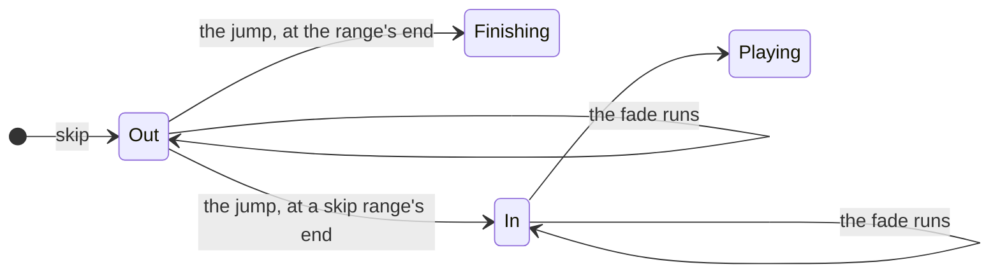

# Skipping

A player can skip a cutscene, all of it or one part. A skip must leave the world as playing to the end would: the possessed entities in their last places, the events that gameplay needs fired, and the doors left open. The player jumps to the target through one evaluation, in a `Skipping` state, behind a fade that the overlay draws ([Tracks: Presentation tracks](tracks.md#presentation-tracks)).

This document describes the skip in `lib/engine/cutscene/player.odin` and `evaluation.odin`, and the skip action in `skipping.odin`. Read [Player](player.md) and [Evaluation](evaluation.md) first.

**In this document:** [The policy](#the-policy) · [The state](#the-state) · [Events](#events) · [Input](#input) · [The fade](#the-fade) · [Not built yet](#not-built-yet) · [Procedures](#procedures)

## The policy

Each cutscene has a skip policy, its `skip` setting ([Content: Cutscenes](../content/kinds/cutscenes.md#the-cutscene)):

| `skip` | A skip at a time goes to |
|---|---|
| `anywhere` (the default) | The end of the cutscene's range |
| `none` | Nowhere: the cutscene cannot be skipped |
| `[[<start>, <end>], ...]` | The end of the skip range that holds the time. A time outside every range cannot be skipped. |

- **A skip range** is `[start, end)` on the cutscene's time. The ranges are in time order and do not overlap. So a designer leaves out a short, important moment, and a skip in the range before it stops at its start.
- **A target past the range's end** is the range's end.
- **The end itself** cannot be skipped, because a skip there would not move.
- `format.cutscene_skip_target(data, blob, t)` gives the target at a time, or false. `can_skip(state, handle)` asks it for a player's time.

## The state

`skip(state, world, handle)` takes a `Ready`, `Playing` or `Paused` player to `Skipping`, with the target at its time. At a time that cannot be skipped, it returns `Not_Skippable`, and nothing happens and nothing is logged, so a player who presses the skip button where it is not allowed does not fill the log.

`Player_Skipping` holds the live data, the target, the part of the fade that runs (`Skip_Fade.Out` or `.In`) and how long that part has run. Each `update` moves the fade on by the frame's real duration (`Player_Context.dt`). The fade's length is the cutscene's `skip_fade`, in ticks, for the fade out and again for the fade in.

1. **The fade out.** The time stands still, as for a paused player. The systems still evaluate the player's tracks at the time, so it holds the world, but it fires no events.
2. **The jump.** At the end of the fade out, `skip_to` moves the time to the target and evaluates each phase there once, as a skip ([Events](#events)).
3. **The end.** At the range's end, the player goes to `Finishing` in the same `update`, and gives the world back. `Finishing` stays instant. There is no fade in before the world comes back: the frame comes back with the world given back, still covered, and the overlay then fades back over gameplay ([The fade](#the-fade)).
4. **The fade in.** At a skip range's end, the fade in runs at the target. The time still stands still. At its end, the player is `Playing` from the target.

A fade of 0 ticks (the default) does all of this in one `update`.

- **A second skip** during `Skipping` or `Finishing` does nothing and returns `Done`.
- **`stop`** during `Skipping` goes to `Finishing` at the time where the skip is. The jump does not happen.
- **A skip while `Loading`** marks the player (`Player_Loading.skip`). Once the player is ready, it skips from the range's start, in the same `update`, without a frame of play. With `anywhere`, the cutscene therefore ends once it has loaded. If the start cannot be skipped, the player does what it was asked to do before the skip: it waits in `Ready`, or plays. The log notes it.
- **A skip while `Ready`** shows the spawned entities and takes the hold, as `start` does ([Possession: The whole cutscene](possession.md#the-whole-cutscene)), so the fade out shows the cutscene's first frame.
- **A hot reload** during a skip clamps the target into the new range at the jump. The policy is read when the skip starts.

## Events

A jump is one evaluation of each phase at the target, over the range `(last, target]` of that phase. `Track_Context.skipped` is true in it. A kind of track that fires events fires only the ones in that range that are marked **fire when skipped**, and starts nothing that the jump passes over, such as a sound. So a door that a cutscene opens with an event stays open after a skip, and a line of dialogue does not play.

- The ranges of the two phases follow their own last times, so no event fires twice and none is lost between the phases.
- A key at the target fires when it is marked, as a key at the end does when the cutscene plays.
- While the fade runs, the evaluations do not move each phase's last time. The jump's range therefore covers what the fade held. For a skip from `Ready`, that includes the keys at the range's start.
- A skip of a range then plays on from the target. The events after it fire as they play.

The event track sends the marked keys of all its tracks in one order: by time, then by the tracks' order. The range that is open at the skip sends its end, and a range that the skip lands in sends its begin ([Tracks: Event tracks](tracks.md#event-tracks)).

## Input

The player skips by holding a button, so that a tap does not skip by mistake.

- **The action** is an input action that the game defines, `skip` unless the project's `cutscene.skip_action` names another ([Overview: Project settings](../overview/architecture.md#project-settings)).
- **The hold** is `cutscene.skip_hold` seconds, 1 by default, and 0 skips on the press.
- **The input context.** The action reads through the input contexts ([Core: Input: Contexts](../core/input.md#contexts)), so the cutscene's context must allow it. Define the `cutscene` context with the `Only` mode and the skip action, and the pause menu's action.

`update_skip(state, world, input, dt)` reads the action once a frame. `game_update` calls it just before `update`, so a skip begins its fade in the same frame. The hold is one union, `Skip_Hold`:

| State | Meaning |
|---|---|
| `nil` | No hold. A press of the action, while a `Playing` cutscene can be skipped at its time, begins one. |
| `Skip_Holding` | The action has been down since the press for `held`. The hold ends when the action is up, or when no playing cutscene can be skipped. When `held` reaches the hold time, the hold skips every `Playing` player that can be skipped. |
| `Skip_Spent` | The hold skipped. It ends when the action is up. So a held button skips once, and does not skip the next range or the next cutscene. |

- **Only a press begins a hold.** A button that is already down when a cutscene starts does not skip it.
- `skip_progress(state)` is how far the hold is, from 0 to 1, for the UI to show. It is 1 while the hold is spent.
- `set_skip_input(state, action, hold)` sets the action's name and the hold time. `update_project` calls it with the project's settings. The name is kept in bytes, so it stays across a code reload.
- `reset` ends a hold, for a soft restart and a new level.

## The fade

The overlay draws the skip's fade over the frame ([Tracks: Presentation tracks](tracks.md#presentation-tracks)). `skip_fade(state, handle)` gives how much the fade covers the frame, from 0 to 1.
- **The color.** The cutscene's `skip_color`, a quoted `"#rrggbb"`, black by default ([Content: Cutscenes](../content/kinds/cutscenes.md#the-cutscene)). The fade draws over the presentation track's own fade.
- **Without a presentation track.** The skip's fade shows all the same.
- **Subtitles** hide for the whole skip, its fade in included.
- **A skip to the end** differs from the fade in of #538, which runs only when play goes on. The world is given back while the fade covers the frame. The overlay outlives the player, so it then fades back from the skip's color to clear, over `skip_fade` ticks on real time, over gameplay. `Finishing` does not wait for it.
  - `Player_Finishing.cover` is how much the skip's fade covered the frame as the player finished: 1 at the end of the fade out, less for a `stop` during the fade, and 0 when the player did not skip. The fade back starts from that coverage.
  - A fade that a presentation track keeps wins over the fade back ([Tracks: Presentation tracks](tracks.md#presentation-tracks)).
- **A skip that plays on** has its fade in at the target, as before.

## Not built yet

The skip exposes what later tracks need, but some are not built yet:
- **Sub-sequences** skip with their parent, through the same jump: their tracks evaluate at the target, mapped to their time, and their keys marked `fire_when_skipped` fire in time order with the parent's ([Tracks: Sub-sequence tracks](tracks.md#sub-sequence-tracks)).

Scripts skip through the `Cutscene` library: `:skip()`, and `on_cutscene_finished(cutscene, skipped)` and `wait_cutscene` say whether a skip took the cutscene to its end ([Scripts](scripts.md)).

The camera cut track is built: a skip to a later time cuts to the section there, and a skip that ends the cutscene cuts back to gameplay, or blends out when the last section has `blend_on_skip = true` ([Tracks: Camera cut tracks](tracks.md#camera-cut-tracks)).

The event track is built: the jump sends the triggers marked `fire_when_skipped`, and the ranges crossed whole that are marked, and ends the ranges that it leaves ([Tracks: Event tracks](tracks.md#event-tracks)).

The audio track is built too: as the skip begins, its voices fade out over what is left of the fade out, and a section marked `plays_through_skip` plays on to its end at its own rate. The jump starts none of the sounds that it passes ([Tracks: Audio tracks](tracks.md#audio-tracks)).

## Procedures

| Procedure | What it does |
|---|---|
| `skip(state, world, handle)` | Starts a skip at the player's time, or returns `Not_Skippable` |
| `can_skip(state, handle)` | Whether a skip would skip now |
| `skip_fade(state, handle)` | How much a skipping player's fade covers the frame, from 0 to 1, which the overlay draws |
| `skip_to(state, e, world, data, blob, target)` | The jump: evaluates each phase once at the target, as a skip |
| `update_skip(state, world, input, dt)` | Reads the skip action and its hold, once a frame |
| `skip_progress(state)` | How far the hold is, from 0 to 1 |
| `set_skip_input(state, action, hold)` | Sets the skip action's name and hold time |
| `format.cutscene_skip_target(data, blob, t)` | Where a skip at a time goes, by the policy |
| `format.cutscene_skip_ranges(data, blob)` | The skip ranges |
