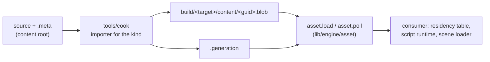

# Content pipeline

The cooker, the cook daemon and the asset runtime: how a source file becomes a blob and how a blob reaches the GPU.

## Documents

Read them in this order the first time.

| Document | What it covers |
|---|---|
| [Identity and cooking](identity-and-cooking.md) | GUIDs, `.meta` files, and what every cook shares. |
| [Scripts](kinds/scripts.md) | Luau scripts. |
| [Scenes](kinds/scenes.md) | Scene files. |
| [Shaders](kinds/shaders.md) | HLSL shaders. |
| [Textures](kinds/textures.md) | Textures and block compression. |
| [Meshes](kinds/meshes.md) | glTF models, mesh sub-assets and mesh files. |
| [Stages](kinds/stages.md) | USD stages: their meshes, textures, material instances and prefab. |
| [Materials](kinds/materials.md) | Shading models, materials, instances, functions and graphs. |
| [Effects](kinds/effects.md) | Emitters of particles, their modules and curves. |
| [Cook daemon](daemon-and-operations.md) | The daemon, asset operations and the cook link. |
| [Blobs and loading](blobs-and-loading.md) | The blob format, the asset runtime and hot reload. |

## Overview

Content has one path into a game. A source file and its `.meta` sidecar are cooked into a blob, the blob is written to the cache, the asset runtime loads it by GUID behind a generational handle, and a consumer such as the renderer's residency table turns the blob into GPU resources. Every step is incremental, and every step can be redone while the game runs.

Content reaches a game in two ways:

| Way | When | How the game learns of new blobs |
|---|---|---|
| **Batch cook** (`just scripts`, `just textures`, `just build` and so on) | A build, or a release cook | The cache's generation counter changes; `asset.poll` swaps the new blobs |
| **Cook daemon** (`just watch`, or started by the editor) | Development, while sources change | The same counter, after each pass |

The code is in three places:

| Package | Files | What they hold |
|---|---|---|
| `tools/cook` | `main.odin` | The commands: `scripts`, `scenes`, `shaders`, `textures`, `models`, `meshes`, `stages`, `materials`, `daemon`, `stage-report`, `--emit-link-schema` |
| | `content.odin`, `assets.odin` | The one pass that every command shares: the scan of the roots, `.meta` files for new assets, and each kind's cook. `IMPORTERS`: each kind's extensions and import settings. |
| | `scripts.odin`, `typecheck.odin`, `schema.odin`, `luau_tools.odin` | Scripts: requires, type checking against the definition file, behaviour fields read with the prelude, and the bindings to the Luau compiler and analyzer |
| | `scenes.odin` | Scenes: the syntax check and the blob |
| | `shaders.odin` | Shaders: DXC as a child process, includes, problems from its messages |
| | `textures.odin`, `compressonator.odin` | Textures: decoding, resizing, mips, block compression through `CMP_Core` |
| | `meshes.odin`, `meshoptimizer.odin` | Models and meshes: glTF through cgltf, the two vertex streams, meshoptimizer |
| | `stages.odin`, `usd.odin`, `usd/cn_usd.cpp` | USD stages: composition and conversion through LightUSD, each sub-asset's cook, the generated material instances and prefab, the manifest |
| | `mesh_files.odin` | Mesh files: the parse and the bake from `format`, then the glTF path's second half. The game bakes the same files live while the editor edits them (see [Mesh editing](../editor/mesh-editing.md#live-meshes)) |
| | `materials.odin`, `graphs.odin` | Shading models, materials, instances and functions: the generated HLSL, the variants, the parameter block; graphs to HLSL |
| | `daemon.odin`, `watch_windows.odin`, `index.odin`, `serve.odin` | The daemon: the watcher, the passes, the index of the content, and the cook link's server |
| | `operations.odin`, `files_windows.odin`, `lock_windows.odin` | The asset operations, the file moves they need, and the cache lock |
| | `problems.odin` | `Problem`: an error or warning with its file, line and column |
| `lib/engine/asset` | `asset.odin` | The runtime: `load`, `poll`, handles, the `Source` union, whose one arm is `Loose_Cache` |
| `lib/engine/asset/format` | `format.odin`, `scene.odin`, `scene_text.odin`, `shader.odin`, `texture.odin`, `mesh.odin`, `mesh_text.odin`, `mesh_bake.odin`, `material.odin` | What the cooker writes and the runtime reads: GUIDs, `.meta` files, the blob header, and each kind's layout. Shared by `tools/cook` and the runtime; imports nothing from `lib/core`. |
| `lib/engine/asset/cook_link` | `cook_link.odin` | The cook link's messages, over the transport in `lib/engine/wire` |

The sections below follow the same order: how an asset is identified, how each kind is cooked, how the daemon keeps the cache current and serves the editor, what a blob looks like, and how the runtime loads it.

## References

- Arseny Kapoulkine, [meshoptimizer](https://github.com/zeux/meshoptimizer): vertex welding, cache and fetch ordering, meshlet building, the cluster LOD builder `clusterlod.h`, and MikkTSpace-compatible tangents in [Meshes](kinds/meshes.md#meshes).
- AMD, [Compressonator](https://github.com/GPUOpen-Tools/compressonator): the `CMP_Core` block encoders for BC1 to BC7 in [Textures](kinds/textures.md#textures).
- Microsoft, [DirectX Shader Compiler](https://github.com/microsoft/DirectXShaderCompiler): the compiler that [Shaders](kinds/shaders.md#shaders) and [Materials](kinds/materials.md#materials) drive, and its `-Zi -Qembed_debug` flags.
- Light Transport Entertainment, [TinyUSDZ](https://github.com/lighttransport/tinyusdz), now LightUSD: the USD reader, composition and Tydra converter behind [Stages](kinds/stages.md#stages).
- Pixar, [UsdPreviewSurface specification](https://openusd.org/release/spec_usdpreviewsurface.html): the inputs, the texture's replacement of a value, and the opacity threshold that [Stages](kinds/stages.md#materials) follows.
- Johannes Kuhlmann, [cgltf](https://github.com/jkuhlmann/cgltf), and Sean Barrett, [stb_image](https://github.com/nothings/stb): the readers behind Odin's `vendor:cgltf` and `vendor:stb/image`.
- Khronos, [glTF 2.0 specification](https://registry.khronos.org/glTF/specs/2.0/glTF-2.0.html): the coordinate system, the primitive rules and the flat-normal fallback that [Meshes](kinds/meshes.md#meshes) follows.
- Unity, [Asset Metadata](https://docs.unity3d.com/Manual/AssetMetadata.html): the GUID-in-a-`.meta`-sidecar model that [Identity](identity-and-cooking.md#identity) takes, including the rule that a sidecar moves with its asset.
- Morten Mikkelsen, [MikkTSpace](http://www.mikktspace.com/): the tangent space that normal map bakers and the generated tangents agree on.
- NVIDIA, [NVIDIA Texture Tools](https://github.com/castano/nvidia-texture-tools): the Kaiser-windowed mip filter that [Textures](kinds/textures.md#textures) uses.
- Microsoft, [Texture Block Compression in Direct3D 11](https://learn.microsoft.com/en-us/windows/win32/direct3d11/texture-block-compression-in-direct3d-11): the BC4 to BC7 and BC6H formats, including BC6H's half-float endpoint interpolation.
- NVIDIA, [Introduction to Turing Mesh Shaders](https://developer.nvidia.com/blog/introduction-turing-mesh-shaders/): the 64-vertex, 124-triangle meshlet sizes that the cooker builds.
- Brian Karis, Rune Stubbe and Graham Wihlidal, [Nanite: A Deep Dive](https://advances.realtimerendering.com/s2021/Karis_Nanite_SIGGRAPH_Advances_2021_final.pdf) (SIGGRAPH 2021): the hierarchy of simplified meshlet groups, and the rule that picks one cut of it, in [Meshlets](kinds/meshes.md#meshlets).
- Luau, [the compiler and analyzer](https://github.com/luau-lang/luau) and [require-by-string](https://rfcs.luau.org/require-by-string-aliases.html): the `luau_compile` options, the type checker, and the `.luaurc` alias rules that [Scripts](kinds/scripts.md#scripts) resolves.
- Microsoft, [ReadDirectoryChangesW](https://learn.microsoft.com/en-us/windows/win32/api/winbase/nf-winbase-readdirectorychangesw) and [Handle Inheritance](https://learn.microsoft.com/en-us/windows/win32/procthread/inheritance): the watcher's API, and the cause of the one-DXC-at-a-time rule.
