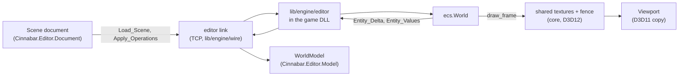

# Editor

The Avalonia editor and the game-side package it drives through the editor link.

## Documents

Read them in this order the first time.

| Document | What it covers |
|---|---|
| [Processes and projects](processes-and-projects.md) | Processes, the UI framework, the C# projects and crash recovery. |
| [Document and scenes](document-and-scenes.md) | The document model, modes, and the scene format. |
| [Editor link](link.md) | The editor link and the game side that mirrors the world. |
| [Viewport](viewport.md) | Frames, the camera, picking, selection, gizmos and viewport settings. |
| [Shell and panels](shell-and-panels.md) | Docking, the ribbon, commands and every panel. |
| [Material editor](material-editor.md) | The node editor and its previews. |
| [Mesh editing](mesh-editing.md) | Level geometry as `.mesh` assets: mesh mode, the mesh and texture tools, and the live path that draws an unsaved mesh. |
| [Prefabs](prefabs.md) | `.prefab` assets: instances and overrides in the scene format, their expansion into plain entities, editing instances and prefabs, and spawning them at run time. |
| [Capture](capture.md) | Screenshots and GIFs of the host, the sidecar, and the automation socket that `editorctl` drives. |

## Overview

The editor has two halves. The C# application owns the user's state: the scene document, the selection, the camera, the panels and the settings. The game side, `lib/engine/editor`, owns nothing persistent: it answers the editor's messages with what the game knows, applies the editor's operations to the world, and draws the viewport's tools. Three flows connect them:

1. **Edits go down.** Every change is an operation on the document, which the editor applies at once and sends to the game. The game applies it to its world and reports what it could not apply. The document is never changed to match the host ([Document model](document-and-scenes.md#document-model)).
2. **The world comes up.** The game scans its world and sends deltas of the entity list, and the values of the entities the editor watches. The editor's mirror changes only from these messages ([World](link.md#world)).
3. **Frames come across.** The host renders into shared textures, and the viewport copies each finished frame into Avalonia's compositor ([Viewport](viewport.md#viewport)).

The game side is small and lives in `lib/engine/editor`:

| File | What it holds |
|---|---|
| `editor.odin` | `Editor` in `Game_State`, `poll`: the connection, the entity deltas, the watches, `Load_Scene` |
| `types.odin` | `component_types`: every registered component with the fields that scenes can set |
| `edit.odin` | `apply_operations`: the editor's edits applied to the world, with problems for what cannot be |
| `modes.odin` | Edit, Play and Paused: `simulation` tells the game's frame what to run |
| `viewport.odin` | The camera, the selection, hidden entities, the ID buffer's pick pass, the outline and the gizmo |
| `helpers.odin`, `icons.odin` | The shapes of lights, volumes and cameras as debug lines, and their clickable icons |
| `commands.odin` | Game commands: registered by the game, shown in the ribbon, run through `poll` |
| `preview.odin` | Material previews for the material editor (see [Rendering](../rendering/materials.md#material-previews)) |
| `live.odin`, `mesh_overlay.odin` | Live meshes baked and made resident in place of their blobs, and mesh mode's overlay (see [Mesh editing](mesh-editing.md#live-meshes)) |
| `link/link.odin` | The editor link's messages, shared with the host |

Everything in the game's `Editor` is a handle, an ID or a copy, so a code reload keeps it; the commands are registrations, made again in `on_reload` ([Game commands](shell-and-panels.md#game-commands)).

## References

- Avalonia, [avaloniaui.net](https://avaloniaui.net) and the [composition GPU interop API](https://docs.avaloniaui.net/docs/guides/graphics-and-animation/graphics-and-animations) (`ICompositionGpuInterop`): the compositor that [Viewport](viewport.md#viewport) imports its D3D11 textures into.
- Wiesław Šoltés, [Dock](https://github.com/wieslawsoltes/Dock): the docking library behind [Shell](shell-and-panels.md#shell).
- Microsoft, [Fluent UI System Icons](https://github.com/microsoft/fluentui-system-icons): the icon set, embedded as path data.
- Microsoft, [Job Objects](https://learn.microsoft.com/en-us/windows/win32/procthread/job-objects): how [Processes](processes-and-projects.md#processes) ties the host's and the daemon's lifetimes to the editor's.
- Microsoft, [Shared Surfaces (Direct3D 11)](https://learn.microsoft.com/en-us/windows/win32/direct3darticles/surface-sharing-between-windows-graphics-apis) and [`IDXGIKeyedMutex`](https://learn.microsoft.com/en-us/windows/win32/api/dxgi/nn-dxgi-idxgikeyedmutex): the keyed-mutex import and the typed-format rule that [Viewport](viewport.md#viewport) works within.
- Microsoft, [Ribbon design guidelines](https://learn.microsoft.com/en-us/windows/win32/uxguide/cmd-ribbons): the tabs, groups, item kinds, contextual tabs and collapse behaviour that [Ribbon](shell-and-panels.md#ribbon) follows.
- Unity, [Scene view navigation](https://docs.unity3d.com/Manual/SceneViewNavigation.html), and Epic, [Viewport controls](https://dev.epicgames.com/documentation/en-us/unreal-engine/viewport-controls-in-unreal-engine): the fly and orbit scheme that the editor camera takes.
- Unity, [Prefabs](https://docs.unity3d.com/Manual/Prefabs.html): the model of instances, overrides and variants that [Prefabs](prefabs.md) follows.
