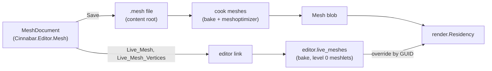

# Mesh editing

Level geometry built in the editor, as Hammer builds it, but as polygon meshes instead of brushes: a mesh asset kind that the editor writes and the cooker cooks, a mesh mode in the viewport that selects vertices, edges and faces and runs the mesh and texture tools on them, and a live path over the editor link so the host draws an unsaved mesh while it is edited. Read [Document and scenes](document-and-scenes.md), [Viewport](viewport.md) and [Content: Meshes](../content/kinds/meshes.md) first. The asset's format is in [Content: Meshes](../content/kinds/meshes.md#mesh-files), the residency override in [Rendering: Assets](../rendering/assets.md#gpu-residency), the messages in [Link](link.md#messages), and the mode's keys in [Viewport](viewport.md#viewport).

**In this document:** [Design](#design) · [Mesh assets](#mesh-assets) · [The mesh model](#the-mesh-model) · [Baking](#baking) · [Live meshes](#live-meshes) · [Mesh mode](#mesh-mode) · [Mesh tools](#mesh-tools) · [Primitives and Draw](#primitives-and-draw) · [Texture tools](#texture-tools) · [Dev materials](#dev-materials) · [Overlay and picking](#overlay-and-picking) · [Undo and saving](#undo-and-saving) · [Messages](#messages) · [Future work](#future-work)

## Design

1. **A level mesh is an asset, not scene data.** Each editable mesh is a text file in a content root with a GUID, cooked to the same `Mesh` blob that glTF meshes cook to, and placed by an ordinary entity with a `Mesh_Renderer`. Nothing downstream changes: residency, culling, meshlets, materials, picking by entity and submesh, previews and the future collision all see a mesh. The scene format does not change. The cost is that a mesh and the scene that places it are two files, which [Undo and saving](#undo-and-saving) keeps consistent.
2. **The editor owns the mesh and does every operation.** The rule of the [document model](document-and-scenes.md#document-model) holds: the host can lose its world at any time, so the editor's C# holds the mesh, applies the tools to it, and keeps the undo history. The host only bakes and draws what it is sent. Every tool is therefore testable under `dotnet test` without a host, which is where the geometry's edge cases belong.
3. **The host draws unsaved meshes from memory.** Saving a file and waiting for the cook daemon takes a few hundred milliseconds ([Cook daemon](../content/daemon-and-operations.md#cook-daemon)), which is fine for the cooked result and useless for a drag. The live path sends the mesh over the link, and the game bakes it and makes it resident in place of the cooked blob until the editor lets go of it.
4. **Texture mapping is parametric, as in Hammer.** A face does not store UVs. It stores a mapping: two axes, a scale, a shift and a rotation. The texture tools edit the mapping, so Shift Left is exact and reversible and Fit and Justify have something to compute from. UVs are derived at bake, in the editor and in the cooker alike.

## Mesh assets

The cooker's `mesh_files.odin` cooks `.mesh` files to `Mesh` blobs. The kind is `Mesh` (`format.Asset_Kind`): `IMPORTERS[.Mesh]` has the extension, and a `.mesh` file is a file asset with one blob under its own GUID, not a sub-asset. The content browser shows it with the mesh icon, it drags onto a `Mesh_Renderer`'s mesh field, and Rename, Duplicate and Delete act on it as on any file.

- **Text source**, for the same reasons as scenes: it diffs and merges, and the editor and the cooker both read it. `format.mesh_text_parse` in `lib/engine/asset/format` and `MeshFile` in `Cinnabar.Editor.Mesh` agree, as `scene_parse` and `SceneFile` do. The file starts with `mesh 1`.
- **Lines:** `material <slot> $<guid>` names a material slot, at most 8 (`render.MAX_MATERIAL_SLOTS`); what the game draws in a slot is the entity's `Mesh_Renderer`'s material for it, which the editor sets together with the slot. `v <x> <y> <z>` is a vertex in meters, in the mesh's space. `f <slot> <v0> <v1> <v2> ...` is a face of three or more vertex indices, clockwise seen from its front, as the cooker leaves glTF faces (see [Content: Meshes](../content/kinds/meshes.md#meshes)). A face's `map` line follows it: `map <ux uy uz> <vx vy vz> <su sv> <tu tv> <rotation>`, the two texture axes in the mesh's space, the scale in meters per texture repeat, the shift in texture repeats, and the rotation in degrees. `e <a> <b> sharp` marks a hard edge. The writer puts vertices, then faces in order, so an edit changes the lines of the face it touches.
- **Indices, not IDs.** Vertices and faces are dense indices, not scene IDs: nothing outside the file refers to them, and an undo is a snapshot ([Undo and saving](#undo-and-saving)), so stability across edits buys nothing. Save writes the mesh compacted.
- **Import settings:** `cluster_lod` and `tangents` as glTF meshes have them; `tangents` defaults to `generate` from the mapping axes ([Baking](#baking)). The scale setting does not apply: a `.mesh` is already in meters.
- **The cook** parses, bakes ([Baking](#baking)), then runs the glTF path's second half unchanged: weld, cache and fetch order, meshlets and their levels, bounds, `Mesh_Contents` and `mesh_write`. The cache key is the cooker's version, meshoptimizer's, the source, the GUID and the settings. A face that the bake refuses (fewer than three distinct vertices, or one that cannot be triangulated) is a problem with the face's line, and the mesh cooks without it.
- **New meshes** come from `Create_Asset` with the `mesh` template, a 1 m box with world-aligned mappings. A mesh made from the content browser's New Mesh goes in the browser's folder. One made in the viewport goes beside the scene, in `<scene name>_meshes/`, so a scene's geometry moves and deletes with it.

## The mesh model

`Cinnabar.Editor.Mesh` is a project with no UI, beside `Cinnabar.Editor.Document`. `MeshData` is the mesh as the file has it, plus the connectivity that the tools need, which a snapshot builds once when first asked:

| Element | Fields | Derived |
|---|---|---|
| Vertex | position (`double3`, meters) | the faces that use it |
| Face | material slot, corner vertex list, `Mapping` | its plane normal, by Newell's method |
| Edge | its two vertices, sharp | its index in `MeshData.Edges`, in the order the faces first use them, and the one or two faces beside it; an edge with more than two is a problem the Clean tool reports |
| `Mapping` | `UAxis`, `VAxis` (`double3`), `Scale` (`double2`, m per repeat), `Shift` (`double2`, repeats), `Rotation` (degrees) | the UV of a position, by the bake's formula |

- **n-gons.** A face is a polygon, not a triangle. The tools' meaning depends on it: Merge Faces makes one, Inset keeps one, a box has six. Triangulation is the bake's.
- **Doubles, in the mesh's space.** A mesh's vertices are at most a few hundred meters from its origin, so `double` in the mesh's space loses nothing, and the file writes `f32`-exact values. World positions are `World_Position`s on the entity ([World](../world/positions-and-transforms.md#positions)); the editor composes the entity's pose as the gizmo does (`MeshPlacement`), and does its picking in the camera's space in doubles.
- **Immutable snapshots.** `MeshData` is immutable: a tool takes one and returns a new one. The arrays are copied, which for a level mesh of thousands of faces is microseconds, and it makes undo a pointer swap and a drag's steps free of aliasing. A change that keeps an array keeps the same array, which is how the live path tells a move from an edit of the topology.
- **Validation** after every tool: each face has three or more distinct vertices, no face uses an index out of range or a slot beyond the eight, no mapping has a zero scale, no edge has more than two faces, and each face is planar within 1 mm. A tool whose result fails validation is refused with the reason in the console, and the mesh does not change. Planarity is the one rule a vertex move can break. With Keep Planar on the Mesh tab (off by default), `MeshTools.KeepPlanar` relaxes after each step of a Move drag: it projects the unmoved vertices of each bent face onto the plane through the face's moved corners, pass after pass, since a vertex moved for one face can bend another, until no face bends beyond the tolerance or sixteen passes have run, and the moved vertices stay where the drag put them. Otherwise the bake's triangulation gives a bent n-gon the fan that the user sees.

## Baking

A bake turns `MeshData` into the two vertex streams and the triangles that a `Mesh` blob holds (see [Content: Meshes](../content/kinds/meshes.md#meshes)). It is written once, in Odin, in `format.mesh_bake` in `lib/engine/asset/format`, so the cooker and the game produce the same vertices, and the editor's C# never needs the GPU layout. The editor sends the game the structured mesh, not baked streams ([Messages](#messages)).

1. **Normals.** A face's normal comes from its plane. A vertex's normal in a face is the average of the normals of the faces around it that it reaches without crossing a sharp edge, weighted by angle. Sharp edges come from the file; Recalculate Normals sets them from an angle ([Mesh tools](#mesh-tools)).
2. **UVs** from the face's mapping: `u = (p · UAxis) / Scale.u + Shift.u`, likewise for v, with the rotation turned about the face's mapping origin, so that a Rotate tool turns the texture in place. The mapping is the vertex's UV0. There is no UV1 and no vertex color; the flags are off and the attribute stride is 16 bytes.
3. **Tangents** are the mapping's `UAxis` projected onto the face's plane, with the bitangent sign from `VAxis`, so a normal map on a planar mapping is exact and MikkTSpace is not needed. `tangents = mikk` runs `meshopt_generateTangents` in the cooker instead; the live path has no meshoptimizer and always projects.
4. **Split vertices** where corners of one position differ in normal or UV, as a glTF cook's weld would leave them.
5. **Triangulate** each face by ear clipping in its plane, which handles the concave faces that Cut leaves. A convex face takes a fan.
6. **Submeshes:** one per material slot, in slot order, with an empty submesh for a slot no face uses, so submesh index is material slot and the viewport's material drop sets the right one. The bake also keeps each triangle's face, which the overlay's fills use ([Overlay and picking](#overlay-and-picking)).
7. **Bounds** of the mesh and of each submesh.

The cooker continues from step 6 with meshoptimizer and the cluster LOD builder. The game continues with its own level-0 meshlets ([Live meshes](#live-meshes)).

## Live meshes

The game draws a mesh the editor is editing from memory, in place of the cooked blob, so that a drag shows at frame rate. This is the one path into the renderer that the mode adds.

- **`editor.live_meshes`** in the game's `Editor` (`live.odin`) is a table from GUID to a live mesh: the structured mesh as the last `Live_Mesh` gave it, with its bake's positions, triangles and their faces for the overlay, in the host's heap so a code reload keeps it. `Live_Mesh` replaces the entry and bakes it into a blob with `live_blob`, which the residency streams; `Live_Mesh_Vertices` replaces only the positions and bakes again, which is the drag path; `Release_Live_Mesh` removes it. A new connection drops the table, as does a soft restart with the rest of `Game_State`, and the editor sends its live meshes again after each snapshot, as it does the camera and the selection. The editor's `init` takes the renderer's residency; without one, as in tests, the table is kept and baked but nothing draws.
- **Level-0 meshlets without meshoptimizer.** The mesh shader path needs meshlets, and the index path needs only indices; a live mesh draws on both, in every pass, without a per-item fallback in the opaque passes. `render.build_simple_meshlets` cuts each submesh's triangles into meshlets of at most 64 vertices and 124 triangles in index order, with a bounding sphere and a normal cone each, one level, error 0 and no parent. The cluster LOD selection then always takes them, and the culling is as for any mesh. It runs in well under a millisecond for a level mesh.
- **Residency override.** `render.Residency` has `set_live(guid, blob)` and `clear_live(guid)`. A live entry takes a resident slot and streams from memory with `stream_buffer`, exactly as a blob does, swapping in when the transfer finishes; `resident_mesh` prefers a live entry to the asset's. `clear_live` marks the entry stale, so the asset streams again at the next `residency_update`, or loads when the daemon has cooked it. A `Live_Mesh_Vertices` step sends only the positions over the link, 12 bytes a vertex, but the game bakes the whole mesh again and streams every buffer: a move changes the normals and can change which corners weld, so the vertex count can change too, and a partial upload would not be safe. A step that arrives while one streams waits for it, and the newest step wins, so a drag never queues behind itself.
- **Traced shadows** build a BLAS for each resident mesh (`create_mesh_accel`). A live mesh gets one when its streams land, and a drag step rebuilds it; a mesh under a drag casts a shadow that lags by the build. The editor sends at most one step per frame.
- **Cost:** a live mesh is one more resident mesh. The table is small, because only the meshes of the open scene that have been edited and not yet cooked are in it ([Undo and saving](#undo-and-saving)).

## Mesh mode

Mesh mode is the editor's, not the game's: the game stays in Edit ([Modes](document-and-scenes.md#modes)) and only hears a different selection and overlay. `EditorShell.MeshMode.cs` holds the state, with the tools in `EditorShell.MeshTools.cs`, `EditorShell.MeshTexture.cs` and `EditorShell.MeshPivot.cs`, and the open documents in `EditorShell.Meshes.cs`.

- **Entering:** Tab, with mesh entities selected, or Edit Mesh on the Home tab, or a double click on a mesh in the viewport, which picks the entity through the ID buffer first. Every selected entity whose `Mesh_Renderer` names a `.mesh` asset becomes an edited mesh; a glTF mesh cannot be edited, and the console says so. The edited meshes' documents open from their files ([Undo and saving](#undo-and-saving)), and each is sent as a `Live_Mesh` so that the live and the cooked mesh are one from the first frame. Tab again, Escape with nothing selected, or Object Mode leaves it. Starting play leaves it too, and so does opening a scene.
- **Elements:** Vertices (1), Edges (2), Faces (3), as Hammer's. The sub-selection, `MeshSelection`, is an immutable set of (mesh, element index) for the current element kind, with an edge named by its index in `MeshData.Edges`. Changing the kind converts the selection through each mesh's vertices: faces to their edges and vertices, vertices to the edges and faces whose every vertex is selected. Ctrl toggles, Shift adds, Ctrl+A selects every element of every edited mesh, and a click on nothing clears. Hovering highlights the element under the mouse. Select Linked takes everything the selection reaches through its neighbors, Grow adds the neighbors, and Shrink drops the elements with a neighbor that is not selected: a vertex's neighbors are the vertices across its edges, an edge's the edges at its ends, and a face's the faces that share a vertex with it. An edit that changes a mesh's topology prunes the selection of indices the mesh no longer has. The face clicked last in the Faces kind is the active face, which Align to Face copies from and the texture gizmo aligns to.
- **The gizmo** is the viewport's (`Gizmo`, `GizmoDrag`), placed on the selection's centroid with the primary mesh's axes in local space. `MeshDrag` keeps each mesh's snapshot and selected vertices from the press (a face's or an edge's are its vertices), applies each step's change about the pivot in world space, snaps a move's positions to the grid ([Grid](#grid)), and puts the vertices back into the mesh's space, as one `MeshOperation` per mesh whose steps replace each other. Shift at the start of a Move drag extrudes first ([Mesh tools](#mesh-tools)), as in Hammer.
- **The ribbon** has a contextual Mesh tab, with `Context = "mode.mesh"`, which `EditorContext` sets on entry and clears on exit: Selection (the element kinds, Select All, Select Through, Select Linked, Grow, Shrink), Edit (the mesh tools, Bevel's segments, the normal angle, Edit Pivot, Center Pivot, Pivot to Grid), Create (the primitive and its parameters, Cut, Draw, Apply Points), Texture (the texture tools as small stacks, Transform Texture, the dev material and the texel density), Options (the grid, Snap, Local Axes, Keep Planar) and Mode (Object Mode). The object tools' Q, W, E, R and X keep their meaning, and Edit Mesh and Block are on the Home tab too. The tool palette shows the element kinds while the mode is on.
- **The Face panel**, `faceEditor` in the right dock (`FaceEditorView`), is Hammer's face edit sheet: the selected faces' material with the properties panel's picker and drop target, the dev materials first; the material's tool texture and its size; the faces' texel density beside the scale, and the project's; the mapping's axes, read-only; its scale, shift and rotation, typed or dragged as the properties panel's numbers are, each drag one undo entry; the hotspot the faces sit on, in the warning color when the texture leaves it; and the texture tools as buttons, with Flip U and Flip V, which mirror the texture within the face. With several faces, a field whose values differ shows "—", and an edit sets each, as the properties panel's multi-select does.
- **The outliner and the properties** keep working, on the entities. The status bar shows the mode and the selection as counts: "Faces: 3 of 2 meshes", and what a tool waits for.
- **Material drop** in mesh mode sets the material of the face under the mouse, or of the selected faces when the mouse is over one of them, by face rather than by submesh. The editor picks the face itself, so the drag shows at once in an undo entry that stays open, and the drop keeps it. Setting a face's material, by a drop, the Face panel's picker or the Dev Material dropdown, takes the mesh's slot that names the material, else a slot that no other face uses, and sets the entity's `materials.N` field of that slot in the same entry; a ninth material is refused with the reason.
- **Edit Pivot** is a toggle: with it on, a Move gizmo stands on the selected entity's position, or the first edited mesh's, and its drag moves the entity through `PoseEdit`, so a child moves by its Local Transform, with every vertex moved back in the mesh's space, so the geometry stays where it is. Snap puts the pivot on the grid. Center Pivot puts the entity at its mesh's bounds' center and Pivot to Grid snaps it, each one undo entry of the Transform and the mesh together.
- *Later:* the pivot's rotation and scale; the gizmo moves it only.

### Grid

Hammer's grid, in meters: 1/64 m to 16 m in powers of two, 0.25 m to start, `[` and `]` halve and double it, and the size shows with the camera's speed. Snap rounds a vertex's world position to the grid, not the drag's delta, so a vertex that is off the grid lands on it. World positions are too large for doubles to snap in, so `MeshGrid` snaps a position relative to the nearest grid point in raw units, which every grid size divides exactly. The game draws the grid in the overlay pass, 40 lines each way on the plane facing the camera's nearest world axis through the sub-selection's centroid, else the selected entity, else the camera's pivot, faint, every tenth line brighter, when the mode is on and Show Grid is set.

## Mesh tools

Each tool is a pure function in `Cinnabar.Editor.Mesh` (`MeshTools.cs`, `MeshTools.Faces.cs`, `MeshTools.Topology.cs`, `MeshBevel.cs`, `MeshCut.cs`), from a mesh and a selection to a `ToolResult`: the new mesh, and what to select next in which kind. The shell runs one on the selected elements of every edited mesh as one undo entry, and a result that fails validation is refused with the reason in the console. The table says what each does on each element kind; a tool that an element kind does not fit is disabled for it. Hammer's names are kept where Hammer's meaning is clear, and the meaning is given where it is not.

| Tool | Vertices | Edges | Faces |
|---|---|---|---|
| **Delete** | Removes the vertices and every face that uses them | Removes the edges' faces | Removes the faces, then the vertices nothing uses |
| **Clean** | Acts on the whole mesh: merges vertices within 0.1 mm, removes faces with fewer than three distinct vertices, removes vertices no face uses, dissolves a vertex that lies on a straight edge between its two neighbors in every face around it, and reports edges with more than two faces: a line in the console, and the edges selected in the Edges kind, so they can be found | | |
| **Detach** | | | Moves the faces into a new mesh asset and a new root entity at the first source's pose, with its materials, the vertices copied in its space and the mappings kept |
| **Extract** | | | As Detach, but the source keeps its faces |
| **Duplicate** | | | Copies the faces in place within the mesh, with the copies selected, so a drag moves them |
| **Merge Faces** | | | Dissolves the edges between selected faces that share a plane within 1° into one n-gon, where the union has one loop; faces that do not share a plane stay |
| **Collapse** | Merges the vertices into one at their centroid | Each edge's two vertices into one at its middle | Each face's vertices into one at its centroid |
| **Extrude** | | Pulls open edges out as a quad each, with the new edges selected; an edge with two faces would get a third | Pulls the faces out along their average normal with walls along the region's boundary, copying the boundary's vertices and moving the interior ones, and selects the new faces, so the following drag gives the distance; faces that share an edge extrude as one, without a wall between them |
| **Offset** | | | Shells: moves the faces along their own normals by a distance, moving a shared vertex along the bisector of its faces' normals so each face stays parallel to where it was, which keeps corners sharp where Push/Pull would skew them |
| **Recalculate Normals** | Acts on the whole mesh or the selected faces: marks an edge sharp where its faces' normals differ by more than the angle (30° by default, on the Mesh tab) and smooth otherwise | | |
| **Invert** | | | Reverses the faces' winding, so they face the other way, and mirrors their mapping's `VAxis` so the texture reads the same |
| **Edit Pivot** | Acts on the mesh's entity: see [Mesh mode](#mesh-mode) | | |
| **Transform Texture** | | | A toggle: the gizmo shifts, turns or scales the selected faces' mappings instead of their vertices ([Texture tools](#texture-tools)) |
| **Push/Pull** | | | Moves the faces along the selection's average normal; neighbors stretch |
| **Inset** | | | Shrinks each region's boundary toward its inside by a distance, in its plane, with a ring of new faces around it that keep the face's mapping; faces that share an edge inset as a region |
| **Outset** | | | Inset with a negative distance |
| **Cut** | A loop cut, as a tool mode: hovering an edge shows the loop a click would cut, from that share of the way along the edge through each quad beside it to the opposite edge at the same share, both ways around the mesh until the loop closes or a face that is not a quad or an open edge stops it, and a click cuts it at once, on the grid when snapping; the new vertices are selected, so a drag slides the loop | | |
| **Bevel** | Replaces each vertex with a cap over it, with its faces notched | Replaces each edge with a strip of faces on a circular profile between its two faces, in segments (1 by default) and a width, closed at each end by a fan from the vertex; the new faces take the mapping of the face each is nearest | |

- **Distances** for Extrude, Offset, Push/Pull, Inset, Outset and Bevel come from a drag of the gizmo after the tool runs (`BeginDistanceTool`): the tool opens the undo entry and waits, with a Move gizmo on the selection whatever the tool, and each step of the drag runs the tool at the drag's change along the selection's average normal, or at the drag's length for Inset, Outset and Bevel's width, rounded to the grid when snapping, replacing the step before. The mesh does not change until the first step, since walls of no height have no area, and an entry that is never dragged leaves no history. Releasing commits; Escape cancels, and the mesh is as before the tool.
- **Mappings of new faces:** an extruded wall, a primitive's face and a drawn plane take a world-aligned mapping at the project's texel density ([Texture tools](#texture-tools)): the material's tool texture's size over the density, 4 m per repeat for the dev grid at 256 texels per meter, or 1 m for a material without a texture, as Hammer does. A wall takes its source face's material's. An inset's ring and a drawn polygon take the face's mapping, so the texture continues.
- **Across meshes:** a selection can span the edited meshes, and every tool runs per mesh. Detach and Extract take faces from several meshes into one new one, in the first source's space.
- **New faces' material** is the project's default mesh material ([Dev materials](#dev-materials)), unless the face they come from has one, as an extruded wall does.
- *Later:* Bevel works edge by edge, so where beveled edges meet the caps overlap; chains and corners that meet cleanly wait. A line cut by points, for which `MeshCut.Cut` keeps its splitting, with runs of points inside a face extended to its boundary.

## Primitives and Draw

New geometry starts as a primitive or as a drawn polygon. Both are generators in `Cinnabar.Editor.Mesh`, `Primitives.Make` and `MeshCut.Plane`, `parameters → MeshData`, so each is a unit test, and the cooker's `mesh` template, which the content browser's New Mesh uses, is the Block generator's output written by hand.

- **Creating** is Hammer's: the Create tool, with the primitive in the Create group's combo box, makes the left button's drag a rectangle on the grid plane, which the grid snaps (`BeginBlock`, `DragBlock`, `EndBlock`), and the primitive fills it a grid cell high, standing along the grid plane's axis; the gizmo then sizes it. Block on the Home tab is the same tool with the block chosen. The new mesh is an asset and an entity, named `<primitive>_<n>`, at the rectangle's corner, in one undo entry with the `CreateMesh` and the scene's operations ([Undo and saving](#undo-and-saving)); it goes in `<scene>_meshes/` beside the scene with the project's default material, its file and `.meta` are written at the scene's next save, and the host draws it live until then. In mesh mode the primitive joins the primary edited mesh instead, as faces, so a room gains a pillar without a new entity; Ctrl at the release forces a new entity.
- **Parameters** are in the Create group: the sides of a cylinder, the segments of a sphere, the steps of a staircase. They stay editable after the drag, until the next edit: a parameter change makes the last primitive again in place of its undo entry while that entry is the last edit, so the user sets the sides after seeing the cylinder and the history has one entry. Hammer makes you set them first.

| Primitive | Parameters | Faces |
|---|---|---|
| **Block** | | 6 quads, world-aligned mappings |
| **Wedge** | | A block cut on its diagonal: 5 faces |
| **Cylinder** | sides (3 to 64, 16 by default) | two n-gon caps and the sides, mapped around with u continuous, so one repeat goes once round |
| **Cone** (Hammer's spike) | sides | one n-gon cap and triangles to a tip |
| **Sphere** | segments around (8 to 64) and rings (4 to 32) | quads with triangle fans at the poles, mapped as a globe |
| **Arch** | sides, wall thickness, arc in degrees (180 by default) | a bent wall of quads, open at its ends |
| **Stairs** | steps, with the rise and the run from the rectangle and the height | a staircase of blocks fused into one mesh, solid underneath |
| **Torus** | segments around, sides of the tube, tube radius | quads |
| **Plane** | | one n-gon, for a floor that only ever faces up |

- Each primitive is closed and its faces front out, except Plane and Arch, and each fills the dragged box in a frame that keeps the world's handedness. Hammer's names are kept where they match (Block, Wedge, Cylinder, Arch, Torus); Spike is Cone, because the base is not always sharp.
- **Draw** is Hammer's polygon tool: a tool mode in which clicks place the corners of a polygon on one plane, and Enter, Apply Points on the Mesh tab, or a click on the first corner closes it. The plane is the face under the first click, or the grid plane when the click is on nothing, where the corners snap to the grid. Backspace removes the last corner and Escape cancels, and the game marks the corners so far as squares. A polygon drawn on a face is cut into it: the face keeps its outside as a ring of two faces around the new face, each from an outer corner around to another and back along the polygon, since a face with a hole is not a polygon; the new face is selected, and an Extrude or Inset follows naturally, so a doorway is Draw on the wall, then Extrude inward. A polygon drawn on the grid plane with no face under it is a new mesh of one face, a Plane fronting the camera, and an Extrude makes it solid. A polygon that crosses itself, or that leaves its face, is refused with the reason, and one that is not clockwise seen from the plane's front is reversed so its face fronts out. The polygon is planar by construction, so the cut never bends the face.
- A drawn polygon's mapping is the face's it was drawn on, so the texture continues across the cut, or world-aligned on the grid plane.
- *Later:* a drag of the gizmo's up axis for a new primitive's height; corners drawn on a face snapping to the grid and to the face's vertices and edges.

## Texture tools

The texture tools edit faces' `Mapping`s: pure functions on a mapping in `MeshTexture` (`Cinnabar.Editor.Mesh`), which the shell runs on the selected faces of every edited mesh as one undo entry. Each directional one is a command of its own, so that it has a key and a ribbon button: `texture.shiftLeft`, `texture.shiftRight`, `texture.shiftUp`, `texture.shiftDown`, `texture.rotateLeft`, `texture.rotateRight`, `texture.scaleUp`, `texture.scaleDown`. In the viewport the arrows shift, `,` and `.` rotate and `-` and `=` scale, with Shift making the step ten times and Ctrl a tenth, as the properties panel's drags do.

| Tool | What it does |
|---|---|
| **Align** | World: the axes from the face's normal's nearest world axis, so neighbors across a right angle share a seam. Face: the axes from the face's own plane, with `UAxis` along its longest edge. To Edge, in the Edges kind: `UAxis` of each selected edge's faces along the edge. To Face: carries the active face's mapping onto the other selected faces, turned about the line where the planes meet and shifted so the texture agrees along a shared edge, so a texture flows around a corner without a seam, as Hammer's Align to View does by a face. Each keeps the scale and clears the shift and rotation. |
| **Scale** | Multiplies the scale by a quarter; Scale Up makes the texture larger on the face. The Face panel types the meters per repeat. Reset Scale sets the scale from the texture's size at the project's density. |
| **Shift** | Adds the step (1/8 of a repeat) to the shift along the mapping's axes, so Shift Left moves the texture left as it shows on the face. |
| **Rotate** | Adds the step (15°) to the rotation about the face's mapping origin, as Hammer's does, so it is exact. |
| **Fit** | Scales and shifts so that the texture's one repeat covers the face's bounding rectangle in the mapping's axes, in u, in v, or both, with the rotation folded into the axes so the texture keeps its direction. Fit with a number tiles that many times. |
| **Justify** | Shifts in UV, so it is exact under any rotation, until the texture's edge, or its center, is on the face's bounding rectangle's: Left, Right, Top, Bottom, Center. Justify Fit is Fit. |
| **Flip** | Mirrors the texture across the face's bounding rectangle, along u or v, so the face shows the same part the other way round. |
| **Hotspot** | Picks, from the material's hotspot rectangles, the one whose aspect ratio and size at the project's density are nearest the face's bounding rectangle in the mapping's axes, and maps the face onto it with Fit. Next takes the rectangle after the one under the middle of the face's UVs, and Random takes the best in one of its symmetries, four, or eight for a square, as Hammer's does for variety. A material without hotspots gets Fit, and the console says so. |
| **Transform Texture** | A toggle: with it on in the Faces kind, the gizmo stands on the active face's texture axes, and a Move, Rotate or Scale drag moves, turns or scales the selected faces' textures about the pivot, snapping a move to eighths of a repeat, with the vertices untouched. |

- **Texel density.** The project settings have `mesh.texel_density`, texels per meter, 256 by default, which the game's parser knows and the Mesh tab's Density box sets in the project's file. A mapping's scale in meters per repeat and the material's texture size give the density of a face, which the Face panel shows beside the scale, and Reset Scale sets the scale from the density and the texture's size.
- **The material's texture.** A material's size for the tools is its tool texture: a `tool_texture = $<guid>` line in a material's or an instance's source, or without one the texture that its first Texture Sample node names through its parameter, or an HLSL material's first texture parameter (see [Content: Materials](../content/kinds/materials.md#materials)). The cook link's `Asset` carries `tool_texture` and, for a texture, `size`, which the daemon reads from the cooked blob's header after each pass, cooked or kept, so the editor never opens an image file. An instance takes its parent's, except that its own line replaces the texture, as does its override of the sampled parameter. The dev materials measure by the engine's grid before the index arrives, so a new project's first block is measured.
- **Hotspots** are `hotspot <x0> <y0> <x1> <y1>` lines in the material's source, in texels of the tool texture, each a rectangle that is a complete tileable piece. The daemon puts them in the `Asset` too. They are the material's, not a separate asset, so a material and its atlas move together.
- **Hotspot materials** need no shader change: the bake writes the rectangle's UVs. A tool that shifts a hotspot face off its rectangle is allowed, and the Face panel shows the rectangle in the warning color when the face's UVs leave it.

## Dev materials

Source's dev textures, so that a level can be blocked out in measured, colored surfaces before art exists.

- **One texture,** `lib/engine/content/textures/dev_grid.png`, 1024 texels square, grayscale: a line every 256 texels, a thinner one every 64, and 128-texel checks of two greys between them. At the project's default density of 256 texels per meter it is 4 m across, with the thick lines a meter apart and the thin ones at the grid's 0.25 m, so the texture reads the grid. `tools/surface_textures.py`, which writes the sample's generated textures, writes it too, and it is committed with its `.meta`. It is the engine root's only texture; nothing else changes, because the cooker takes every root alike ([Content: Identity](../content/identity-and-cooking.md#identity)).
- **One material,** `lib/engine/content/materials/dev_grid.material`, a lit, rough graph that samples the texture and multiplies it by a `tint` color parameter; its `tool_texture` line names the texture, so the texture tools know its size.
- **Instances** in the same folder, each the material with one tint: `dev_gray`, `dev_blue`, `dev_orange`, `dev_green`, `dev_red`, `dev_yellow`, and `dev_sky` for a surface that stands in for the sky. Each is a material instance file of one line, as the sample's are.
- **The default mesh material** is a project setting, `mesh.default_material`, a GUID, `dev_gray` by default, which the game's parser knows so it is not a warning and `EditorShell.DefaultMeshMaterial` reads; new primitives, drawn polygons and faces that come from nothing take it ([Mesh tools](#mesh-tools)). The Face panel's material picker offers the dev materials first, and the Texture group's Dev Material dropdown sets the selected faces' material to one of them without the picker.
- **Measured by default.** A new face's world-aligned mapping at the project's density, and the grid snapping at 0.25 m, mean the texture's lines meet across every face of a snapped block, which is what makes the texture a ruler. Scaling the mapping moves the lines off the grid, and Reset Scale puts them back.

## Overlay and picking

The game draws the mode's picture in the overlay pass of the debug layer ([Rendering](../rendering/layers-and-output.md#debug)), and the editor does the picking.

- **`Mesh_Overlay`** carries the mode's element kind, the grid's plane and size, and for each edited mesh the selected and the hovered elements by index, with edges as vertex pairs so the game needs no edge list, and the marks of a Cut's loop or a Draw's corners. `mesh_overlay.odin` builds the overlay's triangles each frame with the gizmo's builders: every polygon edge as a ribbon, in the Vertices kind every vertex as a square, both sized by their depth, the selection in the accent color and the hovered element brighter, the selected faces as a half-transparent fill of the accent color from the live mesh's bake, the marks as larger squares, and the grid ([Grid](#grid)). The overlay shader's mode for it keeps their depth and fades a pixel whose scene depth is in front of it, as `debug.Mode.Tested` lines are. Unselected meshes in the scene draw nothing extra.
- **Picking is the editor's.** The editor has every edited mesh, the camera and the entities' poses, so a click casts a ray in C#: `MeshPlacement` puts a mesh relative to the camera from its entity's pose, and `MeshPick` intersects the edited meshes' faces in the camera's space, a ray against each face's plane and an even-odd test in it, nearest first, and for edges and vertices takes the nearest in screen space within 8 pixels of the mouse whose depth is within two percent of the face hit's, or of the face under it when nothing is hit. This is synchronous, so hovering, clicking and a drag's start share one frame, and it works while the game is busy. It ignores the scene's other entities, so a wall of another mesh does not hide a vertex behind it; Hammer picks the same way, and the ID pass's per-entity pick stays the object mode's.
- **Box selection** projects the elements: a vertex inside the box, an edge with both ends inside, a face with every vertex inside. Select Through on the Mesh tab includes back faces; off, a face whose normal faces away is skipped, and so are its edges and vertices that no front face uses.
- **Hover** runs the pick on each mouse move and sends `Mesh_Overlay` only when the hovered element, or the Cut tool's loop, changes.

## Undo and saving

The scene's undo stack takes the mesh edits, so that Ctrl+Z in the viewport undoes the last thing the user did, whichever file it touched. This is unlike the material editor, whose documents are tabs of their own with their own stacks.

- **`MeshDocument`** in `Cinnabar.Editor.Mesh` is one mesh's file: its path, GUID, the current `MeshData`, and the saved snapshot. `MeshSet` in the shell holds the open mesh documents of the scene, by GUID: one opens when its mesh enters mesh mode, and closes when the scene closes, after it is saved or discarded with it.
- **Operations.** `SceneDocument`'s `Operation` has a sibling, `MeshOperation(guid, before, after, set)` in `Cinnabar.Editor.Mesh`, whose `Apply` sets the document's `MeshData` to `after` through the `MeshSet` and returns the inverse with the two swapped. It fits the transaction model unchanged: a drag's step `IsReplacedBy` the next step of the same mesh, so the entry keeps the first `before` and the last `after`, and `Commit` stores the inverses. `ToWire` is null, which `SendOperations` leaves out: the set's `Changed` event sends the mesh instead, as a `Live_Mesh_Vertices` when the change kept the faces, the sharp edges, the materials and the vertex count, which is what a move does, and a `Live_Mesh` otherwise. Undo therefore sends the earlier snapshot. `EditorShell.EditMesh(label, guid, after)` validates the result and applies it as one entry, and `OpenMesh(guid)` opens a mesh file's document and sends it live.
- **Mixed entries.** Detach, Extract and a new primitive make, in one entry, a `MeshOperation` on the source, a `CreateMesh(document, set)` that adds a document with a fresh GUID, and the scene's `CreateEntity` for the entity and its `Mesh_Renderer`. Edit Pivot pairs a `MeshOperation` with the `Transform`'s fields, and a face's material pairs one with the `Mesh_Renderer`'s. Undo of `CreateMesh` removes the document; its file, if the scene was saved meanwhile, stays, unreferenced, and the content browser's Delete takes it. Asset files are not undone, as the content browser's operations are not.
- **Dirty and save.** The scene is dirty when its history position is not the saved one, as before; a mesh document is dirty when its `MeshData` is not its saved snapshot. Ctrl+S saves the scene and every dirty mesh document, each through a temporary file, in that order, and a new mesh's file is written at the first save, with its `.meta` and GUID written by the editor so that the scene's reference resolves at the daemon's next pass. This is the second content file the editor writes (see [Content browser](shell-and-panels.md#content-browser)); the daemon learns of it as of any new file. Closing a scene with dirty meshes asks about them with the scene. Autosave writes dirty meshes beside the scene's autosave.
- **Letting go.** After a save, the daemon cooks the mesh and sends `Cook_Finished`; at each one, a mesh document that is live, clean and whose asset's status is current is released with `Release_Live_Mesh`, and the host draws the cooked blob with its levels of detail. A mesh that is dirty, or whose cook failed, stays live, and the next edit sends it live again. A mesh that is let go of before the daemon's pass with its save completes draws the old blob for that pass; the next pass's blob then replaces it through the asset runtime, as any cooked change does.
- **Undo history** shows mesh entries by their tool's label, as "Extrude" or "Move 2 Faces".
- **The host lost its world.** A resync sends the scene, then every live mesh again, then the selection and the overlay. Nothing is lost, because the editor owns all of it.

## Messages

The mode's messages in `lib/engine/editor/link`:

| Message | Direction | Contents |
|---|---|---|
| `Live_Mesh` | editor → game | The GUID and the whole structured mesh: materials, vertices, faces with their corners and mappings, sharp edges. The game bakes it and makes it resident in place of the asset. |
| `Live_Mesh_Vertices` | editor → game | The GUID and the positions only, for a drag's step. The game bakes and re-streams positions and attributes. |
| `Release_Live_Mesh` | editor → game | The GUID. The game clears the override and loads the asset. |
| `Mesh_Overlay` | editor → game | The element kind, and per live mesh the selected and hovered element indices and the tool's marks, and the grid's plane and size. An empty message turns the overlay off. |

The structured mesh on the wire is the file's structure, as a `Scene_Snapshot` is a scene's, so the game has one parser, `format.mesh_text_parse`'s result type, for the file and the link. A `Live_Mesh` of a 10,000-face mesh is about 1 MB, which is far under the 64 MiB frame and sent only on topology changes; a `Live_Mesh_Vertices` is 12 bytes a vertex.

The cook link's `Asset` has `size` for textures and `tool_texture` and `hotspots` for materials and instances ([Texture tools](#texture-tools)), and `Create_Asset` has the `mesh` template.

## Future work

- **A face ID pass.** The ID buffer's 7 spare bits above the entity hold the submesh, not a face ([Viewport](viewport.md#viewport)). A second `R32_Uint` target written only for live meshes in mesh mode, with the face index from the bake's triangle-to-face table, would make picking occlusion-exact and let box selection respect the scene's other geometry. Do this when picking through walls is a complaint.
- **Collision.** Physics does not exist ([World](../world/README.md#future-work)); level meshes are the first thing it will need as colliders, and the cooked blob's level-0 triangles are the input. Keep the `.mesh` file the truth, and cook the collision shape beside the blob.
- **Lightmap UVs.** A second UV set packed at cook, for baked lighting if it comes. The bake leaves UV1 off until then.
- **Vertex colors** painted in the mode, as a face or vertex attribute in the file, for materials that read Vertex Color.
- **Materials by normal.** An extruded wall's material comes from the face it was pulled from, and a face from nothing takes the project's default. A wall material distinct from a floor's and a ceiling's by the face's normal, when levels want it.
- **More primitives:** a hollow Block (Hammer's), a Pipe, and a Spiral Stairs, each a generator and a row in the table. A primitive from the clipboard, for a user's own library of pieces, once prefabs exist.
- **Mesh merge** across entities (the inverse of Detach), and **Mirror** about a plane, which Hammer has and the tool table does not.
- **A mesh preview in the content browser**, as a thumbnail, with the material previews' path ([Shell and panels](shell-and-panels.md#future-work)).
