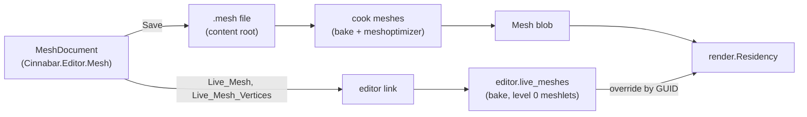

# Mesh editing

*This design is built, in its six phases: the asset is documented in [Content: Meshes](../content/kinds/meshes.md#mesh-files), the residency override in [Rendering: Assets](../rendering/assets.md#gpu-residency), the messages in [Link](link.md#messages), and the mode's keys in [Viewport](viewport.md#viewport). The sections below say where what is built differs from the plan; the phases at the end were the order it was built in, and [Future work](#future-work) is what is not built.*

Level geometry built in the editor, as Hammer builds it, but as polygon meshes instead of brushes: a mesh asset kind that the editor writes and the cooker cooks, a mesh mode in the viewport that selects vertices, edges and faces and runs the mesh and texture tools on them, and a live path over the editor link so the host draws an unsaved mesh while it is edited. Read [Document and scenes](document-and-scenes.md), [Viewport](viewport.md) and [Content: Meshes](../content/kinds/meshes.md) first.

**In this document:** [Design](#design) · [Mesh assets](#mesh-assets) · [The mesh model](#the-mesh-model) · [Baking](#baking) · [Live meshes](#live-meshes) · [Mesh mode](#mesh-mode) · [Mesh tools](#mesh-tools) · [Primitives and Draw](#primitives-and-draw) · [Texture tools](#texture-tools) · [Dev materials](#dev-materials) · [Overlay and picking](#overlay-and-picking) · [Undo and saving](#undo-and-saving) · [Messages](#messages) · [Tests](#tests) · [Phases](#phases) · [Future work](#future-work)

## Design

Four decisions shape everything below.

1. **A level mesh is an asset, not scene data.** Each editable mesh is a text file in a content root with a GUID, cooked to the same `Mesh` blob that glTF meshes cook to, and placed by an ordinary entity with a `Mesh_Renderer`. Nothing downstream changes: residency, culling, meshlets, materials, picking by entity and submesh, previews and the future collision all see a mesh. The scene format does not change. The cost is that a mesh and the scene that places it are two files, which [Undo and saving](#undo-and-saving) keeps consistent.
2. **The editor owns the mesh and does every operation.** The rule of the [document model](document-and-scenes.md#document-model) holds: the host can lose its world at any time, so the editor's C# holds the mesh, applies the tools to it, and keeps the undo history. The host only bakes and draws what it is sent. Every tool is therefore testable under `dotnet test` without a host, which is where the geometry's edge cases belong.
3. **The host draws unsaved meshes from memory.** Saving a file and waiting for the cook daemon takes a few hundred milliseconds ([Cook daemon](../content/daemon-and-operations.md#cook-daemon)), which is fine for the cooked result and useless for a drag. A new live path sends the mesh over the link, and the game bakes it and makes it resident in place of the cooked blob until the editor lets go of it.
4. **Texture mapping is parametric, as in Hammer.** A face does not store UVs. It stores a mapping: two axes, a scale, a shift and a rotation. The texture tools edit the mapping, so Shift Left is exact and reversible and Fit and Justify have something to compute from. UVs are derived at bake, in the editor and in the cooker alike.

## Mesh assets

A new importer in `tools/cook`, `mesh_files.odin`, cooks `.mesh` files to `Mesh` blobs. The kind stays `Mesh` (`format.Asset_Kind`): `IMPORTERS[.Mesh]` gains the extension, and a `.mesh` file is a file asset with one blob under its own GUID, not a sub-asset. The content browser shows it with the mesh icon, it drags onto a `Mesh_Renderer`'s mesh field, and Rename, Duplicate and Delete act on it as on any file.

- **Text source**, for the same reasons as scenes: it diffs and merges, and the editor and the cooker both read it. `format.mesh_text_parse` in `lib/engine/asset/format` and `MeshFile` in `Cinnabar.Editor.Mesh` must agree, as `scene_parse` and `SceneFile` do. The file starts with `mesh 1`.
- **Lines:** `material <slot> $<guid>` names a material slot, at most 8 (`render.MAX_MATERIAL_SLOTS`); a slot that names no material draws the engine's default. `v <x> <y> <z>` is a vertex in meters, in the mesh's space. `f <slot> <v0> <v1> <v2> ...` is a face of three or more vertex indices, clockwise seen from its front, as the cooker leaves glTF faces (see [Content: Meshes](../content/kinds/meshes.md#meshes)). A face's `map` line follows it: `map <ux uy uz> <vx vy vz> <su sv> <tu tv> <rotation>`, the two texture axes in the mesh's space, the scale in meters per texture repeat, the shift in texture repeats, and the rotation in degrees. `e <a> <b> sharp` marks a hard edge. The writer puts vertices, then faces in order, so an edit changes the lines of the face it touches.
- **Indices, not IDs.** Vertices and faces are dense indices, not scene IDs: nothing outside the file refers to them, and an undo is a snapshot ([Undo and saving](#undo-and-saving)), so stability across edits buys nothing. Save writes the mesh compacted.
- **Import settings:** `cluster_lod` and `tangents` as glTF meshes have them; `tangents` defaults to `generate` from the mapping axes ([Baking](#baking)). The scale setting does not apply: a `.mesh` is already in meters.
- **The cook** parses, bakes ([Baking](#baking)), then runs the glTF path's second half unchanged: weld, cache and fetch order, meshlets and their levels, bounds, `Mesh_Contents` and `mesh_write`. The cache key is the cooker's version, meshoptimizer's, the source, the GUID and the settings. A face that the bake refuses (fewer than three distinct vertices, or one that cannot be triangulated) is a problem with the face's line, and the mesh cooks without it.
- **New meshes** come from `Create_Asset` with a new template kind, `mesh`, which writes a 1 m box with world-aligned mappings; the mesh mode's Block tool uses it ([Mesh tools](#mesh-tools)). A mesh made from the content browser's New Mesh goes in the browser's folder. One made in the viewport goes beside the scene, in `<scene name>_meshes/`, so a scene's geometry moves and deletes with it.

## The mesh model

`Cinnabar.Editor.Mesh` is a new project, with no UI, beside `Cinnabar.Editor.Document`. `MeshData` is the mesh as the file has it, plus the connectivity that the tools need, built on load and after each edit:

| Element | Fields | Derived |
|---|---|---|
| Vertex | position (`double3`, meters) | the faces and edges that use it |
| Face | material slot, corner vertex list, `Mapping` | plane (normal, distance), the edges around it |
| Edge | its two vertices, sharp | the one or two faces beside it; an edge with more than two is a problem the Clean tool reports |
| `Mapping` | `UAxis`, `VAxis` (`double3`), `Scale` (`double2`, m per repeat), `Shift` (`double2`, repeats), `Rotation` (degrees) | |

- **n-gons.** A face is a polygon, not a triangle. The tools' meaning depends on it: Merge Faces makes one, Inset keeps one, a box has six. Triangulation is the bake's.
- **Doubles, in the mesh's space.** A mesh's vertices are at most a few hundred meters from its origin, so `double` in the mesh's space loses nothing, and the file writes `f32`-exact values. World positions are `World_Position`s on the entity ([World](../world/positions-and-transforms.md#positions)); the editor composes the entity's pose with `SceneEdits.Pose` as the gizmo does, and does its picking in the camera's space in doubles.
- **Immutable snapshots.** `MeshData` is immutable: a tool takes one and returns a new one. The arrays are copied, which for a level mesh of thousands of faces is microseconds, and it makes undo a pointer swap and a drag's steps free of aliasing. Connectivity is built once per snapshot.
- **Validation** after every tool: each face has three or more distinct vertices, no face uses an index out of range, no edge has more than two faces, and each face is planar within 1 mm. A tool whose result fails validation is refused with the reason in the console, and the mesh does not change. Planarity is the one rule a vertex move can break; the Move tool moves a face's other vertices along with it where the face would otherwise bend only if the user asks (Keep Planar on the Mesh tab, off by default), and otherwise the bake's triangulation gives a bent n-gon the fan that the user sees. *Built: `MeshTools.KeepPlanar` relaxes after each step of a drag, projecting the unmoved vertices of each bent face onto the plane through its moved corners, pass after pass, since a vertex moved for one face can bend another, until no face bends beyond the tolerance or sixteen passes have run. The moved vertices stay where the drag put them.*

## Baking

A bake turns `MeshData` into the two vertex streams and the triangles that a `Mesh` blob holds (see [Content: Meshes](../content/kinds/meshes.md#meshes)). It is written once, in Odin, in `format.mesh_bake` in `lib/engine/asset/format`, so the cooker and the game produce the same vertices, and the editor's C# never needs the GPU layout. The editor sends the game the structured mesh, not baked streams ([Messages](#messages)).

1. **Normals.** A face's normal comes from its plane. A vertex's normal in a face is the average of the normals of the faces around it that it reaches without crossing a sharp edge, weighted by angle. Sharp edges come from the file; Recalculate Normals sets them from an angle ([Mesh tools](#mesh-tools)).
2. **UVs** from the face's mapping: `u = (p · UAxis) / Scale.u + Shift.u`, likewise for v, with the rotation turned about the face's mapping origin, so that a Rotate tool turns the texture in place. The mapping is the vertex's UV0. There is no UV1 and no vertex color; the flags are off and the attribute stride is 16 bytes.
3. **Tangents** are the mapping's `UAxis` projected onto the face's plane, with the bitangent sign from `VAxis`, so a normal map on a planar mapping is exact and MikkTSpace is not needed. `tangents = mikk` runs `meshopt_generateTangents` in the cooker instead; the live path has no meshoptimizer and always projects.
4. **Split vertices** where corners of one position differ in normal or UV, as a glTF cook's weld would leave them.
5. **Triangulate** each face by ear clipping in its plane, which handles the concave faces that Cut leaves. A convex face takes a fan.
6. **Submeshes:** one per material slot that a face uses, in slot order, so submesh index is material slot and the viewport's material drop sets the right one. The bake also returns the polygon edges as index pairs, which the overlay draws instead of the triangles' diagonals ([Overlay and picking](#overlay-and-picking)).
7. **Bounds** of the mesh and of each submesh.

The cooker continues from step 6 with meshoptimizer and the cluster LOD builder. The game continues with its own level-0 meshlets ([Live meshes](#live-meshes)).

## Live meshes

The game draws a mesh the editor is editing from memory, in place of the cooked blob, so that a drag shows at frame rate. This is the one new path into the renderer.

- **`editor.live_meshes`** in the game's `Editor` (`live.odin`) is a table from GUID to a live mesh: the structured mesh as the last `Live_Mesh` gave it, in the host's heap so a code reload keeps it. `Live_Mesh` replaces the entry and bakes it into a blob with `live_blob`, which the residency streams; `Live_Mesh_Vertices` replaces only the positions and bakes again, which is the drag path; `Release_Live_Mesh` removes it. A new connection drops the table, as does a soft restart with the rest of `Game_State`, and the editor sends its live meshes again after each snapshot, as it does the camera and the selection. The editor's `init` takes the renderer's residency; without one, as in tests, the table is kept and baked but nothing draws.
- **Level-0 meshlets without meshoptimizer.** The mesh shader path needs meshlets, and the index path needs only indices; a live mesh must draw on both, in every pass, without a per-item fallback in the opaque passes. `render.build_simple_meshlets` cuts each submesh's triangles into meshlets of at most 64 vertices and 124 triangles in index order, with a bounding sphere and a normal cone each, one level, error 0 and no parent. The cluster LOD selection then always takes them, and the culling is as for any mesh. It is a few hundred lines of Odin in `lib/engine/render` and runs in well under a millisecond for a level mesh.
- **Residency override.** `render.Residency` gains `set_live(guid, blob)` and `clear_live(guid)`. A live entry takes a resident slot and streams from memory with `stream_buffer`, exactly as a blob does, swapping in when the transfer finishes; `resident_mesh` prefers a live entry to the asset's. `clear_live` marks the entry stale, so the asset streams again at the next `residency_update`, or loads when the daemon has cooked it. A `Live_Mesh_Vertices` step sends only the positions over the link, 12 bytes a vertex, but the game bakes the whole mesh again and streams every buffer: a move changes the normals and can change which corners weld, so the vertex count can change too, and a partial upload would not be safe. A step that arrives while one streams waits for it, and the newest step wins, so a drag never queues behind itself.
- **Traced shadows** build a BLAS for each resident mesh (`create_mesh_accel`). A live mesh gets one when its streams land, and a drag step rebuilds it; a mesh under a drag casts a shadow that lags by the build. The editor sends at most one step per frame.
- **Cost:** a live mesh is one more resident mesh. The table is small, because only the meshes of the open scene that have been edited and not yet cooked are in it ([Undo and saving](#undo-and-saving)).

## Mesh mode

Mesh mode is the editor's, not the game's: the game stays in Edit ([Modes](document-and-scenes.md#modes)) and only hears a different selection and overlay. `EditorShell.MeshMode` holds the state, and `EditorShell.Mesh.cs` is its partial.

- **Entering:** Tab, with mesh entities selected, or Edit Mesh on the Home tab, or a double click on a mesh in the viewport. Every selected entity whose `Mesh_Renderer` names a `.mesh` asset becomes an edited mesh; a glTF mesh cannot be edited, and the console says so. The edited meshes' documents open from their files ([Undo and saving](#undo-and-saving)), and each is sent as a `Live_Mesh` so that the live and the cooked mesh are one from the first frame. Tab again, Escape with nothing selected, or Object Mode leaves it. Starting play leaves it too, and so does opening a scene. *Built: `EditorShell.MeshMode.cs`, with `EnterMeshMode`, `LeaveMeshMode` and `EnterMeshModeAt` for the double click, which picks the entity through the ID buffer first.*
- **Elements:** Vertices (1), Edges (2), Faces (3), as Hammer's. The sub-selection is a set of (mesh, element index) for the current element kind. Changing the kind converts the selection: faces to their edges and vertices, vertices to the edges and faces whose every vertex is selected. Ctrl toggles, Shift adds, Ctrl+A selects every element of every edited mesh, and a click on nothing clears. Hovering highlights the element under the mouse. Select Linked takes everything the selection reaches through its neighbors, Grow adds the neighbors, and Shrink drops the elements with a neighbor that is not selected: a vertex's neighbors are the vertices across its edges, an edge's the edges at its ends, and a face's the faces that share a vertex with it. *Built: `MeshSelection` in `Cinnabar.Editor.Mesh`, immutable, converted through each mesh's vertices; an edge's index is its place in `MeshData.Edges`, the connectivity that a snapshot builds once when first asked. An edit that changes a mesh's topology prunes the selection of indices the mesh no longer has.*
- **The gizmo** is the viewport's (`Gizmo`, `GizmoDrag`), placed on the selection's centroid with the primary mesh's axes in local space. A drag moves, turns or scales the selected vertices (a face's or an edge's are its vertices), as `PoseEdit` moves entities. Snapping snaps to the grid ([Grid](#grid)). Shift at the start of a Move drag extrudes first ([Mesh tools](#mesh-tools)), as in Hammer. *Built, without the Shift extrude, which comes with Extrude: `MeshDrag` keeps each mesh's snapshot and selected vertices from the press, applies each step's change about the pivot in world space, snaps a move's positions to the grid, and puts the vertices back into the mesh's space, as one `MeshOperation` per mesh whose steps replace each other.*
- **The ribbon** gains a contextual Mesh tab, with `Context = "mode.mesh"`, which `EditorContext` sets on entry and clears on exit: Selection (element kinds, Select All, Select Linked, Grow, Shrink), Edit (the mesh tools), Create (the primitives, Draw, Cut), Texture (the texture tools, with their directional variants as small stacks), and Options (Keep Planar, grid size). The object tools' Q, W, E, R and X keep their meaning. The tool palette gains the element kinds while the mode is on. *Built with what exists: Selection (Vertices, Edges, Faces, Select All, Select Through), Edit (Delete, which is the entity Delete command acting on the sub-selection), Create (Block), Options (Show Grid, Finer Grid, Coarser Grid, Snap, Local Axes) and Mode (Object Mode); Edit Mesh and Block are on the Home tab too.*
- **The Face panel** is a new panel, `faceEditor`, Hammer's face edit sheet: the selected faces' material with a picker and a drop target, the mapping's fields (axes as read-only directions, scale, shift and rotation editable with the same drags as the properties panel's numbers), the justify and align buttons, and the hotspot's rect and flips. With several faces, a field whose values differ shows "—", and an edit sets each, as the properties panel's multi-select does. *Built: `FaceEditorView`, the Face panel in the right dock, shows the faces' material, their texture and its size, their density beside the scale, the axes, the scale, shift and rotation, which type and drag as the properties panel's numbers do, in one undo entry per drag, the hotspot each sits on, in the warning color when the texture leaves it, and the texture tools as buttons. The flips are Flip U and Flip V, which mirror the texture within the face.*
- **The outliner and the properties** keep working, on the entities. The status bar shows the mode and the selection as counts: "Faces: 3 of 2 meshes".
- **Material drop** in mesh mode sets the material of the faces under the mouse, or of the selected faces when the mouse is over one of them, by face rather than by submesh. *Built: the editor picks the face itself, so the drag shows at once, and a drop sets the mesh's slot and the entity's `materials.N` field of that slot together, as the Face panel's picker and the Dev Material dropdown do. A mesh has eight slots, and a ninth material is refused with the reason.*

### Grid

Hammer's grid, in meters: 1/64 m to 16 m in powers of two, 0.25 m to start, `[` and `]` halve and double it, and the size shows with the camera's speed. Snap rounds a vertex's world position to the grid, not the drag's delta, so a vertex that is off the grid lands on it. The game draws the grid in the overlay pass on the plane through the gizmo facing the camera's nearest world axis, faint, every tenth line brighter, when the mode is on and Show Grid is set. *Built: `MeshGrid`. World positions are too large for doubles to snap in, so a position snaps relative to the nearest grid point in raw units, which every grid size divides exactly. The plane goes through the sub-selection's centroid, else the selected entity, else the camera's pivot, and the game draws 40 lines each way.*

## Mesh tools

Each tool is a static procedure in `Cinnabar.Editor.Mesh.Tools`, `MeshData → MeshData`, with the selection in and the new selection out. The table says what each does on each element kind; a tool that an element kind does not fit is disabled for it. Hammer's names are kept where Hammer's meaning is clear, and the meaning is given where it is not.

| Tool | Vertices | Edges | Faces |
|---|---|---|---|
| **Delete** | Removes the vertices and every face that uses them | Removes the edges' faces | Removes the faces, then the vertices nothing uses |
| **Clean** | Acts on the whole mesh: merges vertices within 0.1 mm, removes faces with fewer than three distinct vertices, removes vertices no face uses, dissolves a vertex that lies on a straight edge between its two neighbors in every face around it, and reports edges with more than two faces | | |
| **Detach** | | | Moves the faces into a new mesh asset and a new entity at the same pose, beside the source entity in the hierarchy, with the vertices copied and the mappings kept |
| **Extract** | | | As Detach, but the source keeps its faces |
| **Duplicate** | | | Copies the faces in place within the mesh, with the copies selected, so a drag moves them; Shift+drag of a face selection does this first |
| **Merge Faces** | | | Dissolves the edges between selected faces that share a plane within 1° into one n-gon; faces that do not share a plane stay |
| **Collapse** | Merges the vertices into one at their centroid | Each edge's two vertices into one at its middle | Each face's vertices into one at its centroid |
| **Extrude** | | Pulls the edges out: new quads along them, with the new edges selected | Pulls the faces out along their average normal by 0 and selects the new faces, so the following drag gives the distance; faces that share an edge extrude as one, without a wall between them |
| **Offset** | | | Shells: moves the faces along their own normals by a distance, moving a shared vertex so each face stays parallel to where it was (the intersection of the moved planes), which keeps corners sharp where Push/Pull would skew them |
| **Recalculate Normals** | Acts on the whole mesh or the selected faces: marks an edge sharp where its faces' normals differ by more than the angle (30° by default, on the Mesh tab) and smooth otherwise | | |
| **Invert** | | | Reverses the faces' winding, so they face the other way, and mirrors their mapping's `VAxis` so the texture reads the same |
| **Edit Pivot** | Acts on the mesh: a drag of the gizmo moves the entity's `Transform` and moves every vertex by the inverse, so the geometry stays where it is; Center Pivot puts it at the bounds' center, and Pivot to Grid snaps it. *Built as a toggle: with it on, a Move gizmo stands on the selected entity's position, or the first edited mesh's, and its drag moves the entity through `PoseEdit`, so a child moves by its Local Transform, with the vertices moved back in the mesh's space; Snap puts the pivot on the grid. Center Pivot and Pivot to Grid are commands beside it.* | | |
| **Transform Texture** | | | A gizmo mode: a drag of the gizmo shifts, turns or scales the selected faces' mappings instead of their vertices ([Texture tools](#texture-tools)) |
| **Push/Pull** | | | Moves the faces along the selection's average normal; neighbors stretch |
| **Inset** | | | Shrinks each face's boundary toward its center by a distance, in its plane, with a ring of new faces around it; faces that share an edge inset as a region |
| **Outset** | | | Inset with a negative distance |
| **Cut** | A tool mode: clicks on the edited meshes draw a line of points, snapped to vertices, edges and the grid, and Enter splits every face the line crosses along it, adding vertices where it crosses edges; a cut across a closed loop slices the mesh through | | |
| **Bevel** | Replaces the vertices with a small face each | Replaces the edges with a strip of faces, with segments (1 by default) and a width; the new faces take the mapping of the face each is nearest | |

- **Distances** for Extrude, Offset, Push/Pull, Inset and Bevel come from a drag of the gizmo's one axis after the tool runs, with the current value in the Face panel for typing. The tool runs with 0 and starts a transaction; the drag's steps replace the step before, as a gizmo drag's do; releasing commits. Escape cancels, and the mesh is as before the tool. *Built as `BeginDistanceTool` in `EditorShell.MeshTools.cs`: the tool opens the undo entry and waits, with a Move gizmo on the selection whatever the tool; the mesh does not change until the first step, since walls of no height have no area, and an entry that is never dragged leaves no history. The distance is the drag's change along the selection's average normal, or the drag's length for Inset, Outset and Bevel's width, rounded to the grid when snapping. The drag alone sets it: the Face panel edits mappings, not the pending distance.*
- **Mappings of new faces:** an extruded wall takes a world-aligned mapping at the project's texel density ([Texture tools](#texture-tools)), which is what a new box's faces have too, and is what Hammer does. *Built: a new face's scale is its material's tool texture's size at the project's density, 4 m per repeat for the dev grid at 256 texels per meter, or 1 m for a material without a texture, and a wall's is its source face's material's; an inset's ring and a drawn polygon take the face's mapping, so the texture continues.*
- **Across meshes:** a selection can span the edited meshes, and every tool runs per mesh. Detach and Extract take faces from several meshes into one new one. *Built: the new mesh is in the first source's space, at the first source's pose and with its materials, as a root entity.*
- **New faces' material** is the project's default mesh material ([Dev materials](#dev-materials)), unless the face they come from has one, as an extruded wall does.
- **What is built differs from the table in three places.** Extrude on edges takes open edges only, each with copies of its own, since a fin on an edge with two faces would give it three and a chain's shared copies would bend the quads. Bevel works edge by edge: each edge's strip is a circular profile between its two faces in the segments asked, closed at each end by a fan from the vertex, so where beveled edges meet the caps overlap, and a vertex bevel is a cap over the vertex with its faces notched; chains and corners that meet cleanly wait. Clean's report of edges with more than two faces goes to the console, and the edges are selected in the Edges kind, so they can be found, rather than listed in a panel. The tools are in `MeshTools.Faces.cs`, `MeshTools.Topology.cs`, `MeshBevel.cs` and `MeshCut.cs`, each a pure function from a mesh and a selection to a `ToolResult` with what to select next, and a result that fails validation is refused with the reason in the console.*

## Primitives and Draw

New geometry starts as a primitive or as a drawn polygon. Both are generators in `Cinnabar.Editor.Mesh.Primitives`, `parameters → MeshData`, so each is a unit test, and the cooker's `mesh` template, which the content browser's New Mesh uses, is the Block generator's output written by hand.

- **Creating** is Hammer's: pick a primitive in the Create group, drag a rectangle on the grid plane, which the grid snaps, and the primitive fills it with the grid's size as its height; then a drag of the gizmo's up axis gives the height, and a drag of a face sizes it further. The new mesh is an asset and an entity, named `<primitive>_<n>`, at the rectangle's corner snapped to the grid, in one undo entry with the `CreateMesh` and the scene's operations ([Undo and saving](#undo-and-saving)); its file exists only when the scene is saved, and the host draws it live until then. A primitive made with the selection in mesh mode is added to the primary edited mesh instead, as faces, so a room gains a pillar without a new entity; Ctrl at the drag's start forces a new entity. *Built for Block: the Block command on the Home and Mesh tabs is a tool that the left button's drag uses, `BeginBlock`, `DragBlock` and `EndBlock`; the block is a grid cell high, and the gizmo then sizes it, as the height drag is not built. In mesh mode the block joins the primary edited mesh, with Ctrl at the release forcing an entity. The new mesh goes in `<scene>_meshes/` beside the scene with the project's default material, and its file and `.meta` are written at the scene's next save.*
- **Parameters** are in the Create group: the sides of a cylinder, the segments of a sphere, the steps of a staircase. They stay editable after the drag, until the next edit: the create's transaction is the open one, and a parameter change generates again and replaces the entry's step, as a drag's steps do, so the user sets the sides after seeing the cylinder and the history has one entry. Hammer makes you set them first.

| Primitive | Parameters | Faces |
|---|---|---|
| **Block** | | 6 quads, world-aligned mappings |
| **Wedge** | | A block cut on its diagonal: 5 faces |
| **Cylinder** | sides (3 to 64, 16 by default) | two n-gon caps and the sides, mapped around with u continuous, so one repeat goes once round |
| **Cone** (Hammer's spike) | sides | one n-gon cap and triangles to a tip |
| **Sphere** | segments around (8 to 64) and rings (4 to 32) | quads with triangle fans at the poles, mapped as a globe |
| **Arch** | sides, wall thickness, arc in degrees (180 by default) | a bent wall of quads, open at its ends |
| **Stairs** | steps, with the rise and the run from the rectangle and the height | a staircase of blocks fused into one mesh, solid underneath |
| **Torus** | segments around, sides of the tube, tube radius | quads |
| **Plane** | | one n-gon, for a floor that only ever faces up |

- Each primitive is closed and its faces front out, except Plane and Arch. Hammer's names are kept where they match (Block, Wedge, Cylinder, Arch, Torus); Spike is Cone, because the base is not always sharp. *Built, in `Primitives.cs`: every primitive fills the dragged box standing along the grid plane's axis, with its parameters from the Create group's combo boxes, which make the last primitive again in place of its undo entry while it is the last edit.*
- **Draw** is Hammer's polygon tool: a tool mode in which clicks place the corners of a polygon on one plane, and Enter, or a click on the first corner, closes it. The plane is the face under the first click, or the grid plane when the click is on nothing. The corners snap to the grid, and to the plane's face's vertices and edges within 8 pixels, so a drawn polygon can meet the face exactly. Backspace removes the last corner and Escape cancels. A polygon drawn on a face is cut into it: the face keeps its outside as a ring around the new face, which is selected, and an Extrude or Inset follows naturally, so a doorway is Draw on the wall, then Extrude inward. A polygon drawn on the grid plane with no face under it is a new mesh of one face, a Plane, and an Extrude makes it solid. A polygon that crosses itself, or that leaves its face, is refused with the reason, and one that is not clockwise seen from the plane's front is reversed so its face fronts out. The polygon is planar by construction, so the cut never bends the face. *Built, with two differences: the ring around a drawn polygon is two faces, each from an outer corner around to another and back along the polygon, since a face with a hole is not a polygon; and corners on a face snap to neither the grid nor the face's vertices yet, while corners on the grid snap to it. The game marks the corners so far as squares. Cut is built as a loop cut instead of a line of points, which was hard to aim: with the tool, hovering an edge shows the loop that a click would cut, from that share of the way along the edge through each quad beside it to the opposite edge at the same share, both ways around the mesh until the loop closes or a face that is not a quad or an open edge stops it, and a click cuts it at once, on the grid when snapping. `MeshCut.Cut` still takes a line of points, with runs of points inside a face extended to its boundary, for the Draw tool and for a later line tool.*
- A drawn polygon's mapping is the face's it was drawn on, so the texture continues across the cut, or world-aligned on the grid plane.

## Texture tools

The texture tools edit faces' `Mapping`s. Each applies to the selected faces, and each directional one is a command of its own, so that it has a key and a ribbon button: `texture.shiftLeft`, `texture.shiftRight`, `texture.shiftUp`, `texture.shiftDown`, `texture.rotateLeft`, `texture.rotateRight`, `texture.scaleUp`, `texture.scaleDown`, with Shift making the step ten times and Ctrl a tenth, as the properties panel's drags do.

*Built: the tools are pure functions on a `Mapping` in `MeshTexture` (`Cinnabar.Editor.Mesh`), and `EditorShell.MeshTexture.cs` runs each on the selected faces of every edited mesh as one undo entry. In the viewport the arrows shift, `,` and `.` rotate, `-` and `=` scale, with Shift and Ctrl for the multiples. Rotate turns about the mapping's origin and Scale scales about it, as Hammer's do, so both are exact; Fit folds the rotation into the axes, so the texture keeps its direction, and Justify works in UV, so it is exact under any rotation. Align to Edge runs in the Edges kind, on each selected edge's faces; Align to Face carries the active face's mapping, the face clicked last, onto the other selected faces, turned about the line where the planes meet and shifted so the texture agrees along a shared edge. Hotspot ranks the rectangles by the nearness of their aspect ratio and their size at the density to the face's bounding rectangle in the mapping's axes; Next takes the one after the rectangle under the middle of the face's UVs; Random takes the best in one of four symmetries, or eight for a square. Transform Texture is a toggle on the Mesh tab: with it on in the Faces kind, the gizmo stands on the active face's texture axes, and a Move, Rotate or Scale drag moves, turns or scales the selected faces' textures about the pivot, snapping a move to eighths of a repeat, with the vertices untouched.*

| Tool | What it does |
|---|---|
| **Align** | World: the axes from the face's normal's nearest world axis, so neighbors across a right angle share a seam. Face: the axes from the face's own plane, with `UAxis` along its longest edge. To Edge: `UAxis` along the selected edge. To Face: copies the active face's mapping onto the others, projected into their planes, so a texture flows around a corner without a seam, as Hammer's Align to View does by a face. |
| **Scale** | Multiplies the scale by the step (1 texture repeat per 0.25 m by default); Scale Up makes the texture larger on the face. Set Scale types the meters per repeat. Reset Scale sets the project's density. |
| **Shift** | Adds the step (1/8 of a repeat) to the shift along the mapping's axes, so Shift Left moves the texture left as it shows on the face. |
| **Rotate** | Adds the step (15°) to the rotation about the face's mapping origin. |
| **Fit** | Scales and shifts so that the texture's one repeat covers the face's bounding rectangle in the mapping's axes, in u, in v, or both. Fit with a number tiles that many times. |
| **Justify** | Shifts so that the texture's edge, or its center, is on the face's bounding rectangle's: Left, Right, Top, Bottom, Center. Justify Fit is Fit. |
| **Hotspot** | Picks, from the material's hotspot rectangles, the one whose aspect ratio and size at the project's density match the face's bounding rectangle best, and maps the face onto it with Fit. Hotspot Next cycles to the next best, and Hotspot Random flips and turns among the rectangle's symmetries, as Hammer's does for variety. A material without hotspots gets Fit, and the console says so. |

- **Texel density.** The project settings gain `texelDensity`, texels per meter, 256 by default, and the Mesh tab shows it. A mapping's scale in meters per repeat and the material's texture size give the density of a face, which the Face panel shows beside the scale, and Reset Scale sets the scale from the density and the texture's size. *Built as `mesh.texel_density`, in the settings' dotted style, which the game's parser knows and the Mesh tab's Density box sets in the project's file.*
- **The material's texture.** A material's size for the tools is its tool texture: a `tool_texture = $<guid>` line in a material's or an instance's source, or without one the texture that its first Texture Sample node names. The cook link's `Asset` gains `tool_texture` and, for a texture, `size`, which the daemon reads from the cooked blob's `size`, so the editor never opens an image file. An instance without its own line takes its material's. *Built: the size comes from the blob's header after each pass, cooked or kept, and an instance that overrides the sampled parameter measures by its own texture. The dev materials measure by the engine's grid before the index arrives, so a new project's first block is measured.*
- **Hotspots** are a block in the material's source: `hotspot <x0> <y0> <x1> <y1>` lines, in texels of the tool texture, each a rectangle that is a complete tileable piece. The daemon puts them in the `Asset` too. They are the material's, not a separate asset, so a material and its atlas move together.
- **Hotspot materials** need no shader change: the bake writes the rectangle's UVs. A tool that shifts a hotspot face off its rectangle is allowed, and the Face panel shows the rectangle in red when the face's UVs leave it. *Built.*

## Dev materials

Source's dev textures, so that a level can be blocked out in measured, colored surfaces before art exists.

- **One texture,** `lib/engine/content/textures/dev_grid.png`, 1024 texels square, grayscale: a line every 256 texels, a thinner one every 64, and 128-texel checks of two greys between them. At the project's default density of 256 texels per meter it is 4 m across, with the thick lines a meter apart and the thin ones at the grid's 0.25 m, so the texture reads the grid. `tools/surface_textures.py`, which already writes the sample's generated textures, writes it too, and it is committed with its `.meta`. Engine content has had no textures; the root gains the folder, and nothing else changes, because the cooker takes every root alike ([Content: Identity](../content/identity-and-cooking.md#identity)). *Built.*
- **One material,** `lib/engine/content/materials/dev_grid.material`, lit, rough, that samples the texture and multiplies it by a `tint` color parameter; `tool_texture` names the texture, so the texture tools know its size. *Built, as a graph with the line.*
- **Instances** in the same folder, each the material with one tint: `dev_gray`, `dev_blue`, `dev_orange`, `dev_green`, `dev_red`, `dev_yellow`, and `dev_sky` for a surface that stands in for the sky. Each is a material instance file of one line, as the sample's are. *Built.*
- **The default mesh material** is a project setting, `mesh.default_material`, a GUID, `dev_gray` by default; new primitives, drawn polygons and faces that come from nothing take it ([Mesh tools](#mesh-tools)). The Face panel's material picker shows the dev materials first, and the Texture group has a Dev Material dropdown that sets the selected faces' material to one of them without the picker. *Built: the setting, which the game's settings parser knows so it is not a warning, and which `EditorShell.DefaultMeshMaterial` reads; the Face panel's picker offers the dev materials first, and the Texture group's Dev Material dropdown sets them.*
- **Measured by default.** A new face's world-aligned mapping at the project's density, and the grid snapping at 0.25 m, mean the texture's lines meet across every face of a snapped block, which is what makes the texture a ruler. Scaling the mapping moves the lines off the grid, and Reset Scale puts them back.

## Overlay and picking

The game draws the mode's picture in the overlay pass of the debug layer ([Rendering](../rendering/layers-and-output.md#debug)), and the editor does the picking.

- **`Mesh_Overlay`** carries, for each live mesh, the selected and the hovered elements by index, and the mode's element kind. `editor.add_viewport_passes` builds, from the live mesh's bake, the overlay's buffers each frame: every polygon edge as a line, every vertex as a point, selected faces as triangles. The overlay shader draws the edges depth-tested with a bias and faint where they are hidden, as `debug.Mode.Tested` lines are, the vertices as 6-pixel squares facing the camera as the icons do, the selection in the accent color and the hovered element brighter, selected faces as a half-transparent fill of the accent color over the surface, and the grid ([Grid](#grid)). Unselected meshes in the scene draw nothing extra. *Built: `mesh_overlay.odin` builds the triangles with the gizmo's builders, edges as ribbons and vertices as squares sized by their depth, and the overlay shader's mode 2 keeps their depth and fades a pixel whose scene depth is in front of it. Edges go on the wire as vertex pairs, so the game needs no edge list; a live mesh keeps its bake's triangles and their faces for the fills.*
- **Picking is the editor's.** The editor has every edited mesh, the camera and the entities' poses, so a click casts a ray in C#: `MeshPick` intersects the edited meshes' faces in the camera's space, nearest first, and for edges and vertices takes the nearest in screen space within 8 pixels of the mouse, whose depth is in front of the face hit, or of the face under it when nothing is hit. This is synchronous, so hovering, clicking and a drag's start share one frame, and it works while the game is busy. It ignores the scene's other entities, so a wall of another mesh does not hide a vertex behind it; Hammer picks the same way, and the ID pass's per-entity pick stays the object mode's. *Built: `MeshPlacement` puts a mesh relative to the camera from its entity's pose, a face hit is a ray against the face's plane and an even-odd test in it, and a vertex or an edge counts as in front of the face hit when its depth is within two percent of the hit's. Later, a face ID pass makes picking occlusion-exact; see [Future work](#future-work).*
- **Box selection** projects the elements: a vertex inside the box, an edge with both ends inside, a face with every vertex inside. Select Through on the Mesh tab includes back faces; off, a face whose normal faces away is skipped, and so are its edges and vertices that no front face uses.
- **Hover** runs the pick on each mouse move and sends `Mesh_Overlay` only when the hovered element changes.

## Undo and saving

The scene's undo stack takes the mesh edits, so that Ctrl+Z in the viewport undoes the last thing the user did, whichever file it touched. This is unlike the material editor, whose documents are tabs of their own with their own stacks.

- **`MeshDocument`** in `Cinnabar.Editor.Mesh` is one mesh's file: its path, GUID, the current `MeshData`, and the saved snapshot. `MeshSet` in the shell holds the open mesh documents of the scene, by GUID: one opens when its mesh enters mesh mode, and closes when the scene closes, after it is saved or discarded with it.
- **Operations.** `SceneDocument`'s `Operation` gains a sibling, `MeshOperation(guid, before, after, set)` in `Cinnabar.Editor.Mesh`, whose `Apply` sets the document's `MeshData` to `after` through the `MeshSet` and returns the inverse with the two swapped. It fits the transaction model unchanged: a drag's step `IsReplacedBy` the next step of the same mesh, so the entry keeps the first `before` and the last `after`, and `Commit` stores the inverses. `ToWire` is null, which `SendOperations` leaves out: the set's `Changed` event sends the mesh instead, as a `Live_Mesh_Vertices` when the change kept the faces, the sharp edges, the materials and the vertex count, which is what a move does, and a `Live_Mesh` otherwise. Undo therefore sends the earlier snapshot. `EditorShell.EditMesh(label, guid, after)` validates the result and applies it as one entry, and `OpenMesh(guid)` opens a mesh file's document and sends it live.
- **Mixed entries.** Detach, Extract and Block make, in one entry, a `MeshOperation` on the source, a `CreateMesh(guid, data)` that adds a document to the set with a fresh GUID, and the scene's `CreateEntity`, `AddComponent` and `SetField` operations for the entity and its `Mesh_Renderer`. Edit Pivot pairs a `MeshOperation` with a `SetField` of the `Transform`. Undo of `CreateMesh` removes the document; its file, if the scene was saved meanwhile, stays, unreferenced, and the content browser's Delete takes it. Asset files are not undone, as the content browser's operations are not.
- **Dirty and save.** The scene is dirty when its history position is not the saved one, as before; a mesh document is dirty when its `MeshData` is not its saved snapshot. Ctrl+S saves the scene and every dirty mesh document, each through a temporary file, in that order, and a new mesh's file is written at the first save, with its `.meta` and GUID written by the editor so that the scene's reference resolves at the daemon's next pass. This is the second content file the editor writes (see [Content browser](shell-and-panels.md#content-browser)); the daemon learns of it as of any new file. Closing a scene with dirty meshes asks about them with the scene. Autosave writes dirty meshes beside the scene's autosave.
- **Letting go.** After a save, the daemon cooks the mesh and sends `Cook_Finished`; at each one, a mesh document that is live, clean and whose asset's status is current is released with `Release_Live_Mesh`, and the host draws the cooked blob with its levels of detail. A mesh that is dirty, or whose cook failed, stays live, and the next edit sends it live again. A mesh that is let go of before the daemon's pass with its save completes draws the old blob for that pass; the next pass's blob then replaces it through the asset runtime, as any cooked change does.
- **Undo history** shows mesh entries by their tool's label, as "Extrude (2 faces)".
- **The host lost its world.** A resync sends the scene, then every live mesh again, then the selection and the overlay. Nothing is lost, because the editor owns all of it.

## Messages

New messages in `lib/engine/editor/link`, which change the protocol version:

| Message | Direction | Contents |
|---|---|---|
| `Live_Mesh` | editor → game | The GUID and the whole structured mesh: materials, vertices, faces with their corners and mappings, sharp edges. The game bakes it and makes it resident in place of the asset. |
| `Live_Mesh_Vertices` | editor → game | The GUID and the positions only, for a drag's step. The game bakes and re-streams positions and attributes. |
| `Release_Live_Mesh` | editor → game | The GUID. The game clears the override and loads the asset. |
| `Mesh_Overlay` | editor → game | The element kind, and per live mesh the selected and hovered element indices, and the grid's plane and size. An empty message turns the overlay off. |

The structured mesh on the wire is the file's structure, as a `Scene_Snapshot` is a scene's, so the game has one parser, `format.mesh_text_parse`'s result type, for the file and the link. A `Live_Mesh` of a 10,000-face mesh is about 1 MB, which is far under the 64 MiB frame and sent only on topology changes; a `Live_Mesh_Vertices` is 12 bytes a vertex.

The cook link's `Asset` gains `size` for textures and `tool_texture` and `hotspots` for materials and instances, which changes the cook protocol's version. `Create_Asset` gains the `mesh` template. *Built.*

## Tests

- **Tools** (`Cinnabar.Editor.Tests/MeshToolsTests.cs`): each tool on a box and on a concave face, checking counts, planarity, winding and the mappings of new faces; Cut across a box; Bevel with segments; Clean on a mesh with a doubled vertex and a collinear one; refusal when validation fails.
- **Mappings** (`MeshMappingTests.cs`): each texture tool's effect on the derived UVs, Fit and Justify against a rectangle, Hotspot's choice among rectangles of known aspect.
- **Format** (`MeshFileTests.cs` and `mesh_text_test.odin`): a round trip of the sample mesh in both parsers, and a file with a bad face's problem on its line.
- **Bake** (`mesh_bake_test.odin`): sharp edges split vertices and smooth ones do not, UVs match the mapping's formula, the tangent is the projected `UAxis`, and ear clipping of a concave face gives the right triangle count. `build_simple_meshlets` keeps every meshlet within the limits and covers every triangle once.
- **Undo** (`MeshDocumentTests.cs`): a drag is one entry with the first `before`; a mixed Detach entry undoes the entity and the document together; dirty states of scene and mesh are independent; save order.
- **Primitives and Draw** (`PrimitivesTests.cs`): each primitive is closed where it should be, fronts out, has the face count of the table and a mapping on every face; a cylinder's sides are continuous in u; Draw on a face cuts it into a ring and an inner face; Draw on nothing gives a Plane; a crossing polygon is refused.
- **Dev materials:** the generated texture's size and its lines at 64 and 256 texels; the instances parse; the engine root's texture cooks in the cooker's tests.
- **Picking** (`MeshPickTests.cs`): a ray against a box picks the near face; the vertex within 8 pixels wins over the face; box selection with Select Through on and off.
- **Live path** (`editor_test.odin` and `residency_test.odin` with a fake GPU): a `Live_Mesh` makes the GUID resident, a `Live_Mesh_Vertices` re-streams, `Release_Live_Mesh` falls back to the asset, a new connection drops the live meshes, and a live blob of the template box has the cooked blob's vertices and triangles; the residency's live blobs swap in when streamed, the newest of several wins, and letting go streams the asset again.
- **Ribbon and keys:** the Mesh tab validates, and the mode's keys do not collide with the viewport's.

## Phases

1. **The asset.** `.mesh` files: the format and both parsers, `mesh_bake`, the cooker's importer, the `mesh` template, and the sample's content gets a `.mesh` room. Meshes made by hand cook and draw. *Built.*
2. **The live path.** `live_meshes`, `build_simple_meshlets`, the residency override, the three live messages, and the editor's `MeshSet` with `MeshOperation` on the scene's stack. Save and release. A mesh that the editor loads and sends draws the same as its cooked blob. *Built.*
3. **The mode.** Entering and leaving, element kinds, `MeshPick`, box selection, `Mesh_Overlay` and the overlay's drawing, the gizmo on the sub-selection with Move, Rotate and Scale, the grid, and Delete. Block, and the dev materials, so that the first blocked-out room is measured and colored. *Built, with Select Through from phase 6; the material drop by face came with phase 5.*
4. **The mesh tools** in the order of the table, with Extrude, Push/Pull and Duplicate first because they make rooms, and Cut and Bevel last because they are the hardest. Draw comes with Cut, which it shares its splitting with, and the other primitives with their parameters come after Block. *Built, except Edit Pivot, which belongs to phase 6, and with the differences the tools' section notes; Transform Texture came with phase 5.*
5. **The texture tools**, the Face panel, texel density, tool textures and sizes in the index, hotspots, and Transform Texture. *Built, with the differences the texture tools' section notes.*
6. **Finish:** Keep Planar, Select Linked, Grow and Shrink, Select Through, Edit Pivot, Clean's report, and the documentation's tables in [Shell and panels](shell-and-panels.md#panels) and the keys in [Viewport](viewport.md#viewport). *Built.*

## Future work

- **A face ID pass.** The ID buffer's 7 spare bits above the entity hold the submesh, not a face ([Viewport](viewport.md#viewport)). A second `R32_Uint` target written only for live meshes in mesh mode, with the face index from the bake's triangle-to-face table, would make picking occlusion-exact and let box selection respect the scene's other geometry. Do this when picking through walls is a complaint.
- **Collision.** Physics does not exist ([World](../world/README.md#future-work)); level meshes are the first thing it will need as colliders, and the cooked blob's level-0 triangles are the input. Keep the `.mesh` file the truth, and cook the collision shape beside the blob.
- **Lightmap UVs.** A second UV set packed at cook, for baked lighting if it comes. The bake leaves UV1 off until then.
- **Vertex colors** painted in the mode, as a face or vertex attribute in the file, for materials that read Vertex Color.
- **Materials by normal.** An extruded wall's material comes from the face it was pulled from, and a face from nothing takes the project's default. A wall material distinct from a floor's and a ceiling's by the face's normal, when levels want it.
- **More primitives:** a hollow Block (Hammer's), a Pipe, and a Spiral Stairs, each a generator and a row in the table. A primitive from the clipboard, for a user's own library of pieces, once prefabs exist.
- **Mesh merge** across entities (the inverse of Detach), and **Mirror** about a plane, which Hammer has and the tool table does not.
- **A mesh preview in the content browser**, as a thumbnail, with the material previews' path ([Shell and panels](shell-and-panels.md#future-work)).
