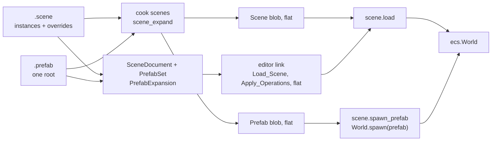

# Prefabs

A prefab is a scene asset that other scenes instantiate: an entity tree authored once, placed many times, with each instance keeping only what differs from the prefab. This document is the design: the asset, the scene format's instance and override blocks, how an instance becomes plain entities everywhere it is used, how the editor edits instances and prefabs, and how a script spawns one. Read [Document and scenes](document-and-scenes.md), [Content: Scenes](../content/kinds/scenes.md) and [Mesh editing](mesh-editing.md#design) first: the mesh design's split between the editor's document and the host's world is the one taken here.

**In this document:** [Design](#design) · [Prefab assets](#prefab-assets) · [Recursion](#recursion) · [Instances in a scene](#instances-in-a-scene) · [Expansion](#expansion) · [Cooking](#cooking) · [The editor's documents](#the-editors-documents) · [Editing an instance](#editing-an-instance) · [Editing a prefab](#editing-a-prefab) · [Panels and the viewport](#panels-and-the-viewport) · [Spawning at run time](#spawning-at-run-time) · [Tests](#tests) · [Phases](#phases) · [Future work](#future-work)

## Design

Five decisions shape everything below.

1. **A prefab is a scene file.** A `.prefab` is a `.scene` with one root entity: the same grammar, the same parser (`format.scene_parse`, `SceneFile`), the same document class, the same blob. It is an asset kind of its own, `Prefab`, so the content browser, the cooker and asset fields can tell it from a scene, but nothing reads it differently. A prefab can contain instances of other prefabs, and a prefab whose root is itself an instance with overrides is what Unity calls a variant; neither needs a feature of its own.
2. **Instances are expanded where they are used, and the world never sees a prefab.** An instance in a scene file is one block that names the prefab, plus override blocks for what differs. Everything that consumes a scene expands instances into plain entities first: the cooker writes scene blobs flat, the editor sends the host a flat `Load_Scene` and flat operations, and a script's `World.spawn(prefab)` copies the prefab's flat blob into the world. The ECS, the scene loader, the editor link's messages and the blob format therefore do not change. The cost is one expansion algorithm written twice, in Odin for the cooker and the runtime and in C# for the editor, which a shared fixture holds to the same result ([Tests](#tests)).
3. **Overrides are the document model's operations.** An override block is a sparse entity block keyed by the entity's path, and an edit of an instance's entity is the same `SetField`, `AddComponent` or `Rename` as on any entity, applied to that sparse block. Reset on a field of a prefab entity removes the override, which is exactly "back to the prefab's value", as [Properties](shell-and-panels.md#properties) already promises. The undo stack, transactions and drags work unchanged.
4. **Paths name an instance's entities, and the path's hash is the world's ID.** The scene format reserves `<instance>#<entity>` ([Scenes](document-and-scenes.md#scenes)). The expanded entity's 64-bit scene ID is a hash of the path, computed the same way in Odin and C#, so `Scene_Entity`, the handles map and every `@` reference stay `u64`, and an entity's ID is the same in the cooked blob and in the editor's `Load_Scene`.
5. **The editor owns the prefab as it owns a mesh.** A prefab that an open scene uses, or that the user edits, is a `PrefabDocument` in a `PrefabSet` beside the scene, with snapshot operations on the scene's undo stack and saved with it, as `MeshDocument` and `MeshSet` are ([Undo and saving](mesh-editing.md#undo-and-saving)). When a prefab changes, the editor expands its instances again and sends the host the difference. The host never learns what a prefab is in edit mode, so a resync is a `Load_Scene` as before.



## Prefab assets

The kind is `Prefab` (`format.Asset_Kind`), with the extension `.prefab`, cooked by `cook scenes` with the scenes ([Cooking](#cooking)). A prefab is a file asset with one blob under its own GUID, not a sub-asset. The content browser shows it with an icon of its own, it drags onto the viewport, the outliner and a `prefab` asset field, and Rename, Duplicate and Delete act on it as on any file.

- **Text source,** for the reasons scenes are text: it diffs and merges, and the editor and the cooker both read it. The file starts with `scene 2`, the format's version ([Instances in a scene](#instances-in-a-scene)), and has the grammar of a scene.
- **One root.** A prefab has exactly one entity without a parent, which is the entity an instance stands for. The cooker reports a prefab with no root or several as an error, and the editor refuses the edits that would make a second root while a prefab is the open document ([Editing a prefab](#editing-a-prefab)).
- **The root's pose is not the prefab's.** An instance's pose is the scene's: the instance block always writes the root's `Transform`, or its `Local_Transform` under a parent, and the prefab root's own `Transform` and `Local_Transform` never reach an instance. By convention the root sits at the origin, so what the user sees when editing the prefab is what an instance places. Everything else on the root, its name, its other components and its behaviours, is the prefab's, and overrides apply to it as to any entity.
- **References** inside a prefab name its own entities, with `@` and the entity's ID in the prefab, and at expansion each becomes the instance's entity on that path, as Duplicate remaps references inside a copy. A prefab cannot refer to anything outside itself; a behaviour field that must point at something in the scene, such as a door's `trigger`, is left `@0` in the prefab and overridden in each instance.
- **Nesting.** An entity inside a prefab can be an instance of another prefab, and a prefab cannot contain itself, directly or through another. Recursion can arise only as a cycle in the graph of which prefab instantiates which, because a prefab refers to nothing outside itself and an override can change only an entity its prefab has: `prefab` is not an overridable key. Three guards catch it, each where the one before cannot ([Recursion](#recursion)).

### Recursion

- **Expansion refuses a cycle.** `scene_expand` and `PrefabExpansion` carry the chain of prefab GUIDs they are inside, and check an instance's GUID against it before expanding the instance. A hit is a cycle, reported with the chain in the message, and the instance expands as a missing prefab does: its root alone, with its overrides. A depth of 8 levels is a second guard behind the check, so a path is at most nine IDs and nothing recurses without bound whatever the files say. Every consumer goes through expansion, so the cooker, the editor and a run-time spawn refuse the same cycle the same way.
- **The cooker rejects the files.** `cook scenes` parses every prefab first and walks the graph once. Each prefab in a cycle is an error and keeps its old blob, and so does a scene that names one, so a cycle that reaches disk, from a merge or another tool, never cooks ([Cooking](#cooking)).
- **The editor stops it before it reaches a file.** The `PrefabSet` has every prefab the document uses, with its expansion cached, so "does B contain A" is a lookup. Each of these edits is refused with a line in the console: dropping prefab B into the open prefab document A when B is A or B's expansion contains A; Make Prefab in a prefab document when the selection holds an instance of the document's own prefab; and Apply from an instance whose added entities include an instance of a prefab that contains the target. Make Variant never makes a cycle, since the variant is new and only points at the original. A cycle that appears on disk while a scene is open goes through the reload path, so its instances degrade to their roots with a warning until the file is fixed, and the editor stays up.
- **New prefabs** come from `Create_Asset` with the `prefab` template, a root named for the file with an identity `Transform`, from the content browser's New Prefab, or from Make Prefab on a selected entity ([Editing an instance](#editing-an-instance)).

## Instances in a scene

The scene format gains four things, and its version becomes `scene 2`; a reader takes version 1 too, which has none of them. Everything else, the values, the sorting and the unknown-key rule, holds.

- **An instance block** is an entity block with a `prefab = $<guid>` key. Its ID is the instance's ID, random and unique in the scene as any entity's, and it stands for the prefab's root. It carries the root's overrides: its `parent`, its pose in a `component` block, which the editor always writes, and whatever else the user changed on the root, such as `name` or `active = false`.
- **An override block** is an entity block whose ID is a path, `<instance>#<entity>`, for an entity inside the instance that differs from the prefab. It holds only the differences: a `component` block sets the listed fields and leaves the prefab's others, and adds the component if the prefab's entity lacks it; a `behaviour` block does the same by script; `name`, `parent` and `active` override the entity's keys; `remove component <id>` and `remove behaviour $<guid>` take one away; and `removed = true` takes the entity and its descendants out of the instance. A field the override does not name is the prefab's. An override cannot unset a field the prefab sets; it sets another value.
- **An added entity** is an ordinary entity block whose `parent` is a path, such as `parent = @5f3a9c01e2b47d10#a90b3e7f15c4d2e8`. It has a plain scene ID and no override block; it belongs to the scene.
- **References** to an instance's entities are `@` and a path, from anywhere in the scene, and the loader resolves them through the path's ID ([Expansion](#expansion)).
- **Sorting:** blocks are sorted by the ID of their first path element, then by path, so an instance's override blocks follow it and an edit changes only the lines of the entity it touches. The writer leaves out an override block that no longer differs.
- **A prefab in a prefab** writes its overrides the same way in the prefab's file, with paths of one level. The scene's override of an entity two levels down is a path of three IDs, `<instance>#<inner instance>#<entity>`. The prefab's GUID is not in the path, so swapping a prefab for one with the same entity IDs, as a variant has, keeps the overrides.

A sketch of a scene with one instance of a door prefab, whose frame's light is dimmed and whose handle is removed, with a sticker added to the frame:

```
scene 2

entity 5f3a9c01e2b47d10
name = "Front Door"
prefab = $9db8150cc7215ffc2708d20d77cf60bf
component 1 Transform
	position = [16777216, 0, -754974720]
	rotation = [0, 0.7071068, 0, 0.7071068]
	scale = [1, 1, 1]
behaviour 9d2e41c0b7a35f6e81c4d2a90b3e7f15
	trigger = @7a11e0c3d94b2f56

entity 5f3a9c01e2b47d10#a90b3e7f15c4d2e8
component 35 Point_Light
	intensity = 0.25

entity 5f3a9c01e2b47d10#c41d2f0e9b7a3651
removed = true

entity 8c2e7b19d4f0a3c5
name = "Sticker"
parent = @5f3a9c01e2b47d10#a90b3e7f15c4d2e8
component 2 Local_Transform
	position = [0.1, 1.2, 0.02]
```

## Expansion

Expansion turns a scene with instances into the flat scene that the world loads. It is `format.scene_expand` in `lib/engine/asset/format`, for the cooker and the runtime, and `PrefabExpansion` in `Cinnabar.Editor.Document`, for the editor. Both take a scene and a way to find a prefab's parsed scene by GUID, and give a flat scene with no instance blocks, no override blocks and no paths.

1. **Expand each instance's prefab first.** A prefab's own instances expand before the prefab is placed, with the prefab's overrides, so a prefab is always flat before a scene uses it, and the scene's overrides apply last: the outermost scene wins.
2. **Give every entity its path's ID.** The root takes the instance's ID. Every other entity of the prefab takes `scene_path_id(instance, id)`: FNV-1a over the 16 bytes of the two IDs, little-endian, folded one level at a time for a nested path, and 1 if the hash is 0. The ID is random enough that a collision with a scene ID is a 2^-64 event, and the expansion still checks and reports one rather than loading two entities under one ID.
3. **Remap references.** A `@` reference inside the prefab to one of its entities becomes the path's ID. A reference in the scene written as a path becomes the path's ID. A reference from the prefab to an ID the prefab does not have is a warning in the cooker, and expands to `@0`.
4. **Apply the overrides,** from the root's instance block and each override block: keys over keys, listed fields over the prefab's, added components and behaviours in place, removals, and `removed = true` dropping the entity with its descendants. An override block whose path names an entity the prefab no longer has is kept in the file and reported as a warning, as an unknown component is, so a prefab edit never deletes a scene's data.
5. **Order the result** as the scene's blocks are: the instance, its prefab's entities in the prefab's order, then the next block. The loader spawns in this order, so the outliner's handle order follows the file.

A prefab that is missing, or that fails to parse, expands to the instance's root alone with its overrides, and the warning names the prefab. The scene still loads, with the instance's pose and name, so a missing asset does not empty a level.

The algorithm is a few hundred lines in each language. The Odin side is a pure procedure over `format.Scene` with a resolver callback, in the shared `format` package, so the cooker and the game DLL compile the same code and neither needs the ECS. The C# side works on `Scene` and gives the flat entities as `SceneEntity` values, so the rest of the document model and the link's snapshot encoding take them unchanged.

## Cooking

`cook scenes` cooks both kinds, because a scene's cook needs the prefabs it expands parsed in the same pass ([Content: Scenes](../content/kinds/scenes.md)).

- **Prefabs first.** The pass parses every `.prefab`, checks each one ([Prefab assets](#prefab-assets)), and expands it, nested prefabs included. Then each scene expands with the prefabs' flat scenes. Cycles are errors for the prefabs in the cycle, and a scene that names one of them keeps its old blob.
- **Blobs are flat.** A scene cooks to the flat `Scene` blob it does today, with path IDs as its entity IDs, so `scene.load` and the asset runtime do not change. A prefab cooks to a flat `Scene` blob under the `Prefab` kind, which is what a run-time spawn copies ([Spawning at run time](#spawning-at-run-time)).
- **Cache keys** of a scene cover the sources of every prefab it expands, transitively, beside its own, so a saved prefab recooks the scenes that use it on the daemon's next pass. A prefab's key covers the prefabs it nests.
- **Dependencies:** the prefabs a scene or a prefab instantiates go in its `dependencies`, with the scripts it names, so the index shows where a prefab is used, Delete warns about its users, and the editor can find every open scene's prefabs.
- **Checks:** a prefab with no root or several, a cycle ([Recursion](#recursion)), a depth beyond the limit, and an instance that names a GUID that is not a prefab are errors; the asset keeps its old blob. A reference to an entity the prefab lacks, an override block whose entity is gone, and a missing prefab are warnings, as a missing script is, and the scene cooks with them so a broken reference never loses a level.
- **The template:** `Create_Asset` gains the `prefab` template, a one-root scene, and the cook link's `Asset` carries nothing new: a prefab has a kind, a path and dependencies like any asset.

## The editor's documents

The editor keeps the scene as it is written, with instances and override blocks, and derives the flat view the host and the panels need.

- **`Scene` and `SceneEntity`** gain what the file has: `Prefab`, the GUID on an instance block; `Path`, the IDs of an override block, with `Id` as its path's ID so `Find(id)` and the operations work on it; `Removed`; and the lists of removed components and behaviours. An entity of an instance with no override block has no `SceneEntity` until an edit makes one.
- **`PrefabSet`** holds the open `PrefabDocument`s by GUID, one for each prefab the scene instantiates at any depth, opened from its file through the content index's path when the scene opens or an instance is created, and one for each prefab the user edits. A `PrefabDocument` is a `Scene` with its path, GUID and saved snapshot, like a `MeshDocument`. The set closes with the scene.
- **The expansion** is cached per prefab, flat, and each instance copies it with its overrides applied. `SceneDocument` exposes `Expanded`, the flat entity list, which the snapshot (`Load_Scene`), the outliner, the properties panel, the gizmo's poses and picking read in place of `Scene.Entities`. A flat entity knows its path and its prefab, so the panels can mark it.
- **Operations map to the flat world.** An operation applies to the document as today, and its wire form is computed against the expansion rather than from the operation alone, so `ToWire` takes the document. An operation on a plain entity is its own wire form. On an instance's entity: `SetField` with a value is `Set_Field` on the path's ID; `SetField` with null, which removes the override, is `Set_Field` with the prefab's value, or `Reset_Field` when the prefab does not set the field either; `AddComponent`, `RemoveComponent` and the behaviour operations are the same on the path's ID; `Rename`, `SetParent` and `SetActive` likewise; and `DestroyEntity` on a prefab entity, which writes `removed = true`, is `Destroy_Entity` of it and its descendants. Every one of these is an existing message.
- **`CreateInstance(id, prefab, parent, pose, overrides)`** is a new operation: it adds the instance block, and its wire form is a `Create_Entity` for each of the instance's flat entities, the root first, so an undo's `DestroyInstance` sends their destroys deepest first. Duplicate of an instance root is a `CreateInstance` with a fresh ID and the override blocks copied under it, their paths re-rooted.
- **`PrefabOperation(guid, before, after)`** is the sibling of `MeshOperation`: a snapshot swap of a `PrefabDocument`'s `Scene` through the `PrefabSet`, with the inverse the two swapped, `ToWire` null, and `IsReplacedBy` for a drag's steps on the same prefab.
- **Re-expansion sends a difference.** When a `PrefabDocument` changes, by a `PrefabOperation`, its undo, or a reload from disk, the set's `Changed` event expands the scene again and `PrefabExpansion.Diff(before, after)` gives the host the operations that turn the old flat world into the new: creates for entities that appeared, destroys for those that vanished, and sets, resets, renames, reparents, component and behaviour changes for the rest. The operations go in `Apply_Operations` and not on the undo stack, because the document's state is the prefab's snapshot, which is already on it. A resync needs none of this: `Load_Scene` carries the expansion.
- **Dirty and save.** The scene is dirty as before. A prefab document is dirty when its scene is not its saved snapshot. Ctrl+S writes the scene and every dirty prefab, each through a temporary file, and a prefab that Make Prefab created gets its file and its `.meta` with its GUID at the first save, as a new mesh does, so the scene's `$` reference resolves at the daemon's next pass. Closing asks about dirty prefabs with the scene. Autosave writes them beside the scene's autosave.
- **Changes on disk.** When the index reports a prefab that an open scene uses as changed, and its document is clean, the editor reads the file again and re-expands, so an edit in another editor, or a pull, shows at once. A dirty document keeps the editor's version, with a line in the console.
- **Problems** from the host, `Edit_Problems`, name a path's ID; the editor maps it back to the path, and the mark shows on the instance's entity in the outliner.

## Editing an instance

An instance's entities edit like any others. The difference is what the document records.

- **Overrides.** Setting a field of a prefab entity writes it in the entity's override block, creating the block, and the properties panel shows the field's name in bold with the reset button. Reset removes the override, and the field shows the prefab's value again. Adding a component, a behaviour or a child entity, removing one, renaming, deactivating and reparenting inside the instance are overrides too, each with the inverse the document model already gives it.
- **Moving.** The gizmo and the properties panel edit the root's `Transform`, which is the scene's, not an override, since the prefab's root pose never reaches the instance. Moving a child inside an instance overrides its `Local_Transform`.
- **Removing** a prefab entity writes `removed = true`; undo removes the key. Removing the root removes the instance and its blocks, as destroying a tree does, in one entry.
- **Reparenting** a prefab entity to another entity of the same instance is an override of its `parent`; reparenting it out of the instance, or an outside entity into it as a child, is refused with a line in the console, as a reparent under a descendant is. Added entities reparent freely under the instance's entities.
- **Make Prefab** (Ctrl+Shift+P, and in the outliner's menu) takes the selected entity and its descendants, asks for a name, and in one undo entry adds a `PrefabDocument` with a fresh GUID whose root is the entity, with the same IDs, written at the next save in the content browser's folder, and replaces the entities in the scene with an instance: the root keeps its ID as the instance's ID and its `Transform`, the descendants become the prefab's entities, and every reference elsewhere in the scene to a descendant becomes a path reference. The world does not change, so the operation's wire form is empty. Undo removes the document; its file, if the scene was saved meanwhile, stays for the content browser's Delete, as an undone mesh's does.
- **Unpack** (in the menu) makes the instance's flat entities ordinary scene entities, with their path IDs as their scene IDs and their current values, in one entry. Unpack Completely does the same through every nesting. The world does not change.
- **Apply and Revert.** A field's menu has Apply to Prefab, which sets the value in the prefab's document and removes the override, so other instances in the scene take it through the re-expansion; and Revert, which is Reset. The instance's header has Apply All and Revert All, which do every override of the instance, including added and removed entities, components and behaviours. Each is one entry of the `PrefabOperation` and the override operations together, so undo brings both back. An Apply writes to the prefab the file names; through a nested instance it writes to the innermost prefab that has the entity, as Unity's does. An Apply that would put a prefab inside one it contains is refused ([Recursion](#recursion)).
- **Selection** in the viewport picks the instance's outermost root on a click, so a door is one thing to move; a double click selects the entity under the mouse. The outliner selects anything. Box selection takes roots.

## Editing a prefab

A prefab opens as the document, in the scene's place, and is edited as a scene.

- **Opening:** Open Prefab from an instance's menu or the properties header, or a double click in the content browser. It asks to save the open scene's changes first, as Open Scene does. The title bar shows the prefab's file and the status bar marks it as a prefab. Every tool works: the gizmo, mesh mode, materials, behaviours, nested instances.
- **One root.** With a prefab open, New Entity makes a child of the root, a drop onto the space below the outliner's rows is refused, and Delete of the root is refused, each with a line in the console. A drop of the prefab itself, or of one that contains it, is refused too ([Recursion](#recursion)).
- **Play** works in a prefab document: Play loads the prefab's expansion alone into the host's world, so a turret can be tried by itself.
- **Save** writes the file; the daemon cooks it, and the scenes that use it recook. The next scene opened sees the new prefab, as does an open scene when it is opened again.
- **In context,** the user does not need to open the prefab: Apply from an instance edits the `PrefabDocument` in the `PrefabSet`, which the properties panel shows is dirty in the instance's header, and Ctrl+S saves it with the scene. The two paths are the same document class; only what the window shows differs.
- **A variant** is a prefab whose root is an instance block. Make Variant on an instance's menu writes one: a new prefab whose root instantiates the original with the instance's overrides, and replaces the scene's instance with an instance of the variant. Nothing else knows about variants; expansion handles them as nesting.

## Panels and the viewport

- **Outliner:** an instance's root row shows the prefab's icon before its name, in the accent color, as Unity's does, and its prefab entities under it as any children. An entity with an override block has a dot after its name, an added entity a plus, and a removed one is not shown. The row's menu adds Open Prefab, Select Prefab Asset, Make Prefab, Unpack, Unpack Completely, Make Variant, Apply All and Revert All. Filter matches the prefab's name too.
- **Properties:** the header of an instance's entity names the prefab, with Open, Apply All and Revert All, and a dirty mark when its document is dirty. An overridden field's name is bold and has the reset button and the Apply menu; a field the prefab sets has no reset, since its default is the prefab's; a field neither sets edits as today and becomes an override. An added component's group is marked, and a removed one is a chip under the groups with Revert. Multi-select over instances of one prefab works field by field as it does today.
- **Content browser:** the `Prefab` kind with its icon, New Prefab in the commands and menus, `kind:prefab` in search, the details' "used by" from the dependencies, and double click opens it. A prefab drags onto the viewport, where the instance lands at the pick under the mouse, on the scene's geometry, or on the grid plane through the camera's pivot when the pick hits nothing, snapped when Snap is on, in an undo entry that stays open while the drag shows and closes at the drop, as a material drop does; onto a row in the outliner, which makes it a child of that entity at the identity pose; onto the space below the rows, which makes it a root at the origin; and onto a `prefab` asset field.
- **Undo history** names instance entries as "Create Instance Door", "Override Point_Light.intensity", "Apply Door" and so on.
- **The viewport** draws nothing new: the game shows flat entities, so the selection outline, the icons and the helpers are as for any entity.

## Spawning at run time

A game spawns an instance from a script, or from native code at a serial point, by copying the prefab's flat blob into the world.

- **`scene.spawn_prefab(w, scripts, assets, guid, pose) -> (root, ok)`** in `lib/engine/scene` loads the prefab's blob through `asset.load`, which keeps it loaded so a second spawn reads memory, reads its flat `Scene`, and adds the entities with `add_entities` through a map of its own, so the prefab's IDs never meet the scene's. The root takes the pose, children keep their `Local_Transform` and propagation places them. The entities get no `Scene_Entity`, as a game-spawned entity has none, and the editor does not edit them. References inside the prefab resolve through the map; a reference to `@0` stays none. Problems go to the log with the prefab's GUID, as a scene load's do.
- **`World.spawn(prefab, position?, rotation?)`** in scripts takes an asset reference and calls `spawn_prefab` with `immediate` set, so every behaviour in the instance gets `awake` and `on_enable` before `spawn` returns, in the prefab's entity order, as `entity:add` does and as Unity's `Instantiate` does ([Scripting: Structural changes](../scripting/api.md#structural-changes)). It returns the root's handle. A script spawn is in the script phase, which is serial, so the structural change is immediate as the rest of the script API's are.
- **Asset references** are what a script needs to name a prefab, and they are the one piece outside this design that it depends on. The first slice is what spawn needs: `Field.asset("prefab")` in `Behaviour.define`, the `Asset` kind in the cooker's behaviour schema and the blob's field records, the `$` value in scenes and the properties panel's picker for it, and the asset reference value in scripts, a light userdata that holds the GUID and compares by it ([Scripting: Future work](../scripting/api.md#future-work)). Other kinds follow the same path for free.
- **From native code,** a game calls `spawn_prefab` between frames or in a serial phase. From a system, which runs as a job, the structural change must be deferred: a `command_spawn_prefab` on the command buffer waits for a game that needs it ([Future work](#future-work)).
- **Hot reload of a prefab** at run time changes the blob behind its handle, so the next spawn reads the new prefab; instances already in the world are copies and stay as they are, as in Unity. In the editor's edit mode, instances follow the prefab through re-expansion ([The editor's documents](#the-editors-documents)); in Play, the world is the game's.

## Tests

- **One fixture, two expansions.** `lib/engine/asset/format/testdata/prefabs/` holds a scene, the prefabs it uses at two levels of nesting, with overrides of every kind, an added entity, a removed one, a variant, a missing prefab and a dangling override, and the expected flat scene as a `.scene` file. The Odin test expands and compares with the expected file, and the C# test reads the same files and does the same, so the two implementations agree on every ID, reference and order. A test for `scene_path_id` in each language pins the hash with known values.
- **Cooker:** a prefab with two roots, a direct cycle and one through a third prefab, a depth beyond the limit, a scene whose prefab is missing, the cache key changing with a nested prefab's source, and the dependencies in the index.
- **Document:** round trip of the version 2 file, an override through each operation and its inverse, the wire form of each operation on an instance's entity, `CreateInstance` and Duplicate, Make Prefab with references remapped, Unpack, Apply and Revert, each refused edit of [Recursion](#recursion), the diff of a re-expansion after each kind of prefab change, and dirty state and save order.
- **Runtime:** `spawn_prefab` with references inside the prefab, a nested prefab, `awake` before `World.spawn` returns, and a soft restart keeping the spawned entities.
- **Shell:** an instance dropped in the viewport as one entry, a drag of a child as an override, Reset as revert, and Play from a prefab document, under `dotnet test` with the host.

## Phases

1. **Format and cooker:** the version 2 keys in `scene_text.odin` and `SceneFile`, `scene_path_id`, `scene_expand`, the `Prefab` kind and extension, `cook scenes` cooking both kinds flat with the checks, the keys and the dependencies, the `prefab` template, and the fixture. A cooked scene with instances then loads in the game with no runtime change.
2. **Instances in the editor:** `PrefabSet` and `PrefabDocument`, `PrefabExpansion` and `Expanded`, wire forms against the expansion, `CreateInstance`, drag from the content browser, the outliner's and the properties panel's marks, overrides through every operation, Reset as revert, Duplicate, Unpack, and Make Prefab with the file written at save.
3. **Prefab editing:** a prefab as the open document with its rules, `PrefabOperation`, Apply and Revert, the re-expansion diff, reload from disk, dirty state and save, Make Variant, and Play from a prefab.
4. **Spawning:** the asset reference slice, `spawn_prefab`, `World.spawn(prefab, ...)`, and the Unity mapping's row.

## Future work

- **glTF as a prefab.** A model's node hierarchy becomes a `prefab` sub-asset of the model that places its mesh sub-assets, and its textures and materials become sub-assets too, which is importing a glTF file as a scene ([Content: Identity and cooking](../content/identity-and-cooking.md#future-work)). The importer writes the prefab's flat scene straight into a blob; there is no text file to edit, so Apply to such a prefab is refused, and Make Variant is how a user customizes one.
- **Spawning from systems.** `command_spawn_prefab` on the command buffer, applied with the other structural changes, for a native system that spawns projectiles. Do this with the first native system that spawns.
- **A `Prefab_Instance` marker** on a spawned root, with the prefab's GUID, so the outliner names a spawned instance in Play and a system can find every instance of a prefab. Do this when a game asks for either.
- **Overrides of removed entities' descendants** are dropped silently with their ancestor; the file keeps them, so reverting the removal brings them back. A warning in the properties panel would help.
- **Pooling** of spawned instances, which a game that spawns hundreds a second needs, over `spawn_prefab` and a despawn that keeps the entities. Do this when a game's spawns show in the profile.
- **A prefab preview** in the content browser, as a thumbnail, with the material previews' path ([Shell and panels](shell-and-panels.md#future-work)).
- **Several scenes open at once** would let a prefab edit in its own tab beside the scene, with the scene's instances following live. It waits for the editor's several-document model ([Document and scenes: Future work](document-and-scenes.md#future-work)).
