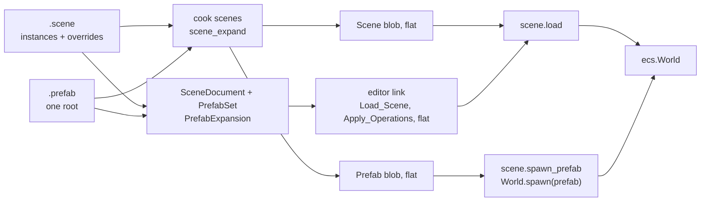

# Prefabs

A prefab is an entity tree authored once and placed many times: a `.prefab` asset that scenes instantiate, each instance keeping only what differs from the prefab. This document covers the asset, the scene format's instance and override blocks, the expansion that turns an instance into plain entities wherever it is used, how the editor edits instances and prefabs, and how a game spawns one. Read [Document and scenes](document-and-scenes.md), [Content: Scenes](../content/kinds/scenes.md) and [Mesh editing](mesh-editing.md#design) first: prefabs take the mesh editor's split between the editor's document and the host's world.

**In this document:** [Design](#design) · [Prefab assets](#prefab-assets) · [Recursion](#recursion) · [Instances in a scene](#instances-in-a-scene) · [Expansion](#expansion) · [Cooking](#cooking) · [The editor's documents](#the-editors-documents) · [Editing an instance](#editing-an-instance) · [Editing a prefab](#editing-a-prefab) · [Panels and the viewport](#panels-and-the-viewport) · [Spawning at run time](#spawning-at-run-time) · [Future work](#future-work)

## Design

1. **A prefab is a scene file.** A `.prefab` is a `.scene` with one root entity: the same grammar, the same parsers (`format.scene_parse`, `SceneFile`), the same document class and the same blob. It is an asset kind of its own, `Prefab`, so the content browser, the cooker and asset fields can tell it from a scene. A prefab can contain instances of other prefabs, and a prefab whose root is an instance of another is what Unity calls a variant; neither needs a feature of its own.
2. **The world never sees a prefab.** Everything that consumes a scene expands its instances into plain entities first: the cooker writes blobs flat, the editor sends the host a flat `Load_Scene` and flat operations, and `World.spawn(prefab)` copies a flat blob. The ECS, the scene loader, the editor link's messages and the blob format do not know about prefabs. The cost is one expansion written twice, in Odin for the cooker and the runtime and in C# for the editor, which a shared fixture holds to the same result ([Expansion](#expansion)).
3. **Overrides are the document model's operations.** An edit of an instance's entity is the same `SetField`, `AddComponent` or `Rename` as on any entity; the document writes it in the entity's block, with only what differs from the prefab. Reset removes the override, which is "back to the prefab's value", as [Properties](shell-and-panels.md#properties) promises. The undo stack, transactions and drags work unchanged.
4. **A path names an instance's entity, and its hash is the entity's scene ID.** `<instance>#<entity>` names an entity inside an instance ([Scenes](document-and-scenes.md#scenes)). The expanded entity's 64-bit scene ID is a hash of the path, the same in Odin and C#, so `Scene_Entity`, the handles map and every `@` reference stay `u64`, and an entity has the same ID in the cooked blob and in the editor's `Load_Scene`.
5. **The editor owns a prefab as it owns a mesh.** Each prefab that the open scene uses is a `PrefabDocument` in a `PrefabSet` beside it, whose edits are snapshots on the scene's undo stack and which saves with the scene, as `MeshDocument` and `MeshSet` do ([Undo and saving](mesh-editing.md#undo-and-saving)). When a prefab changes, the editor expands the scene again and sends the host the difference, so a resync is a `Load_Scene` as before.



## Prefab assets

The kind is `Prefab` (`format.Asset_Kind`, and the cook link's), with the extension `.prefab`, cooked by `cook scenes` with the scenes ([Cooking](#cooking)). A prefab is a file asset with one blob under its own GUID. The content browser shows it with an icon of its own, it drags onto the viewport, the outliner and a `prefab` asset field, and Rename, Duplicate and Delete act on it as on any file.

- **Text source,** as scenes are: it diffs and merges, and the editor and the cooker both read it. It has the grammar of a scene, version 2 ([Instances in a scene](#instances-in-a-scene)).
- **One root.** A prefab has exactly one entity without a parent, the entity that an instance stands for. The cooker reports a prefab with no root or several as an error, and the editor refuses an edit that would make a second one while a prefab is the open document ([Editing a prefab](#editing-a-prefab)).
- **The root's pose is the scene's.** An instance block always writes the root's `Transform`, or its `Local_Transform` under a parent, and the prefab root's own `Transform` and `Local_Transform` never reach an instance. By convention the root sits at the origin, so what the user sees when editing the prefab is what an instance places. Everything else on the root, its name, its other components and its behaviours, is the prefab's, and overrides apply to it as to any entity.
- **References** inside a prefab name its own entities, with `@` and the entity's ID in the prefab; at expansion each becomes the instance's entity on that path, as Duplicate remaps references inside a copy. A prefab refers to nothing outside itself: a field that must point into the scene, such as a door's `trigger`, is `@0` in the prefab and overridden in each instance.
- **New prefabs** come from `Create_Asset` with the `prefab` template, a root named for the file with an identity `Transform`, which the content browser's New Prefab sends, and from Make Prefab and Make Variant ([Editing an instance](#editing-an-instance)).

### Recursion

A prefab cannot contain itself, directly or through another. Recursion can arise only as a cycle in the graph of which prefab instantiates which, since a prefab refers to nothing outside itself and an override can change only an entity that its prefab has: an override block cannot set `prefab`.

- **Expansion refuses a cycle.** `scene_expand` and `PrefabExpansion` carry the chain of prefab GUIDs that they are inside, starting with the prefab's own when they expand a prefab, and check each instance's GUID against it. A hit is an error that names the chain, and the instance expands as a missing prefab does: its root alone, with its overrides. A depth of 8 is a second guard, so a path has at most nine IDs. The cooker, the editor and a run-time spawn all expand, so they refuse the same cycle the same way.
- **The cooker keeps the old blobs.** A cycle is an error in every prefab in it and in every scene that reaches one, so a cycle that reaches disk, from a merge or another tool, never cooks.
- **The editor refuses the edit.** `SceneDocument` undoes and refuses an operation after which its expansion has a cycle that it did not have, with the reason in the console. That covers a prefab dropped into a prefab document that it is or contains, Make Prefab, and Apply; Apply All checks the instances that it would add before it starts. Make Variant cannot make a cycle, since the variant is new. A cycle that arrives on disk while a scene is open shows as instances that are their roots alone, with an error in the console, until the file is fixed.

## Instances in a scene

Prefabs bring the scene format to version 2, `scene 2`, which the editor writes; both readers take version 1 too, which has no instances. The values, the sorting and the unknown-key rule hold.

- **An instance block** is an entity block with `prefab = $<guid>`. Its ID is the instance's, random and unique in the scene as any entity's, and it stands for the prefab's root: its `parent` and its pose are the scene's, and anything else that it writes overrides the root.
- **An override block** is an entity block whose ID is a path, `<instance>#<entity>`, for an entity inside the instance that differs from the prefab. It holds only the differences: a `component` block sets the fields that it lists and leaves the prefab's others, and adds the component if the prefab's entity lacks it; a `behaviour` block does the same by script; `name`, `parent` and `active` override the entity's keys; a `remove component <id>` or `remove behaviour $<guid>` line takes one away; and `removed = true` takes the entity and its descendants out of the instance. An override cannot unset a field that the prefab sets; it sets another value.
- **Keys:** an instance or override block writes exactly the keys that it overrides, so `name = ""` and `active = true` are overrides, and the editor keeps which ones it writes in `SceneEntity.Keys`. A plain entity writes a name that is not empty, a parent that is not 0 and `active = false`, as in version 1. A removal or `removed` on a plain entity, and `prefab` on an override block, are errors.
- **An added entity** is a plain entity block whose `parent` is a path, such as `parent = @5f3a9c01e2b47d10#a90b3e7f15c4d2e8`. It has a plain scene ID and belongs to the scene.
- **References** to an instance's entities are `@` and a path, from anywhere in the scene, and read as the path's ID ([Expansion](#expansion)). The editor writes a reference or a parent inside an instance as its path, so it follows the prefab.
- **Order:** blocks are sorted by the ID of their first path element, then by path, so an instance's override blocks follow it. Within a block the writer puts `name`, `parent`, `prefab`, `active`, `removed`, unknown keys, the removals, then the components and behaviours. It leaves out an override block that no longer differs.
- **A prefab in a prefab** writes its overrides the same way in the prefab's file. The scene's override of an entity two levels down is a path of three IDs, `<instance>#<inner instance>#<entity>`. The prefab's GUID is not in the path, so swapping a prefab for one with the same entity IDs keeps the overrides. A variant's entities are a level down, under its root instance, so the scene names the original's entities through an instance of the variant as `<instance>#<variant's root>#<entity>`.

A scene with one instance of a door prefab, whose frame's light is dimmed and whose handle is removed, with a sticker added to the frame:

```
scene 2

entity 5f3a9c01e2b47d10
name = "Front Door"
prefab = $9db8150cc7215ffc2708d20d77cf60bf
component 1 Transform
	position = [16777216, 0, -754974720]
	rotation = [0, 0.7071068, 0, 0.7071068]
	scale = [1, 1, 1]
behaviour 9d2e41c0b7a35f6e81c4d2a90b3e7f15
	trigger = @7a11e0c3d94b2f56

entity 5f3a9c01e2b47d10#a90b3e7f15c4d2e8
component 35 Point_Light
	intensity = 0.25

entity 5f3a9c01e2b47d10#c41d2f0e9b7a3651
removed = true

entity 8c2e7b19d4f0a3c5
name = "Sticker"
parent = @5f3a9c01e2b47d10#a90b3e7f15c4d2e8
component 2 Local_Transform
	offset = [0.1, 1.2, 0.02]
```

## Expansion

Expansion turns a scene with instances into the flat scene that the world loads: no instance blocks, no override blocks and no paths. It is `format.scene_expand` in `scene_expand.odin`, a pure procedure in the shared `format` package, so the cooker and the game DLL compile the same code and neither needs the ECS; and `PrefabExpansion.Expand` in `Cinnabar.Editor.Document`, which gives `SceneEntity` values that the rest of the document model and the link's snapshot take unchanged. Both take a way to find a prefab's parsed scene by GUID: Odin's `Prefab_Resolver`, C#'s a function.

1. **Each instance's prefab expands first,** its own instances with its own overrides, so a prefab is flat before a scene places it, and the scene's overrides apply last: the outermost scene wins.
2. **Every entity takes its path's ID.** The root takes the instance's ID, and every other entity of the flat prefab takes `scene_path_id(instance, id)`: FNV-1a over the two IDs' 16 bytes, little-endian, or 1 if the hash is 0. A longer path folds from the end, `scene_path_id(a, id(b#c))`, since a flat prefab's entity already has the inner path's ID. Two entities with one ID after expansion are an error, not two entities loaded under one ID.
3. **References are remapped.** A reference inside the prefab to one of its entities becomes the path's ID. A reference to an ID that the prefab does not have is a warning and becomes `@0`.
4. **The overrides apply,** from the instance block, without its pose, over the root, and from each override block over its entity: keys over keys, listed fields over the prefab's in their places, new fields after them, added components and behaviours, removals, and `removed = true`, which drops the entity and every descendant, the scene's added entities under it too. An override block whose path names an entity that the prefab no longer has is a warning and stays in the file, as an unknown component does, so a prefab edit never deletes a scene's data.
5. **The result is in the scene's order:** each instance's root, its prefab's other entities in the prefab's order, then the next block. The loader spawns in this order, so the outliner follows the file.

A prefab that is missing, fails to parse, or has no root or several expands to the instance's root alone with its overrides, and the warning names the prefab, so a missing asset does not empty a level. A nested prefab's warnings are its own cook's: a scene reports those of its own blocks and the prefabs that it places, and errors from any depth, each naming the scene's instance that reaches it.

The fixture in `lib/engine/asset/format/testdata/prefabs` holds the two expansions to one result: a level with a door that has an override of every kind and a nested lamp, an added entity, one under a removed entity, a variant, a missing prefab and a dangling override, the prefabs with their GUIDs in `.meta` files, and the flat scene that the level expands to. `asset_format`'s tests and the editor's `PrefabTests` expand it and compare, and both pin `scene_path_id` with the same values.

## Cooking

`cook scenes` cooks both kinds in one pass, since a scene's cook expands the prefabs that it instantiates ([Content: Scenes](../content/kinds/scenes.md)).

- **Prefabs first.** The pass parses every `.prefab`, checks its one root, and expands it with its own GUID first in the chain. Then each scene expands with the parsed prefabs.
- **Blobs are flat.** A scene cooks to a flat `Scene` blob, with path IDs as its entity IDs, so `scene.load` and the asset runtime are unchanged. A prefab cooks to a flat `Scene` blob under the `Prefab` kind, which a spawn copies ([Spawning at run time](#spawning-at-run-time)).
- **Cache keys** of a scene or a prefab cover, beside its own source, the GUID of every prefab that it reaches, through the ones inside them, with the prefab's source or a mark that it is missing, so saving a prefab cooks its users again and a prefab that appears cooks the scenes that waited for it.
- **Dependencies** are the prefabs that a file instantiates itself and the scripts that its behaviours name, so the index shows where a prefab is used and Delete warns about its users.
- **Checks:** a prefab with no root or several, a cycle, a nesting deeper than 8, and an instance of an asset that is not a prefab are errors, and the asset keeps its old blob. A reference to an entity that a prefab lacks, an override whose entity is gone, and a missing prefab are warnings, as a missing script is, so a broken reference never loses a level. References and scripts are checked on the flat scene.

## The editor's documents

The editor keeps the scene as the file has it, with instances and override blocks, and derives the flat view that the host and the panels need.

- **`Scene` and `SceneEntity`** have what the file has: `Prefab`, the GUID of an instance block; `Path`, the IDs of an override block, with `Id` its path's ID so `Find(id)` finds it; `Keys`; `Removed`; the removed components and behaviours; and `ParentPath`, a parent written as a path. A `SceneValue` keeps a reference written as a path. An instance's entity with no overrides has no `SceneEntity` until an edit makes its block.
- **`PrefabSet`** holds a `PrefabDocument` for each prefab that the scene uses, at any depth, opened from the file that the content index names when an expansion first asks for it; an instance whose prefab the index does not have yet expands when the index arrives. A `PrefabDocument` is the prefab's `Scene`, its path, its GUID and the text that its file has. The set closes with the scene.
- **`SceneDocument.Expanded`** is the expansion: the flat `Scene`, an `InstanceEntity` for each flat entity inside an instance, with its path and the prefab whose root it is, and the problems, which the console shows when the scene opens. The snapshot, the outliner, the properties panel, the gizmo's poses and picking read it. It is made again after every operation, which is fast enough for the scenes there are.
- **Operations name flat entities.** `PrefabEdits.Route` passes an operation on a plain entity through, with references to an instance's entities written as paths, and turns one on an instance's entity into a `BlockOperation`: a swap of the entity's instance block, or its override block, made if it has none, written with only what differs from the prefab. A name, activity or parent that is the prefab's again leaves the key out, and an override block that no longer differs goes, so undo is exact. A `BlockOperation` holds the document, and its wire form, which `Operation.ToWires` gives, is `PrefabExpansion.Diff` of the expansion before and after it applies: the destroys of entities that vanished, the deepest first, the creates of those that appeared, each after its parent, and the sets, resets, renames, reparents and component and behaviour changes of the rest. So Reset sends the prefab's value, and a removed entity sends the destroys of it and its descendants. Creating, removing and duplicating an instance are such swaps; a drag's steps on one field of one entity replace each other.
- **`PrefabOperation`** is the sibling of `MeshOperation`: a snapshot swap of a `PrefabDocument`'s scene through the `PrefabSet`, its inverse the two swapped, and its wire form the expansion's difference, so every instance follows the prefab. Make Prefab and Make Variant add their new documents with a `PrefabSetOperation`.
- **Dirty and save.** The scene's undo stack holds the prefabs' edits, so the scene is dirty when they are, and closing asks about them with the scene. A prefab document is dirty when its scene is not its file's text. Ctrl+S writes every dirty prefab and then the scene, each through a temporary file; a prefab that has no file yet gets it and its `.meta` with its GUID, so the scene's `$` reference resolves at the cook daemon's next pass.
- **Changes on disk.** When the index reports and a prefab's file no longer has the document's text, a clean document reads it again and the host gets the difference, so an edit in another editor, or a pull, shows at once. A dirty one keeps the editor's version, with a line in the console once.
- **Problems** from the host, `Edit_Problems`, name flat scene IDs, which are path IDs inside an instance, so the outliner's mark shows on the instance's entity.

## Editing an instance

- **Overrides.** Setting a field of a prefab's entity writes it in the entity's override block, and the properties panel shows the field's name in bold with the reset button, which reverts it. Adding or removing a component, a behaviour or a child entity, renaming, deactivating and reparenting inside the instance are overrides too.
- **Moving.** The gizmo and the properties panel edit the root's `Transform`, which is the scene's, not an override. Moving a child inside an instance overrides its `Local_Transform`.
- **Removing** a prefab's entity writes `removed = true`, after destroying the entities that the scene added under it; undo brings both back. Removing the root removes the instance and all its blocks in one entry.
- **Reparenting** a prefab's entity under another entity of the same instance overrides its `parent`. A prefab's entity cannot leave its instance, and an entity outside an instance cannot move into one; both are refused with a line in the console. The scene's added entities move freely under the instance's entities, and a new entity can be made under one.
- **Duplicate** of an instance's root makes a new instance with the override blocks copied onto the copy's paths, and references inside them to the copy's entities. A prefab's entity inside an instance duplicates as plain entities, which the scene adds to the instance.
- **Make Prefab** (Ctrl+Shift+M, since Ctrl+Shift+P is the command palette, and in the outliner's menu) takes a plain entity and its descendants, asks for a name, and in one undo entry adds a `PrefabDocument` with a fresh GUID in the content browser's folder, or the game root without one, written at the next save, and replaces the entities with an instance of it. A name that a file has is refused. The prefab has the entities with their IDs and its root at the origin; the instance keeps the root's ID and pose; every reference elsewhere in the scene to one of the entities becomes a path; and a reference from inside to the rest of the scene becomes `@0`. The descendants' scene IDs become their paths', so the host gets the difference. Undo removes the document; its file, if a save wrote it meanwhile, stays for the content browser's Delete, as an undone mesh's does.
- **Unpack** makes an instance's own level the scene's: its prefab's entities become plain entities with their current values, and the instances inside the prefab stay instances, with the scene's overrides of their entities on paths from them. Those entities' paths change, so the host gets the difference. **Unpack Completely** makes every entity of the instance plain, through every nesting, with its path's ID as its scene ID, so the world does not change and the host gets nothing.
- **Apply and Revert.** An overridden field's name has Apply to Prefab and Revert in its menu. Apply sets the value in the prefab that the instance names, on the entity's path in it, and drops the override, so every instance has the value. It writes to that prefab also for an entity inside a nested instance, rather than to the innermost prefab: an override that the outer prefab has of the same entity would hide a value written to the innermost one. A field that refers to an entity outside the instance cannot be applied, since a prefab cannot refer outside itself. Revert is Reset.
- **Apply All and Revert All,** in the instance's header and the outliner's menu, do every override of the instance. Apply All carries the instance block's keys, components and behaviours, every override block, the removals, and the entities that the scene added, which the prefab then has with their scene IDs, so their paths in the scene, and the scene's references to them, change. A field that refers outside the instance stays the scene's override, and an added entity's references outside the instance become `@0` in the prefab. An added instance of a prefab that contains this one is refused. Revert All drops the overrides and destroys the added entities. Apply runs the routed operations on a working copy of the prefab, a document of its own, so the prefab takes an override by the scene's rules; each Apply is one undo entry of its `PrefabOperation` and the scene's edits, so undo brings both back.
- **Selection** in the viewport picks an instance's outermost root on a click, so a door is one thing to move, and box selection takes roots. A double click on an instance's entity that is not selected selects it, and a second one enters mesh mode as on any entity. The outliner selects anything.

## Editing a prefab

A prefab opens as the document in the scene's place, through Open Scene, the outliner's Open Prefab, the properties header's Open, or a double click in the content browser. It asks to save the open scene's changes first, as Open Scene does. The document is a `SceneDocument` whose `PrefabGuid`, from the index or the `.meta` file, starts its expansion's chain, so it cannot take itself in. The title bar shows the prefab's file, the status bar shows "Prefab" before its name, and every tool works.

- **One root.** The document refuses an edit after which it has no root or several, with the reason in the console: a drop onto the space below the outliner's rows, Move to Root, a Delete of the root. New Entity, New Volume and a drop in the viewport put the entity under the root, keeping its place in the world.
- **Play** needs nothing of its own: the host's world is the prefab's expansion, so a turret can be tried by itself.
- **Save** writes the file; the daemon cooks it, and the scenes that use it cook again. A scene opened afterward reads the new prefab; only one document is open at a time, so no open scene follows it.
- **In context,** the user does not need to open the prefab: Apply edits the `PrefabDocument` in the scene's set, which the properties header marks with a dot while it has unsaved changes, and Ctrl+S saves it with the scene.
- **Make Variant,** in the outliner's menu of an instance's root, asks for a name, `<prefab>_variant` by default, and makes a prefab in the content browser's folder, written at the next save, whose root is an instance of the original with the instance's overrides and the entities that the scene added to it. The scene's instance becomes an instance of the variant with its pose; a field that refers outside the instance stays the scene's override, on the path through the variant's root, and the scene's paths into the instance gain the variant's root. Nothing else knows about variants: expansion handles them as nesting.

## Panels and the viewport

- **Outliner:** an instance's root, at any depth, shows the prefab's icon before its name in the accent color, as Unity's does, with its prefab's entities under it as children. An entity with an override block has a dot after its name, an entity that the scene added to an instance a plus, and a removed one is not shown. The menu of an instance's entity adds Open Prefab, Select Prefab Asset, Apply All and Revert All, and for its root Make Variant, Unpack and Unpack Completely; a plain entity's adds Make Prefab. The filter matches prefab names too.
- **Properties:** the header of an instance's entity says "Instance of" or "In an instance of" and the prefab, a link to it in the content browser, with a dot while the prefab has unsaved changes, and Open, Apply All and Revert All. An overridden field's name is bold, with the reset button as Revert and Apply to Prefab in its menu; a field that the prefab sets has no reset, since its default is the prefab's; the root's pose is the scene's and is never bold. An added component's group has an "Added" badge, and a removed component or behaviour is a chip under the groups with Revert, which brings back the prefab's. A behaviour's `Field.asset` field shows the asset picker for its kind.
- **Content browser:** the `Prefab` kind with its icon, New Prefab in the commands and menus, `kind:prefab` in search, the details' "used by" from the dependencies, and a double click that opens it. A prefab drags onto the viewport, where its instance shows at the pick under the mouse, on what the pixel shows or on the grid plane through the camera's pivot, snapped when Snap is on, in an undo entry that the drop keeps and that leaving takes back; onto an outliner row, which makes it a child of that entity at the identity pose; onto the space below the rows, which makes it a root at the origin; and onto a `prefab` asset field.
- **Undo history** names the entries by the prefab's file, such as "Create Instance door", "Apply Intensity to door" and "Make Prefab crate".
- **The viewport** draws nothing new: the game shows flat entities, so the selection outline, the icons and the helpers are as for any entity.

## Spawning at run time

A game spawns an instance by copying a prefab's flat blob into the world.

- **`scene.spawn_prefab(w, scripts, assets, guid, pose) -> (root, ok)`** loads the prefab's blob through `asset.load`, which keeps it loaded, so a second spawn reads memory, and refuses one that is not of the `Prefab` kind with an error in the log. It adds the entities through a map of its own, so the prefab's IDs never meet the scene's and the prefab's references resolve to its own new entities, and gives the root the pose; the children keep their `Local_Transform`, and propagation places them. The entities get no `Scene_Entity`, as a game's entities have none, so the editor does not edit them. The behaviours wake in the next script phase. Call it between frames or in a serial phase.
- **`World.spawn(prefab, position?, rotation?)`** in scripts takes an `Asset` of a prefab and returns the root, and every behaviour in the instance gets `awake` and `on_enable` before it returns, in the prefab's entity order, as `entity:add` does and as Unity's `Instantiate` does ([Scripting: Structural changes](../scripting/api.md#structural-changes)). The script runtime is below the scene loader, so it calls a `Prefab_Spawner` that `scene.register_scripts` sets in the game's `Register_Proc`, which a code reload runs again; the spawner adds the entities and gives the behaviours back, and the binding attaches them on its own thread. Without the registration, `World.spawn(prefab)` raises an error that says so.
- **Asset references** are how a script names a prefab. `Field.asset(kind?)` declares a behaviour field of a kind of asset, such as `"prefab"`; the cooker's schema keeps the kind in the field record's text, a scene writes the value as `$` and the GUID, the inspector reports the field as an asset field while it holds none, with its kind, and the editor link's `Behaviour_Field` carries both, so the properties panel shows the picker. The value in scripts is an `Asset`, a light userdata whose payload is the GUID's place in a table of the runtime, at most 4096, so two references to one asset are the same value and compare equal ([Scripting: Values](../scripting/api.md#values)).
- **Hot reload of a prefab** changes the blob behind its handle, so the next spawn reads the new prefab; instances already in the world are copies and stay as they are, as in Unity. In edit mode the editor's instances follow the prefab through re-expansion ([The editor's documents](#the-editors-documents)); in Play the world is the game's.

## Future work

- **glTF as a prefab.** A model's node hierarchy becomes a `prefab` sub-asset of the model that places its mesh sub-assets, and its textures and materials become sub-assets too, which is importing a glTF file as a scene ([Content: Identity and cooking](../content/identity-and-cooking.md#future-work)). The importer writes the prefab's flat scene straight into a blob; there is no text file to edit, so Apply to such a prefab is refused, and Make Variant is how a user customizes one.
- **Spawning from systems.** `command_spawn_prefab` on the command buffer, applied with the other structural changes, for a native system, which runs as a job and cannot spawn at once. Do this with the first native system that spawns, such as one for projectiles.
- **Autosave of new prefabs.** The autosave writes the scene alone, so a restored autosave whose Make Prefab or Make Variant was never saved has that instance as its root alone. The prefab documents that have no file yet belong beside the scene's autosave.
- **References out of Apply All's added entities.** An added entity's reference to an entity outside the instance becomes `@0` in the prefab; keeping it as the scene's override, as Apply All does for the instance's own entities, would lose nothing.
- **A cached expansion.** `SceneDocument.Expanded` expands the whole scene after every operation. Caching each prefab's flat scene, and expanding only the instance that an edit touches, waits for a scene where the drag shows the cost.
- **A `Prefab_Instance` marker** on a spawned root, with the prefab's GUID, so the outliner names a spawned instance in Play and a system can find every instance of a prefab. Do this when a game asks for either.
- **Overrides of removed entities' descendants** are dropped silently with their ancestor; the file keeps them, so reverting the removal brings them back. A warning in the properties panel would help.
- **Pooling** of spawned instances, which a game that spawns hundreds a second needs, over `spawn_prefab` and a despawn that keeps the entities. Do this when a game's spawns show in the profile.
- **A prefab preview** in the content browser, as a thumbnail, with the material previews' path ([Shell and panels](shell-and-panels.md#future-work)).
- **Several documents open at once** would let a prefab edit in its own tab beside the scene, with the scene's instances following live. It waits for the editor's several-document model ([Document and scenes: Future work](document-and-scenes.md#future-work)).
