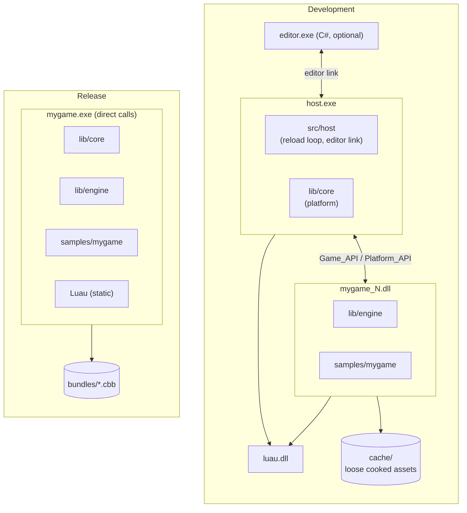

# Overview

The whole engine: what runs where, the boundary that hot reload imposes, how to build, and the rules every part follows.

## Documents

Read them in this order the first time.

| Document | What it covers |
|---|---|
| [Architecture](architecture.md) | The frame's phases and each part's role, with pointers into the layers. |
| [Hot reload](hot-reload.md) | The rules game-side code follows, what survives a reload, and the reload sequence. |
| [Building and running](building-and-running.md) | The `just` recipes, and a walkthrough of the sample game's frame. |
| [Conventions](conventions.md) | The rules that cut across every layer. |

## Overview

A shipped game is one executable and a set of content bundles.

- The **executable** contains the engine and the game code, compiled together. In release builds they are statically linked. In development, they are built as a DLL that a host process loads and hot-reloads.
- The **bundles** contain all content data. The asset pipeline compiles them from source assets.



Four programs take part in development, and only the first survives into release:

| Program | Language | Role | Document |
|---|---|---|---|
| `host.exe` + `mygame_N.dll` | Odin | The game. The host owns the window, the GPU device, memory and the job system, and reloads the DLL, which holds the engine and the game code. | This one, then [Hot reload](hot-reload.md) and [Core](../core/README.md) |
| `cook.exe` | Odin | The asset cooker: a batch compiler of source assets into blobs, and a daemon that keeps the cache current and does the editor's asset operations. | [Content pipeline](../content/README.md) |
| `editor.exe` | C# | The editor. It starts the host and the daemon as child processes, owns the scene being edited, and shows the host's frames in its viewport. | [Editor](../editor/README.md) |
| `luau.dll` | C++ | One copy of the Luau VM that the host and the game DLL share, so that script state survives a code reload. | [Scripting](../scripting/README.md) |

The engine is about 50 000 lines of Odin, 22 000 lines of C# and 4 500 lines of HLSL.

## Repository layout

```
cinnabar/
├── justfile                 Every build, cook, run and test recipe (see Building and running)
├── docs/                    These documents
├── lib/
│   ├── core/                Host side: the platform layer
│   │   ├── api.odin         Platform_API and Game_API, the two structs that cross the boundary
│   │   ├── platform.odin    Frame begin/end, memory arenas, the DLL loader
│   │   ├── input.odin, window_windows.odin, file.odin
│   │   ├── jobs/            The fiber job system
│   │   ├── layout/          Type layout hashing, for reload checks
│   │   ├── gpu/             The GPU interface, the null backend, the D3D12 backend, and cinnabar.hlsli
│   │   ├── luau/            Odin bindings to Luau, and the CMake project that builds it
│   │   └── script/          The script VM's heap and host trampolines
│   └── engine/              Game side: everything hot-reloaded
│       ├── ecs/             Entities, archetypes, queries, systems, transforms, positions
│       ├── render/          The render graph, extraction, and the built-in renderer
│       ├── asset/           The asset runtime; format/ (shared with the cooker) and cook_link/
│       ├── script/          Luau bindings, behaviours, the scheduler, prelude.luau, engine.d.luau
│       ├── scene/           The scene loader and the component field walker
│       ├── editor/          The game side of the editor link; link/ holds the messages
│       ├── volume/          Volumes: settings that depend on where a point is
│       ├── project/         The project settings file
│       ├── debug/           The immediate-mode debug drawing API
│       ├── wire/            Framing, wire format and schema writer, shared by both links
│       └── content/         Engine content: shaders, shading models, the default material, the preview meshes
├── src/
│   ├── host/                The development host: main.odin (the reload loop), link.odin (the editor link server)
│   └── editor/              The C# editor solution, one project per concern
├── tools/
│   ├── cook/                The cooker: one file per asset kind, the daemon, the index, operations, the cook link
│   ├── viewer/              Shows a host's shared frames without the editor
│   └── ltc_fit/             Fits the area lights' lookup tables
├── samples/mygame/          The sample game: game.odin, main_release/, content/, project.settings
└── vendor/                  luau, compressonator, meshoptimizer (submodules); agility, dxc (downloaded)
```

Packages are small and single-purpose. A package's tests are beside it as `*_test.odin`, and the justfile's `test` recipe lists every package with tests.

## Modules

| Module | Side | Responsibility |
|---|---|---|
| `lib/core` | Host | Platform services and every OS or device resource: window, input, GPU device, worker threads, fiber scheduler, virtual memory, file I/O, file watching, dynamic library loading. |
| `lib/core/gpu` | Shared | Backend-agnostic GPU interface: handles and the command list format. Backends execute the command lists that the engine records. |
| `lib/core/luau` | Shared | Odin bindings to the Luau C API. |
| `lib/core/script` | Host | The script VM's allocator, and every function pointer that Luau stores. |
| `lib/core/layout` | Shared | Type layout hashing, used to detect `Game_State` and command format changes across a reload. |
| `lib/core/gpu/d3d12` | Host | The D3D12 backend. |
| `lib/core/gpu/null` | Host | A backend that validates command lists and executes nothing. Used for headless tests. |
| `lib/engine` | Game | Everything that does not own an OS resource: world, render frontend, asset runtime, script bindings, gameplay systems. |
| `lib/engine/script` | Game | Script bindings, behaviours, the coroutine scheduler and script hot reload. |
| `lib/engine/asset` | Game | The asset runtime: loading by GUID, handles and the sources of blobs. |
| `lib/engine/scene` | Game | The scene loader, which replaces the world with a cooked scene or the editor's snapshot, and the walk over a component's fields that scenes and the editor share. |
| `lib/engine/render` | Game | The render graph, render extraction, and the built-in renderer: views, layers, materials and the frame's passes. |
| `lib/engine/editor` | Game | The game side of the editor link: component types, the entity list and its deltas, watched values, scene snapshots and edit operations, and the viewport tools' passes: picking from the entity ID buffer, the selection outline and the gizmo. |
| `lib/engine/wire` | Shared | The transport of the editor link and the cook link: framing, the wire format and the schema writer, for any union of messages. |
| `lib/engine/volume` | Game | Volumes: settings components that change with where a point is, such as the post-processing at the camera (see [World](../world/volumes.md#volumes)). |
| `lib/engine/project` | Game | The project's settings file and the user's file beside it, which the game reads again when they change (see [Project settings](architecture.md#project-settings)). |
| `lib/engine/debug` | Game | Immediate-mode debug drawing: lines, boxes, spheres, arrows and axes, in world positions (see [Rendering](../rendering/layers-and-output.md#debug)). |
| `lib/engine/editor/link` | Shared | The editor link's messages, and the schema that the editor's C# is generated from. The host and the game both import it. |
| `lib/engine/asset/format` | Shared | GUIDs, `.meta` files and blob layouts. `tools/cook` and the runtime both import it. |
| `lib/engine/asset/cook_link` | Shared | The cook link's messages, between the editor and the cook daemon, and the schema that the editor's C# is generated from. `tools/cook` imports it. |
| `samples/<game>` | Game | A game. Each game has a game package and a small `main_release` package that links everything statically. |
| `src/host` | Host | The generic development host. It loads the game DLL, runs the frame loop, drives hot reload and serves the editor link. One host serves every game. |
| `src/editor` | — | The C# editor application. It runs `host.exe` and the cook daemon as child processes. |
| `tools/cook` | — | The asset compiler and the cook daemon, which watches the content roots and does the editor's asset operations. |
| `vendor/luau` | Shared | The Luau VM and compiler. |
| `vendor/dxc` | Tools | The DXC shader compiler. Only `tools/cook` uses it. |
| `vendor/` | — | Other third-party code. |

"Host side" code is in the executable during development and is not hot-reloaded. Changing it means restarting. "Game side" code is in the DLL during development and is hot-reloaded. "Shared" packages are compiled into both, so they import nothing that is only on one side, and a change to their layouts is checked at reload. In release builds both sides are in one executable and the distinction disappears.

### The boundary

The two sides communicate only through two structs of procedures, both in `lib/core/api.odin`:

- **`Platform_API`** (host → game): what `core` provides to the engine. Its fields are the complete list of what a game may ask of the platform: allocators and virtual memory, time, input, files, the window, jobs, every `gpu_*` procedure, and the script VM's `script_*` procedures.
- **`Game_API`** (game → host): `init`, `update`, `shutdown`, `on_reload`, `state_size`, `layout_hash`, `abi_hash` (the GPU command format and `Platform_API`), `script_types` (see [Scripting](../scripting/tooling-and-hot-reload.md#types-and-tooling)), and `editor_poll`, the game's side of the editor link (see [Editor](../editor/link.md#world)).

In development, the host gets `Game_API` from the DLL's exported `cinnabar_game_api` procedure. In release, `main_release` fills both structs with direct procedure references, so the code paths are the same in both configurations. Code must not branch on `HOT_RELOAD` outside `src/host` and the per-game `main_release` stubs.

## Future work

Cross-cutting items. Each document has its own Future work section for its part.

- **Other platforms and GPU APIs.** A port adds files to `lib/core` and a backend package to `lib/core/gpu`: Vulkan or Metal, with SPIR-V or a metallib as more entries in the same shader blobs. Nothing in `lib/engine` or in games changes. The null backend and the shared command-buffer validation are the test bed for a new backend before any hardware (see [GPU](../gpu/README.md#future-work)).
- **Bundles.** Release builds still read the release loose cache. Bundles (`*.cbb`) are designed: a table of contents by GUID, aligned and individually compressed blobs, one bundle per load unit with dependencies (see [Content pipeline](../content/blobs-and-loading.md#loading)).
- **Prefabs.** Scenes, the editor's document model and `World.spawn` are designed around them, and their entity paths are reserved in the scene format, but prefabs are their own design and are not built (see [Editor](../editor/document-and-scenes.md#scenes)).
- **Physics, animation and audio.** The architecture reserves their places: native `Fixed` systems on the job system, `Previous_Transform` interpolation for presentation, per-island `World_Position` anchors for physics, and events into scripts (`on_trigger_enter`). None of them exist yet. The platform layer has no audio device yet either.
- **Large worlds.** Positions already reach ±2^38 m, and the render origin rebases. What is missing is streaming: splitting a world into scenes that load and unload separately, and bundles as streaming chunks (see [Editor](../editor/README.md#deferred)).
- **A remote host.** The editor link is TCP over loopback by design, so that the same protocol can later drive a host on another machine or a console, with the viewport's frames sent over the link instead of a shared texture.
- **Engine-side change tracking.** Several consumers scan the whole world every frame or several times a second: the editor's entity deltas, the GPU scene's full rewrite, and script queries. An ECS that reports changed entities would let each of them do work proportional to what changed (see [World](../world/README.md#future-work), [Rendering](../rendering/README.md#future-work)).

## References

- **Odin:** [odin-lang.org](https://odin-lang.org) and the [overview](https://odin-lang.org/docs/overview/). The engine relies on Odin's file-suffix platform selection, collections for backend selection, `context` allocators, and runtime type info for the field walkers.
- **Hot reload with one state struct:** Casey Muratori's Handmade Hero (days 21–22) established the pattern of a host that owns memory and a game DLL that owns only code. Our Machinery's blog post [*DLL Hot Reloading in Theory and Practice*](https://ruby0x1.github.io/machinery_blog_archive/post/dll-hot-reloading-in-theory-and-practice/index.html) covers the pitfalls that [Hot reload](hot-reload.md) rules out.
- **Fiber job systems:** Christian Gyrling, [*Parallelizing the Naughty Dog Engine Using Fibers*](https://www.gdcvault.com/play/1022186/Parallelizing-the-Naughty-Dog-Engine), GDC 2015. The job system in `lib/core/jobs` follows its shape: a fiber pool, atomic counters, and no OS locks across a yield.
- **A host process that owns the device and a tool that mirrors the world:** the editor–host split is the one Unity, Unreal and most in-house engines use between an editor and a play-in-editor runtime, taken one step further by putting them in separate processes, so a game crash cannot take the editor down.
- **Luau:** [luau.org](https://luau.org) and the [repository](https://github.com/luau-lang/luau).
- **just:** [github.com/casey/just](https://github.com/casey/just).

- Casey Muratori, Handmade Hero, days 21 (*Loading Game Code Dynamically*) and 22 (*Instantaneous Live Code Editing*): the origin of the host-owned-memory, code-only-DLL pattern.
- Our Machinery, [*DLL Hot Reloading in Theory and Practice*](https://ruby0x1.github.io/machinery_blog_archive/post/dll-hot-reloading-in-theory-and-practice/index.html): the catalogue of things that point into a DLL's image, and the "reload callbacks" pattern that `on_reload` is.
- Odin's [runtime type info](https://odin-lang.org/docs/overview/#type-info) and `reflect` package, which the layout hash and the field walkers use.
