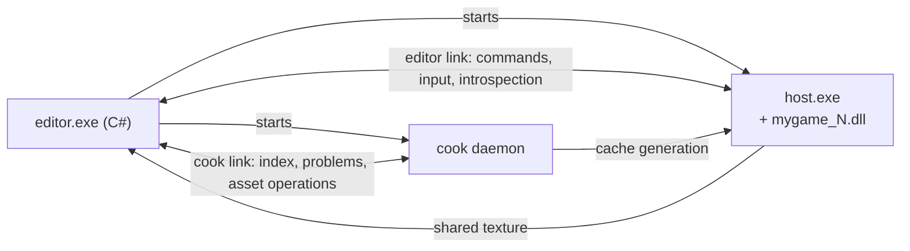
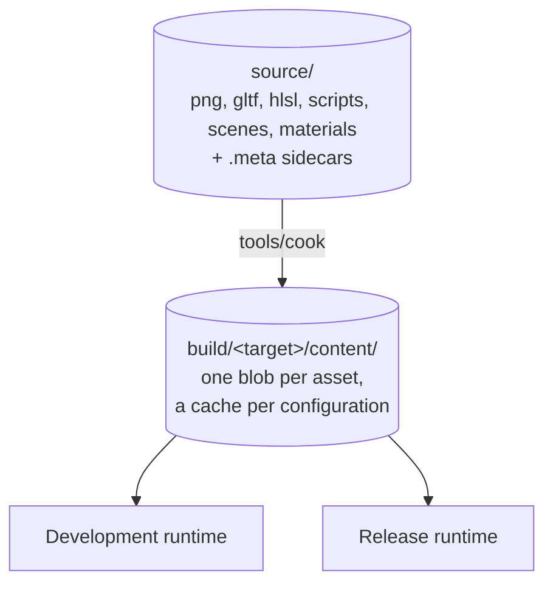

# Architecture

This document is the map of cinnabar's runtime: the phases of a frame and the role of each major part, with a pointer to the layer that owns it. Read [Overview](README.md) first for the processes and modules, and [Conventions](conventions.md) for the rules every part follows.

**In this document:** [Hot reload](#hot-reload) · [Platform layer](#platform-layer) · [Frame](#frame) · [World model](#world-model) · [Rendering](#rendering) · [Scripting](#scripting) · [Editor](#editor) · [Project settings](#project-settings) · [Content pipeline](#content-pipeline)

## Hot reload

The host keeps all persistent state. The game DLL keeps only code.

- All persistent game-side state lives in one root `Game_State`, in memory that the host owns.
- Persistent state never contains pointers into the DLL image. It uses handles and IDs instead, and `on_reload` rebuilds all registrations.
- The host reloads the DLL at the end of a frame, after the job system is drained. If the layout of `Game_State` changed, the host restarts the game with fresh state. The window, the GPU device and the loaded assets stay up.

Details: [Hot reload](hot-reload.md).

## Platform layer

All platform-specific and graphics-backend-specific code lives in `lib/core`. Windows and D3D12 are the only targets. `engine` and games hold no platform code, so the procedures in `Platform_API` are the complete porting surface.

`core` also provides the two services that everything else is built on:

- **Jobs:** a fiber-based job system. Jobs are frame-scoped. Logic that spans frames runs in [scripts](#scripting).
- **Memory:** arenas with distinct lifetimes. The host owns all of them, so they survive code reload.

Details: [Core](../core/README.md).

## Frame

One frame runs these phases in order:

1. Poll platform events and input.
2. Run the fixed ticks that are due (zero or more). Each tick runs the `Fixed` systems (parallel jobs) and applies their structural changes, runs the scripts' fixed step (serial: `fixed_update`, then the tick's events and `wait_fixed` coroutines), and propagates transforms.
3. Run the `Update` systems (parallel jobs).
4. Apply queued structural changes to the world.
5. Run the script phase (serial): behaviour lifecycle callbacks, events, opt-in `update` calls and due coroutines.
6. Apply queued structural changes to the world.
7. Run the `Late` systems, then transform propagation (parallel jobs).
8. Record render command lists. Render extraction interpolates between the last two ticks.
9. Drain the job system. This is the hot-reload point.

Phases 2 to 7 are the world's ([World](../world/ecs.md#systems) has the stages, and [Scripting](../scripting/behaviours.md#frame) the script phase's steps). Phase 8 is the renderer's ([Rendering](../rendering/frame.md#frame)). Between phases 9 and 1 of the next frame, while no job runs, the host reloads the DLL if a new build exists, and hands the editor's messages to the game ([Editor](../editor/link.md#editor-link)).

## World model

All world data lives in a native ECS in `lib/engine/ecs`. Native systems run on the job system, at a fixed tick rate or once per frame. World positions are fixed-point. Scripts see an object-style API on top of the ECS: entity handles, component access through those handles, and behaviour components that hold script objects.

Component types have stable IDs. Cooked scenes, the editor link and scripts all identify component types by these IDs.

Details: [World](../world/README.md).

## Rendering

The render frontend is in `lib/engine`. The GPU device and the backend are in `lib/core/gpu`.

- Every frame, the engine records **backend-agnostic command lists** into frame memory.
- `core/gpu` translates and submits them.
- GPU resources (buffers, textures, pipelines) are handles that `core/gpu` owns. They survive code reload.

With this boundary, rendering does not call across the DLL once per draw. The boundary is plain data, and porting means writing a new consumer of the command lists.

Resource binding is bindless, and barriers come from a render graph in `lib/engine`. The backend translates commands and does not track state.

The built-in renderer is clustered forward with a depth and normal prepass. It draws the world and a first-person view model in linear HDR, and the UI and debug drawing in their own targets, which one output pass combines after tone mapping. Materials pick a shading model, and the cooker compiles them from node graphs.

Details: [GPU](../gpu/README.md) for the interface and the render graph, [Rendering](../rendering/README.md) for the renderer built on them.

## Scripting

Gameplay logic that spans frames runs in sandboxed Luau.

- The host and the game DLL share one copy of Luau. It is `luau.dll` in development and linked statically in release.
- The VM heap lives in host-owned memory, so scripts and their suspended coroutines survive code reload. Every function pointer that Luau stores is host code, which forwards to the game's bindings by stable ID.
- The API follows Unity's: entities, behaviours with serialized fields, `get`, `spawn`, `destroy` and coroutines.
- Scripts are content. `tools/cook` compiles them to bytecode, and they hot-reload through the asset system.

Details: [Scripting](../scripting/README.md).

## Editor

The editor is a separate C# application, built with Avalonia. It is not part of the engine, and games never link it.

- The editor runs `host.exe` as a child process. The host also runs without the editor, in its own window.
- The editor controls the host through the **editor link**, a message protocol. The host serves it by calling the editor procedures in `Game_API`. Type info for game-side types exists only in the DLL, so all introspection goes through those procedures.
- The host renders the game into a shared GPU texture, which the editor displays in its viewport.
- The editor owns the scene being edited, and the host's world mirrors it. A host crash or a soft restart therefore loses no edits: the editor sends the scene again.

Details: [Editor](../editor/README.md).

## Project settings

A project's settings are a text file beside the game, such as `samples/mygame/project.settings`: `key = value` lines, with blank lines and `#` comments, as `.meta` files have. They are settings of the game as a whole, not of a scene.

- **The user's file** beside it, `project.user.settings`, replaces the project's values on one machine, for a display or a GPU that the project's choice does not suit. Version control ignores `*.user.settings`.
- **Reading:** `lib/engine/project` reads both files, the project's first. The game reads them when it starts, and looks for a change twice a second (`project.refresh`), so an edit in the editor shows in a running game at once. An unknown key or a value that does not fit is a warning, and the setting keeps its default. The game finds the file at `Platform_API.project_path`: beside the executable, or where the host's `--project` points, as it finds its content at `content_dir` (see [Building and running](building-and-running.md#build-layout)).
- **The editor** edits both: the Home tab's Game Window group sets the project's output and quality preset, and this machine's, and Run Game opens the game in its own window, which shows what the viewport cannot (see [Editor](../editor/viewport.md#quality)). `mesh.default_material` and `mesh.texel_density` are the editor's: the material of new faces in mesh mode and the texture tools' texels per meter (see [Mesh editing](../editor/mesh-editing.md#dev-materials)), which the game's parser knows only so they are not warnings.

| Key | Values | Default | What it sets |
|---|---|---|---|
| `output` | `Auto`, `Sdr`, `Hdr10`, `Scrgb` | `Auto` | The window's output mode (see [Rendering](../rendering/layers-and-output.md#hdr-output)): `Auto` is HDR10 on a display in HDR, and SDR otherwise. `CINNABAR_OUTPUT` replaces it. The sample's F8 cycles it until the files change. |
| `quality.*` | See [Rendering: Saved quality](../rendering/quality.md#saved-quality) | The device's `default_quality` | The render quality: a preset, and keys that replace its features. The game saves the player's choice to the user's file (`project.save_quality`, or `Render.save_quality` from a script), keeping the file's other lines. |
| `physics.layers`, `physics.ignore` | Layer names, and `A:B` pairs, each separated by commas | One layer, `Default`, and every pair colliding | The physics layers that a `Collider`'s `layer` indexes, and the pairs that do not collide (see [Physics: Layers](../physics/design.md#layers)). |
| `physics.backend` | `jolt`, `none`, or another backend's name | `jolt` | The physics backend, which the host loads before the game starts; `--physics` on its command line replaces it (see [Physics: Backends](../physics/backends.md#choosing)). |

## Content pipeline

- Every source asset has a GUID. Content refers to other content only by GUID.
- `tools/cook` compiles source assets into a cache of blobs. `tools/cook` and the runtime share the asset type definitions from `lib/engine`.
- The runtime reads blobs from the loose cache of its configuration: `build/dev/content` in development, and the `content` folder beside the executable in release. The blob format is the same in both.
- In development, the cook daemon watches the source files and cooks what changes. After each pass, it writes a counter to the cache, and the running game swaps every new blob in place in one frame.
- The cook daemon is the only program that writes `.meta` files. The editor's content browser asks it to create, move, rename and delete assets.

Details: [Content pipeline](../content/README.md).
