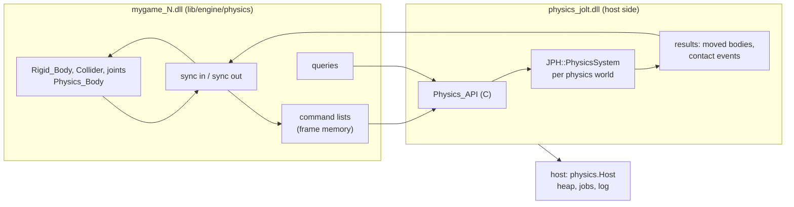

# Physics design

Physics in cinnabar: rigid bodies, constraints, collision queries and sensors, simulated by [Jolt Physics](https://github.com/jrouwe/JoltPhysics) behind a boundary that another implementation can replace. This document is the design: where Jolt lives, the boundary between the engine and a physics backend, the components and the systems that keep the world and the simulation in step, queries, events, the editor's part, and the phases that build it. Read [Hot reload](../overview/hot-reload.md#rules), [World: ECS](../world/ecs.md), [Positions and transforms](../world/positions-and-transforms.md) and [Time](../world/time.md) first; the boundary follows the one in [GPU: Command buffers](../gpu/command-buffers.md#command-buffers).

**In this document:** [Design](#design) · [Where Jolt lives](#where-jolt-lives) · [The boundary](#the-boundary) · [Positions and precision](#positions-and-precision) · [Components](#components) · [Scripts in fixed ticks](#scripts-in-fixed-ticks) · [The physics tick](#the-physics-tick) · [Layers](#layers) · [Shapes](#shapes) · [Constraints](#constraints) · [Queries](#queries) · [Events](#events) · [Scripts](#scripts) · [The editor](#the-editor) · [Determinism](#determinism) · [2D physics](#2d-physics) · [Plugins](#plugins) · [Tests](#tests) · [Phases](#phases) · [Future work](#future-work)

## Design

Six decisions shape everything below.

1. **Jolt is host code, in a library of its own.** Jolt has static state (its factory, its registered types, its allocator hooks) and its bodies hold vtable pointers into Jolt's image. If the game DLL linked it, a code reload would bring a second copy and leave the simulation's objects pointing into the old one. So Jolt is built as `physics_jolt.dll` in development, which the host loads, and linked statically in release, as Luau is ([Scripting: Embedding](../scripting/embedding.md#embedding)). The simulation survives a code reload because nothing in it points into the game DLL. That same library is the unit a [plugin](#plugins) swaps later, so the reload rule and the plugin goal give one answer.
2. **The boundary is plain data and C.** The engine records **physics command lists** (create a body, set a velocity, add a joint) into frame memory, and the backend executes them in order. Results come back as plain arrays: the poses of the bodies that moved, and the tick's contact events. Queries are direct calls that fill caller-owned arrays. Every procedure has the C calling convention and takes pointers and counts, never Odin slices or strings, so the backend can be C++ with no Odin glue, and a third party can write one. No game procedure is ever stored in the backend: filters are tables, and listeners are buffers that the backend fills.
3. **The world is the truth; the backend is a cache of it.** Authoring components (`Rigid_Body`, `Collider`, the joints) say what should exist. A runtime component, `Physics_Body`, holds the backend's handle and what was last sent. Each tick, a sync compares the two and records commands. A host restart or a soft restart loses the backend's state and nothing else, because the world rebuilds it. Gameplay acts on bodies through commands, never by writing mirrored fields.
4. **Positions cross the boundary as `f64` relative to the physics world's anchor.** Jolt is built with `JPH_DOUBLE_PRECISION`. Each physics world has a `World_Position` anchor, and the engine converts with two new position operations. This replaces the earlier plan of an `f32` anchor per island, which Jolt cannot do ([Positions and precision](#positions-and-precision)).
5. **Scripts get a fixed step, and physics steps after it, as Unity's does after `FixedUpdate`.** A fixed tick runs the `Fixed` systems, then the behaviours' `fixed_update`, then the physics tick (sync in, step, sync out), then the tick's contact events into scripts. A script's force applies in the same tick, and its `on_collision_enter` runs before the next tick, as in Unity. The game's frame code drives this order one tick at a time ([Scripts in fixed ticks](#scripts-in-fixed-ticks), [The physics tick](#the-physics-tick)).
6. **3D and 2D are two boundaries, not one with a dimension.** A 2D backend (Box2D v3 is the expected one) gets its own `Physics2D_API` and its own components, as Godot's two physics servers and Unity's two physics modules do. What they share is engine-side machinery: handle pools, command recording, layers, event delivery and the plugin loader ([2D physics](#2d-physics)).



## Where Jolt lives

| Package | Side | What it holds |
|---|---|---|
| `lib/core/physics` | Shared | The boundary: handle types, descriptions, the command format and its hash, `Physics_API`, `Host`, `Features`. Plain data and procedure types only. `physics.h` is the same layouts in C, and both sides assert their sizes. |
| `lib/core/physics/host` | Host | The `Host` table that a backend calls: the heap, the job system and the log, as C procedures. |
| `lib/core/physics/conformance` | Shared | The suite that every simulating backend passes, driven through `Physics_API` with no world ([Tests](#tests)). |
| `lib/core/physics/jolt` | Host | `CMakeLists.txt` that builds Jolt from `vendor/jolt` (a submodule at a release tag) and `jolt_backend.cpp`, which implements `Physics_API` and exports `cinnabar_physics_api`. |
| `lib/core/physics/null` | Host | A backend that keeps bodies where they are put, steps nothing and hits nothing. For headless tests of the sync layer, and the backend of a game with physics turned off. |
| `lib/engine/physics` | Game | Components, the handle pools, the sync, the physics tick, layers, events, queries for native code, script bindings, and collider drawing for the editor. |

- **Build:** `just jolt` builds `lib/core/physics/jolt/CMakeLists.txt` twice, as `just luau` does: `physics_jolt.dll` for development and a static library for release and tests, both with the static CRT. The `physics_backend` collection picks the backend package, as `gpu_backend` picks the GPU's, and `-define:PHYSICS_SHARED=true` links the DLL in the host and the game DLL; the game never calls it directly, only through `Platform_API.physics`. Jolt's options: `DOUBLE_PRECISION=ON`, `CROSS_PLATFORM_DETERMINISTIC` as a project choice ([Determinism](#determinism)), `OBJECT_LAYER_BITS=32`, the debug renderer only in development. A running host keeps the DLL locked, and a changed backend needs a host restart, as `luau.dll` does.
- **Memory:** the backend sets Jolt's `Allocate`, `Free`, `Reallocate`, `AlignedAllocate` and `AlignedFree` to the host heap that `physics.Host` gives it, and each world's `TempAllocatorImpl` takes one block from it at creation (8 MiB by default, in `World_Desc`).
- **Jobs:** the backend implements `JPH::JobSystemWithBarrier` over the host's fiber job system. `QueueJob` and `QueueJobs` start cinnabar jobs through `Host.jobs_run`, whose data is the Jolt job, and the host runs each by calling the backend's `run_job`. `GetMaxConcurrency` is the worker count. After `PhysicsSystem::Update`, the step waits for the backend's counter too, so no fiber job that holds a Jolt job outlives the step, even one whose job the barrier's waiter already ran. A Jolt job runs to completion and never waits, so a fiber that runs one never moves threads mid-job, which is what [the job rule](../core/jobs-and-memory.md#job-system) needs. Only the caller of `PhysicsSystem::Update` waits, inside the barrier, and that caller is the physics tick's job. *Later:* the stock barrier sleeps on a semaphore while it has no job of its own to run, which holds a worker thread; a barrier that waits on a `jobs.Counter` instead frees the thread ([Future work](#future-work)).
- **Lifetime:** the game creates a physics world in `init` and destroys it in `shutdown`. The backend tracks every world it made, and at a soft restart the host destroys the ones the old game left, as it closes script VMs and destroys the `Game` GPU scope ([What survives](../overview/hot-reload.md#what-survives)). A code reload keeps them, with every body.

| | Code reload | Soft restart | Host restart |
|---|---|---|---|
| Physics worlds, bodies, joints, shapes, contacts | Kept | Destroyed by the host; the new game's sync makes them again from the world | Lost; made again from the scene |
| The engine's handle pools, `Physics_Body` components | Kept (in `Game_State` and the world) | Fresh | Fresh |

## The boundary

`lib/core/physics` defines two tables of procedures and the data they pass.

**Handles.** `World`, `Body`, `Shape` and `Joint` are each a 32-bit index and a 32-bit generation. The engine allocates `Body`, `Shape` and `Joint` handles itself, from pools in `Game_State`, before the backend knows them, as `ecs.reserve` hands out an entity before `apply` makes it. A command can therefore name a body that an earlier command in the same list creates, and the sync never waits for a reply. The backend keeps a dense table from handle index to its own ID (`JPH::BodyID`, a `Constraint` reference, a `Shape` reference).

**Commands.** A command list is a sequence of packets in frame memory, each a small header and a fixed struct, as GPU packets are. `physics.format_hash()` hashes their layouts, and the game's `abi_hash` includes it, so a game and a backend that disagree never meet.

| Packet | What it does |
|---|---|
| `Create_Shape`, `Release_Shape` | A shape from a description ([Shapes](#shapes)); shapes are reference-counted by the backend and shared among bodies |
| `Create_Body`, `Destroy_Body` | A body: its shape, motion type, layer, pose, mass properties, material, damping, gravity factor, motion quality (discrete or CCD), allowed degrees of freedom, whether it is a sensor, whether it starts asleep, and its `user` value, which is the entity |
| `Set_Pose` | Teleport: position and rotation, with or without waking |
| `Move_Kinematic` | A kinematic body's target pose for this step; Jolt gives it the velocity that reaches it |
| `Set_Velocity`, `Add_Force`, `Add_Torque`, `Add_Impulse`, `Add_Angular_Impulse`, `Add_Force_At` | Gameplay's effects on a dynamic body |
| `Activate`, `Deactivate` | Sleep control |
| `Set_Enabled` | Takes a body out of the simulation, or puts it back, for an entity that becomes inactive or active |
| `Create_Joint`, `Destroy_Joint`, `Set_Joint` | A constraint between two bodies, or a body and the world, and its limits, motor and enabled state ([Constraints](#constraints)) |
| `Set_World` | Gravity and the layer tables ([Layers](#layers)) |

**`Physics_API`** is what a backend provides:

| Procedure | What it does |
|---|---|
| `info() -> Backend_Info` | The backend's name, version, `PHYSICS_API_VERSION` and `Features`: a bit set of `Rigid_Bodies`, `Joints`, `Queries`, `Sensors`, `Characters`, `Vehicles`, `Soft_Bodies`, `Cloth`, `Hair`, `Buoyancy`, `Deterministic`, `Double_Precision`, `Save_State` |
| `world_create(desc) -> World`, `world_destroy(world)` | A physics world: its anchor's meaning is the engine's, the backend sees only `f64` positions; capacity limits; the temp allocator's size |
| `submit(world, commands, size)` | Executes a command list. Not during `step`. |
| `step(world, dt, substeps)` | One fixed tick. It returns when the step is done. |
| `results(world) -> Step_Results` | Pointers and counts into the backend's memory, valid until the next `submit` or `step`: the bodies that moved (handle, `user`, position, rotation, linear and angular velocity), the bodies that fell asleep, the contact events ([Events](#events)), and the joints that broke |
| `body_state(world, bodies, count, out)` | The state of chosen bodies, for code that needs one that did not move |
| `raycast`, `shape_cast`, `overlap`, `point_query`, each with a closest, any or all form | [Queries](#queries) |
| `debug_lines(world, filter, out)` | The backend's own view of its shapes as lines, for the editor, where the backend can draw it |

**`Host`** is what the host gives a backend when it loads it: the heap's allocate, reallocate and free, `jobs_run`, `jobs_wait`, the worker count and the log, all as C procedures in the host's image. The backend calls nothing else of the engine's. *Later:* the profiler's zones, so the step's jobs show in the editor's profiler.

**How the game reaches it.** `Platform_API` gains `physics: physics.Physics_API`, by value, so its layout is in the ABI hash. The host fills it from the backend it loaded, or from the null backend. In release, `main_release` fills it with direct references to the static library's procedures, as it does every other field.

**Threads.** `submit` and `step` run from one job at a time, inside the physics tick. Queries are safe from any number of jobs at once, and from the script phase, at any time outside the physics tick: during `Fixed`, `Update` and `Late` systems, and in scripts. The backend uses Jolt's locking body interface for queries, so this holds even when a later change runs queries beside the step.

## Positions and precision

- Each physics world has an anchor, a `World_Position` that the game chooses at creation and keeps in `Game_State` beside the world handle. Every position that crosses the boundary is an `[3]f64` offset from it, in meters. Rotations are `f32` quaternions, and velocities, forces and directions are `[3]f32`.
- `ecs` gains `position_sub_f64(a, b) -> [3]f64` and `position_offset_f64(p, delta: [3]f64) -> World_Position`. They are the `f64` forms of the two operations, with the same rounding rules: the difference is converted once, and the offset rounds to the nearest unit. Physics is their only intended user; meters as `f64` stay for authoring and display.
- **Why `f64` and not an `f32` anchor per island**, which [Where positions go](../world/positions-and-transforms.md#where-positions-go) reserved: islands in Jolt form and split inside a step, on its threads, with no hook to give each its own origin, and Jolt has no origin shift. Its double-precision mode already does what the anchors were for: positions are `f64`, and the narrow phase and the solver work in `f32` relative to a base offset near each contact. Jolt measures it at 5 to 10% slower than single precision.
- **Range.** Within 2^29 m (about 500 000 km) of the anchor, an `f64` offset is exact to the fixed-point unit. Beyond it, it rounds to the `f64`'s step, 2^-14 m (60 µm) at 2^38 m, which physics does not notice. The broad phase is `f32`, though, and at 10 000 km its resolution is a meter: bodies that close count as overlapping, which costs narrow-phase work but not quality. A game whose action spans more than a few thousand kilometers uses several physics worlds, each with an anchor near its action, such as one per ship ([Future work](#future-work)).

## Components

New engine component IDs take the range 64 to 79 for 3D physics; 80 to 95 is kept for 2D.

| Component | ID | Kind | Fields |
|---|---|---|---|
| `Rigid_Body` | 64 | Authoring | `motion` (`Static`, `Kinematic`, `Dynamic`), `mass` (0: from the shape's density), `linear_damping`, `angular_damping`, `gravity_factor`, `ccd`, `lock_position` and `lock_rotation` (per axis), `start_asleep`, `report_contacts` (on by default) |
| `Collider` | 65 | Authoring | `shape` (`Box`, `Sphere`, `Capsule`, `Cylinder`, `Convex_Mesh`, `Mesh`, `Height_Field`), its size fields, `offset` and `rotation` relative to the entity, `mesh` (an asset reference, for the mesh kinds), `friction`, `restitution`, `density`, `sensor`, `layer` |
| `Physics_Body` | 66 | Runtime | The `Body` handle, its `Shape` handles, the pose last sent or received, a hash of the authoring fields it was made from, and the last linear and angular velocity |
| `Fixed_Joint`, `Point_Joint`, `Hinge_Joint`, `Slider_Joint`, `Distance_Joint`, `Cone_Joint`, `Six_DOF_Joint` | 67 to 73 | Authoring | [Constraints](#constraints) |
| `Physics_Joint` | 74 | Runtime | The `Joint` handle, the bodies it joined, a hash of the authoring fields it was made from, whether it broke |

- **A `Collider` without a `Rigid_Body` is a static body**, as in Unity. A `Rigid_Body` without a `Collider` on itself or a child is an error that the sync logs once, and it has no body.
- **Compound bodies.** A `Collider` on a descendant of an entity with a `Rigid_Body`, with no `Rigid_Body` between them, is a part of that body's compound shape (`Create_Compound`), at its pose relative to the body. The pose is composed from the `Local_Transform`s between them, so it does not change while the body moves, and a part's change, addition or removal makes the body again. A body with one collider on itself uses that shape directly. Friction, restitution, the layer and the sensor flag are the body's, from its own `Collider` or else its first part's. The world keeps no child lists, so the sync finds the parts by walking up from each `Collider` without a `Rigid_Body` that has a `Parent`, once per tick.
- **Runtime components are not saved and not edited.** `Physics_Body` and `Physics_Joint` hold what the sync made; their fields are read-only or hidden in the properties panel, and the editor's play mode shows them. A body record in the engine's pool keeps each body's entity, which is how the sync finds a body whose entity or components are gone ([The physics tick](#the-physics-tick)).
- **Scale.** The entity's `Transform` scale scales its collider's dimensions: a box's size on each axis, a sphere's radius by the largest axis, and a capsule's or a cylinder's radius by the larger of x and z and its height by y. A primitive therefore needs no scaled wrapper; a mesh collider will use Jolt's `ScaledShape`. A change of scale makes the body again.

## Scripts in fixed ticks

Behaviours gain `fixed_update(dt)`, Unity's `FixedUpdate`, which replaces the rule that scripts never run in fixed ticks ([Behaviours](../scripting/behaviours.md#lifecycle)). It does not depend on physics, and is built first ([Phases](#phases)).

- **Why.** Two things need it. A script that moves a body, or anything that is interpolated, must do it once per tick, or the motion stutters against the tick's interpolation; from `update` it moves at the frame rate instead. And a script that reacts to a contact must be able to answer before the next step, as Unity's `OnCollisionEnter` can; from the script phase it answers after every tick of the frame has run.
- **The game drives the ticks.** `ecs.run_fixed` becomes a loop in the frame code, so the order of systems, scripts and physics is in one place and no procedure is registered for it:

  ```odin
  ticks := ecs.begin_ticks(&s.world, dt)            // phase 2: each tick that is due, at most 4
  for ecs.next_tick(&ticks) {
      ecs.run_tick_systems(&ticks, s)               // Previous_Transform, the Fixed systems, apply
      script.fixed_update(&s.scripts, &ticks, input)
      ecs.update_transforms(&s.world)
      physics.tick(&s.physics, &s.world)            // sync in, step, sync out
      script.fixed_events(&s.scripts, &s.physics)   // the tick's contact events, wait_fixed coroutines
      ecs.update_transforms(&s.world)
  }
  ```

  A game without scripts or physics leaves out their lines, and `ecs.run_fixed` stays as the short form for one that has neither.
- **`script.fixed_update`** is serial, like the script phase, and does in order: set `Time` for the tick; drain the world's log and run `awake`, `on_enable` and `start` for instances that are due, so an instance's `start` precedes its first `fixed_update`, as in Unity; call `fixed_update` on the enabled, active instances of the classes that define it, in slot order; deliver the events that it sent; and apply its structural changes and drain the log again.
- **`script.fixed_events`** delivers the tick's physics events ([Events](#events)), then the events that the handlers sent, in rounds as the script phase does, then resumes the coroutines waiting in `wait_fixed()`, Unity's `WaitForFixedUpdate`, and applies their structural changes.
- **Opt-in,** as `update` is: only classes that define `fixed_update` are called, and with up to 4 ticks a frame the profiler shows its cost per class. A class with nothing per tick does not define it.
- **Time and input.** In the fixed step, `Time.delta` is the tick's duration, as Unity's `Time.deltaTime` is in `FixedUpdate`, `Time.time` is the tick's world time, and `Time.in_fixed` is true. Input follows [the tick rule](../world/time.md#fixed-and-variable-rate): an edge reaches the first tick after it, and waits for the next tick when no tick ran in its frame. `Input.was_pressed` in `fixed_update` therefore never misses a press, which Unity's `GetKeyDown` in `FixedUpdate` can.
- **Writes are immediate,** as in the script phase, since the step is serial; despawns wait for the end of the step. `World.spawn` runs `awake` before it returns, and the spawned body is created by the same tick's sync.
- **What stays per frame:** `update`, coroutines other than `wait_fixed`, events that `Update` systems queue, and the collector's step. Edit mode runs no ticks, so no `fixed_update`; a paused step runs one tick, and with it one `fixed_update`.
- **Native `Fixed` systems run before the scripts in each tick,** as `Update` systems run before the script phase. A script sees the tick's system results, and a system sees the scripts' writes in the next tick.

## The physics tick

The physics tick is the `physics.tick` line of the loop above. A fixed tick is therefore:

1. Copy `Transform` to `Previous_Transform` (unchanged).
2. Run the `Fixed` systems, and apply their buffers.
3. Run the scripts' `fixed_update`, and apply their changes.
4. Propagate transforms, so the sync sees this tick's poses of kinematic and static children.
5. **The physics tick** (`physics.tick`), one job:
   1. **Destroyed bodies and joints:** check each live body in the engine's pool: one whose entity is gone, whose `Physics_Body` names another body, or whose `Rigid_Body` and `Collider` were removed is destroyed, and one whose entity became inactive leaves the simulation with `Set_Enabled`. The world's removal log has one reader, the script runtime, so the pool is checked instead; it costs a lookup per body per tick.
   2. **Sync in,** as parallel jobs over the chunks, each recording into its own command list:
      - an entity with `Rigid_Body` or `Collider` and no `Physics_Body` gets a body, and a `command_add` for its `Physics_Body`;
      - an entity whose authoring fields' hash changed gets its body made again, keeping its velocity; an edit in the editor or a change of scale is rare enough that this is simpler than changing a body in place;
      - a `Static` or `Kinematic` body whose `Transform` differs from the pose last sent gets `Set_Pose` or `Move_Kinematic`;
      - a `Dynamic` body whose `Transform` differs from the pose that physics last wrote was moved by someone else, a script or the editor, and gets `Set_Pose`: a write of `Transform` teleports a body, as in Unity.
   3. **Gameplay's commands:** the physics command buffers that were recorded since the last tick ([Scripts](#scripts)): the script phase's of the last frame, the `Fixed` systems' in system order and then job order, and this tick's `fixed_update`'s.
   4. `submit` the lists in that order, then the joints' sync, which needs the bodies, then `step`.
   5. **Sync out,** as parallel jobs over `results`: write each moved body's `Transform` (and `Local_Transform` for a body under a parent), its velocities into `Physics_Body`, and the last pose. Copy the contact events and the broken joints into the tick's event buffer ([Events](#events)).
6. Apply the physics tick's buffers, so new `Physics_Body` components exist for the next tick.
7. Deliver the tick's events to scripts and resume `wait_fixed` coroutines (`script.fixed_events`).
8. Propagate transforms (unchanged), so the children of moved bodies, and what the event handlers moved, follow.

Step 4 is a second propagation each tick. It costs what one propagation costs; *later*, it can be limited to the subtrees of kinematic and static bodies that have a parent.

- A sleeping body is not in `results`, so the sync's cost follows what moves. The comparisons of step 4.2 visit every body each tick; with ten thousand bodies that is a few hundred kilobytes of reads. The world's [change tracking](../world/README.md#future-work) would make it visit only what changed.
- `Previous_Transform` interpolation needs nothing new: physics writes `Transform` in the tick, and presentation blends the last two ([Time](../world/time.md#fixed-and-variable-rate)).
- **Scene loads.** The scene loader replaces the world, and the check of the pool destroys the bodies whose entities are gone. A body's entity is matched by its `Physics_Body`'s handle, so a new entity in an old one's slot does not keep the old body.
- **Activity.** Queries exclude `Inactive` entities, so the sync's queries skip them. An entity that becomes inactive has its body removed from the simulation (`Deactivate` and out of the broad phase, keeping the body), and gets it back when it becomes active.

## Layers

- **Object layers** are named in the project's settings, up to 32: `physics.layers = Default, Static, Player, Enemy, Debris, Trigger`. A `Collider`'s `layer` is the index, shown by name in the editor.
- **The collision matrix** is in the same file, as the pairs that do not collide: `physics.ignore = Debris:Player, Debris:Debris`. Every other pair collides. The engine turns it into one 32-bit mask per layer and sends it with `Set_World`, so the backend's `ObjectLayerPairFilter` is a table lookup, with no call into the game. A change of the file reaches a running game, as other project settings do.
- **Broad-phase layers** are the backend's business: the Jolt backend uses two, moving and non-moving, chosen from the motion type.
- **Groups.** A joint with `collide_connected` off puts its two bodies in a pair that does not collide, through Jolt's `GroupFilterTable`. Ragdolls need nothing more.

## Shapes

- **Primitives** (box, sphere, capsule, cylinder) are described in the command, and the engine shares one `Shape` among every collider with the same description and scale, through a table keyed by the description's hash.
- **Meshes and convex hulls** come from a mesh asset. In the first phase that has them, the engine reads the `Mesh` blob's level-0 triangles and sends them in `Create_Shape`; the backend builds its own structure, which for a large level mesh takes milliseconds at load. The cooker then writes a **collision sub-asset** beside the mesh blob: welded triangles with a material index each, and the convex hull's points, both backend-neutral, as [Mesh editing](../editor/mesh-editing.md#future-work) asks. `.mesh` level geometry and glTF meshes both get it, chosen by a `.meta` option (`collision = mesh`, `convex`, or `none`).
- **Height fields** come from a surface's height map ([Rendering: Surfaces](../rendering/surfaces.md)), in the phase that adds terrain collision.
- A shape that the asset runtime reloads is created again, and the bodies that use it are made again.

## Constraints

- **A joint goes on any entity, and joins the body that entity belongs to.** `body_a` is the entity's own body, or its nearest ancestor's, as a child `Collider` belongs to the nearest ancestor `Rigid_Body` ([Components](#components)). `body_b` is an entity field, or none for the world. A joint with no body above it is an error that the sync logs once.
- **The common case is Unity's:** the `Hinge_Joint` goes on the door itself, with its `offset` at the hinge's edge. That is one entity, nothing more to propagate, and a prefab that reads as the object it is.
- **A child entity is the escape hatch.** The ECS allows one component of each type on an entity, so a body with two joints of one kind, such as a plank hinged at both ends, holds the second on a child entity without a body. A child joint also gets the editor's gizmo for placing its frame.
- **The frame** is the entity's pose with the joint's `offset` and `rotation` applied: the hinge's axis is the frame's +x, the slider's axis its +z, and so on. The frame on `body_b` comes from the two bodies' poses when the joint is created, which is Unity's automatic connected anchor and what Jolt does with constraint settings in world space. A `connected_offset` and `connected_rotation`, set with `use_connected_frame`, give that frame explicitly, relative to `body_b`, for a joint whose bodies are not posed together at creation.
- **Kinds**, one component each so the properties panel shows only what applies: `Fixed_Joint`, `Point_Joint` (ball and socket), `Hinge_Joint`, `Slider_Joint`, `Distance_Joint`, `Cone_Joint` and `Six_DOF_Joint`. Each embeds a common `Joint` struct (`body_b`, `offset`, `rotation`, `use_connected_frame`, `connected_offset`, `connected_rotation`, `collide_connected`, `break_force`, `break_torque`, `enabled`) and adds its limits, its spring (frequency and damping) and, where it has one, its motor (off, velocity or position, a target and a maximum force or torque).
- **Creation waits for both bodies.** The joints' sync runs after the bodies' commands, and a joint whose body does not exist yet waits for a later tick.
- **A change makes the joint again.** `Physics_Joint` keeps a hash of the joint's authoring fields and the bodies it joined, as `Physics_Body` does. A change of the frame, a body, a limit or the kind, or a new nearest body after a reparent, destroys the joint and creates it from the current poses. A motor's target, its maximum and `enabled` change in place with `Set_Joint`, so a script can drive a motor every tick without remaking the joint. Moving a child joint entity relative to its body changes the frame too, and is treated the same way.
- **Breaking.** Jolt has no breakable joints. The backend compares each breakable joint's applied impulse, divided by the step, with its limits after the step, disables a joint that exceeds them, and reports it in `results`. The engine sets `Physics_Joint.broken`, and a script on the joint's entity gets `on_joint_break(force)`.
- Ragdolls, vehicles' wheels and character bodies build on these and are later phases ([Future work](#future-work)).

## Queries

| Query | Native (`lib/engine/physics`) | What it returns |
|---|---|---|
| Ray | `physics.raycast(origin, direction, max_distance, filter)` and the `_any` and `_all` forms | The entity, the body, the position as a `World_Position`, the normal, the distance and the sub-shape |
| Shape cast | `physics.shape_cast(shape, origin, rotation, direction, distance, filter)` | As a ray, with the first contact |
| Overlap | `physics.overlap(shape, origin, rotation, filter, out)` | The entities whose bodies overlap the shape |
| Point | `physics.point(position, filter, out)` | The entities whose shapes contain the point |

- A `Query_Filter` is data: a layer mask, whether to include sensors, and up to 8 bodies to ignore (the caller's own). It has no callback.
- Results are written to the caller's array, in a defined order: by distance, then by body handle. The `all` and overlap forms return how many hits there were, so a caller can ask again with more room.
- **Batches.** `physics.raycast_batch` takes many rays and fills one array, run by the backend on jobs. A sight-line system with hundreds of agents uses it.

## Events

- **The backend reports body pairs, not sub-shapes.** Jolt's listener runs on its threads during the step, once per sub-shape pair. The backend counts the touching sub-shape pairs of each body pair, and emits `Begin` when the count leaves zero and `End` when it returns to zero, with the first contact's point, normal, relative velocity and an estimate of the impulse for a `Begin`. A body that is destroyed, or leaves the simulation because its entity became inactive, ends its pairs in the same step. Events cover bodies with `report_contacts`, and every sensor.
- **Which pairs report.** As Unity's defaults: a pair reports when at least one body is dynamic, or when one is a sensor and the other is dynamic or kinematic. Kinematic against static or kinematic does not report. A sensor with `detect_static` sees static bodies too, through Jolt's `mCollideKinematicVsNonDynamic`.
- **Order.** The listener's order depends on threads; the backend sorts each step's events by body handles before `results`, so their order is the same on every run.
- **Native code** reads the tick's events from `Physics_Events` in `Game_State`: the events of the most recent tick, which a `Fixed` system of the next tick sees, and the events of every tick in the frame, which `Update` and `Late` systems see.
- **Scripts** get the tick's events in the same tick, from `script.fixed_events`, which is serial frame code where `script.send` is safe ([Scripts in fixed ticks](#scripts-in-fixed-ticks)). No job sends events, so the per-job event buffers that [Events](../scripting/behaviours.md#events) reserved are not needed. Each event goes to the entity of each body:

  | Event | Unity | Arguments |
  |---|---|---|
  | `on_collision_enter` | `OnCollisionEnter` | The other entity, the point (`WorldPosition`), the normal, the relative velocity, the impulse |
  | `on_collision_exit` | `OnCollisionExit` | The other entity |
  | `on_trigger_enter` | `OnTriggerEnter` | The other entity; sent when either body is a sensor |
  | `on_trigger_exit` | `OnTriggerExit` | The other entity |
  | `on_joint_break` | `OnJointBreak` | The force, to the joint's entity |

- **Differences from Unity,** each deliberate: one event per body pair where Unity sends one per collider pair; only the body's entity receives it, not a child collider's; and an exit is sent when the other body is destroyed or deactivated, which Unity omits.
- There is no `stay` event. A script that needs it keeps a set from enter and exit; *later*, `Physics.contacts(entity)` can return the current pairs.
- A compound body's events go to the body's entity, and name the other entity, not the child collider; the sub-shape is in the native event for code that needs it.

## Scripts

- **`Physics`** is a new engine library ([API](../scripting/api.md#engine-libraries)): `Physics.raycast(origin, direction, max_distance?, layers?)` returns a `RaycastHit` table or `nil`, and `raycast_all`, `sphere_cast`, `box_cast`, `capsule_cast`, `overlap_sphere`, `overlap_box` and `overlap_capsule` follow it. Positions are `WorldPosition`s, as everywhere in the API. `Physics.layers("Player", "Enemy")` returns a mask, and `Physics.gravity` reads and sets the world's gravity.
- **Bodies** act through methods on the entity's `RigidBody` component reference: `add_force(v)`, `add_force_at(v, position)`, `add_impulse(v)`, `add_torque(v)`, `velocity` and `angular_velocity` (read from `Physics_Body`, and a write records `Set_Velocity`), `sleep()`, `wake()` and `is_sleeping`. Every effect records into the scripts' physics command buffer. From `fixed_update` or a contact handler it applies in the current or next step, once; from `update` it applies in the next tick, once, however many ticks the frame runs, so a continuous force belongs in `fixed_update`, as in Unity.
- Moving a body is writing its `Transform`, or `entity:teleport(...)`; the sync turns it into `Set_Pose` ([The physics tick](#the-physics-tick)).
- The Unity mapping gains `Rigidbody`, `Collider`, the joints, `Physics.Raycast` and its relatives, and the collision and trigger messages, and its `FixedUpdate` row becomes `fixed_update`.

## The editor

- **Components in the properties panel** come from the field walker, as every component's do; the shape's size fields show only for the shape chosen, and `layer` shows the project's layer names.
- **Colliders are drawn by the engine**, from the components, in the debug layer: the selected entity's colliders always, and every collider with the viewport's Colliders toggle. This needs no backend, so it works with the null backend and in edit mode. A joint draws its frame and its limits, and a selected joint on a body entity shows a handle at its `offset` that drags the frame, as Unity's anchor handle does; a child joint uses the ordinary gizmo.
- **Edit mode syncs and does not step.** The game's frame runs `physics.sync` without `step` while the world does not run ([Modes](../editor/document-and-scenes.md#modes)), so the backend mirrors the scene as it is edited, and the editor's tools can query it: drop to ground and surface snapping. Play then starts from a synced physics world.
- **Play and Stop** need nothing new: Stop replaces the world with the editor's scene, whose removals destroy the play world's bodies ([The physics tick](#the-physics-tick)).
- **The backend's debug view** (`debug_lines`) shows the backend's own shapes, contacts and sleeping state in play mode, behind a viewport toggle, for when the components and the simulation disagree.

## Determinism

- The simulation is deterministic on one build when its inputs are: the same commands in the same order. Command lists are submitted in system and job order, the sync's jobs record in chunk order, and the events are sorted, so a replay of the same inputs gives the same poses.
- Body handles come from the engine's pool in the order of the sync, which is deterministic; nothing is ordered by `Entity` value ([Command buffers](../world/ecs.md#command-buffers)).
- **Across machines** needs Jolt's `CROSS_PLATFORM_DETERMINISTIC`, about 8% slower, and the same Jolt build everywhere. It is a project choice for networked games with lockstep or rollback, made in the build, and reported in `Features`.
- Queries are deterministic in their results and, with the sort, in their order. Jolt's broad phase queries alone are not, and the backend never returns them unfiltered.

## 2D physics

The reading here is a 2D simulation inside cinnabar, for 2D games and 2D parts of 3D ones, with its own backend.

- **Its own boundary.** `lib/core/physics2d` defines `Physics2D_API`, with the same shape as the 3D one: handles the engine allocates, command lists, results, queries with data filters, and `Features`. Box2D v3 is C, has a task interface that maps onto cinnabar's jobs as Jolt's does, and is deterministic, so a `physics_box2d` backend is the expected first one.
- **Its own components**, in the range 80 to 95: `Rigid_Body_2D`, `Collider_2D` (circle, box, capsule, polygon, segment chain) and the 2D joints, on the same entities and `Transform`s, using x and y. The script events are `on_collision_enter_2d` and the rest, as Unity names them.
- **Shared engine-side code** moves into `lib/engine/physics/common` when the second backend arrives, not before: the handle pools, command recording, the layer settings (with their own `physics2d.layers`), event sorting and delivery, and the loader.
- **Precision.** Box2D is `f32`. Its world also has a `World_Position` anchor, and the same advice holds: a 2D world spanning more than tens of kilometers uses several worlds.
- A 2D world and a 3D world in the same game do not interact. A game that needs both on one entity bridges them in its own code.

If the "separate 2D engine" is instead a separate program that should reuse this physics, the C boundary serves it unchanged: it needs only `physics.Host` from its own platform layer.

## Plugins

The first phases link one backend. The boundary is already the plugin's; what the plugin phase adds is choosing.

- **A backend is a library that exports `cinnabar_physics_api(host: ^physics.Host) -> ^Physics_API`.** The host checks `PHYSICS_API_VERSION` and the command format's hash against its own before it uses one, and falls back to the null backend with an error otherwise.
- **The project chooses:** `physics.backend = jolt`, `none`, or the name of another backend, in the project's settings, which the host reads for this one key before it loads the game; `--physics` on the host's command line overrides it. In release, `main_release` links the chosen backend statically, chosen by a build define, so a shipped game has no plugin loading.
- **Features gate components.** A component whose feature the backend lacks (a `Vehicle` on a backend without `Vehicles`) is logged once and ignored, rather than failing.
- The plugin phase also writes the backend author's document: the command semantics, the threading rules, what `results` must contain, and the conformance tests that any backend runs ([Tests](#tests)).

## Tests

- **Boundary, through the null backend:** command recording and the format hash, handle reuse with generations, and the sync's decisions: a new body, a changed collider, a moved static, a teleported dynamic, a destroyed entity through the log, an inactive entity; and for joints, `body_a` from the entity itself and from an ancestor, a joint with no body, a second joint on a child, the connected frame from the poses and given explicitly, and a changed offset or a reparent making the joint again.
- **Backend conformance,** one suite that runs against every backend: a box falls and rests on a plane; a ray hits it, and misses with a filter; a sensor reports enter and exit once per pair; a hinge holds a pendulum within its limits; a joint breaks; a motor's target changes without the joint being made again; events are in sorted order; two runs of the same commands give the same poses; a box at 2^37 m from the origin rests as one at the origin does, through the anchor.
- **Reload:** a code reload keeps every body and contact; a soft restart destroys the worlds and the new game makes them again; the scene's bodies after a host restart match the ones before.
- **Fixed step:** `fixed_update` runs once per tick with the tick's `Time.delta`, after `start` and not before; a frame of three ticks calls it three times and `update` once; an input edge reaches exactly one tick; a disabled instance or an inactive entity is skipped; `wait_fixed` resumes once per tick; and a paused step calls it once.
- **Scripts:** `Physics.raycast`, `RigidBody.add_force` from `fixed_update` applying in the same tick, and `on_trigger_enter` and `on_collision_exit` delivered to a behaviour in the tick of the contact, before the next tick's `fixed_update`.
- **Editor:** collider drawing for each shape, edit mode syncing a moved static without stepping, and Play and Stop with a falling box, under `dotnet test` with the host.

## Phases

1. *Built.* **The boundary and the backend:** `lib/core/physics`, the command format, `Host`, Jolt 5.6.0 as a submodule with `just jolt`, `physics_jolt.dll` and the static library, the allocator and the job system on fibers, the null backend, `Platform_API.physics`, the soft-restart cleanup, and the conformance suite's falling box, ray, stale handles and determinism, driven through the API with no world. The boundary has the commands and the closest ray that this phase needs; `Set_Body`, the joints' commands, the other queries, contact events and `debug_lines` come with the phases that use them, each a change of `API_VERSION`.
2. *Built.* **Scripts in fixed ticks,** which needs no physics and can come first: `ecs.next_tick` and `run_tick_systems` with `run_fixed` as their short form, `script.fixed_update` and `script.fixed_events`, `wait_fixed`, `Time.in_fixed`, the definitions file and the Unity mapping's row, and the sample's frame driving its ticks. The loop is an iterator, `ecs.begin_ticks` with `ecs.next_tick`, since the clock needs the frame's time. Until physics, `fixed_events` takes only the runtime, and the sample propagates once per tick, after it; the profiler names the callback `fixed_update`.
3. **Rigid bodies in the world:** the components and their IDs, `Physics_Body`, the handle pools, `position_sub_f64` and `position_offset_f64`, `physics.tick` in the tick loop, the sync in and out, primitive shapes with scale, compounds from child colliders, layers in the project's settings, edit-mode sync, and collider drawing. The sample game drops a stack of boxes.
4. **Queries, sensors and events:** the native queries and their batch form, `Physics_Events`, events into scripts through `script.fixed_events`, the `Physics` library and `RigidBody`'s methods, and the Unity mapping. The sample's door opens on `on_trigger_enter`.
5. **Constraints:** the joint components, `body_a` from the nearest body, the offset and the connected frame, the joints' sync and making a joint again on a change, motors, springs and limits, breaking and `on_joint_break`, and joint drawing. The sample hangs a chain.
6. **Mesh colliders:** triangles from mesh blobs, then the cooker's collision sub-asset and the `.meta` option, convex hulls, and level meshes colliding.
7. **Plugins:** the exported entry point and its checks, `physics.backend` and `--physics`, features gating components, release builds choosing statically, and the backend author's document.

## Future work

Each item with the condition that makes it worth doing.

- **A character controller.** Jolt's `CharacterVirtual`, as a `Character` component with a `move(velocity)` command and its ground state in a runtime component, for walking, stairs and slopes. The first thing a game with a player will ask for after rigid bodies; it needs `Characters` in `Features`.
- **Vehicles.** Jolt's `VehicleConstraint`, with wheeled, tracked and motorcycle controllers, as a `Vehicle` component on a body and `Wheel` components on child entities whose poses the sync writes. Jolt takes the vehicle's up and forward axes, so the engine's left-handed +y up and +z forward pass straight through. When a game has something to drive.
- **Buoyancy.** `Body::GetSubmergedVolume` and `ApplyBuoyancyImpulse` against a water surface's plane, as a `Buoyancy` component that a system updates each tick from the water's height at the body. Waves need the surface's displacement evaluated on the CPU, as [Surfaces](../rendering/surfaces.md) would need for any gameplay on water. When the sample has water to float on.
- **Soft bodies and cloth.** Jolt's soft bodies, from a cooked mesh with its constraints, with cloth as a soft body whose pinned vertices follow a skinned mesh. Both need a renderer path for meshes whose vertices change every frame, and cloth needs skinning, which waits for animation. When animation exists.
- **Hair.** Jolt's strand hair (5.6) runs on the GPU through Jolt's own compute abstraction. Using it means implementing that abstraction over [the GPU interface](../gpu/interface.md), which gives a backend GPU access through `physics.Host` and changes the boundary's scope. Weigh it against hair in the renderer's own compute passes, which collide with physics shapes uploaded to the GPU. When a game needs hair.
- **Ragdolls.** Joints between bodies that follow a skeleton, and blending back to animation. With animation.
- **A fiber-aware barrier.** The stock `JobSystemWithBarrier` sleeps on a semaphore when its caller has no job to run, holding a worker. A barrier over `jobs.Counter` frees it. When the physics tick shows idle worker time in the profiler.
- **Several physics worlds with handover.** One world per region, each anchored near its action, with bodies moved between them as they cross. For worlds whose action spans more than a few thousand kilometers ([Positions and precision](#positions-and-precision)).
- **Cooked native shapes.** Jolt's own binary form of a mesh shape, cooked beside the neutral sub-asset and keyed by the backend's name and version, so large level meshes load without building their trees. When a level's mesh shapes show in load times.
- **Saving and restoring state.** Jolt's `StateRecorder`, behind `Save_State` in `Features`, for rollback networking and replays. With networking.
- **Physics materials as assets.** A `.physmat` kind for friction, restitution and an impact sound, when collider fields repeated across content become a chore.
- **Terrain collision** from height maps, with the terrain's collision in [Surfaces](../rendering/surfaces.md#future-work).
- **Contacts as a query.** `Physics.contacts(entity)`, the current pairs, in place of a `stay` event. When a game asks for `OnCollisionStay`.
- **Change tracking** in the world would let the sync visit only what changed ([World](../world/README.md#future-work)).
