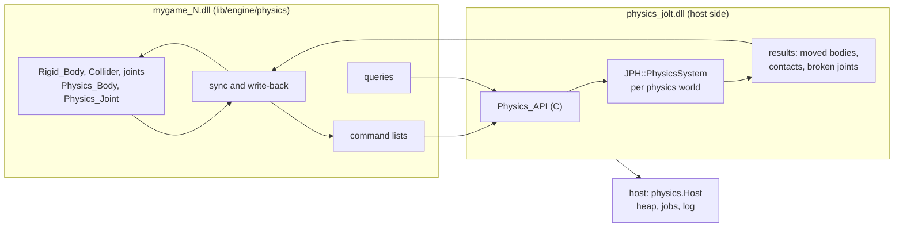

# Physics design

Rigid bodies, joints, collision queries and sensors, simulated by [Jolt Physics](https://github.com/jrouwe/JoltPhysics) behind a boundary that another backend can fill. This document covers where Jolt lives, the boundary between the engine and a backend, the components, the physics tick that keeps the world and the simulation in step, shapes, joints, queries, events, scripts, the editor's part and determinism. [Backends](backends.md) is the contract that a backend implements. Read [Hot reload](../overview/hot-reload.md#rules), [World: ECS](../world/ecs.md), [Positions and transforms](../world/positions-and-transforms.md) and [Time](../world/time.md) first; the boundary follows the one in [GPU: Command buffers](../gpu/command-buffers.md#command-buffers).

**In this document:** [Design](#design) · [Where Jolt lives](#where-jolt-lives) · [The boundary](#the-boundary) · [Positions and precision](#positions-and-precision) · [Components](#components) · [Scripts in fixed ticks](#scripts-in-fixed-ticks) · [The physics tick](#the-physics-tick) · [Layers](#layers) · [Shapes](#shapes) · [Constraints](#constraints) · [Queries](#queries) · [Events](#events) · [Scripts](#scripts) · [The editor](#the-editor) · [Determinism](#determinism) · [Plugins](#plugins) · [Future work](#future-work)

## Design

1. **The backend is host code, in a library of its own.** Jolt has static state (its factory, its registered types, its allocator hooks), and its bodies hold vtable pointers into Jolt's image. If the game DLL linked it, a code reload would bring a second copy and leave the simulation's objects pointing into the old one. So the host loads the backend, `physics_jolt.dll` in development, and a release build links it, as Luau is linked ([Scripting: Embedding](../scripting/embedding.md#embedding)). Nothing in the simulation points into the game DLL, so a code reload keeps every body. The same library is the unit that a project swaps for another backend ([Plugins](#plugins)).
2. **The boundary is plain data and C.** The engine records **command lists** (create a body, set a velocity, add a joint) and the backend runs them in order. Results come back as plain arrays: the bodies that moved, the contacts that began and ended, and the joints that broke. Queries are direct calls that fill the caller's arrays. Every procedure has the C calling convention and takes pointers and counts, never Odin slices or strings, so a backend can be C or C++ with no Odin glue. No game procedure is stored in the backend: filters are tables, and listeners fill buffers.
3. **The world is the truth, and the backend a cache of it.** Authoring components (`Rigid_Body`, `Collider`, the joints) say what should exist. Runtime components (`Physics_Body`, `Physics_Joint`) hold the backend's handle and what was last sent. Each tick, the sync compares them and records commands. A soft restart or a host restart loses the backend's state and nothing else, since the world makes it again. Gameplay acts on bodies through effects, which are commands, not by writing mirrored fields.
4. **Positions cross the boundary as `f64` offsets from the physics world's anchor**, with Jolt built in double precision ([Positions and precision](#positions-and-precision)). Jolt cannot give each island an `f32` origin of its own, which is what [Where positions go](../world/positions-and-transforms.md#where-positions-go) first had in mind.
5. **Scripts have a fixed step, and physics steps after it**, as Unity's does after `FixedUpdate`. A tick runs the `Fixed` systems, the behaviours' `fixed_update`, the physics tick, then the tick's contacts into scripts. A script's force applies in the same tick, and its `on_collision_enter` runs before the next tick. The game's frame code drives this order one tick at a time ([Scripts in fixed ticks](#scripts-in-fixed-ticks)).



## Where Jolt lives

| Package | Side | What it holds |
|---|---|---|
| `lib/core/physics` | Shared | The boundary: handle types, descriptions, the command format and its hash, `Physics_API`, `Host`, `Features` and the layout signature. Plain data and procedure types only; the package is `physics_boundary`, as `core/script`'s is `script_host`. `physics.h` is the same layouts in C, and both sides assert their sizes. |
| `lib/core/physics/host` | Host | The `Host` table that a backend calls: the heap, the job system and the log, as C procedures; and the reader of the project's `physics.backend`. |
| `lib/core/physics/conformance` | Shared | The suite that every simulating backend passes ([Backends](backends.md#conformance)). |
| `lib/core/physics/jolt` | Host | `CMakeLists.txt`, which builds Jolt from `vendor/jolt` (a submodule at a release tag), and `jolt_backend.cpp`, which implements `Physics_API` and exports `cinnabar_physics_api`. |
| `lib/core/physics/null` | Host | A backend that keeps bodies where they are put, steps nothing and hits nothing. It runs the sync's tests, and a game whose `physics.backend` is `none`. |
| `lib/core/physics/plugin` | Host | The development host's loader: `physics_<name>.dll` beside the host, or the null backend for `none` ([Backends](backends.md#loading)). |
| `lib/engine/physics` | Game | The components, the handle pools, the sync, the physics tick, layers, contacts, queries, effects, script bindings, and the colliders' size for the editor's drawing. |

- **Build:** `just jolt` builds `lib/core/physics/jolt/CMakeLists.txt` twice, as `just luau` does: `physics_jolt.dll` for development and a static library for release and tests, both with the static CRT. The `physics_backend` collection picks the loader, as `gpu_backend` picks the GPU's: a backend's package for release and tests, which links it, and the plugin loader for the development host and game DLL. The game reaches a backend only through `Platform_API.physics`. Jolt's options are `DOUBLE_PRECISION`, `CROSS_PLATFORM_DETERMINISTIC` as a project's choice ([Determinism](#determinism)), and `OBJECT_LAYER_BITS=32`; its GPU compute, its profiler and its debug renderer are off. A running host keeps the DLL loaded, and a changed backend needs a host restart, as `luau.dll` does.
- **Memory:** the backend points Jolt's `Allocate`, `Reallocate`, `Free`, `AlignedAllocate` and `AlignedFree` at the host's heap, and each world's `TempAllocatorImpl` takes one block of it (8 MiB, `World_Desc.temp_size`).
- **Jobs:** the backend implements `JPH::JobSystemWithBarrier` over the host's fiber job system. `QueueJob` and `QueueJobs` start host jobs through `Host.jobs_run`, whose data is the Jolt job, and the host runs each by calling the backend's `run_job`; `GetMaxConcurrency` is the worker count. A Jolt job runs to completion and never waits, so its fiber never moves threads in the middle of one, as [the job rule](../core/jobs-and-memory.md#job-system) asks. Only the caller of `PhysicsSystem::Update` waits, in the barrier, and then for its counter, so no host job that holds a Jolt job outlives the step, even one whose job the barrier's waiter already ran.
- **Lifetime:** the game makes a physics world in `init` and destroys it in `shutdown`. The backend keeps every world it made, and a soft restart destroys the ones that the old game left, as it closes script VMs and destroys the `Game` GPU scope ([What survives](../overview/hot-reload.md#what-survives)).

| | Code reload | Soft restart | Host restart |
|---|---|---|---|
| Physics worlds, bodies, joints, shapes, contacts | Kept | Destroyed by the host; the new game's sync makes them again | Lost; made again from the scene |
| The engine's pools, `Physics_Body` and `Physics_Joint` | Kept (in `Game_State` and the world) | Fresh | Fresh |

## The boundary

`lib/core/physics` defines two tables of procedures and the data they pass. [Backends](backends.md#the-contract) has the contract in full.

**Handles.** `World`, `Body`, `Shape` and `Joint` are each a 32-bit index and a 32-bit generation. The engine allocates `Body`, `Shape` and `Joint` handles itself, from pools in `Game_State`, before the backend knows them, as `ecs.reserve` hands out an entity before `apply` makes it. A command can therefore name a body that an earlier command in the same list creates, and the sync never waits for a reply. The backend keeps a table from each handle's index to its own object.

**Commands.** A command list is packets in chunks of frame memory, each an 8-byte header and a fixed payload, as GPU packets are. `physics.format_hash()` hashes their layouts, and the game's `abi_hash` includes it.

| Packet | What it does |
|---|---|
| `Set_World` | Gravity and each layer's collision mask ([Layers](#layers)) |
| `Create_Shape`, `Create_Compound`, `Release_Shape` | A primitive shape at an offset and a rotation in its body, a compound of shapes, and the release of a handle; a body holds its shape ([Shapes](#shapes)) |
| `Create_Body`, `Destroy_Body` | A body: its shape, motion type, layer, pose, velocities, mass, material, damping, gravity factor, sensor, CCD and starting asleep, and its `user` value, which is the entity |
| `Set_Pose`, `Move_Kinematic` | A teleport, with or without waking; a kinematic body's target pose for the step, which Jolt reaches with a velocity |
| `Set_Velocity`, `Add_Force`, `Add_Force_At`, `Add_Torque`, `Add_Impulse`, `Add_Angular_Impulse` | The effects on a dynamic body |
| `Activate`, `Deactivate` | Sleep |
| `Set_Enabled` | Takes a body out of the simulation, or puts it back, for an entity that becomes inactive or active |
| `Create_Joint`, `Destroy_Joint`, `Set_Joint` | A joint between two bodies, or a body and the world, and its enabled state and motor ([Constraints](#constraints)) |

**`Physics_API`** is what a backend provides: `info` (name, version, `API_VERSION`, `Features` and the layout signature), `world_create` and `world_destroy`, `submit` (a chunk of commands), `step` (one tick), `results` (the bodies that moved or fell asleep, the contacts and the broken joints, valid until the next `submit` or `step`), `body_state`, `create_mesh_shape` ([Shapes](#shapes)), the queries `raycast`, `raycast_all`, `raycast_batch`, `shape_cast` and `overlap` ([Queries](#queries)), `run_job`, and the host's `world_destroy_all` and `shutdown`.

**`Host`** is what the host gives a backend: the heap's `allocate`, `reallocate` and `free`, `jobs_run`, `jobs_wait`, the worker count and the log, as C procedures in the host's image. The backend calls nothing else of the engine's.

**How the game reaches it.** `Platform_API.physics` is the backend's `Physics_API`, by value, so its layout is in the ABI hash. `core.init` fills it, in development and in release.

**Threads.** `submit` and `step` run from the frame code, one at a time. Queries run from any number of jobs at once, and from scripts, at any time outside the physics tick.

## Positions and precision

- Each physics world has an anchor, a `World_Position` that the game gives `physics.init` and keeps in the physics `State`. Every position that crosses the boundary is an `[3]f64` offset from it, in meters. Rotations are `f32` quaternions, and velocities, forces and directions are `[3]f32`.
- `ecs.position_sub_f64` and `ecs.position_offset_f64` are the `f64` forms of the position operations, with the same rounding: the difference is converted once, and the offset rounds to the nearest unit.
- **Why `f64` and not an `f32` origin per island:** Jolt forms and splits islands inside a step, on its threads, with no hook to give each its own origin, and it has no origin shift. Its double-precision mode does what the origins would have: positions are `f64`, and the narrow phase and the solver work in `f32` about a base offset near each contact, at 5 to 10% of the speed.
- **Range.** Within 2^29 m (about 500 000 km) of the anchor, an `f64` offset is exact to the fixed-point unit; beyond it, it rounds to 2^-14 m (60 µm) at 2^38 m. The broad phase is `f32`, though: its resolution is a meter at 10 000 km and 16 km at the sample's 1.5e11 m, which costs narrow-phase work. The sample therefore anchors its world at its scenes, where its stack of boxes rests as it does at the origin. A game whose action spans more than a few thousand kilometers needs several worlds ([Future work](#future-work)).

## Components

The physics components take the engine IDs 64 to 79.

| Component | ID | Kind | Fields |
|---|---|---|---|
| `Rigid_Body` | 64 | Authoring | `motion` (`Static`, `Kinematic`, `Dynamic`), `mass` (0: from the colliders' density), `linear_damping`, `angular_damping`, `gravity_factor`, `ccd`, `start_asleep`, `report_contacts` |
| `Collider` | 65 | Authoring | `shape` (`Box`, `Sphere`, `Capsule`, `Cylinder`, `Mesh`, `Convex_Mesh`), `size` for a box, `radius` and `height` for the others, `mesh` for the mesh shapes, `offset` and `rotation` in the entity, `friction`, `restitution`, `density`, `sensor`, `detect_static`, `layer` |
| `Physics_Body` | 66 | Runtime | The `Body` handle, the pose last sent or written, a hash of what the body was made from, its motion, its velocities, and whether it sleeps |
| `Fixed_Joint`, `Point_Joint`, `Hinge_Joint`, `Slider_Joint`, `Distance_Joint`, `Cone_Joint`, `Six_DOF_Joint` | 67 to 73 | Authoring | [Constraints](#constraints) |
| `Physics_Joint` | 74 | Runtime | The `Joint` handle, its kind, whether it broke, a hash of what it was made from, and the enabled state and motor last sent |

- **Defaults are in the registry**, so a scene's bare `component 65 Collider` is a 1 m box: a `Rigid_Body` is dynamic, with damping 0.05, a gravity factor of 1 and `report_contacts`; a `Collider` is a box of size 1, radius 0.5 and height 2, with friction 0.5 and a density of 1000.
- **A `Collider` without a `Rigid_Body` is a static body**, as in Unity. A `Rigid_Body` with no collider on itself or below it has no body, which the sync warns about once.
- **Compound bodies.** A `Collider` on a descendant of a `Rigid_Body`, with no `Rigid_Body` between them, is a part of that body's shape, at its pose in the body. The pose is composed from the `Local_Transform`s between them, so it does not change while the body moves. The body's friction, restitution, layer and sensor flag are its own `Collider`'s, or else its first part's. The world keeps no child lists, so the sync finds the parts once per tick by walking up from each `Collider` without a `Rigid_Body` that has a `Parent`; an entity that becomes a part gives up its own body.
- **Runtime components** hold what the sync made. The properties panel shows their fields read-only or not at all, and nothing saves them.
- **Scale.** An entity's scale scales its collider: a box's size on each axis, a sphere's radius by the largest axis, a capsule's or a cylinder's radius by the larger of x and z and its height by y, and a mesh's vertices. No shape needs a scaled wrapper.

## Scripts in fixed ticks

The game's frame code drives the ticks one at a time, so the order of systems, scripts and physics is in one place and no procedure is registered for it:

```odin
ticks := ecs.begin_ticks(&s.world, dt)
physics.begin_frame(&s.physics)
for ecs.next_tick(&ticks) {
    ecs.run_tick_systems(&ticks, s)                       // Previous_Transform, the Fixed systems, apply
    script.fixed_update(&s.scripts, &ticks, input)        // fixed_update, its events and structural changes
    ecs.update_transforms(&s.world)
    physics.tick(&s.physics, &s.world)                    // sync, step, write-back
    physics.send_events(&s.physics, &s.world, &s.scripts) // the tick's contacts and broken joints
    script.fixed_events(&s.scripts)                       // delivers them, then the wait_fixed coroutines
    ecs.update_transforms(&s.world)
}
```

- A script that moves a body, or anything that is interpolated, does it once per tick in `fixed_update`; from `update` it would move at the frame rate and stutter against the tick's interpolation. A contact handler answers before the next step, as Unity's `OnCollisionEnter` does. [Behaviours: Fixed step](../scripting/behaviours.md#fixed-step) has the fixed step's order, its `Time` and its input.
- **Native `Fixed` systems run before the scripts in each tick,** as `Update` systems run before the script phase: a script sees the tick's system results, and a system sees the scripts' writes in the next tick.
- A game without scripts or physics leaves out their lines; `ecs.run_fixed` is the short form for one that has neither.

## The physics tick

`physics.tick` is serial frame code. It syncs, steps by the tick's duration, and writes back:

1. **The effects** that gameplay recorded since the last tick, from frame code and from systems' jobs ([Scripts](#scripts)), go first, before anything that this sync destroys.
2. `Set_World`, when the gravity or the layers changed.
3. **The pool is checked.** A live body whose entity is gone, whose `Physics_Body` names another body, or whose `Rigid_Body` and `Collider` were removed is destroyed, and its `Physics_Body` with it. A body whose entity became inactive leaves the simulation with `Set_Enabled`, and comes back when it is active. The world's removal log has one reader, the script runtime, so the pool keeps each body's entity and is checked instead, a lookup per body per tick. A new entity in a dead one's slot is matched by its `Physics_Body`'s handle, so it never keeps the old body, which is how a scene load or the editor's Stop destroys the old world's bodies.
4. **New bodies.** An entity with a `Collider`, or a `Rigid_Body` with parts, and no `Physics_Body` gets its body, its `Physics_Body`, and a `Previous_Transform` if it moves.
5. **Changed and moved bodies.** A body whose `Rigid_Body`, `Collider`, scale, parts or meshes changed, by their hash, is made again with its velocity; an edit or a change of scale is rare enough that this is simpler than changing a body in place. A body whose `Transform` differs from the pose last sent was moved by someone else, a script or the editor: a static one is set there, a kinematic one moves there in the step and is stopped after, and a dynamic one is teleported, as a write of `Transform` teleports a body in Unity.
6. **Joints** ([Constraints](#constraints)), after the bodies' new components are applied, so a joint on a new body is made in the same tick.
7. `submit`, then the shape handles that the sync released go back to the pool, then `step`.
8. **Write-back.** Each moved dynamic body writes its `Transform`, or a child's `Local_Transform`, which the tick's last propagation turns into its `Transform`; every moved body writes its velocities and whether it sleeps into `Physics_Body`. The broken joints are marked, and the contacts kept ([Events](#events)).

- A sleeping body is not in the results, so the write-back costs what moves. The comparisons of step 5 visit every body each tick, a few hundred kilobytes of reads for ten thousand bodies; the world's [change tracking](../world/README.md#future-work) would visit only what changed.
- `Previous_Transform` interpolation needs nothing new: physics writes `Transform` in the tick, and presentation blends the last two ([Time](../world/time.md#fixed-and-variable-rate)).
- The propagation before the physics tick lets it see the tick's poses of kinematic and static children. It costs a propagation per tick; *later*, only the subtrees of such children.

## Layers

- **Object layers** are named in the project's settings, up to 32: `physics.layers = Default, Player, Enemy, Debris`. A `Collider`'s `layer` is an index into them. Without the key there is one layer, `Default`.
- **The collision matrix** is the pairs that do not collide: `physics.ignore = Debris:Player, Debris:Debris`, in either order with `physics.layers`; every other pair collides. `project.physics_layers` reads both keys into `physics.Layers`, plain data, and the game passes it to `physics.set_layers` when the settings change. The engine sends one mask per layer with `Set_World`, so the backend's pair filter is a table lookup.
- **Broad-phase layers** are the backend's business: the Jolt backend has two, moving and non-moving, from the motion type.
- **Joined bodies.** A joint without `collide_connected` keeps its two bodies from colliding: the backend keeps the joined pairs and rejects their contacts in Jolt's `OnContactValidate`. A group filter, such as Jolt's `GroupFilterTable`, gives each body one group, which a body with several joints outgrows.

## Shapes

- **Each body makes its shapes.** A primitive is a `Create_Shape` with its dimensions scaled and its offset and rotation in the body, which Jolt wraps in a `RotatedTranslatedShape`. Several colliders are the children of a `Create_Compound`. The engine releases the handles once the body holds the shape, and they return to the pool after the sync's submit, so a mesh shape, which is made at once, never takes a handle that a command in the list still releases.
- **Meshes and convex hulls** come from a mesh asset: a `Collider`'s `shape` is `Mesh` or `Convex_Mesh`, and its `mesh` names the asset. The cooker writes each mesh's **collision data** into its blob, beside the render streams ([Content: Meshes](../content/kinds/meshes.md)): its positions welded by position alone, which joins the triangles that the render mesh splits at its seams, so a collider has no internal edges there; its triangles over them, without the ones that welding made degenerate; and each triangle's submesh. It is backend-neutral, and glTF meshes and `.mesh` level geometry both have it unless their `collision` import setting is `false`. A section of the blob needs no asset kind or GUID of its own, since a collider names the mesh.
- **Mesh shapes are made at once.** Mesh data does not fit in a command, so `create_mesh_shape` makes a triangle `Mesh` or a `Convex_Hull` under an engine handle, which the following commands use as any shape's. The engine loads the blob through the asset runtime, which `physics.init` takes, and applies the collider's offset, rotation and scale to the vertices. A triangle mesh has no mass, so a dynamic body takes its hull instead, with a warning, as Unity asks for a convex mesh on a moving body, and the backend refuses a dynamic body on a triangle mesh. A collider whose mesh is not cooked or has no collision data makes no shape, with a warning.
- **Hot reload.** A body's hash has the version of each mesh that its colliders name, which the asset runtime raises when it swaps a blob, so a recooked mesh makes its bodies again.

## Constraints

- **A joint goes on any entity, and joins the body that entity belongs to:** its own, or its nearest ancestor's, as a child `Collider` belongs to the nearest `Rigid_Body`. `body_b` is an entity, whose body or nearest ancestor's is the other, or none for the world. The common case is Unity's: the `Hinge_Joint` goes on the door itself, with its `offset` at the hinge's edge. The ECS allows one component of each type on an entity, so a body with two joints of one kind, such as a plank hinged at both ends, holds the second on a child entity without a body, which also gets the editor's gizmo for its frame.
- **The frame** is the entity's pose with the joint's `offset`, scaled as a `Collider`'s is, and `rotation`. Its +x is a hinge's and a slider's axis and a cone's twist axis, Jolt's own default for each; a fixed or six-DOF joint uses its x and y. The frame on `body_b` is where the joint's frame is when the joint is made, which is Unity's automatic connected anchor; `use_connected_frame` with `connected_offset` and `connected_rotation` gives it on `body_b`'s entity instead.
- **Kinds,** one component each, so the properties panel shows only what applies: `Fixed_Joint`, `Point_Joint` (a ball and socket), `Hinge_Joint` and `Slider_Joint` (limits, a spring that softens them, and a `Motor` of mode, target and most torque or force, whose position mode the spring drives), `Distance_Joint` (a range, negative for the distance at creation, and a spring), `Cone_Joint` (a half angle) and `Six_DOF_Joint` (each axis free, fixed or limited). Each holds a `Joint`: `body_b`, the frame, `collide_connected`, `break_force`, `break_torque` and `enabled`, which the properties panel shows as `joint.body_b` and the rest. Angles are in radians.
- **The joints' sync** makes a joint when both bodies exist, and waits while one is missing. A change of the component, of a body, or of the joint's pose in its body makes the joint again from the poses then; its hash leaves out the motor and `enabled`, which change in place with `Set_Joint`, so a script or a system can drive a motor every tick. A joint whose entity or one of whose bodies is inactive is disabled. The backend removes a body's joints when it destroys the body, since a Jolt constraint holds its bodies, and the engine makes them again with the new body.
- **Breaking.** Jolt has no breakable joints. After each step, the backend divides each breakable joint's impulse by the step, compares it with `break_force` and `break_torque`, disables a joint that carried more, and reports it. The engine sets `Physics_Joint.broken`, and a behaviour on the joint's entity gets `on_joint_break(force, torque)`. A broken joint stays broken until something it is made from changes.

## Queries

| Query | `lib/engine/physics` | Gives |
|---|---|---|
| Ray | `raycast(s, w, origin, direction, max_distance, filter)` | The closest `Hit`: the entity, the point as a `World_Position`, the normal, the distance and the sub-shape |
| All along a ray | `raycast_all(s, w, origin, direction, max_distance, out, filter)` | Every hit by distance, and how many there were |
| A batch of rays | `raycast_batch(s, w, rays, out, filter)` | The closest hit of each, a zero `Hit` for a miss, in one call to the backend |
| Shape cast | `shape_cast(s, w, shape, origin, rotation, direction, distance, filter)` | The first hit of a swept shape |
| Overlap | `overlap(s, w, shape, origin, rotation, out, filter)` | The entities whose bodies overlap a shape, by body handle, and how many there were |

- A `Filter` is data: a layer mask, whether to include sensors, and up to 8 entities whose bodies to skip, such as the caller's own. It has no callback.
- A query's shape is a primitive, sized as a `Collider` is at scale 1.
- An array that is too small still gets the count, so a caller can ask again with more room. A ray ignores the back faces of triangles.

## Events

- **The backend reports body pairs, not sub-shapes.** Jolt's listener runs on its threads during the step, once per sub-shape pair. The backend keeps each body pair's touching sub-shape pairs, and reports `Begin` when the first touches and `End` when the last parts, with the first contact's point, normal, relative velocity and an estimate of the impulse for a `Begin`. Jolt makes the estimate when it first finds the contact, which can be a little before the bodies touch, so a slow contact's impulse can be low; it is for sounds and effects. Jolt removes the contacts of sleeping bodies and adds them again when they wake, so a removal between two bodies that are both asleep or static is not a parting. A body that is destroyed, or leaves the simulation, ends its pairs in the same step.
- **Which pairs report:** those with a body whose `report_contacts` is set, or a sensor. Jolt makes no contact between a kinematic body and a static or kinematic one, so neither does a kinematic sensor, unless its `detect_static` is set.
- **Order.** The listener's order depends on threads, so the backend sorts each step's contacts by body handles.
- **Native code** reads `physics.tick_contacts`, the last tick's, which a `Fixed` system of the next tick sees, and `physics.frame_contacts`, every tick's since `physics.begin_frame`, which the frame calls before its ticks, for `Update` and `Late` systems. A `Contact` names its two entities, with the point as a `World_Position`.
- **Scripts** get the tick's events in the same tick: `physics.send_events` queues them with `script.send`, which is safe in frame code, and `script.fixed_events` delivers them ([Scripts in fixed ticks](#scripts-in-fixed-ticks)). Each goes to the entity of each body, if it has behaviours:

  | Event | Unity | Arguments |
  |---|---|---|
  | `on_collision_enter` | `OnCollisionEnter` | The other entity, the point (`WorldPosition`), the normal from this body towards the other, the other's velocity relative to this one, the impulse |
  | `on_collision_exit` | `OnCollisionExit` | The other entity |
  | `on_trigger_enter` | `OnTriggerEnter` | The other entity; sent when either body is a sensor |
  | `on_trigger_exit` | `OnTriggerExit` | The other entity |
  | `on_joint_break` | `OnJointBreak` | The force and the torque, to the joint's entity |

- **Where it differs from Unity:** one event per body pair where Unity sends one per collider pair; the body's entity receives it, not a child collider's; an exit comes when the other body is destroyed or deactivated, which Unity omits; and there is no `stay` event, which a script keeps as a set from enter and exit.

## Scripts

- **`Physics`** is an engine library that the game defines with `physics.register_scripts` ([API](../scripting/api.md#engine-libraries)). `Physics.raycast(origin, direction, max_distance?, layers?)` gives a `RaycastHit` table (`entity`, `position`, `normal`, `distance`) or `nil`, and `raycast_all`, `sphere_cast`, `box_cast`, `capsule_cast`, `overlap_sphere`, `overlap_box` and `overlap_capsule` follow it, with `WorldPosition`s and a box's whole size. `Physics.layers("Player", "Enemy")` gives a mask, `Physics.gravity()` and `Physics.set_gravity(v)` read and set gravity, and `Physics.set_motor(entity, mode, target?, max?)` and `Physics.set_joint_enabled(entity, enabled)` drive joints. `RigidBody` and `Collider` are exposed, so a script reads and changes their fields, which makes the body again.
- **Effects on bodies** take the entity first, since component references have no methods: `Physics.add_force(e, v)`, `add_force_at`, `add_impulse`, `add_torque`, `add_angular_impulse`, `velocity`, `angular_velocity`, `set_velocity`, `set_angular_velocity`, `sleep`, `wake` and `is_sleeping`. An entity without a body is an error that names it. Moving a body is writing its `Transform`, or `entity:teleport`.
- **When they apply.** Each effect records a command, which the next physics tick submits before its own. From `fixed_update` or a contact handler, an effect applies in that tick's step or the next; from `update`, in the next tick, once, however many ticks the frame runs, so a continuous force belongs in `fixed_update`, as in Unity. A velocity that `set_velocity` sets shows in `Physics_Body` after the tick.
- **Native code** has the same effects, which take where to record them: `physics.effects(s)` from frame code, and `physics.job_effects(s, ctx)` from a system's job, its own list, which the world flushes into the state's pending list after the stage, in system order and then job order ([ECS: Command buffers](../world/ecs.md#command-buffers)). An effect from a `Fixed` system applies in the same tick, and the order of effects never depends on the jobs' timing.

## The editor

- **Components** show in the properties panel through the field walker, as every component's do.
- **Colliders are drawn** among the viewport's helpers in edit mode: a selected entity's in color, a sensor in its own, or every entity's in grey when the helpers show every entity. They are drawn at the sizes the simulation has (`physics.collider_size`), with no backend, so they draw on the null backend too; a mesh collider is its mesh's bounds. A selected joint draws its frame as axes and a line to its `body_b`'s entity; another is a dot.
- **Edit mode syncs and does not step.** The game's frame runs `physics.sync` while the world does not run ([Modes](../editor/document-and-scenes.md#modes)), so the backend mirrors the scene as it is edited, queries see it, and Play starts from a synced world. Stop replaces the world with the editor's scene, whose new entities do not keep the play world's bodies ([The physics tick](#the-physics-tick)).

## Determinism

- The simulation is deterministic on one build when its inputs are: the same commands in the same order. The sync runs in query order, effects keep the order of the frame code and of the systems' jobs, and the results and contacts are sorted, so a replay of the same inputs gives the same poses, which the conformance suite checks to the bit.
- Body handles come from the engine's pool in the order of the sync; nothing is ordered by `Entity` value ([Command buffers](../world/ecs.md#command-buffers)).
- **Across machines** needs Jolt's `CROSS_PLATFORM_DETERMINISTIC`, about 8% slower, and the same Jolt build everywhere: a project's choice for lockstep or rollback networking, made in the build and reported in `Features`.
- Queries give the same results in the same order. Jolt's broad phase queries alone do not, and the backend never returns them unfiltered.

## Plugins

A backend is a library that exports `cinnabar_physics_api`, and a project chooses it with `physics.backend` in its settings, or `--physics` on the host's command line: `jolt`, the default, `none` for the null backend, or another backend's name. The development host loads `physics_<name>.dll` beside it; a release build links its backend, chosen by the justfile's `physics_backend`. The host checks a backend's `API_VERSION` and its layout signature, a hash of every boundary type's size that `physics.h` computes too, since a backend in C cannot compute `format_hash`; a backend that does not load or does not match is an error, and the game runs on the null backend. The engine ignores a component whose feature the backend lacks, with one warning for each. [Backends](backends.md) has all of it.

## Future work

Each item with the condition that makes it worth doing.

- **A character controller.** Jolt's `CharacterVirtual`, as a `Character` component with a `move(velocity)` command and its ground state in a runtime component, for walking, stairs and slopes. The first thing a game with a player will ask for; it needs `Characters` in `Features`.
- **2D physics,** as a boundary of its own rather than one with a dimension, as Godot's two physics servers and Unity's two physics modules are. `lib/core/physics2d` would define `Physics2D_API`, with the same shape as the 3D one; Box2D v3 is C, has a task interface that maps onto the host's jobs as Jolt's does, and is deterministic, so a `physics_box2d` backend is the first. Its components, `Rigid_Body_2D`, `Collider_2D` and the 2D joints, would take the IDs 80 to 95, on the same entities and `Transform`s, using x and y, with `on_collision_enter_2d` and the rest, as Unity names them. Box2D is `f32`, so its world has an anchor too. The handle pools, command recording, layers, contacts and the loader move into a shared package then, not before. When a game is 2D.
- **Vehicles.** Jolt's `VehicleConstraint`, with wheeled, tracked and motorcycle controllers, as a `Vehicle` component on a body and `Wheel` components on child entities whose poses the sync writes. Jolt takes the vehicle's up and forward axes, so the engine's left-handed axes pass straight through. When a game has something to drive.
- **Buoyancy.** `Body::GetSubmergedVolume` and `ApplyBuoyancyImpulse` against a water surface's plane, as a `Buoyancy` component that a system updates each tick from the water's height at the body. Waves need the surface's displacement on the CPU, as [Surfaces](../rendering/surfaces.md) would for any gameplay on water. When there is water to float on.
- **Soft bodies and cloth.** Jolt's soft bodies, from a cooked mesh with its constraints, and cloth as a soft body whose pinned vertices follow a skinned mesh. Both need a renderer path for meshes whose vertices change every frame, and cloth needs skinning. With animation.
- **Hair.** Jolt's strand hair (5.6) runs on the GPU through Jolt's own compute abstraction. Using it means implementing that over [the GPU interface](../gpu/interface.md), which gives a backend GPU access through `Host` and widens the boundary. Weigh it against hair in the renderer's own compute passes, colliding with physics shapes uploaded to the GPU. When a game needs hair.
- **Ragdolls.** Joints between bodies that follow a skeleton, and blending back to animation. With animation.
- **Axis locks.** `Rigid_Body.lock_position` and `lock_rotation` per axis, through Jolt's allowed degrees of freedom, for a top-down or side-on game. When a game asks.
- **A point query**, the entities whose shapes contain a point, and **mesh shapes in queries.** When a game asks.
- **Contacts as a query.** `Physics.contacts(entity)`, the current pairs, in place of a `stay` event. When a game asks for `OnCollisionStay`.
- **Methods on component references,** so that `rb:add_force(v)` is `Physics.add_force(entity, v)`, and scripts can read a joint's nested fields. With the script runtime's next change to component references.
- **The backend's debug view.** A `debug_lines` procedure for the backend's own shapes, contacts and sleep, behind a viewport toggle in play mode, for when the components and the simulation disagree.
- **The editor:** a collider's layer by name in the properties panel, and a handle at a joint's `offset` that drags its frame. When content uses layers or joints enough to want them.
- **Shared shapes.** One primitive shape for every collider with the same description and scale, through a table by the description's hash, and one mesh shape for every body of a mesh. When many bodies share shapes, or a large level mesh is made more than once.
- **Cooked native shapes.** Jolt's own binary form of a mesh shape, cooked beside the collision data and keyed by the backend's name and version, so large level meshes load without building their trees. Building one from the welded data takes milliseconds per hundred thousand triangles; when a level's load time shows it.
- **A parallel sync and batch.** The sync's comparisons and the write-back over chunks in jobs, and a large ray batch on the backend's jobs. When the physics tick or a sight-line system shows in the profile.
- **Profiler zones from the backend,** through `Host`, so the step's jobs show in the editor's profiler.
- **A fiber-aware barrier.** The stock `JobSystemWithBarrier` sleeps on a semaphore when its waiter has no job to run, which holds a worker; a barrier over a `jobs.Counter` frees it. When the physics tick shows idle worker time.
- **A narrower propagation** before the physics tick, of only the subtrees of kinematic and static children. When propagation shows in the profile.
- **Several physics worlds with handover.** One world per region, each anchored near its action, with bodies moved between them as they cross. For worlds whose action spans more than a few thousand kilometers ([Positions and precision](#positions-and-precision)).
- **Saving and restoring state.** Jolt's `StateRecorder`, behind `Save_State` in `Features`, for rollback networking and replays. With networking.
- **Physics materials as assets.** A `.physmat` kind for friction, restitution and an impact sound, chosen per triangle by the collision data's submeshes. When collider fields repeated across content become a chore.
- **Terrain collision** from a surface's height map, with the terrain ([Surfaces](../rendering/surfaces.md#future-work)).
- **Change tracking** in the world would let the sync visit only what changed ([World](../world/README.md#future-work)).
