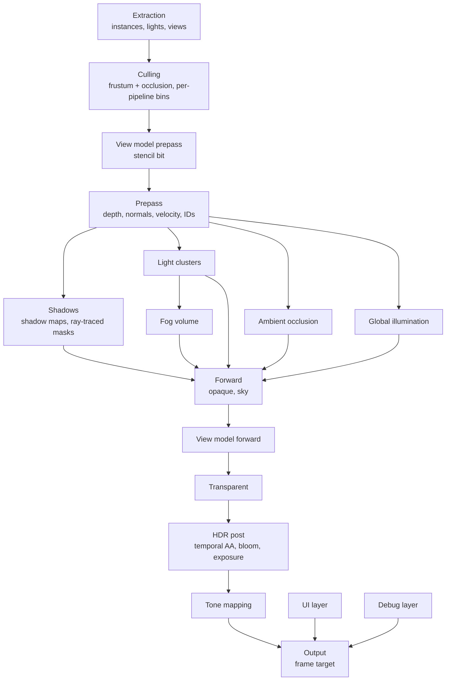
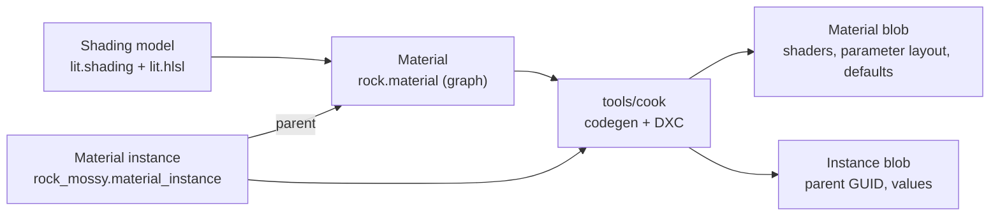

# Rendering

The built-in renderer draws the world, a first-person view model, the UI and debug drawing into one frame. It is in `lib/engine/render`, on top of the render graph, and it records everything through `lib/core/gpu` (see [GPU](gpu.md)). A game uses the built-in renderer or builds its own graph. The sample's hand-written frame becomes the second case.

## Goals

- **Layers:** the world, the view model, the UI and debug drawing each have their own target and their own rules, and one output pass combines them.
- **Shading models:** a new lighting model is one HLSL file and one declaration. Materials pick a shading model, and every pass that draws them works without changes.
- **Materials from graphs:** a node graph in the editor makes a material. A material instance changes its parameters and needs no new shaders.
- **Room to grow:** volumetric fog, global illumination, bloom, exposure, tone mapping, ambient occlusion and ray-traced shadows each have a fixed place in the frame and the inputs they need.

## Decisions

| Question | Decision | Why |
|---|---|---|
| Shading path | Clustered forward, with a depth and normal prepass | See [Clustered forward](#clustered-forward). |
| Depth | Reversed infinite Z: depth is `near / z`, test `Greater`, clear 0 | `D32_Float` has its precision near 0. Reversing puts that precision in the distance instead of at the near plane, where nothing needs it. |
| Scene color | `RGBA16_Float`, linear, pre-exposed | Bloom, exposure and tone mapping need HDR. Pre-exposure keeps bright values inside the half-float range. |
| View model | A second view drawn into the scene's targets, not a separate target | See [View model](#view-model). |
| UI and debug | Separate targets, combined after tone mapping | Tone mapping and exposure do not change them, and the scene can render at a lower resolution than they do. |
| HDR output | HDR10 by default on a display in HDR, scRGB on request; the tone mapper's SDR result, opened up above a knee to the display's peak | The tone mappers keep their look, and SDR's white, which the UI has, is as bright as Windows shows SDR content. See [HDR output](#hdr-output). |
| Instance positions | Relative to a render origin that snaps to a 1024 m grid, in a persistent GPU scene | See [GPU scene](#gpu-scene). |
| Anti-aliasing | Temporal, no MSAA | Fog, GI and ambient occlusion all need temporal accumulation, so the frame has the history and velocities anyway. |

## Frame



- The render graph culls every pass whose result nothing reads. A feature that is off adds no passes, and the passes that read its result read a default texture instead, for example a white ambient occlusion texture.
- The ambient occlusion and the global illumination run on the compute queue (see [GPU](gpu.md#queues)). They depend only on the prepass and on textures from last frame, so they overlap with the light clusters and the shadow maps. The clusters, the fog volume and the exposure run on the graphics queue: the fog reads the shadow maps, which are drawn just before it, and the exposure is explained in [Post-processing](#post-processing).
- The renderer is a `render.Renderer` in `Game_State`: the residency table, the transient texture cache, the debug lines, the mesh extractor, the materials, the GPU scene, the lights' extractors and clusters, the shadows' acceleration structure, the volumes' query, the ambient occlusion's, the global illumination's and the fog's pipelines (`render.Ao_Passes`, `render.Gi_Passes`, `render.Volumetric_Fog`), and post-processing's pipelines, exposure and lookup table (`render.Post`). It holds handles only, so a code reload keeps it (see [Hot reload](hot-reload.md#rules)). A game calls `renderer_init` after its world and asset runtime, `renderer_reload` in `on_reload`, which makes its registrations again and updates every pipeline at the next frame, and `renderer_destroy` at shutdown.
- A game calls `render.draw_frame(&renderer, &world, frame_desc)` once a frame. `Frame_Desc` is in frame memory: the view, the size, whether to keep the IDs and the depth for the editor, the entity slots not to draw (the editor's hidden ones), the frame's settings or nil for the volumes' (see [Settings](#settings)), the hooks, and the editor's material previews to draw (see [Material previews](#material-previews)). The lights are components (see [Lights and clusters](#lights-and-clusters)).
- **Hooks** add a game's own work, in the order of the frame. Each is optional, and each gets the `render.Frame`, which holds the graph, the view and its projection, the targets, and the hooks' `data`:

| Hook | When | What it does |
|---|---|---|
| `before_world` | Before the prepass | Adds passes, such as culling on the compute queue |
| `after_prepass` | After the prepass, before the ambient occlusion and the global illumination | Adds passes that read `Frame.depth`, `Frame.normals` and `Frame.velocity` |
| `world_uses` | When the world pass is declared | Declares what `world_draw` reads |
| `world_draw` | In the world pass, the forward pass, `world_pieces` pieces, after the meshes in piece 0 | Records draws into the world's targets |
| `after_world` | After the world pass | Adds passes; a pass that makes a new scene color sets `Frame.scene` to it |
| `before_post` | Just before post-processing | Adds passes, such as a layer of the game's own that it composites into `Frame.scene` in linear HDR; post-processing then reads `Frame.scene` |
| `ui` | After a pass that clears the UI target | Adds passes that draw the UI; they load it |
| `debug` | After the debug lines | Adds passes that draw into the debug layer, such as the editor's tools |

- The hooks are procedures in the game DLL, so they are never stored in `Game_State`.
- **A game's own draws** in `world_draw` are not in the prepass. They test and write the depth that the prepass left, write the scene color and their IDs, and have no normals or velocities, no shadows from the renderer, no clusters' lights, no ambient occlusion, no global illumination and no fog unless their shaders read them. They are in the lit scene that the global illumination's rays read, but not in the depth that the rays test, so their light reaches only the surfaces that the rays find behind them. They place vertices with `render.jittered_view_projection(f)`, so they cover the same pixels as the renderer's draws, and scale their colors by the exposure in `Frame.exposure`, because the scene is pre-exposed (see [Post-processing](#post-processing)). The sample's draws do both. Temporal AA moves their pixels with the camera, since they have no velocities, so a moving draw of a game's own leaves a short trail that the history's clipping limits.
- **Missing shaders:** a pass whose pipeline does not exist yet, because its shader is not cooked, records nothing, so the frame still validates.

### Settings

The settings that make the scene's look are settings components on [volumes](world.md#volumes) (`lib/engine/render/settings.odin`). The frame takes each from the volumes at the camera, so a box volume can change the look of one room. Each field is a `volume.Value`, which a volume overrides or leaves to the volumes below it, and 0 in a value means its default.

| Component | Stable ID | Settings |
|---|---|---|
| `Anti_Aliasing` | 43 | `off`: no temporal AA |
| `Exposure` | 44 | `mode` (Auto or Manual), the manual `exposure`, the `compensation` in stops, and the auto exposure's `range` and `adaptation_speed` |
| `Tone_Mapping` | 45 | The `tone_mapper`, the grading's `contrast`, `saturation` and `tint`, and HDR output's `paper_white` and `peak` |
| `Bloom` | 46 | `off`, `intensity` |
| `Ambient_Occlusion` | 47 | `off`, `radius`, `power` |
| `Global_Illumination` | 48 | `off` |
| `Environment` | 49 | The `background`, which the world pass clears the scene to and which is not pre-exposed, and the ambient light's `sky` and `ground` (`DEFAULT_AMBIENT` when zero) |
| `Fog` | 38 | See [Volumetric fog](#volumetric-fog) |
| `Shadows` | 50 | The directional cascades' `distance` (`SHADOW_DISTANCE`, 100 m) and `split_lambda` between even and exponential (`SHADOW_SPLIT_LAMBDA`, 0.75) |

- **Resolving:** `resolve_settings(&renderer, &world, position, hidden)` gives a `Frame_Settings` with the volumes' settings blended and the rest at their defaults: `Post_Settings`, `Ao_Settings`, `Gi_Settings`, `Fog_Settings`, the background and the `Ambient`. `draw_frame` calls it at the view's position when `Frame_Desc.settings` is nil. A game can call it, change a value, and pass the result.
- **Defaults:** volumes blend from each component's `DEFAULT_*` value, which holds the defaults that 0 stands for, so a volume that reaches halfway sets a value halfway from the default. Paper white and the peak have no fixed default, the display's, so they blend from 0.
- **The sample's scene** has a Global Volume with its background.

### Views

- A `render.View` is a camera: its pose, its projection, its viewport, and its layers. The editor's camera and the game's camera both give one (see [Editor](editor.md#viewport)).
- A frame has one main view, and in the editor the [material previews](#material-previews). More views come later: split screen, reflection captures. Each view has its own clusters, history and scene color. Every view uses the same [GPU scene](#gpu-scene), because its poses have no camera rotation (see [World](world.md#render-extraction)).
- A view's constants hold its offset from the render origin as an `f32` vector, with its rotation and projection.

## GPU scene

The GPU scene holds every instance's record in a persistent buffer, `Gpu_Scene` in `lib/engine/render/scene.odin`: its pose and its last frame's pose as the rows of 3x4 matrices, and its entity's ID for the editor. Each frame's draw items carry the rest: the mesh, the submesh's indices and bounds, and the material.

- **Render origin.** Poses are relative to the render origin, a `World_Position` snapped to a grid of 1024 m. Snapping is an integer mask on the Q39.24 values, so the offset between two origins is exact. Shaders subtract the view's offset from the origin, so their error near the camera is about one `f32` unit at 1024 m, about 0.06 mm.
- **Rebasing.** The origin moves when the camera is more than 1.5 cells from it, so a camera on a cell's edge does not move it back and forth. A rebase writes every record again, rebuilds the top-level acceleration structure, and moves every world-space history (last frame's poses, cached shadow maps, GI probes) by the exact offset.
- **Stable slots.** Each rendered entity has a slot for its whole life, at most `MAX_INSTANCES` (16 384). A free list gives slots, and a map from entity to slot, in host memory, lives in the `Renderer`. A slot whose entity has no `Mesh_Renderer` in a frame is free again. A soft restart builds them again. Culling, the acceleration structure's instance IDs and the occlusion culling's visibility from the last frame all index by slot.
- **Camera-relative records.** The view model's instances have slots in the GPU scene, but their rows are relative to the camera, and last frame's relative to last frame's camera, not to the render origin. The view model is within a meter of the camera, where the render origin's error would show as about a pixel of jitter at the near plane. The debug shapes are not in the GPU scene; the debug layer writes them relative to the camera every frame.
- **Updates.** Every frame writes every slot, relative to the render origin, into the upload ring, and a copy moves them into the persistent buffer: 112 bytes per instance with both poses. Last frame's pose is the slot's presented pose of the frame before, or this frame's for a new slot. Every GPU-side consumer has its final layout. *Later, extraction writes only the slots that changed (see [Future work](#future-work)).*
- **Draw items** are one per submesh of each visible `Mesh_Renderer` whose mesh is resident: its slot, its mesh's record, its indices, its material's block, its bin, and its submesh's bounding sphere. Hidden entities (`Frame_Desc.hidden`) keep their slots but have no items.
- **Culling** is a compute pass, `cull_draws.hlsl`, with a row of the dispatch for each view: the camera (`VIEW_CAMERA`), the view model (`VIEW_VIEW_MODEL`), then each shadow view (see [Shadows](#shadows)). It tests each item's sphere, moved by its instance's rows and the view's offset from their space, against the view's six planes; the camera's and the view model's far planes are at infinity. A shadow view takes only the items that cast shadows (the `Mesh_Renderer`'s `cast_shadows` and the material's), the view model's view only the view model's items, and every other view leaves those out. A visible item takes the next place in its bin of that view with an atomic add, and writes there both its indirect draw, whose draw ID is that place, and its draw record. Each view has room for every item, and each bin has the same range in every view. *Occlusion culling, and culling on the compute queue, come later.*
- **Drawing:** the prepass, the shadow maps and the forward pass each draw a bin of their view with one `cmd_draw_indirect` and the bin's count, with the bin's material's pipeline for their pass. The vertex shader reads its draw record by its draw ID, and pulls its index from the mesh's index buffer, then its vertex: every mesh has buffers of its own, so no one index buffer could be bound for a bin. *The mesh shader path draws meshlets instead, later.*
- **The frame's constants** (`Frame_Constants`, the pass constants of every material pass) hold the view's projection, with the camera's jitter for the camera's and the view model's copies, and last frame's without it, the camera's offset from the origin and last frame's camera's, the camera's offset from the origin again as `origin_offset`, which the view model's copy keeps where it zeroes the others, the ambient light, the cascades' splits, the records' bindless indices and their offsets in the upload ring (mesh records, material table, lights, shadow views), the clusters' grid, the jitter, the exposure buffer, which the forward pass scales its colors by, whether there is fog, with the fog volume's sampler and the share of it that the screen covers, and whether there is global illumination. Each shadow view has a copy with its own projection, which takes positions relative to the camera too, so the depth pass places vertices with the same code. The forward pass pushes the shadow atlas, the shadow mask, the ambient occlusion, the fog volume and the global illumination's diffuse and specular light (`Material_Push`), which exist only once the frame records. The fog's injection uses the camera's constants too, so a frame with fog writes them even when nothing draws.
- **The acceleration structure.** With `Ray_Query`, each instance whose `Mesh_Renderer` casts shadows is an instance of the GPU scene's top-level acceleration structure, in the render origin's space, with its slot as its ID. It is built again every frame that traces shadows.

## Layers

| Layer | Target | Space | Depth | Composited |
|---|---|---|---|---|
| World | Scene color, `RGBA16_Float` | Linear HDR | Scene depth | Is the base |
| View model | The world's targets | Linear HDR | Scene depth, its own projection, a stencil bit | In the forward pass |
| UI | `RGBA8_Unorm`, premultiplied | sRGB-encoded, blended as encoded | None | In the output pass, over the tone-mapped scene |
| Debug | `RGBA8_Unorm_Srgb`, premultiplied | Linear, which the target's sRGB view encodes; the output pass blends it as encoded | Tested lines test scene depth; overlay lines ignore it | In the output pass, over the UI |

- The renderer makes the UI target only with a `ui` hook, and the debug layer only with debug lines or a `debug` hook. Without them, the output pass reads neither.

### View model

A first-person view model needs its own field of view, and it must never go into a wall. A separate target that is composited on top does both, but the view model then misses everything that runs on the scene: it receives no shadows from the world and casts none, it has no ambient occlusion or fog, temporal AA and motion blur do not see it, and bloom and exposure treat it apart from the world. The renderer therefore draws the view model into the world's own targets, as a second view:

1. **The view model prepass runs first.** It draws the view model with its own projection and writes depth and stencil bit 0 (`VIEW_MODEL_STENCIL`). The scene's depth is `D32_Float_S8_Uint` for the stencil.
2. **The world prepass tests stencil bit 0** and draws nowhere that the view model is. A wall that is closer than the arms never covers them. One prepass pipeline does both: its test is `Greater_Equal` against the reference with `Replace`, and the view model draws with the bit as the reference, which passes everywhere and sets it, and the world with 0, which passes only where the bit is clear.
3. **The view model's forward pass** shades it with the world's lights, shadows, ambient occlusion and fog. Its indirect light is the ambient light: the global illumination's probes sit only on the world's surfaces. Its records are relative to the camera, not the render origin (see [GPU scene](#gpu-scene)), but they are still world-space positions with no camera rotation. Only its projection differs, so its lighting matches the world's. The forward pipeline tests the stencil bit `Equal` to the reference, so the world's draws never shade the view model's pixels either.
4. **Passes that rebuild positions from depth check the stencil bit**, and use the view model's projection and near plane for its pixels. The shadow mask reads the bit through the depth texture's stencil view (`gpu.stencil_index`). The forward pass finds a pixel's cluster and its place in the fog volume from its position, projected as the camera's projection would place it, not from the pixel, because the clusters and the volume are the camera's screen tiles. The ambient occlusion rebuilds each pixel with its own projection, and a step of its search that crosses from the world onto the view model, or back, finds nothing, so the view model occludes only itself. The global illumination's rays pass the view model's pixels, and its probes skip them. *Later,* depth of field leaves those pixels sharp.

- **Which entities:** those with a `Mesh_Renderer` and the `View_Model` tag (stable ID 37). Their pose is in the world, usually as a child of the camera, so they follow it.
- **The projection:** the camera's `view_model_fov` and `view_model_near`, which reach the frame as `View.view_model_fov` and `view_model_near`; 0 means the camera's own. `view_model_view` gives the view that it draws with. A nearer near plane lets the view model come closer to the eye than the world does.
- **Shadows:** the view model receives the world's shadows: the shadow maps sample at its position relative to the camera, and the mask traces from it. It casts none, into the world or onto itself, because its pose is not its real place in the world: it is in no shadow view and not in the acceleration structure.
- **A game's own draws** in `world_draw` test the stencil bit with `render.WORLD_STENCIL`, so they never cover the view model either. The sample's pipelines do.
- **Debug lines** that test depth compare it only with the world's pixels: over the view model, they draw at the hidden part's alpha, as behind a wall.
- A game that wants a truly separate target can use the `before_post` hook, which still composites in linear HDR before post.

### UI

- The UI draws into its own target in sRGB-encoded values, and blends them as encoded values, as design tools do. A color that a designer picks is the color on the screen.
- The output pass combines the UI with the tone-mapped scene in its shader, not with fixed-function blending, so it can blend in sRGB space, and in HDR output, scale the UI to paper white (see [HDR output](#hdr-output)).
- The UI target has the frame target's size. The scene can render at a lower resolution, and the UI stays sharp.
- The UI renderer itself is not part of this design. It only has to write into the UI target, through the `ui` hook. The sample draws a HUD panel there, with colors picked as sRGB values, and the `Premultiplied` blend.

### Debug

- `cinnabar:engine/debug` is an immediate API: `debug.line`, `debug.box`, `debug.sphere`, `debug.circle`, `debug.arrow`, `debug.axes`, and later text. Each takes a `debug.Draw` (the renderer's is `Renderer.debug`), `World_Position`s, a linear color, a duration in seconds (0 is this frame only) and a mode: `Tested` or `Overlay`. Every shape is lines.
- Any job can call it: a line takes its slot in one array with an atomic add, and lines past `MAX_LINES` are dropped. The array is in host memory, so lines with a duration survive a code reload. `draw_frame` uploads the lines relative to the camera, the tested ones first, and `end_frame` then drops those of this frame only and those that expired.
- Each line is a quad two pixels wide that the vertex shader makes, and a line that passes behind the camera is clipped where it does. Tested lines draw twice: with depth `Less` at `DEBUG_HIDDEN_ALPHA`, then with `Greater_Equal` at full alpha.
- **Tested** shapes read scene depth. The hidden part draws with a lower alpha, so a shape inside a wall still shows where it is. **Overlay** shapes draw over everything.
- The colors are exactly the colors given: no exposure, no tone mapping, no fog.
- The editor's selection outline and gizmo draw into the debug layer: the game adds `editor.add_viewport_passes` in its `debug` hook, with `Frame.debug` as the target (see [Editor](editor.md#viewport)).
- Release builds compile the debug calls out: the justfile's release build sets `DEBUG_DRAW` false.

### Output

The output pass is one full-screen pass that writes the frame target (`lib/engine/content/shaders/output.hlsl`):

1. Read the scene, which is pre-exposed, add bloom, and tone map it through the [lookup table](#post-processing), which gives sRGB-encoded colors. Until the table is baked, a plain roll-off to white, `x / (1 + x)`, stands in. *Later, a separate pass tone maps the scene, and this pass reads it, upscaled to the frame's size if the scene's resolution is lower.*
2. Without the table, encode the color to sRGB. In HDR output, the table's colors are in nits: divide them by paper white and encode them with the sRGB curve, which goes on above 1.
3. Blend the UI over it, then the debug layer, both as sRGB-encoded values.
4. Write the result, encoded for the output mode (`Frame.output`). In SDR, the frame target has an sRGB view (`FRAME_TARGET_FORMAT`), so the pass decodes the result to linear first and the view encodes it again. In HDR, the pass decodes it, scales it by paper white and encodes it for the display (see [HDR output](#hdr-output)).

The pass has a pipeline for each output mode's frame target format (`Renderer.output_pipelines`), made when a frame first needs it.

### HDR output

On a display in HDR, the frame reaches it in HDR: highlights go up to the display's peak, while the colors up to SDR's white look as they do in SDR.

- **The mode** is `core`'s (see [GPU](gpu.md#presentation)): `Frame.output` holds the frame's `gpu.Output`, with its mode, the frame target's format and the display. A game asks for a mode with `gpu_request_output`. The default, `Auto`, is HDR10 on a display in HDR and SDR otherwise. `CINNABAR_OUTPUT` replaces the game's request, for example `CINNABAR_OUTPUT=Scrgb`. The editor's viewport is always SDR.
- **Paper white** is the brightness of SDR's white, in nits. The UI's white has it, and so does the display color that a tone mapper gives 1 in SDR. By default it is the display's SDR white, which Windows' HDR settings set, so the frame's SDR colors are as bright as other SDR content on the desktop. Where that is unknown, it is `DEFAULT_PAPER_WHITE` (200). `Tone_Mapping.paper_white` replaces it.
- **The peak** is the display's maximum luminance, `DEFAULT_PEAK` (1000) when it is unknown, or `Tone_Mapping.peak`. Paper white is at most the peak.
- **The lookup table** bakes the tone mapper's SDR display colors as before, then opens up those above `HDR_KNEE` (0.5) of SDR's white, so that SDR's white reaches the peak instead (`hdr_expand` in `tone_lut.hlsl`). Below the knee, the colors keep their SDR values. Above it, a curve goes on at the same slope and reaches peak / paper white at 1. The curve scales each color by its largest channel, so the tone mapper's hue and desaturation stay. The entries hold the result times paper white, in nits, encoded with the PQ curve. The table bakes again when the mode, paper white or the peak changes.
- **The output pass** blends the UI and the debug layer as in SDR, in sRGB-encoded values relative to paper white, where the scene's highlights are above 1. Then it decodes the result to linear and scales it by paper white. For HDR10, it converts the result from Rec. 709 primaries to Rec. 2020 primaries and encodes it with PQ. For scRGB, it divides by 80 nits, scRGB's 1.
- **A frame whose table is still SDR or HDR** after the mode changes, until the table bakes again, reads the table as it was baked.
- The editor's previews are always SDR. They draw only in shared mode, which is SDR, so the table is SDR for them too.
- *Later:* HDR10 metadata for the swapchain, a UI scale for its brightness separate from the scene's paper white, and a calibration screen for the peak and paper white.

## Clustered forward

Forward shading with a prepass is the default and only path at first.

- **Many shading models cost nothing.** Each material's pixel shader runs its own shading model. A deferred path would have to pack every model's inputs into one G-buffer and branch on a model ID.
- **Transparent surfaces** use the same light loop as opaque ones.
- **The prepass gives the screen-space passes their inputs:** depth, a normal and a velocity for each pixel. Ambient occlusion and screen-space GI then run before the forward pass, and the forward pass applies them to indirect light only, which a deferred or a plain forward path gets wrong or gets a frame late.
- **The clusters serve fog too.** The fog volume's froxels and the light clusters share their depth slices, so fog reads the same light lists.
- **The prepass removes overdraw.** The forward pass tests depth with `Equal` and shades each pixel once.

### Prepass

- Writes depth, the normal in the world (folded into the octahedron, `NORMAL_FORMAT`, `RG16_Float`) and the velocity: how far the surface moved on the screen since last frame, in UV (`VELOCITY_FORMAT`, `RG16_Float`), from the instance's last pose and last frame's camera and projection, without the camera's jitter. The pass clears the velocity to `VELOCITY_NONE` where it draws nothing, which temporal AA then moves with the camera.
- **The IDs stay in the forward pass.** It shades each visible pixel once, so it writes each pixel's ID as the prepass would, and a game's own draws in `world_draw` write theirs in the same target.
- The normal is the material's normal, normal maps included. The prepass's pixel shader returns only the normal, so DXC drops the parts of `evaluate` that only the other surface inputs need; the opacity still discards for a masked material.
- The forward pass places vertices with the same code, `clip_position` in `material_vertex.hlsli`, whose result is `precise`, so its depths equal the prepass's for its `Equal` test.
- *Later:* opaque materials with no vertex offset and no mask share one prepass pipeline for depth, and one with normals for each normal source, so most draws use a few pipelines. That needs bins by pass, not only by material.
- *Later:* **occlusion culling** is two-phase: draw what was visible last frame, build a depth pyramid, then test everything else against it and draw what passes.

### Lights and clusters

- **Light components:** `Directional_Light`, `Point_Light` and `Spot_Light`, and the [area lights](#area-lights) `Quad_Light`, `Disk_Light` and `Line_Light` (see [Components](#components)). Each frame, `extract_lights` writes them relative to the camera into the upload ring (`Light_Record`), the directional ones first, at most `MAX_LIGHTS` (1024), of which `MAX_DIRECTIONAL_LIGHTS` (4). The editor's hidden entities light nothing.
- **A light's falloff:** its color times its intensity. A punctual light falls off with the square of the distance, windowed to 0 at its range: `saturate(1 - (d / range)^4)^2 / d^2`. A spot light's cone also falls off from 1 at its inner angle to 0 at its outer angle, squared.
- **Clusters:** a compute pass (`cluster_lights.hlsl`) assigns the punctual and area lights to clusters: tiles of `CLUSTER_TILE` (64) pixels, in `CLUSTER_SLICES` (32) depth slices, exponential from the near plane to `CLUSTER_FAR` (500 m); the last slice reaches on to infinity. A thread for each cluster tests each light's sphere against the cluster's box in view space, so a spot light counts as its whole sphere. It takes room for its lights in one index list with an atomic add, and writes its offset and count. The list has room for `CLUSTER_AVERAGE_LIGHTS` (32) lights per cluster on average; a cluster that finds it full gets fewer. The clusters' buffers live in the `Renderer` and grow with the frame's size.
- **The forward pass** finds its pixel's cluster from its position and its depth (`cluster_of`), and calls the shading model's `shade_direct` for each directional light, then for each light of its cluster, with the light's shadow (`material_lighting.hlsli`). It calls `shade_area` for an area light. Until the cluster pipeline exists, the forward pass leaves the punctual and area lights out.
- The directional lights are not clustered. Every pixel loops over them.

### Area lights

- **Shapes:** `Quad_Light` is a rectangle, `Disk_Light` a disk or an ellipse, and `Line_Light` a tube with round ends, or an ideal line when its radius is 0. A quad or a disk shines along its entity's +z, or from both faces when it is two-sided. A line is along its entity's +x.
- **Intensity** is a point light's: an area light gives what a point light of the same intensity would give along the light's +z, so a bigger light spreads the same light over more of its surface. Its radiance is its color times its intensity over the area that it shows along its normal: 4·hx·hy for a quad, π·rx·ry for a disk, 4·h·r + π·r² for a tube, and 2·h for an ideal line, whose radiance is per meter of its width.
- **The record** (`Light_Record`) holds an area light's middle, its normal in `direction`, its half size along its +x in `extent`, and in `extent_y` a quad's half height, a disk's radius along its +y, or a line's radius. Its range is the component's range plus its shape's bounding radius, so the clusters' sphere test covers the whole shape. Its range's window starts from its middle.
- **Shading:** linearly transformed cosines (`ltc.hlsli`). A lobe that is a clamped cosine transformed by a 3x3 matrix integrates over a shape as the cosine does over the shape transformed by the matrix's inverse. `shade_area` calls `ltc_integral` with Lit's specular inverse from `ltc_ggx`, and with the identity for Lambert's diffuse, then multiplies by the light's radiance.
  - A quad is a polygon, clipped to the horizon and integrated edge by edge.
  - A tube is the polygon of its outline from the point: the hull of its ends' spheres, an arc of four edges for each, joined by their tangents. End on, the outline is the near sphere's.
  - An ideal line has a closed form, and a disk is the sphere with its ellipse's form factor, clipped to the horizon by a table (Heitz and Hill, 2017).
- **The tables:** two 64x64 `RGBA32_Float` textures (`ltc_ggx.bin`, which `lights_init` uploads). The first holds the inverse matrices, by roughness across and by sqrt(1 − cos θ) of the view down. The second holds the specular's magnitude and Fresnel term, and the horizon-clipped sphere's form factor.
- **Fitting:** `just ltc-fit` fits the tables (`tools/ltc_fit`). For each texel, Nelder–Mead finds the matrix whose lobe best matches `shade_direct`'s GGX specular without Fresnel, first about the specular's average direction, then tilted. The tool prints how much of the light each fit puts in the wrong place: little except at grazing views, where linearly transformed cosines cannot follow GGX. Run it after a change to Lit's specular, and commit the table.
- **Fog** sees an area light as a point light at its middle, whose light a quad or a disk sends out with the cosine of its face.

### Shadows

| Light | With `Ray_Query` | Without |
|---|---|---|
| Directional | A screen-space mask: a compute pass traces from the prepass depth | Cascaded shadow maps |
| Spot, point | A mask for the few most important; maps for the rest | A shadow atlas |
| Quad, disk, line | As a point light at the light's middle | As a point light at the light's middle |

- **Which lights:** the lights that cast shadows take them in order: the directional lights, then the punctual lights by how much light they bring to the view (their brightest channel over their squared distance), leaving out those whose spheres miss the view (`assign_shadows`). With `Ray_Query`, the first `MAX_MASK_LIGHTS` (4) take the mask's channels. The others take shadow maps while the atlas has room. Only one directional light has cascades; another without a mask channel has no shadow.
- **The shadow mask** is a screen-space texture, `RGBA8_Unorm`, with one channel for each traced light. A compute pass (`shadow_mask.hlsl`) rebuilds each pixel's position from the prepass's depth, moves it off the surface along the prepass's normal, and traces one ray toward each light with `RayQuery`, accepting the first hit. A light records its channel, and the forward pass reads the channel at its pixel. The shadows are hard. This is the sample's ray-traced shadow, made general.
- **Acceleration structures:** a mesh's bottom-level structure holds all its triangles, opaque, and the residency table creates it when the mesh becomes ready (see [GPU residency](#gpu-residency)). The frame that next traces builds it, then the top-level structure (see [GPU scene](#gpu-scene)).
- **The atlas:** one `D32_Float` texture of `SHADOW_ATLAS_SIZE` (4096), a frame's transient. A cascade takes a cell of `SHADOW_CELL` (1024) pixels, from the first cells; a spot light takes a slot of `SHADOW_SLOT` (512), four to a cell, and a point light six slots, one for each face of its cube.
- **Cascades:** four, which cover the view to `SHADOW_DISTANCE` (100 m), split between even and exponential by `SHADOW_SPLIT_LAMBDA` (0.75), unless the volumes' `Shadows` settings give others (see [Settings](#settings)). Each is an orthographic view of the bounding sphere of its slice of the view's frustum. The sphere's radius is rounded up to sixteenths of a meter, and its center snaps to the cascade's texels in the render origin's space, so the shadow's edges stay still as the camera moves and turns. Depth is clamped, not clipped, and culling has no plane toward the light, so casters between the light and the view still cast.
- **Spot and point lights:** a perspective view with reversed depth from `SHADOW_NEAR` (5 cm), as wide as the spot light's cone or 90° for each cube face, culled at the light's range. An area light's shadows are a point light's from its middle, so they are hard.
- **The depth pass:** the shadow maps are one render pass with a piece for each view, each with its own viewport of the atlas. Each draws its view's bins with each material's depth pipeline, so masked materials cast the right shadows. The pipelines have a depth bias and a slope bias against acne, `SHADOW_DEPTH_BIAS` and `SHADOW_SLOPE_BIAS`.
- **Sampling:** the forward pass moves the point along its normal by one and a half texels of the view, projects it, and takes four bilinear comparisons a half texel apart with a comparison sampler, which filter a 3x3 neighbourhood. The taps stay inside the view's rectangle. A directional light picks the first cascade that reaches the pixel's depth; beyond the last, it casts no shadow. A point light picks the face of the direction from the light.
- *Later:* the forward pass traces in the pixel shader with `RayQuery` for transparent surfaces, which have no prepass depth. Soft shadows from traced lights and area lights, with a denoiser. Cached shadow maps for static lights and casters.
- The ray-tracing pipeline path stays the sample's alternative (see [GPU](gpu.md#ray-tracing)). Every ray-traced path has the shadow map fallback: a device without `Ray_Query`, and the lights after the mask's four, take shadow maps.

### Transparency

- Transparent and additive draws go after the opaque forward pass and the view model. They test depth and do not write it.
- They draw sorted back to front by the distance of each instance's bounds from the camera. Sorting is per instance, not per triangle, so a mesh that overlaps itself can show the wrong order. Two-sided transparent materials draw their back faces first, then their front faces.
- They light with the same template as opaque surfaces: the light clusters, the fog volume and the GI. They have no prepass, so ambient occlusion and screen-space shadow masks do not apply to them, and ray-traced shadows trace in the pixel shader (see [Shadows](#shadows)).
- Sorting happens on the CPU after culling at first. Sorting on the GPU comes with more transparent instances.
- *Order-independent transparency comes only when a game needs it (see [Future work](#future-work)).*

## Materials



### Shading models

A shading model is a lighting model: `Unlit`, `Lit` (metallic and roughness), later `Subsurface`, `Cloth`, `Toon`. It is two content files, so a game adds its own in its content root:

- `<name>.shading` declares it (see [Content pipeline](content-pipeline.md#materials)): its surface inputs with their types and defaults, and flags: `no_lighting` (skip the light loop), later `needs_shadow_mask`. Its name is the file's, such as `lit`.
- `<name>.hlsli`, beside it, implements it. It is an include, not an asset. The cooker generates the `Surface` struct and `default_surface()` from the declaration, and the file defines:

```hlsl
float3 shade_emission(Surface s);
float shade_opacity(Surface s);
// Unless no_lighting:
float3 shade_direct(Surface s, Shading_Point p, Light light);
float3 shade_area(Surface s, Shading_Point p, Area_Light light);
float3 shade_indirect(Surface s, Shading_Point p, Indirect indirect);
```

- **The engine's:** `lib/engine/content/shading/lit` (GGX specular with Smith visibility and Schlick's Fresnel, Lambert diffuse, linearly transformed cosines for area lights, and Karis's fit of the environment BRDF for indirect specular) and `unlit` (its color, as it is).
- **Area lights:** `shade_area` multiplies the light's radiance by `ltc_integral` of each of its lobes. A lobe is given by a 3x3 matrix's inverse: the identity for Lambert's diffuse, or `ltc_ggx`'s for Lit's specular (see [Area lights](#area-lights)). A shading model with another specular fits its own tables as `tools/ltc_fit` does.
- **A tangent-space normal:** a shading model whose inputs include a `float3 normal` takes it in tangent space, as a normal map gives it, and the template maps it to the world before shading.
- The engine's forward template owns the light loop. For each directional light and each light in the pixel's cluster, it calls `shade_direct` with the light's color after its falloff and its shadow, or `shade_area` for an area light (see [Lights and clusters](#lights-and-clusters)). Then it calls `shade_indirect`, and adds the emission. `Unlit` has `No_Lighting` and only emits.
- The indirect light is the [global illumination](#global-illumination)'s diffuse and specular light, or without it the ambient light: the sky's color from above and the ground's from below (`Environment`). The template scales both by the [ambient occlusion](#ambient-occlusion) before it calls `shade_indirect`.
- The material graph's output node has one input for each surface input of its shading model. The cook link sends the shading models to the editor with the importers, so the editor shows the right inputs.
- Fog, exposure, the ambient occlusion and the shadow mask are applied by the template, not by shading models.

### Material

A material is a `.material` text file (see [Content pipeline](content-pipeline.md#materials)). The editor's material editor writes its graph, as the editor writes scenes (see [Editor](editor.md#material-editor)). It has:

- **Settings:** the shading model, the blend mode (`Opaque` and `Masked` now; `Transparent` and `Additive` with sorted transparent draws), the domain (`Surface`, later `Decal`, `Post_Process`, `UI`), two-sided, casts shadows.
- **Parameters:** scalars, vectors, colors, textures and static switches, each with a name, a default and a group for the editor.
- **The graph:** nodes and links (see [Content pipeline](content-pipeline.md#material-graphs)). Nodes include math, texture samples, parameters, time, world position (relative to the render origin, see below), object position (in the mesh's own space), vertex attributes, static switches, material functions (`.material_function` assets, graphs that a node calls) and a custom HLSL node.

The cooker turns the graph into an HLSL function, `Surface evaluate(Material_Inputs inputs)`, and compiles it into each pass's template. A material's `evaluate` can also be HLSL written after a `---` line of the file, which is how the built-in materials exist. `evaluate` reads its parameters from the generated `params`, and its static switches as defines; a graph's switch nodes are decided when each variant generates its source, so they need no defines.

**World position.** `Material_Inputs.position` is relative to the camera, which is what the passes need, but a pattern made from it would slide with the camera. The World Position node gives `world_position(inputs)`: the position relative to the render origin, `inputs.position + frame.origin_offset`, which stays put while the camera moves and keeps `f32`'s precision, because the origin is within 1.5 cells of the camera. The origin snaps to 1024 m, so a pattern whose period divides 1024 m has no seam when it moves; any other pattern jumps there. In a preview, the origin is the mesh's middle.

**No raw stage inputs.** Generated code reads attributes only through `Material_Inputs`, and samples textures only through `cn_sample`, which takes the derivatives from the inputs. A later visibility buffer path can then fill the inputs from barycentrics and analytic derivatives without changing a material (see [Open questions](#open-questions)).

### Permutations

The cooker compiles each material for each pass and each vertex path:

| Axis | Values |
|---|---|
| Pass | `Forward`, `Prepass` (depth, normals, velocity), `Depth` (shadow maps) |
| Vertex path | Vertex pulling; the mesh shader path and skinning later (see [GPU](gpu.md#mesh-shaders)) |
| Static switches | Each combination that the material or an instance uses |

- One generated source holds every pass, each by its entry points (see [Content pipeline](content-pipeline.md#materials)). DXC keeps only what each pass's outputs need: the depth pass of an opaque material has no pixel shader and no material code. *Later,* such materials share one depth pipeline.
- The cooker names each generated source by its hash, which covers what it includes, so identical permutations compile once, and a source that an earlier cook compiled is not compiled again. *Later, the renderer shares one pipeline among the identical permutations of a material and of materials, which needs the blob to give each variant's hash, and an update in place to move a changed material to its new pipeline without a frame of nothing.*

### Material instance

A `.material_instance` names its parent (a material or another instance) and overrides parameters. Changing a parameter changes data, never shaders.

- **Static switches** can be overridden in an instance. The override selects another permutation of the parent material. The cooker compiles each permutation that some instance uses, once, under the hash of its generated HLSL, so instances that set the same switches share it.
- A material's blob holds every permutation that its instances use. A new instance that sets switches no other instance set cooks the material again.
- A dynamic instance cannot change static switches at runtime, because that would need a permutation that was never cooked.
- The editor shows how many permutations each material has, so a material whose instances set many combinations of switches is easy to see.

At runtime, `render.material_instance(parent)` makes a dynamic instance whose parameters a game or a script sets every frame.

### Runtime

- **One table.** Each frame uploads a table with a block for each material or instance that it draws (`Material_Table`, in `lib/engine/render/materials.odin`). A block holds the parameters in the layout that the material's blob gives, with each texture's bindless index written: the resident texture, or the default for its parameter (white, black or a flat normal) until it is resident. Each draw record holds its block's offset. *A persistent table that writes only what changed comes with larger scenes.*
- **Pipelines by material.** The renderer creates the pipelines of each material and switch combination that a draw needs, one for each pass, from the material's blob, at most `MAX_MATERIAL_PIPELINES` combinations. Instances with the same switches share them. A two-sided material culls no faces. The forward pipeline tests depth `Equal` and does not write it.
- **The default material.** A submesh without a material, or whose material cannot draw (not cooked, or without the variant that its instance needs), draws with the engine's default material, `lib/engine/content/materials/default.material`.
- **Bins.** Culling writes each visible draw into the bin of its pipeline. Each bin is one indirect draw with a count buffer (see [GPU](gpu.md#gpu-driven-rendering)).
- **Hot reload.** A new material blob updates its pipelines with `update_graphics_pipeline`, so the old shaders draw until the new ones compile. A new instance blob rewrites its parameter block. Both come through `asset.poll` (see [Content pipeline](content-pipeline.md#loading)).
- **Missing pipelines.** A bin whose pipeline is not compiled yet draws nothing until it is, which is the backend's rule for every pipeline. *Later, it draws with the default material in the same blend mode, so nothing pops in as a hole.*

### Material previews

The editor's material editor shows the material on a mesh. The game renders it with the renderer, as a second kind of view, into a second shared target. The preview therefore uses the same shaders, shading models and passes as the game.

- **Its own scene.** A preview does not draw the world. It draws one preview mesh with the material, lit by one directional light from over the camera's shoulder and the default ambient light, with the material's prepass and forward pipelines, then tone maps it with the output pass, through the frame's lookup table. It is not pre-exposed (`Post.unit_exposure`) and has no bloom. The mesh is one of the engine's, a sphere, a cube or a plane, each 1 m across (`lib/engine/content/models/preview.gltf`, `render.preview_mesh`), or a mesh asset. Its records are relative to its camera, which orbits the mesh's middle. It has no shadows, no clusters, no fog, no GI and no temporal passes, so it keeps no history.
- **In the frame's graph.** `Frame_Desc.previews` gives the previews that a frame draws (`render.Preview_Desc`): the target, the material, the mesh and the camera. `draw_frame` adds each one's passes to its graph: a copy of its records into the renderer's preview buffers, which the shaders read from their starts, its prepass, its forward pass and its output pass. A preview without its mesh or its material clears its target to the background.
- **Complete.** `draw_frame` sets a preview's `complete` when its mesh was resident, its pipelines were compiled (`gpu_pipeline_ready`), its textures were resident and the lookup table was baked, so the game draws it again until it shows the material as it is.
- **Its own shared target.** Each preview has a set of shared textures and a fence, named and paced as the viewport's are (see [GPU](gpu.md#presentation) and [Editor](editor.md#viewport)): `<name>.preview<id>.g<generation>.texture0..2`, with IDs below `gpu.MAX_PREVIEW_TARGETS` (4). `gpu_preview_target` gives the game a target's texture for a frame, at most `gpu.MAX_PREVIEW_SIZE` (1024) on each side, and `gpu_release_preview_target` releases it.
- **Only when needed.** The game's editor package (`editor.previews`, which the game's frame puts in `Frame_Desc.previews`) draws a preview when its material, its mesh, its camera or its size changes, until it is complete, and every frame while its material reads the time (the blob's `Reads_Time`). It draws at most one in each frame, in turn, and none whose target the editor may still be reading.
- **Editor link messages:** `Open_Preview` with the preview's ID, the material or instance GUID and whether to load the unsaved blob, `Preview_Settings` with the mesh, the orbit camera and the size, `Close_Preview`, and `Preview_Target` from the game with the shared target's name and generation. The editor acknowledges each frame that it copies with `Preview_Acknowledged`, which the host handles. The editor's side is in [Editor](editor.md#material-editor).
- **Unsaved changes.** The preview shows a graph that the user has not saved. The editor sends the graph's text to the cook daemon in a `Cook_Preview` message on the cook link. The daemon cooks it under the material's GUID into a separate preview area of the cache, `build/cache/dev/preview/<guid>.blob`, and once a cook has succeeded, the editor opens the preview again with `unsaved`, so the game loads the preview's material from there (`asset.preview_blob`). The game checks the blob's time each frame while the preview is open, and a new one makes the renderer update the preview's own pipelines, which draw the old shaders until the new ones compile. The game's material changes only when the file is saved. A preview of an instance shows its cooked blob.
- **Time:** materials read the frame's time as `Frame_Constants.time`: seconds since the host started, wrapped every hour so that a float keeps its precision.
- **Thumbnails.** The content browser's thumbnails for materials, meshes and textures can come from the same view: the game renders a preview at a fixed size and reads it back (see [Content pipeline](content-pipeline.md#implementation-phases), phase 4).

## Ambient occlusion

The ambient occlusion is ground-truth ambient occlusion (GTAO, after Jimenez et al. and Intel's XeGTAO) from the prepass's depth and normals, with a temporal denoiser, both on the compute queue (`lib/engine/render/ambient_occlusion.odin`). The `Ambient_Occlusion` settings set it (see [Settings](#settings)). Without its pipelines, or with `off`, it adds no passes, and the forward pass reads a white texture.

- **The search** (`gtao.hlsl`) looks along two slices through each pixel's view direction, four steps on each side, for the highest horizon within `radius` (`DEFAULT_AO_RADIUS`, 1 m), and integrates the cosine-weighted visible arc between the two horizons. Occluders fade out over the last 61.5% of the radius. The search reaches at most 256 pixels. The visibility is raised to `power` (`DEFAULT_AO_POWER`, 2.2), and never falls below 0.03.
- **The slices turn evenly around the view direction.** Slices spaced evenly in screen angle, as XeGTAO places them, are uneven around the view direction away from the screen's center. An open plane then looks a few percent occluded near the screen's bottom, and brighter than open at its sides. So each slice's direction turns around the view direction, and is then projected to the screen.
- **Noise.** The slices' angle and the steps' offsets come from interleaved gradient noise, which moves every frame, so the denoiser averages many directions. Each pixel's estimate is noisy around its true value, above 1 too, so it is not clamped until the forward pass reads it.
- **Positions** come from the depth with the camera's jitter, which the depth was drawn with, so a slope does not seem to bend. The view model's pixels use its projection (see [View model](#view-model)).
- **The denoiser** (`gtao_denoise.hlsl`) averages the 3x3 neighbors within 5% of the pixel's depth. Then it blends that into a history texture (`RGBA16_Float`: the occlusion, the view depth and the count of frames) at the pixel's place last frame, by its velocity. A history counts only if its depth is within 5% of where this frame's point was last frame, so a surface that comes into view starts over. It averages at most `AO_HISTORY_FRAMES` (16) frames.
- **The forward pass** scales the indirect light, diffuse and specular, by the occlusion. Direct light is not occluded.
- With [global illumination](#global-illumination), which finds the larger occluders, the ambient occlusion still scales its light, for the contact shadows that the probes are too coarse for.
- *Later:* specular occlusion from the roughness, and bent normals.

## Global illumination

The global illumination is screen-space radiance cascades, on the compute queue after the prepass (`lib/engine/render/gi.odin`). It replaces the constant ambient light with the light that reaches each pixel: the sky's, which nearby surfaces block, and the light that those surfaces reflect, which bounces on from frame to frame. The `Global_Illumination` settings set it, and it is on by default. Without its pipelines, or with `off`, the indirect light is the `Environment`'s ambient light.

- **Cascades** (`gi_common.hlsli`): `GI_CASCADES` (5). Cascade k has a probe every `GI_SPACING << k` pixels (8 to 128), on the surface at its tile's center, with `(GI_DIRECTIONS << k)^2` directions over the sphere (16 to 4096), folded into an octahedron. Each cascade therefore has about a quarter of the screen's pixels as texels, and all of them are one `RGBA16_Float` texture, each cascade in its own rows.
- **Intervals.** Cascade k's rays trace from one distance to the next, each interval four times as long as the one before. The first is `GI_INTERVAL_SCALE` (2) probe spacings long at the probe's depth, so a cascade covers about as many pixels at every depth. For a surface 3 m away in a view 720 pixels high, the last cascade ends about 30 m away.
- **The rays** (`gi_trace.hlsl`) march their interval in 8 steps through the depth buffer, from the probe's surface moved off it by two pixels. Where a step passes behind a surface by less than its thickness, the ray stops, and takes that surface's light from last frame's lit scene, where it was then. A ray that leaves the screen, or reaches its interval's end, lets through what lies beyond. The rays' directions within their texels and their steps' offsets come from noise that moves every frame.
- **The merge** (`gi_merge.hlsl`), one pass for each cascade from the last to the first, adds to each texel what gets through it: the next cascade's light in the four finer directions that it splits into, at the four probes around it. Probes on the same surface count fully: their surfaces are within 3% of the view depth from the texel's tangent plane. Others count very little, and background has none. Beyond the last cascade, and where no probe of the next cascade has a surface, the light is the ambient sky's (`Frame_Desc.ambient`).
- **The gather** (`gi_gather.hlsl`) gives each pixel its diffuse light, the cosine-weighted mean of the first cascade's directions around its normal, and its specular light, the second cascade's along its reflection, blended between the nearest directions. Each comes from the four probes around the pixel, weighted as in the merge and by how alike their normals are. Both blend into history textures by the velocity, at most `GI_HISTORY_FRAMES` (12) frames. A history whose depth is not where this frame's point was last frame starts over.
- **The lit scene** (`gi_lit.hlsl`): after the world pass, a half-resolution copy of the scene without its pre-exposure is kept as a history texture for the next frame's rays. It holds the indirect light too, so light bounces once more each frame. It also holds the fog in front of each surface.
- **The forward pass** reads the diffuse and specular light as `Indirect`, scaled by the ambient occlusion. The view model's pixels take the ambient light.
- **Limits:** the rays see only what is on the screen, so light from behind the camera or from hidden surfaces is missing, and a surface's light changes as other surfaces come into view. Specular light is as coarse as the second cascade's 64 directions, so reflections are blurred. Thin objects can block too much, since the depth buffer has no thickness.
- *Later:* a world-space probe grid traced with ray queries, for what the screen does not see.

## Volumetric fog

The fog is a froxel volume: screen tiles of `FOG_TILE` (16) pixels, in `FOG_SLICES` (64) depth slices, two for each of the clusters' slices (`lib/engine/render/fog.odin`). Its texels are a 3D texture (see [GPU](gpu.md#resources)).

- **The `Fog` settings** (stable ID 38, see [Settings](#settings)) give the frame its fog, from the volumes at the camera. `density` is the share of light that a meter of fog takes away, at and below `base_height`, a height in the world in meters. Above it, the density falls off by `height_falloff` per meter. `albedo` is the share of that light that the fog scatters, per channel (0 means white). `anisotropy` is Henyey-Greenstein's g: above 0, the fog glows around a light that the camera looks toward. Without a density, or without the fog's pipelines, the frame has no fog passes.
- **Injection** (`fog_inject.hlsli`, a compute pass after the clusters and the shadow maps): each froxel takes a point in its slice, which moves through 8 places from frame to frame. It writes the scattering and the extinction there, and the light that the point scatters toward the camera: every directional light, the punctual lights of its cluster with their falloff, each with Henyey-Greenstein's phase and its shadow maps, and the ambient light from every direction. A light with a channel of the shadow mask has no shadow maps, so with `Ray_Query` the traced shader (`fog_inject_traced.hlsl`) traces a ray toward it. A device without `Ray_Query` has no mask, and uses `fog_inject.hlsl`. Then the froxel blends 10% of this frame (`FOG_BLEND`) into its history, read where the point was in last frame's volume. The volume is not pre-exposed.
- **Integration** (`fog_integrate.hlsl`) walks each tile's froxels from the camera outward. For each, it writes the light that the fog scatters toward the camera up to the slice's far end, and the share of light from there that reaches the camera. Each slice integrates its light as the fog dims it, so the result does not depend on the slices' thickness.
- **The forward pass** reads the volume at each pixel's position, trilinearly: `color × transmittance + scattered`, before the exposure. The view model's pixels take their place from the camera's projection, as the clusters do.
- **The background:** where nothing drew, the scene holds the `Environment`'s background, which the forward pass did not fog. A last pass (`fog_background.hlsl`) dims it by the whole volume and adds the volume's light, pre-exposed. The volume ends at the clusters' far end (`CLUSTER_FAR`, 500 m), so fog beyond it adds nothing.
- A game's own draws in `world_draw` are not fogged unless their shaders read the volume.
- *Later:* the transparent template reads the volume, local fog volumes, the sky's light in the fog, and the injection on the compute queue.

## Post-processing

The post passes run after the `before_post` hook, in linear HDR at the scene's resolution (`lib/engine/render/post.odin`). The `Anti_Aliasing`, `Exposure`, `Tone_Mapping` and `Bloom` settings set them (see [Settings](#settings)). A pass whose pipeline is not compiled yet is left out, and the frame goes on without it: no jitter without temporal AA, and a plain roll-off to white until the lookup table is baked.

| Pass | Method | Inputs | Output |
|---|---|---|---|
| Temporal AA | Reprojection by velocity, a Catmull-Rom history, clipping to the neighborhood's colors; an upscaler later | Scene color, velocity, depth, history | Its history texture, which becomes `Frame.scene` |
| Exposure | A luminance histogram, then the exposure that maps its average to middle grey | Scene color, depth | The exposure buffer, which pre-exposes the next frame |
| Bloom | A chain of downsamples with a 13-tap filter, and upsamples with a 3x3 tent | Scene color | `Frame.bloom` |
| Tone mapping | A lookup table that a compute pass bakes when the settings change: the color grading and the curve (AgX by default; Khronos PBR Neutral, ACES); the output pass reads it | Scene color, bloom | sRGB-encoded colors, or PQ-encoded nits in [HDR output](#hdr-output) |

- **Jitter.** With temporal AA, the camera's projection moves within the pixel every frame, through the first 8 points of the Halton (2, 3) sequence (`Frame.jitter`, in normalized device coordinates). The camera's and the view model's views draw with it, the velocities leave it out, and `jittered_view_projection` gives it to a game's own draws. The debug layer and the editor's tools draw without it. The ID buffer is jittered with the scene, so the editor's selection outline can move by a pixel at edges from frame to frame.
- **Temporal AA** (`temporal_aa.hlsl`, a compute pass) takes each pixel's motion from the nearest of its 3x3 neighbors, so edges move with the surface in front. Where the prepass drew nothing (`VELOCITY_NONE`), the pixel moves with the camera: its depth gives its position, which moves by the camera's motion (`Frame.camera_motion`) into last frame's projection (`Frame.previous_view_projection`). The history is read with a Catmull-Rom filter in five bilinear taps, scaled by the ratio of this frame's exposure to last frame's, and clipped to the neighborhood's mean ± 1.25 standard deviations in YCoCg. Then 10% of this frame (`TEMPORAL_BLEND`) blends in, after a reversible tone map, so one bright sample does not dominate. Without a valid history, or where last frame's position is off the screen, the pixel is this frame's color.
- **History textures:** `history_texture` in the render graph gives a pair of textures that the `Texture_Cache` keeps and swaps every frame, for temporal AA, the ambient occlusion, the global illumination and the fog now, and later for the denoisers (see [GPU](gpu.md#render-graph)). Last frame's is not valid in the first frame, after a frame that did not use it, or when the view's size changes.
- **Pre-exposure.** The forward pass multiplies its colors by the exposure, so the scene holds `radiance × exposure`, inside the half-float range at any brightness. The exposure is in a buffer of two floats (`Post.exposure`): this frame's, then last frame's. The exposure pass writes the next frame's after the scene is drawn, so the exposure lags a frame, and temporal AA rescales the history by the ratio. A game's own draws in the world pass read it too. The clear color is not pre-exposed.
- **Exposure.** With `Auto`, the histogram (`exposure_histogram.hlsl`) counts each pixel's luminance, without pre-exposure, into 256 bins of log2 luminance from -12 to 8. Pixels where nothing drew hold the clear color, which is not pre-exposed, so they do not count; otherwise the exposure would chase its own scale. The exposure pass (`exposure_adapt.hlsl`) takes the mean log2 luminance between the 10th and the 90th percentiles, clamps it to `exposure_range` (`DEFAULT_EXPOSURE_RANGE`, -8 to 4), and aims at `0.18 / average × 2^exposure_compensation`. It goes `1 - e^(-speed × seconds)` of the way there in a frame (`adaptation_speed`, `DEFAULT_ADAPTATION_SPEED`), and all the way in the first frame. With `Manual`, the exposure is `exposure × 2^exposure_compensation`, at once. Both passes run on the graphics queue: on the compute queue, the next frame's forward pass would need the graph to order the exposure buffer across frames.
- **Bloom** halves the scene at most `BLOOM_LEVELS` (6) times, while each side stays at least `BLOOM_MIN_SIZE` (8) pixels. The first downsample weighs each of the filter's five boxes by `1 / (1 + luminance)`, so a single bright pixel does not flicker as it moves. Then, from the smallest level up, each level adds the level below it, blurred with a 3x3 tent. The output pass adds the largest level: `scene × (1 - intensity) + bloom × intensity / levels`, with `bloom_intensity` 0.04 by default (`DEFAULT_BLOOM_INTENSITY`).
- **The lookup table** (`tone_lut.hlsl`, `tone_lut.hlsli`) has 32 entries on each axis, its blue slices side by side in one 1024x32 `RGBA16_Float` texture, since textures are 2D. The entries cover -12.5 to +8 stops around middle grey on a log2 scale, so a scene color in any range has a place. Each holds the display color of its scene color, sRGB-encoded: the tint, the saturation and the contrast (`tint`, `saturation`, `contrast`), then the tone mapper. A compute pass bakes it in the first frame, and again when the grading or its shader changes. The output pass reads it with two bilinear samples. AgX rolls bright colors off to white with less saturation than Khronos PBR Neutral, and keeps dark colors a little brighter, so `tone_mapper = .Pbr_Neutral` gives the look that the fixed tone mapper had before.
- *Later:* an upscaler in place of temporal AA, the exposure on the compute queue, a sky that counts in the histogram once it is pre-exposed, and velocities for a game's own draws.

### Debug views

The editor shows what makes the frame in its viewport (see [Editor](editor.md#viewport)): `Frame_Desc.debug_view` replaces the lit scene, `Frame_Desc.disable` turns features off, and `Frame_Desc.exposure_offset` adds stops to the exposure. A game passes them from the editor while it edits, and leaves them zero otherwise (`lib/engine/render/debug_views.odin`).

| View | Drawn by | Shows | Shaded |
|---|---|---|---|
| `Lit` | The forward pass | The scene | Yes |
| `Lighting_Only` | The forward pass | The lighting on a grey base color, without emission | Yes |
| `Direct_Light`, `Indirect_Light` | The forward pass | Only the lights' light, or only the indirect light | Yes |
| `Fog` | The forward pass | Only the light that the fog scatters toward the camera | Yes |
| `Albedo` | The forward pass | The base color, or an unlit surface's color | No |
| `Light_Complexity` | The forward pass | The lights that shade each pixel, as heat colors up to 16 | No |
| `Shadow_Cascades` | The forward pass | Each directional cascade in its color: red, green, blue, yellow, then grey beyond | No |
| `Normals`, `Depth`, `Velocity` | `debug_view.hlsl` | The prepass's: the world normal, the depth on a log scale to 1 km, the motion with grey where nothing moved | No |
| `Ambient_Occlusion`, `Shadow_Mask` | `debug_view.hlsl` | The occlusion, and each traced light's mask channel in its own color | No |
| `Gi_Diffuse`, `Gi_Specular` | `debug_view.hlsl` | The global illumination's light | Yes |
| `Entity_Ids` | `debug_view.hlsl` | Each entity in a color of its own | No |
| `Luminance` | `debug_view.hlsl` | The scene's EV100 as heat colors, from -4 to 16 | No |

- **In the forward pass:** `Frame_Constants.debug_view` drives a dynamic branch in the forward template, so the views need no permutations. The cooker defines `SHADING_HAS_BASE_COLOR` for a shading model with a `float3 base_color` input.
- **From the frame's textures:** a compute pass after the `before_post` hook writes the view into a new scene color. A texture that the frame does not have, such as the global illumination's when it is off, gives black.
- **Shaded views** are exposed and tone mapped as the scene is. The others are colors as they are: the output pass only encodes them (`Output_Push.raw`), they have no temporal AA, jitter or fog, and the exposure stays where it was, so the lit scene comes back as it was. Only `Lit` has bloom and the game's [post effects](#post-effects).
- **Features** (`Features`) the viewport can turn off: temporal AA, bloom, the tone mapping (a plain roll-off to white in its place), the fog, the ambient occlusion, the global illumination, the shadows and the game's post effects. They change the settings after `resolve_settings`, so a volume cannot turn them back on.

### Post effects

A game adds its own post effects among the renderer's passes (`lib/engine/render/post_effects.odin`). Each is driven by a settings component on [volumes](world.md#volumes), as the renderer's settings are, so the editor shows it on a volume, and a volume turns it on where it reaches.

- **Registering:** `register_post_effect(&renderer, &world, name, point, T, defaults, add, order)` after `renderer_init` and again after `renderer_reload`, which clears the effects, because their procedures were in the old code. `T` is a registered settings component, and `defaults` its settings with the defaults that 0 stands for. At most `MAX_POST_EFFECTS` (16).
- **Points:** `Before_Temporal_Aa`, after the `before_post` hook; `After_Temporal_Aa`, before the exposure's histogram and bloom, so an effect changes both; and `Before_Tone_Mapping`, in linear HDR just before the output pass. The renderer's own passes keep their order. At a point, effects run by `order`, then in the order that they registered.
- **When an effect runs:** where a volume with its component reaches the camera. Its procedure gets the `Frame` and its settings, blended from the volumes there. It reads `Frame.scene`, and a pass that makes a new scene color sets `Frame.scene` to it. `Frame.data` is the hooks' data. An effect whose pipeline is not ready (`pipeline_ready`) should add nothing, as the renderer's own passes do.
- **Bloom first:** before the effects at `Before_Tone_Mapping`, a composite pass (`bloom.hlsl`'s composite mode) adds bloom into a new scene color, as the output pass would, so the effects see the scene as the display will. The output pass then adds no bloom. Without an effect there, the frame has no composite pass.
- **The sample's lens** (`Lens`, stable ID 1003, and `lens.hlsl`): chromatic aberration and a vignette at `Before_Tone_Mapping`, on the sample scene's Global Volume. Before, the sample did them in its `after_world` pass, before temporal AA. That pass now only multiplies in its triangles' shadows.

## Later features

| Feature | Place in the frame | Inputs | Output read by |
|---|---|---|---|
| World-space global illumination | After the prepass: a probe grid traced with ray queries, behind the same `Indirect` as the screen-space cascades. | The acceleration structure, history | `shade_indirect` |
| Ray-traced shadows | See [Shadows](#shadows). | Depth, the acceleration structure | The forward template |
| Sky and atmosphere | Lookup tables baked when the sun moves; the sky draws in the forward pass where depth is 0. | The directional light | Forward, fog, GI |

**History textures.** The denoisers keep textures from frame to frame with the render graph's `history_texture`, as temporal AA does (see [Post-processing](#post-processing)).

## GPU additions

The design needs these changes in `lib/core/gpu` and the render graph:

- *Done in phase 3:* depth bias and clamping, and comparison samplers (see [GPU](gpu.md#pipelines)).
- *Done in phase 4:* stencil state in `Graphics_Pipeline_Desc`, the reference value in a command, the stencil's load and clear with the depth attachment, and a view of the stencil for shaders.
- *Done in phase 5:* preview targets beside the frame target (`gpu_preview_target`), and whether a pipeline is compiled (`gpu_pipeline_ready`) (see [GPU](gpu.md#presentation)).
- *Done in phase 6:* history textures in the render graph (`history_texture`, see [GPU](gpu.md#render-graph)).
- *Done in phase 7:* 3D textures (`Texture_Desc.depth`, see [GPU](gpu.md#resources)), and the layout change for a compute-queue pass, which the texture's last pass on the graphics queue makes (see [GPU](gpu.md#render-graph)).
- **Read-only depth:** a `Depth_Read` texture use in the graph and the `Depth_Stencil_Read` layout, so a pass can test against depth while another reads it as a texture.
- *Done in phase 9:* output modes for the frame target: HDR10 and scRGB beside SDR, with the display's HDR state, luminances and SDR white (`gpu_output`, `gpu_request_output`, see [GPU](gpu.md#presentation)).
## Assets and components

The renderer draws shader, texture and mesh assets, which the cooker makes (see [Content pipeline](content-pipeline.md#shaders)).

### GPU residency

The asset runtime keeps blobs on the CPU. The renderer's residency table, in `Renderer`, gives the GPU resources of the assets that it draws.

- **By GUID.** `render.resident_texture(&renderer, guid)` and `render.resident_mesh(&renderer, guid)` return the GPU handles and whether they are ready. The first call loads the asset, creates its resources and streams its data with `gpu_stream_texture` and `gpu_stream_buffer` (see [GPU](gpu.md#streaming)). Each later call is a lookup.
- **Until a resource is ready**, a texture gives the default for its usage (white, a flat normal, black) and a mesh draws nothing. Nothing waits for a stream.
- **Hot reload.** When `asset.poll` swaps a blob, the table streams the new data into new resources, and switches to them only when their transfers are done, so the old version draws until then. Then it destroys the old resources.
- **Shaders** are not in the table. A `render.Shader_Pipeline` names its shader by the GUID in the shader's `.meta` file. `render.sync_graphics_pipeline`, `sync_compute_pipeline` and `sync_ray_tracing_pipeline`, called each frame, load the shader, create the pipeline from the blob's entries, and update it when `asset.poll` swaps the blob. On a code reload, `force` updates every pipeline with the new descriptions. A shader change therefore needs no code reload: the daemon cooks it, and the next frame's pipeline compiles from it.
- **Lifetime.** Resident resources have the `Game` scope. A soft restart destroys them with the old game, and loads the assets again, as it loads every asset again (see [Content pipeline](content-pipeline.md#loading)).
- **The table** is `render.Residency`: a fixed array of `MAX_RESIDENT` entries in `Game_State`, found by GUID. `residency_update`, once a frame before drawing, swaps in what finished streaming and starts streaming each asset whose blob `asset.poll` swapped. A mesh keeps its position, attribute and index buffers, and the index ranges of its first `MAX_SUBMESHES` submeshes; 16-bit indices are padded to whole words.
- **Failures:** an asset that is not cooked, or whose blob is not of its kind, is logged once and tried again every `RESIDENT_RETRY_FRAMES` frames, or when a newer blob arrives.
- **Unused assets** stay resident. Unloading by use, and streaming mips by distance, come with larger scenes.
- **Acceleration structures:** with `Ray_Query` (`Residency.accels`), a mesh that becomes ready gets a bottom-level acceleration structure of all its triangles, which the renderer builds the next frame that traces shadows (`unbuilt_accels`).
- *Later:* the meshlet streams, for the mesh shader path.

### Asset fields

A component refers to an asset by GUID, in a `format.Guid` field with an `asset` tag that names the kind as the cook link does, in lowercase: ``mesh: format.Guid `asset:"mesh"` ``. A field without the tag takes any asset.

- **Field kind:** the field walker (`scene.component_fields`) gives such a field the `Asset` kind and its `asset_kind`, and the editor link's `Field_Info` carries both. A fixed array of asset references, such as ``materials: [8]format.Guid `asset:"material"` ``, is a field for each element, named `materials.0` and on.
- **Scenes** write the value as `$` and 32 hex digits, or `$0` for none (see [Editor](editor.md#scenes)), and the loader writes the GUID into the field. A component holds the GUID, never a loaded asset: the renderer resolves GUIDs through its residency table.
- **Missing assets:** the cooker warns when a scene names a GUID that no asset or sub-asset in the content has, as it does for a missing script. Field types exist only in the game DLL, so the cooker cannot check the kind; the editor offers and accepts only assets of the field's kind.
- **The properties panel** shows the asset's name, picks from the assets of the field's kind, and accepts one dragged from the content browser (see [Editor](editor.md#properties)).
- *Not yet:* behaviour fields of assets, and asset fields in scripts, which skip them as they skip any field type that they do not know.

### Components

- **`Camera`** (stable ID 32): the vertical field of view in radians and the near plane in meters; 0 in either means 60° or 5 cm. Also the view model's field of view and near plane, 0 for the camera's own (see [View model](#view-model)). The camera's pose is its entity's presented `Transform`, and `render.camera_view` gives the view. `Game_State` holds the active camera's entity, as world-wide state (see [World](world.md)). The game's view comes from it, unless an editor is linked (see [Editor](editor.md#viewport)).
- **`Mesh_Renderer`** (stable ID 33): a mesh, a material or instance for each of its mesh's first `MAX_MATERIAL_SLOTS` (8) submeshes (`materials.0` and on), and whether it casts shadows. `render.register_components` registers both. The renderer draws every `Mesh_Renderer` through the [GPU scene](#gpu-scene).
- **`Directional_Light`** (stable ID 34): a color, an intensity and whether it casts shadows. It shines along its entity's +z.
- **`Point_Light`** (35): a color, an intensity, a range in meters, and whether it casts shadows.
- **`Spot_Light`** (36): a point light in a cone along its entity's +z, with inner and outer half angles in radians.
- **`Quad_Light`** (39): a rectangle of light, a width and a height in meters along its entity's x and y, that shines along its +z, or from both faces when it is two-sided. Also a color, an intensity, a range beyond its shape, and whether it casts shadows (see [Area lights](#area-lights)).
- **`Disk_Light`** (40): a disk of light, a width and a height across along its entity's x and y, so an ellipse when they differ. Otherwise as `Quad_Light`.
- **`Line_Light`** (41): a tube of light along its entity's x, with a length and a radius in meters; a radius of 0 is an ideal line. Also a color, an intensity, a range beyond its shape, and whether it casts shadows.
- **Defaults:** a light's color of 0 means white, a range of 0 means `DEFAULT_LIGHT_RANGE` (10 m), an outer angle of 0 means `DEFAULT_SPOT_OUTER` (45°), and an inner angle of 0 means the outer angle. An area light's width, height or length of 0 means `DEFAULT_AREA_SIZE` (1 m). An intensity of 0 is a light that is off.
- **`View_Model`** (37): a tag that makes a `Mesh_Renderer` part of the view model (see [View model](#view-model)).
- **The settings components** (38 and 43 to 50), which volumes carry (see [Settings](#settings)).

## Implementation phases

| Phase | Result |
|---|---|
| 0 | *Done.* In order: reversed Z. Shader assets, and the sample's and the editor tools' shaders moved to them. The BC formats in `lib/core/gpu`, and texture assets. Mesh assets. Asset fields. The residency table, `Camera` and `Mesh_Renderer`, and the sample drawing a glTF mesh. |
| 1 | *Done.* The frame skeleton: one view, the world layer, a fixed tone mapper, the UI and debug targets, the output pass. The `debug` API, and the editor's overlay moved into the debug layer. |
| 2 | *Done.* The GPU scene with the render origin and stable slots, written in full every frame. Shading models and materials written in HLSL: `Unlit` and `Lit`, material and instance assets, the material table, pipelines by material and culling into bins. The sample draws with them. |
| 3 | *Done.* Clustered forward: the prepass with normals and velocities, the forward pass with `Equal` depth, the light components, clusters, shadow maps in an atlas with cascades, and ray-traced shadow masks with the GPU scene's acceleration structures. The sample's scene has a sun, a point light and a spot light. |
| 4 | *Done.* The view model, with the stencil additions: the `View_Model` tag, its projection from the `Camera`, its stencil bit in the prepass and the forward pass, and positions rebuilt with its projection for its pixels. The sample's camera holds a rod that reaches through the triangles. |
| 5 | *Done.* The material graph: the `.material` graph format and material functions, the cooker's code generation with each permutation's switches decided and hash-named sources that compile once, the editor's node editor, and material previews in their own shared targets with `Cook_Preview`. The sample's checker material is a graph. |
| 6 | *Done.* Post-processing: history textures in the render graph, temporal AA with the camera's jitter, the exposure from a luminance histogram, which pre-exposes the scene, bloom, and the tone mapping lookup table with AgX, Khronos PBR Neutral and ACES, and color grading. The `before_post` hook. |
| 7 | *Done.* GTAO with a temporal denoiser on the compute queue. Volumetric fog: the fog's component, a froxel volume with the clusters' slices, injection with traced or mapped shadows, integration, and the background's fog. 3D textures, and the graph's layout changes for the compute queue. The sample's scene had low fog. |
| 8 | *Done.* Global illumination with screen-space radiance cascades on the compute queue: five cascades traced through the depth buffer into last frame's lit scene, merged with the ambient sky beyond, gathered into diffuse and specular histories that the forward pass reads in place of the ambient light. |
| 9 | *Done.* HDR output: HDR10 and scRGB frame targets from `core`, chosen by the display's HDR state; paper white from Windows' SDR white; a lookup table that opens the tone mapper's SDR colors up to the display's peak; and the output pass, which blends the UI at paper white and encodes for the display. |
| 10 | *Done.* Settings on volumes: the settings components, `resolve_settings` at the camera, and `Fog` with a base height in the world. The sample's scene has a Global Volume. |
| 11 | *Done.* Post effects: `register_post_effect` with three points among the post passes, settings on volumes, and the bloom composite before tone mapping. The sample's lens is one. |
| 12 | *Done.* Debug views: the forward template's views of the albedo, the lighting, the light complexity and the cascades, the views from the frame's textures, the raw output, and the features that the editor turns off. |
| 13 | *Done.* The cascades' reach and split as `Shadows` settings on volumes. *The depth bias stays a constant: it is in the shadow pipelines' descriptions.* |

## Future work

- **Updates of changed slots only.** The ECS reports the entities whose `Transform` changed, and the spawns and destroys. Extraction then writes only those slots: it puts (slot, record) pairs in the upload ring, and a compute pass copies each record to its slot. The cost then follows what moves, not the size of the scene. Static content gains the most. An entity with a `Previous_Transform` changes every frame, because its interpolated pose does. Edits from the editor and changes of activity take the same path. Do this when scenes pass about 50 000 instances, or when cached shadow maps or world-space GI need static content to stay still.
- **Spreading a rebase over several frames.** A rebase costs one frame what every frame costs now, so the average cost does not change, but that frame takes longer. To spread it, the renderer keeps a second GPU scene relative to the next origin, and fills it over several frames before the camera reaches the hysteresis limit. Until the switch, it must apply every update to both scenes. Do this only if measurements show a hitch at the rebase.
- **Order-independent transparency.** Weighted blended transparency for particles and effects, where its approximation is not visible, and per-pixel lists or moment-based transparency for surfaces that intersect. Do this when a game has transparent content that sorting by instance gets wrong.

## Open questions

- **A visibility buffer.** The GPU-driven mesh shader path could write triangle IDs and shade in compute, bin by material, which removes the forward pass's quad overdraw on small triangles. `Material_Inputs` and `cn_sample` keep that path open. Decide after phase 5, with measurements.
