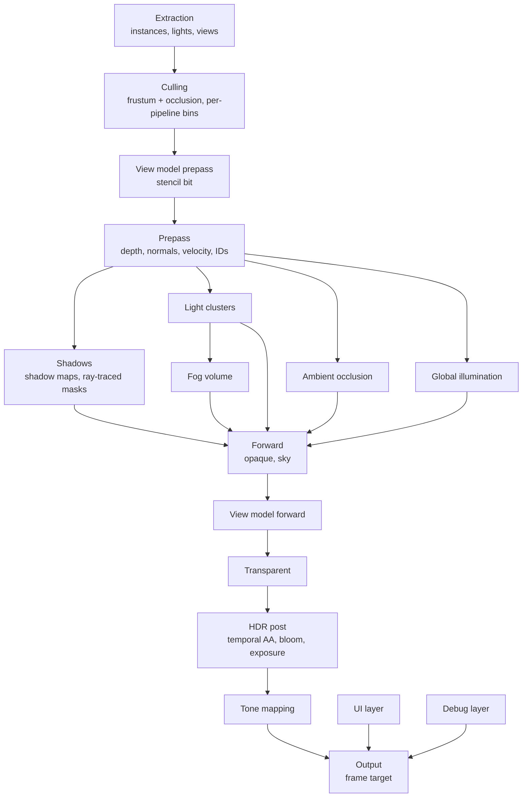
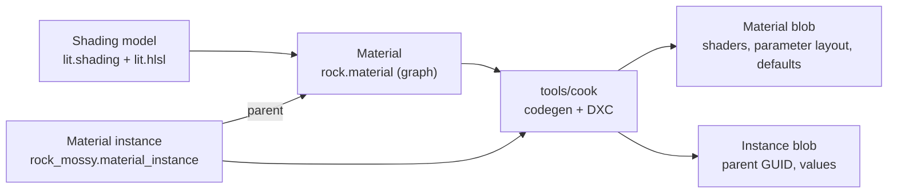

# Rendering

The built-in renderer draws the world, a first-person view model, the UI and debug drawing into one frame. It is in `lib/engine/render`, on top of the render graph, and it records everything through `lib/core/gpu` (see [GPU](gpu.md)). A game uses the built-in renderer or builds its own graph. The sample's hand-written frame becomes the second case.

## Goals

- **Layers:** the world, the view model, the UI and debug drawing each have their own target and their own rules, and one output pass combines them.
- **Shading models:** a new lighting model is one HLSL file and one declaration. Materials pick a shading model, and every pass that draws them works without changes.
- **Materials from graphs:** a node graph in the editor makes a material. A material instance changes its parameters and needs no new shaders.
- **Room to grow:** volumetric fog, global illumination, bloom, exposure, tone mapping, ambient occlusion and ray-traced shadows each have a fixed place in the frame and the inputs they need.

## Decisions

| Question | Decision | Why |
|---|---|---|
| Shading path | Clustered forward, with a depth and normal prepass | See [Clustered forward](#clustered-forward). |
| Depth | Reversed infinite Z: depth is `near / z`, test `Greater`, clear 0 | `D32_Float` has its precision near 0. Reversing puts that precision in the distance instead of at the near plane, where nothing needs it. |
| Scene color | `RGBA16_Float`, linear, pre-exposed | Bloom, exposure and tone mapping need HDR. Pre-exposure keeps bright values inside the half-float range. |
| View model | A second view drawn into the scene's targets, not a separate target | See [View model](#view-model). |
| UI and debug | Separate targets, combined after tone mapping | Tone mapping and exposure do not change them, and the scene can render at a lower resolution than they do. |
| Instance positions | Relative to a render origin that snaps to a 1024 m grid, in a persistent GPU scene | See [GPU scene](#gpu-scene). |
| Anti-aliasing | Temporal, no MSAA | Fog, GI and ambient occlusion all need temporal accumulation, so the frame has the history and velocities anyway. |

## Frame



- The render graph culls every pass whose result nothing reads. A feature that is off adds no passes, and the passes that read its result read a default texture instead, for example a white ambient occlusion texture.
- Ambient occlusion, light clustering, the fog volume and exposure run on the compute queue where they can (see [GPU](gpu.md#queues)). They depend only on the prepass, so they overlap with the shadow passes.
- The renderer is a `render.Renderer` in `Game_State`: the residency table, the transient texture cache, the debug lines, the mesh extractor, the materials, the GPU scene, the lights' extractors and clusters, the shadows' acceleration structure, and later the history textures and the settings. It holds handles only, so a code reload keeps it (see [Hot reload](hot-reload.md#rules)). A game calls `renderer_init` after its world and asset runtime, `renderer_reload` in `on_reload`, which makes its registrations again and updates every pipeline at the next frame, and `renderer_destroy` at shutdown.
- A game calls `render.draw_frame(&renderer, &world, frame_desc)` once a frame. `Frame_Desc` is in frame memory: the view, the size, whether to keep the IDs and the depth for the editor, the entity slots not to draw (the editor's hidden ones), the exposure, the clear color, the ambient light until global illumination (`Ambient`, `DEFAULT_AMBIENT` when zero), the hooks, and the editor's material previews to draw (see [Material previews](#material-previews)). The lights are components (see [Lights and clusters](#lights-and-clusters)).
- **Hooks** add a game's own work, in the order of the frame. Each is optional, and each gets the `render.Frame`, which holds the graph, the view and its projection, the targets, and the hooks' `data`:

| Hook | When | What it does |
|---|---|---|
| `before_world` | Before the prepass | Adds passes, such as culling on the compute queue |
| `after_prepass` | After the prepass | Adds passes that read `Frame.depth`, `Frame.normals` and `Frame.velocity` |
| `world_uses` | When the world pass is declared | Declares what `world_draw` reads |
| `world_draw` | In the world pass, the forward pass, `world_pieces` pieces, after the meshes in piece 0 | Records draws into the world's targets |
| `after_world` | After the world pass | Adds passes, such as post effects; a pass that makes a new scene color sets `Frame.scene` to it |
| `ui` | After a pass that clears the UI target | Adds passes that draw the UI; they load it |
| `debug` | After the debug lines | Adds passes that draw into the debug layer, such as the editor's tools |

- The hooks are procedures in the game DLL, so they are never stored in `Game_State`. *Phase 6 adds a hook before post.*
- **A game's own draws** in `world_draw` are not in the prepass. They test and write the depth that the prepass left, write the scene color and their IDs, and have no normals or velocities, no shadows from the renderer and no clusters' lights unless their shaders read them.
- **Missing shaders:** a pass whose pipeline does not exist yet, because its shader is not cooked, records nothing, so the frame still validates.

### Views

- A `render.View` is a camera: its pose, its projection, its viewport, and its layers. The editor's camera and the game's camera both give one (see [Editor](editor.md#viewport)).
- A frame has one main view, and in the editor the [material previews](#material-previews). More views come later: split screen, reflection captures. Each view has its own clusters, history and scene color. Every view uses the same [GPU scene](#gpu-scene), because its poses have no camera rotation (see [World](world.md#render-extraction)).
- A view's constants hold its offset from the render origin as an `f32` vector, with its rotation and projection.

## GPU scene

The GPU scene holds every instance's record in a persistent buffer, `Gpu_Scene` in `lib/engine/render/scene.odin`: its pose and its last frame's pose as the rows of 3x4 matrices, and its entity's ID for the editor. Each frame's draw items carry the rest: the mesh, the submesh's indices and bounds, and the material.

- **Render origin.** Poses are relative to the render origin, a `World_Position` snapped to a grid of 1024 m. Snapping is an integer mask on the Q39.24 values, so the offset between two origins is exact. Shaders subtract the view's offset from the origin, so their error near the camera is about one `f32` unit at 1024 m, about 0.06 mm.
- **Rebasing.** The origin moves when the camera is more than 1.5 cells from it, so a camera on a cell's edge does not move it back and forth. A rebase writes every record again, rebuilds the top-level acceleration structure, and moves every world-space history (last frame's poses, cached shadow maps, GI probes) by the exact offset.
- **Stable slots.** Each rendered entity has a slot for its whole life, at most `MAX_INSTANCES` (16 384). A free list gives slots, and a map from entity to slot, in host memory, lives in the `Renderer`. A slot whose entity has no `Mesh_Renderer` in a frame is free again. A soft restart builds them again. Culling, the acceleration structure's instance IDs and the occlusion culling's visibility from the last frame all index by slot.
- **Camera-relative records.** The view model's instances have slots in the GPU scene, but their rows are relative to the camera, and last frame's relative to last frame's camera, not to the render origin. The view model is within a meter of the camera, where the render origin's error would show as about a pixel of jitter at the near plane. The debug shapes are not in the GPU scene; the debug layer writes them relative to the camera every frame.
- **Updates.** Every frame writes every slot, relative to the render origin, into the upload ring, and a copy moves them into the persistent buffer: 112 bytes per instance with both poses. Last frame's pose is the slot's presented pose of the frame before, or this frame's for a new slot. Every GPU-side consumer has its final layout. *Later, extraction writes only the slots that changed (see [Future work](#future-work)).*
- **Draw items** are one per submesh of each visible `Mesh_Renderer` whose mesh is resident: its slot, its mesh's record, its indices, its material's block, its bin, and its submesh's bounding sphere. Hidden entities (`Frame_Desc.hidden`) keep their slots but have no items.
- **Culling** is a compute pass, `cull_draws.hlsl`, with a row of the dispatch for each view: the camera (`VIEW_CAMERA`), the view model (`VIEW_VIEW_MODEL`), then each shadow view (see [Shadows](#shadows)). It tests each item's sphere, moved by its instance's rows and the view's offset from their space, against the view's six planes; the camera's and the view model's far planes are at infinity. A shadow view takes only the items that cast shadows (the `Mesh_Renderer`'s `cast_shadows` and the material's), the view model's view only the view model's items, and every other view leaves those out. A visible item takes the next place in its bin of that view with an atomic add, and writes there both its indirect draw, whose draw ID is that place, and its draw record. Each view has room for every item, and each bin has the same range in every view. *Occlusion culling, and culling on the compute queue, come later.*
- **Drawing:** the prepass, the shadow maps and the forward pass each draw a bin of their view with one `cmd_draw_indirect` and the bin's count, with the bin's material's pipeline for their pass. The vertex shader reads its draw record by its draw ID, and pulls its index from the mesh's index buffer, then its vertex: every mesh has buffers of its own, so no one index buffer could be bound for a bin. *The mesh shader path draws meshlets instead, later.*
- **The frame's constants** (`Frame_Constants`, the pass constants of every material pass) hold the view's projection and last frame's, the camera's offset from the origin and last frame's camera's, the ambient light, the cascades' splits, the records' bindless indices and their offsets in the upload ring (mesh records, material table, lights, shadow views), and the clusters' grid. Each shadow view has a copy with its own projection, which takes positions relative to the camera too, so the depth pass places vertices with the same code. The forward pass pushes the shadow atlas and the shadow mask (`Material_Push`), which exist only once the frame records.
- **The acceleration structure.** With `Ray_Query`, each instance whose `Mesh_Renderer` casts shadows is an instance of the GPU scene's top-level acceleration structure, in the render origin's space, with its slot as its ID. It is built again every frame that traces shadows.

## Layers

| Layer | Target | Space | Depth | Composited |
|---|---|---|---|---|
| World | Scene color, `RGBA16_Float` | Linear HDR | Scene depth | Is the base |
| View model | The world's targets | Linear HDR | Scene depth, its own projection, a stencil bit | In the forward pass |
| UI | `RGBA8_Unorm`, premultiplied | sRGB-encoded, blended as encoded | None | In the output pass, over the tone-mapped scene |
| Debug | `RGBA8_Unorm_Srgb`, premultiplied | Linear, which the target's sRGB view encodes; the output pass blends it as encoded | Tested lines test scene depth; overlay lines ignore it | In the output pass, over the UI |

- The renderer makes the UI target only with a `ui` hook, and the debug layer only with debug lines or a `debug` hook. Without them, the output pass reads neither.

### View model

A first-person view model needs its own field of view, and it must never go into a wall. A separate target that is composited on top does both, but the view model then misses everything that runs on the scene: it receives no shadows from the world and casts none, it has no ambient occlusion or fog, temporal AA and motion blur do not see it, and bloom and exposure treat it apart from the world. The renderer therefore draws the view model into the world's own targets, as a second view:

1. **The view model prepass runs first.** It draws the view model with its own projection and writes depth and stencil bit 0 (`VIEW_MODEL_STENCIL`). The scene's depth is `D32_Float_S8_Uint` for the stencil.
2. **The world prepass tests stencil bit 0** and draws nowhere that the view model is. A wall that is closer than the arms never covers them. One prepass pipeline does both: its test is `Greater_Equal` against the reference with `Replace`, and the view model draws with the bit as the reference, which passes everywhere and sets it, and the world with 0, which passes only where the bit is clear.
3. **The view model's forward pass** shades it with the world's lights and shadows, and later its GI and fog. Its records are relative to the camera, not the render origin (see [GPU scene](#gpu-scene)), but they are still world-space positions with no camera rotation. Only its projection differs, so its lighting matches the world's. The forward pipeline tests the stencil bit `Equal` to the reference, so the world's draws never shade the view model's pixels either.
4. **Passes that rebuild positions from depth check the stencil bit**, and use the view model's projection and near plane for its pixels. The shadow mask reads the bit through the depth texture's stencil view (`gpu.stencil_index`). The forward pass finds a pixel's cluster from its position, projected as the camera's projection would place it, not from the pixel, because the clusters are the camera's screen tiles. *Later,* ambient occlusion and fog check it the same way, and depth of field leaves those pixels sharp.

- **Which entities:** those with a `Mesh_Renderer` and the `View_Model` tag (stable ID 37). Their pose is in the world, usually as a child of the camera, so they follow it.
- **The projection:** the camera's `view_model_fov` and `view_model_near`, which reach the frame as `View.view_model_fov` and `view_model_near`; 0 means the camera's own. `view_model_view` gives the view that it draws with. A nearer near plane lets the view model come closer to the eye than the world does.
- **Shadows:** the view model receives the world's shadows: the shadow maps sample at its position relative to the camera, and the mask traces from it. It casts none, into the world or onto itself, because its pose is not its real place in the world: it is in no shadow view and not in the acceleration structure.
- **A game's own draws** in `world_draw` test the stencil bit with `render.WORLD_STENCIL`, so they never cover the view model either. The sample's pipelines do.
- **Debug lines** that test depth compare it only with the world's pixels: over the view model, they draw at the hidden part's alpha, as behind a wall.
- A game that wants a truly separate target can use a hook at `Before_Post`, which still composites in linear HDR before post.

### UI

- The UI draws into its own target in sRGB-encoded values, and blends them as encoded values, as design tools do. A color that a designer picks is the color on the screen.
- The output pass combines the UI with the tone-mapped scene in its shader, not with fixed-function blending, so it can blend in sRGB space and later scale the UI to the display's paper white for HDR output.
- The UI target has the frame target's size. The scene can render at a lower resolution, and the UI stays sharp.
- The UI renderer itself is not part of this design. It only has to write into the UI target, through the `ui` hook. The sample draws a HUD panel there, with colors picked as sRGB values, and the `Premultiplied` blend.

### Debug

- `cinnabar:engine/debug` is an immediate API: `debug.line`, `debug.box`, `debug.sphere`, `debug.circle`, `debug.arrow`, `debug.axes`, and later text. Each takes a `debug.Draw` (the renderer's is `Renderer.debug`), `World_Position`s, a linear color, a duration in seconds (0 is this frame only) and a mode: `Tested` or `Overlay`. Every shape is lines.
- Any job can call it: a line takes its slot in one array with an atomic add, and lines past `MAX_LINES` are dropped. The array is in host memory, so lines with a duration survive a code reload. `draw_frame` uploads the lines relative to the camera, the tested ones first, and `end_frame` then drops those of this frame only and those that expired.
- Each line is a quad two pixels wide that the vertex shader makes, and a line that passes behind the camera is clipped where it does. Tested lines draw twice: with depth `Less` at `DEBUG_HIDDEN_ALPHA`, then with `Greater_Equal` at full alpha.
- **Tested** shapes read scene depth. The hidden part draws with a lower alpha, so a shape inside a wall still shows where it is. **Overlay** shapes draw over everything.
- The colors are exactly the colors given: no exposure, no tone mapping, no fog.
- The editor's selection outline and gizmo draw into the debug layer: the game adds `editor.add_viewport_passes` in its `debug` hook, with `Frame.debug` as the target (see [Editor](editor.md#viewport)).
- Release builds compile the debug calls out: the justfile's release build sets `DEBUG_DRAW` false.

### Output

The output pass is one full-screen pass that writes the frame target (`lib/engine/content/shaders/output.hlsl`):

1. Read the scene, scaled by the exposure, and tone map it. Until the tone mapping lookup table (phase 6), the pass tone maps itself with Khronos PBR Neutral, which keeps colors up to 0.76 as they are. *Later, it reads the tone-mapped scene, upscaled to the frame's size if the scene's resolution is lower.*
2. Encode it to sRGB.
3. Blend the UI over it, then the debug layer, both as sRGB-encoded values.
4. Write the result. The frame target has an sRGB view (`FRAME_TARGET_FORMAT`), so the pass decodes the result to linear first and the view encodes it again.

*HDR output* needs a frame target in `RGB10A2_Unorm` (PQ) or `RGBA16_Float` (scRGB) from `core`. The output pass then encodes for the display instead of step 2, and scales the UI and debug layers to paper white. Only this pass changes.

## Clustered forward

Forward shading with a prepass is the default and only path at first.

- **Many shading models cost nothing.** Each material's pixel shader runs its own shading model. A deferred path would have to pack every model's inputs into one G-buffer and branch on a model ID.
- **Transparent surfaces** use the same light loop as opaque ones.
- **The prepass gives the screen-space passes their inputs:** depth, a normal and a velocity for each pixel. Ambient occlusion and screen-space GI then run before the forward pass, and the forward pass applies them to indirect light only, which a deferred or a plain forward path gets wrong or gets a frame late.
- **The clusters serve fog too.** The fog volume's froxels and the light clusters share their depth slices, so fog reads the same light lists.
- **The prepass removes overdraw.** The forward pass tests depth with `Equal` and shades each pixel once.

### Prepass

- Writes depth, the normal in the world (folded into the octahedron, `NORMAL_FORMAT`, `RG16_Float`) and the velocity: how far the surface moved on the screen since last frame, in UV (`VELOCITY_FORMAT`, `RG16_Float`), from the instance's last pose and last frame's camera and projection. *The stencil bits come with the view model (phase 4).*
- **The IDs stay in the forward pass.** It shades each visible pixel once, so it writes each pixel's ID as the prepass would, and a game's own draws in `world_draw` write theirs in the same target.
- The normal is the material's normal, normal maps included. The prepass's pixel shader returns only the normal, so DXC drops the parts of `evaluate` that only the other surface inputs need; the opacity still discards for a masked material.
- The forward pass places vertices with the same code, `clip_position` in `material_vertex.hlsli`, whose result is `precise`, so its depths equal the prepass's for its `Equal` test.
- *Later:* opaque materials with no vertex offset and no mask share one prepass pipeline for depth, and one with normals for each normal source, so most draws use a few pipelines. That needs bins by pass, not only by material.
- *Later:* **occlusion culling** is two-phase: draw what was visible last frame, build a depth pyramid, then test everything else against it and draw what passes.

### Lights and clusters

- **Light components:** `Directional_Light`, `Point_Light` and `Spot_Light` (see [Components](#components)), later area lights. Each frame, `extract_lights` writes them relative to the camera into the upload ring (`Light_Record`), the directional ones first, at most `MAX_LIGHTS` (1024), of which `MAX_DIRECTIONAL_LIGHTS` (4). The editor's hidden entities light nothing.
- **A light's falloff:** its color times its intensity. A punctual light falls off with the square of the distance, windowed to 0 at its range: `saturate(1 - (d / range)^4)^2 / d^2`. A spot light's cone also falls off from 1 at its inner angle to 0 at its outer angle, squared.
- **Clusters:** a compute pass (`cluster_lights.hlsl`) assigns the punctual lights to clusters: tiles of `CLUSTER_TILE` (64) pixels, in `CLUSTER_SLICES` (32) depth slices, exponential from the near plane to `CLUSTER_FAR` (500 m); the last slice reaches on to infinity. A thread for each cluster tests each light's sphere against the cluster's box in view space, so a spot light counts as its whole sphere. It takes room for its lights in one index list with an atomic add, and writes its offset and count. The list has room for `CLUSTER_AVERAGE_LIGHTS` (32) lights per cluster on average; a cluster that finds it full gets fewer. The clusters' buffers live in the `Renderer` and grow with the frame's size.
- **The forward pass** finds its pixel's cluster from its position and its depth (`cluster_of`), and calls the shading model's `shade_direct` for each directional light, then for each light of its cluster, with the light's shadow (`material_lighting.hlsli`). Until the cluster pipeline exists, the forward pass leaves the punctual lights out.
- The directional lights are not clustered. Every pixel loops over them.

### Shadows

| Light | With `Ray_Query` | Without |
|---|---|---|
| Directional | A screen-space mask: a compute pass traces from the prepass depth | Cascaded shadow maps |
| Spot, point | A mask for the few most important; maps for the rest | A shadow atlas |

- **Which lights:** the lights that cast shadows take them in order: the directional lights, then the punctual lights by how much light they bring to the view (their brightest channel over their squared distance), leaving out those whose spheres miss the view (`assign_shadows`). With `Ray_Query`, the first `MAX_MASK_LIGHTS` (4) take the mask's channels. The others take shadow maps while the atlas has room. Only one directional light has cascades; another without a mask channel has no shadow.
- **The shadow mask** is a screen-space texture, `RGBA8_Unorm`, with one channel for each traced light. A compute pass (`shadow_mask.hlsl`) rebuilds each pixel's position from the prepass's depth, moves it off the surface along the prepass's normal, and traces one ray toward each light with `RayQuery`, accepting the first hit. A light records its channel, and the forward pass reads the channel at its pixel. The shadows are hard. This is the sample's ray-traced shadow, made general.
- **Acceleration structures:** a mesh's bottom-level structure holds all its triangles, opaque, and the residency table creates it when the mesh becomes ready (see [GPU residency](#gpu-residency)). The frame that next traces builds it, then the top-level structure (see [GPU scene](#gpu-scene)).
- **The atlas:** one `D32_Float` texture of `SHADOW_ATLAS_SIZE` (4096), a frame's transient. A cascade takes a cell of `SHADOW_CELL` (1024) pixels, from the first cells; a spot light takes a slot of `SHADOW_SLOT` (512), four to a cell, and a point light six slots, one for each face of its cube.
- **Cascades:** four, which cover the view to `SHADOW_DISTANCE` (100 m), split between even and exponential by `SHADOW_SPLIT_LAMBDA` (0.75). Each is an orthographic view of the bounding sphere of its slice of the view's frustum. The sphere's radius is rounded up to sixteenths of a meter, and its center snaps to the cascade's texels in the render origin's space, so the shadow's edges stay still as the camera moves and turns. Depth is clamped, not clipped, and culling has no plane toward the light, so casters between the light and the view still cast.
- **Spot and point lights:** a perspective view with reversed depth from `SHADOW_NEAR` (5 cm), as wide as the spot light's cone or 90° for each cube face, culled at the light's range.
- **The depth pass:** the shadow maps are one render pass with a piece for each view, each with its own viewport of the atlas. Each draws its view's bins with each material's depth pipeline, so masked materials cast the right shadows. The pipelines have a depth bias and a slope bias against acne, `SHADOW_DEPTH_BIAS` and `SHADOW_SLOPE_BIAS`.
- **Sampling:** the forward pass moves the point along its normal by one and a half texels of the view, projects it, and takes four bilinear comparisons a half texel apart with a comparison sampler, which filter a 3x3 neighbourhood. The taps stay inside the view's rectangle. A directional light picks the first cascade that reaches the pixel's depth; beyond the last, it casts no shadow. A point light picks the face of the direction from the light.
- *Later:* the forward pass traces in the pixel shader with `RayQuery` for transparent surfaces, which have no prepass depth. Soft shadows from traced lights, with a denoiser. Cached shadow maps for static lights and casters.
- The ray-tracing pipeline path stays the sample's alternative (see [GPU](gpu.md#ray-tracing)). Every ray-traced path has the shadow map fallback: a device without `Ray_Query`, and the lights after the mask's four, take shadow maps.

### Transparency

- Transparent and additive draws go after the opaque forward pass and the view model. They test depth and do not write it.
- They draw sorted back to front by the distance of each instance's bounds from the camera. Sorting is per instance, not per triangle, so a mesh that overlaps itself can show the wrong order. Two-sided transparent materials draw their back faces first, then their front faces.
- They light with the same template as opaque surfaces: the light clusters, the fog volume and the GI. They have no prepass, so ambient occlusion and screen-space shadow masks do not apply to them, and ray-traced shadows trace in the pixel shader (see [Shadows](#shadows)).
- Sorting happens on the CPU after culling at first. Sorting on the GPU comes with more transparent instances.
- *Order-independent transparency comes only when a game needs it (see [Future work](#future-work)).*

## Materials



### Shading models

A shading model is a lighting model: `Unlit`, `Lit` (metallic and roughness), later `Subsurface`, `Cloth`, `Toon`. It is two content files, so a game adds its own in its content root:

- `<name>.shading` declares it (see [Content pipeline](content-pipeline.md#materials)): its surface inputs with their types and defaults, and flags: `no_lighting` (skip the light loop), later `needs_shadow_mask`. Its name is the file's, such as `lit`.
- `<name>.hlsli`, beside it, implements it. It is an include, not an asset. The cooker generates the `Surface` struct and `default_surface()` from the declaration, and the file defines:

```hlsl
float3 shade_emission(Surface s);
float shade_opacity(Surface s);
// Unless no_lighting:
float3 shade_direct(Surface s, Shading_Point p, Light light);
float3 shade_indirect(Surface s, Shading_Point p, Indirect indirect);
```

- **The engine's:** `lib/engine/content/shading/lit` (GGX specular with Smith visibility and Schlick's Fresnel, Lambert diffuse, and Karis's fit of the environment BRDF for indirect specular) and `unlit` (its color, as it is).
- **A tangent-space normal:** a shading model whose inputs include a `float3 normal` takes it in tangent space, as a normal map gives it, and the template maps it to the world before shading.
- The engine's forward template owns the light loop. For each directional light and each light in the pixel's cluster, it calls `shade_direct` with the light's color after its falloff and its shadow (see [Lights and clusters](#lights-and-clusters)). Then it calls `shade_indirect`, and adds the emission. `Unlit` has `No_Lighting` and only emits.
- *Until global illumination,* the indirect light is the ambient light: the sky's color from above and the ground's from below (`Frame_Desc.ambient`). *Later,* `shade_indirect` gets the GI and the ambient occlusion.
- The material graph's output node has one input for each surface input of its shading model. The cook link sends the shading models to the editor with the importers, so the editor shows the right inputs.
- Fog, exposure and the shadow mask are applied by the template, not by shading models.

### Material

A material is a `.material` text file (see [Content pipeline](content-pipeline.md#materials)). The editor's material editor writes its graph, as the editor writes scenes (see [Editor](editor.md#material-editor)). It has:

- **Settings:** the shading model, the blend mode (`Opaque` and `Masked` now; `Transparent` and `Additive` with sorted transparent draws), the domain (`Surface`, later `Decal`, `Post_Process`, `UI`), two-sided, casts shadows.
- **Parameters:** scalars, vectors, colors, textures and static switches, each with a name, a default and a group for the editor.
- **The graph:** nodes and links (see [Content pipeline](content-pipeline.md#material-graphs)). Nodes include math, texture samples, parameters, time, world position (relative to the camera), vertex attributes, static switches, material functions (`.material_function` assets, graphs that a node calls) and a custom HLSL node.

The cooker turns the graph into an HLSL function, `Surface evaluate(Material_Inputs inputs)`, and compiles it into each pass's template. A material's `evaluate` can also be HLSL written after a `---` line of the file, which is how the built-in materials exist. `evaluate` reads its parameters from the generated `params`, and its static switches as defines; a graph's switch nodes are decided when each variant generates its source, so they need no defines.

**No raw stage inputs.** Generated code reads attributes only through `Material_Inputs`, and samples textures only through `cn_sample`, which takes the derivatives from the inputs. A later visibility buffer path can then fill the inputs from barycentrics and analytic derivatives without changing a material (see [Open questions](#open-questions)).

### Permutations

The cooker compiles each material for each pass and each vertex path:

| Axis | Values |
|---|---|
| Pass | `Forward`, `Prepass` (depth, normals, velocity), `Depth` (shadow maps) |
| Vertex path | Vertex pulling; the mesh shader path and skinning later (see [GPU](gpu.md#mesh-shaders)) |
| Static switches | Each combination that the material or an instance uses |

- One generated source holds every pass, each by its entry points (see [Content pipeline](content-pipeline.md#materials)). DXC keeps only what each pass's outputs need: the depth pass of an opaque material has no pixel shader and no material code. *Later,* such materials share one depth pipeline.
- The cooker names each generated source by its hash, which covers what it includes, so identical permutations compile once, and a source that an earlier cook compiled is not compiled again. *Later, the renderer shares one pipeline among the identical permutations of a material and of materials, which needs the blob to give each variant's hash, and an update in place to move a changed material to its new pipeline without a frame of nothing.*

### Material instance

A `.material_instance` names its parent (a material or another instance) and overrides parameters. Changing a parameter changes data, never shaders.

- **Static switches** can be overridden in an instance. The override selects another permutation of the parent material. The cooker compiles each permutation that some instance uses, once, under the hash of its generated HLSL, so instances that set the same switches share it.
- A material's blob holds every permutation that its instances use. A new instance that sets switches no other instance set cooks the material again.
- A dynamic instance cannot change static switches at runtime, because that would need a permutation that was never cooked.
- The editor shows how many permutations each material has, so a material whose instances set many combinations of switches is easy to see.

At runtime, `render.material_instance(parent)` makes a dynamic instance whose parameters a game or a script sets every frame.

### Runtime

- **One table.** Each frame uploads a table with a block for each material or instance that it draws (`Material_Table`, in `lib/engine/render/materials.odin`). A block holds the parameters in the layout that the material's blob gives, with each texture's bindless index written: the resident texture, or the default for its parameter (white, black or a flat normal) until it is resident. Each draw record holds its block's offset. *A persistent table that writes only what changed comes with larger scenes.*
- **Pipelines by material.** The renderer creates the pipelines of each material and switch combination that a draw needs, one for each pass, from the material's blob, at most `MAX_MATERIAL_PIPELINES` combinations. Instances with the same switches share them. A two-sided material culls no faces. The forward pipeline tests depth `Equal` and does not write it.
- **The default material.** A submesh without a material, or whose material cannot draw (not cooked, or without the variant that its instance needs), draws with the engine's default material, `lib/engine/content/materials/default.material`.
- **Bins.** Culling writes each visible draw into the bin of its pipeline. Each bin is one indirect draw with a count buffer (see [GPU](gpu.md#gpu-driven-rendering)).
- **Hot reload.** A new material blob updates its pipelines with `update_graphics_pipeline`, so the old shaders draw until the new ones compile. A new instance blob rewrites its parameter block. Both come through `asset.poll` (see [Content pipeline](content-pipeline.md#loading)).
- **Missing pipelines.** A bin whose pipeline is not compiled yet draws nothing until it is, which is the backend's rule for every pipeline. *Later, it draws with the default material in the same blend mode, so nothing pops in as a hole.*

### Material previews

The editor's material editor shows the material on a mesh. The game renders it with the renderer, as a second kind of view, into a second shared target. The preview therefore uses the same shaders, shading models and passes as the game.

- **Its own scene.** A preview does not draw the world. It draws one preview mesh with the material, lit by one directional light from over the camera's shoulder and the default ambient light, with the material's prepass and forward pipelines, then tone maps it with the output pass. The mesh is one of the engine's, a sphere, a cube or a plane, each 1 m across (`lib/engine/content/models/preview.gltf`, `render.preview_mesh`), or a mesh asset. Its records are relative to its camera, which orbits the mesh's middle. It has no shadows, no clusters, no fog, no GI and no temporal passes, so it keeps no history.
- **In the frame's graph.** `Frame_Desc.previews` gives the previews that a frame draws (`render.Preview_Desc`): the target, the material, the mesh and the camera. `draw_frame` adds each one's passes to its graph: a copy of its records into the renderer's preview buffers, which the shaders read from their starts, its prepass, its forward pass and its output pass. A preview without its mesh or its material clears its target to the background.
- **Complete.** `draw_frame` sets a preview's `complete` when its mesh was resident, its pipelines were compiled (`gpu_pipeline_ready`) and its textures were resident, so the game draws it again until it shows the material as it is.
- **Its own shared target.** Each preview has a set of shared textures and a fence, named and paced as the viewport's are (see [GPU](gpu.md#presentation) and [Editor](editor.md#viewport)): `<name>.preview<id>.g<generation>.texture0..2`, with IDs below `gpu.MAX_PREVIEW_TARGETS` (4). `gpu_preview_target` gives the game a target's texture for a frame, at most `gpu.MAX_PREVIEW_SIZE` (1024) on each side, and `gpu_release_preview_target` releases it.
- **Only when needed.** The game's editor package (`editor.previews`, which the game's frame puts in `Frame_Desc.previews`) draws a preview when its material, its mesh, its camera or its size changes, until it is complete, and every frame while its material reads the time (the blob's `Reads_Time`). It draws at most one in each frame, in turn, and none whose target the editor may still be reading.
- **Editor link messages:** `Open_Preview` with the preview's ID, the material or instance GUID and whether to load the unsaved blob, `Preview_Settings` with the mesh, the orbit camera and the size, `Close_Preview`, and `Preview_Target` from the game with the shared target's name and generation. The editor acknowledges each frame that it copies with `Preview_Acknowledged`, which the host handles. The editor's side is in [Editor](editor.md#material-editor).
- **Unsaved changes.** The preview shows a graph that the user has not saved. The editor sends the graph's text to the cook daemon in a `Cook_Preview` message on the cook link. The daemon cooks it under the material's GUID into a separate preview area of the cache, `build/cache/dev/preview/<guid>.blob`, and once a cook has succeeded, the editor opens the preview again with `unsaved`, so the game loads the preview's material from there (`asset.preview_blob`). The game checks the blob's time each frame while the preview is open, and a new one makes the renderer update the preview's own pipelines, which draw the old shaders until the new ones compile. The game's material changes only when the file is saved. A preview of an instance shows its cooked blob.
- **Time:** materials read the frame's time as `Frame_Constants.time`: seconds since the host started, wrapped every hour so that a float keeps its precision.
- **Thumbnails.** The content browser's thumbnails for materials, meshes and textures can come from the same view: the game renders a preview at a fixed size and reads it back (see [Content pipeline](content-pipeline.md#implementation-phases), phase 4).

## Post-processing

All post passes before tone mapping work in linear HDR at the scene's resolution.

| Pass | Method | Inputs |
|---|---|---|
| Temporal AA | Reprojection with velocity, neighborhood clamping; an upscaler later | Scene color, velocity, depth, history |
| Bloom | A chain of downsamples and upsamples with a 13-tap filter | Scene color |
| Exposure | A luminance histogram on the compute queue; the result scales the next frame (pre-exposure) | Scene color |
| Tone mapping | A 3D lookup table that a compute pass bakes when the settings change: the curve (AgX by default; Khronos PBR Neutral, ACES) and color grading | Scene color, bloom, exposure |

## Later features

| Feature | Place in the frame | Inputs | Output read by |
|---|---|---|---|
| Ambient occlusion | After the prepass, compute queue. GTAO with a temporal denoiser. | Depth, normals, velocity | `shade_indirect` |
| Volumetric fog | After light clustering. A froxel volume with the clusters' depth slices: inject density and light, accumulate over time, integrate along each view ray. | Light clusters, shadow maps or masks, history | The forward and transparent templates |
| Global illumination | After the prepass. Behind one interface: `Indirect` holds diffuse and specular indirect light for a pixel. First radiance cascades in screen space; a world-space probe grid with ray tracing later. | Depth, normals, last frame's lit color, history | `shade_indirect` |
| Ray-traced shadows | See [Shadows](#shadows). | Depth, the acceleration structure | The forward template |
| Sky and atmosphere | Lookup tables baked when the sun moves; the sky draws in the forward pass where depth is 0. | The directional light | Forward, fog, GI |

**History textures.** Temporal AA, exposure, fog, GI and the denoisers each keep textures from frame to frame. The render graph gets `history_texture`: a pair of textures that a cache in `Game_State` keeps and swaps every frame, and that it clears when the view's size changes. The pass that writes this frame's texture reads last frame's.

## GPU additions

The design needs these changes in `lib/core/gpu` and the render graph:

- *Done in phase 3:* depth bias and clamping, and comparison samplers (see [GPU](gpu.md#pipelines)).
- *Done in phase 4:* stencil state in `Graphics_Pipeline_Desc`, the reference value in a command, the stencil's load and clear with the depth attachment, and a view of the stencil for shaders.
- *Done in phase 5:* preview targets beside the frame target (`gpu_preview_target`), and whether a pipeline is compiled (`gpu_pipeline_ready`) (see [GPU](gpu.md#presentation)).
- **Read-only depth:** a `Depth_Read` texture use in the graph and the `Depth_Stencil_Read` layout, so a pass can test against depth while another reads it as a texture.
- **History textures** in the render graph (see [Later features](#later-features)).
- **An HDR frame target** from `core`, for HDR output.
## Assets and components

The renderer draws shader, texture and mesh assets, which the cooker makes (see [Content pipeline](content-pipeline.md#shaders)).

### GPU residency

The asset runtime keeps blobs on the CPU. The renderer's residency table, in `Renderer`, gives the GPU resources of the assets that it draws.

- **By GUID.** `render.resident_texture(&renderer, guid)` and `render.resident_mesh(&renderer, guid)` return the GPU handles and whether they are ready. The first call loads the asset, creates its resources and streams its data with `gpu_stream_texture` and `gpu_stream_buffer` (see [GPU](gpu.md#streaming)). Each later call is a lookup.
- **Until a resource is ready**, a texture gives the default for its usage (white, a flat normal, black) and a mesh draws nothing. Nothing waits for a stream.
- **Hot reload.** When `asset.poll` swaps a blob, the table streams the new data into new resources, and switches to them only when their transfers are done, so the old version draws until then. Then it destroys the old resources.
- **Shaders** are not in the table. A `render.Shader_Pipeline` names its shader by the GUID in the shader's `.meta` file. `render.sync_graphics_pipeline`, `sync_compute_pipeline` and `sync_ray_tracing_pipeline`, called each frame, load the shader, create the pipeline from the blob's entries, and update it when `asset.poll` swaps the blob. On a code reload, `force` updates every pipeline with the new descriptions. A shader change therefore needs no code reload: the daemon cooks it, and the next frame's pipeline compiles from it.
- **Lifetime.** Resident resources have the `Game` scope. A soft restart destroys them with the old game, and loads the assets again, as it loads every asset again (see [Content pipeline](content-pipeline.md#loading)).
- **The table** is `render.Residency`: a fixed array of `MAX_RESIDENT` entries in `Game_State`, found by GUID. `residency_update`, once a frame before drawing, swaps in what finished streaming and starts streaming each asset whose blob `asset.poll` swapped. A mesh keeps its position, attribute and index buffers, and the index ranges of its first `MAX_SUBMESHES` submeshes; 16-bit indices are padded to whole words.
- **Failures:** an asset that is not cooked, or whose blob is not of its kind, is logged once and tried again every `RESIDENT_RETRY_FRAMES` frames, or when a newer blob arrives.
- **Unused assets** stay resident. Unloading by use, and streaming mips by distance, come with larger scenes.
- **Acceleration structures:** with `Ray_Query` (`Residency.accels`), a mesh that becomes ready gets a bottom-level acceleration structure of all its triangles, which the renderer builds the next frame that traces shadows (`unbuilt_accels`).
- *Later:* the meshlet streams, for the mesh shader path.

### Asset fields

A component refers to an asset by GUID, in a `format.Guid` field with an `asset` tag that names the kind as the cook link does, in lowercase: ``mesh: format.Guid `asset:"mesh"` ``. A field without the tag takes any asset.

- **Field kind:** the field walker (`scene.component_fields`) gives such a field the `Asset` kind and its `asset_kind`, and the editor link's `Field_Info` carries both. A fixed array of asset references, such as ``materials: [8]format.Guid `asset:"material"` ``, is a field for each element, named `materials.0` and on.
- **Scenes** write the value as `$` and 32 hex digits, or `$0` for none (see [Editor](editor.md#scenes)), and the loader writes the GUID into the field. A component holds the GUID, never a loaded asset: the renderer resolves GUIDs through its residency table.
- **Missing assets:** the cooker warns when a scene names a GUID that no asset or sub-asset in the content has, as it does for a missing script. Field types exist only in the game DLL, so the cooker cannot check the kind; the editor offers and accepts only assets of the field's kind.
- **The properties panel** shows the asset's name, picks from the assets of the field's kind, and accepts one dragged from the content browser (see [Editor](editor.md#properties)).
- *Not yet:* behaviour fields of assets, and asset fields in scripts, which skip them as they skip any field type that they do not know.

### Components

- **`Camera`** (stable ID 32): the vertical field of view in radians and the near plane in meters; 0 in either means 60° or 5 cm. Also the view model's field of view and near plane, 0 for the camera's own (see [View model](#view-model)). The camera's pose is its entity's presented `Transform`, and `render.camera_view` gives the view. `Game_State` holds the active camera's entity, as world-wide state (see [World](world.md)). The game's view comes from it, unless an editor is linked (see [Editor](editor.md#viewport)).
- **`Mesh_Renderer`** (stable ID 33): a mesh, a material or instance for each of its mesh's first `MAX_MATERIAL_SLOTS` (8) submeshes (`materials.0` and on), and whether it casts shadows. `render.register_components` registers both. The renderer draws every `Mesh_Renderer` through the [GPU scene](#gpu-scene).
- **`Directional_Light`** (stable ID 34): a color, an intensity and whether it casts shadows. It shines along its entity's +z.
- **`Point_Light`** (35): a color, an intensity, a range in meters, and whether it casts shadows.
- **`Spot_Light`** (36): a point light in a cone along its entity's +z, with inner and outer half angles in radians.
- **Defaults:** a light's color of 0 means white, a range of 0 means `DEFAULT_LIGHT_RANGE` (10 m), an outer angle of 0 means `DEFAULT_SPOT_OUTER` (45°), and an inner angle of 0 means the outer angle. An intensity of 0 is a light that is off.
- **`View_Model`** (37): a tag that makes a `Mesh_Renderer` part of the view model (see [View model](#view-model)).

## Implementation phases

| Phase | Result |
|---|---|
| 0 | *Done.* In order: reversed Z. Shader assets, and the sample's and the editor tools' shaders moved to them. The BC formats in `lib/core/gpu`, and texture assets. Mesh assets. Asset fields. The residency table, `Camera` and `Mesh_Renderer`, and the sample drawing a glTF mesh. |
| 1 | *Done.* The frame skeleton: one view, the world layer, a fixed tone mapper, the UI and debug targets, the output pass. The `debug` API, and the editor's overlay moved into the debug layer. |
| 2 | *Done.* The GPU scene with the render origin and stable slots, written in full every frame. Shading models and materials written in HLSL: `Unlit` and `Lit`, material and instance assets, the material table, pipelines by material and culling into bins. The sample draws with them. |
| 3 | *Done.* Clustered forward: the prepass with normals and velocities, the forward pass with `Equal` depth, the light components, clusters, shadow maps in an atlas with cascades, and ray-traced shadow masks with the GPU scene's acceleration structures. The sample's scene has a sun, a point light and a spot light. |
| 4 | *Done.* The view model, with the stencil additions: the `View_Model` tag, its projection from the `Camera`, its stencil bit in the prepass and the forward pass, and positions rebuilt with its projection for its pixels. The sample's camera holds a rod that reaches through the triangles. |
| 5 | *Done.* The material graph: the `.material` graph format and material functions, the cooker's code generation with each permutation's switches decided and hash-named sources that compile once, the editor's node editor, and material previews in their own shared targets with `Cook_Preview`. The sample's checker material is a graph. |
| 6 | Post: history textures, temporal AA, bloom, exposure, the tone mapping lookup table. |
| 7 | Ambient occlusion and volumetric fog. |
| 8 | Global illumination with radiance cascades. |
| 9 | HDR output. |

## Future work

- **Updates of changed slots only.** The ECS reports the entities whose `Transform` changed, and the spawns and destroys. Extraction then writes only those slots: it puts (slot, record) pairs in the upload ring, and a compute pass copies each record to its slot. The cost then follows what moves, not the size of the scene. Static content gains the most. An entity with a `Previous_Transform` changes every frame, because its interpolated pose does. Edits from the editor and changes of activity take the same path. Do this when scenes pass about 50 000 instances, or when cached shadow maps or world-space GI need static content to stay still.
- **Spreading a rebase over several frames.** A rebase costs one frame what every frame costs now, so the average cost does not change, but that frame takes longer. To spread it, the renderer keeps a second GPU scene relative to the next origin, and fills it over several frames before the camera reaches the hysteresis limit. Until the switch, it must apply every update to both scenes. Do this only if measurements show a hitch at the rebase.
- **Order-independent transparency.** Weighted blended transparency for particles and effects, where its approximation is not visible, and per-pixel lists or moment-based transparency for surfaces that intersect. Do this when a game has transparent content that sorting by instance gets wrong.

## Open questions

- **A visibility buffer.** The GPU-driven mesh shader path could write triangle IDs and shade in compute, bin by material, which removes the forward pass's quad overdraw on small triangles. `Material_Inputs` and `cn_sample` keep that path open. Decide after phase 5, with measurements.
