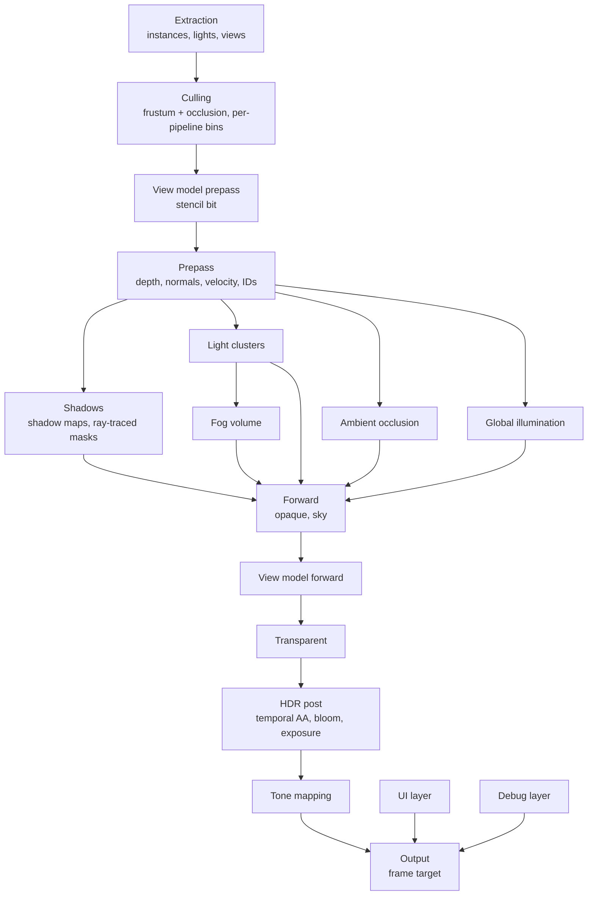
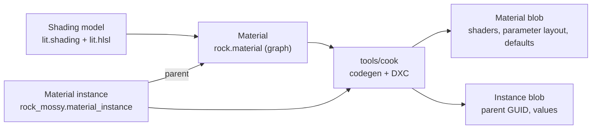

# Rendering

The built-in renderer draws the world, a first-person view model, the UI and debug drawing into one frame. It is in `lib/engine/render`, on top of the render graph, and it records everything through `lib/core/gpu` (see [GPU](gpu.md)). A game uses the built-in renderer or builds its own graph. The sample's hand-written frame becomes the second case.

## Goals

- **Layers:** the world, the view model, the UI and debug drawing each have their own target and their own rules, and one output pass combines them.
- **Shading models:** a new lighting model is one HLSL file and one declaration. Materials pick a shading model, and every pass that draws them works without changes.
- **Materials from graphs:** a node graph in the editor makes a material. A material instance changes its parameters and needs no new shaders.
- **Room to grow:** volumetric fog, global illumination, bloom, exposure, tone mapping, ambient occlusion and ray-traced shadows each have a fixed place in the frame and the inputs they need.

## Decisions

| Question | Decision | Why |
|---|---|---|
| Shading path | Clustered forward, with a depth and normal prepass | See [Clustered forward](#clustered-forward). |
| Depth | Reversed infinite Z: depth is `near / z`, test `Greater`, clear 0 | `D32_Float` has its precision near 0. Reversing puts that precision in the distance instead of at the near plane, where nothing needs it. |
| Scene color | `RGBA16_Float`, linear, pre-exposed | Bloom, exposure and tone mapping need HDR. Pre-exposure keeps bright values inside the half-float range. |
| View model | A second view drawn into the scene's targets, not a separate target | See [View model](#view-model). |
| UI and debug | Separate targets, combined after tone mapping | Tone mapping and exposure do not change them, and the scene can render at a lower resolution than they do. |
| Instance positions | Relative to a render origin that snaps to a 1024 m grid, in a persistent GPU scene | See [GPU scene](#gpu-scene). |
| Anti-aliasing | Temporal, no MSAA | Fog, GI and ambient occlusion all need temporal accumulation, so the frame has the history and velocities anyway. |

## Frame



- The render graph culls every pass whose result nothing reads. A feature that is off adds no passes, and the passes that read its result read a default texture instead, for example a white ambient occlusion texture.
- Ambient occlusion, light clustering, the fog volume and exposure run on the compute queue where they can (see [GPU](gpu.md#queues)). They depend only on the prepass, so they overlap with the shadow passes.
- The renderer is a `render.Renderer` in `Game_State`: the residency table, the transient texture cache, the debug lines, the mesh extractor and its pipelines, and later the material table, the history textures and the settings. It holds handles only, so a code reload keeps it (see [Hot reload](hot-reload.md#rules)). A game calls `renderer_init` after its world and asset runtime, `renderer_reload` in `on_reload`, which makes its registrations again and updates every pipeline at the next frame, and `renderer_destroy` at shutdown.
- A game calls `render.draw_frame(&renderer, &world, frame_desc)` once a frame. `Frame_Desc` is in frame memory: the view, the size, whether to keep the IDs and the depth for the editor, the entity slots not to draw (the editor's hidden ones), the exposure, the clear color, the sun and the ambient light until phase 3's lights (`Sun`, `DEFAULT_SUN` when zero), and the hooks.
- **Hooks** add a game's own work, in the order of the frame. Each is optional, and each gets the `render.Frame`, which holds the graph, the view and its projection, the targets, and the hooks' `data`:

| Hook | When | What it does |
|---|---|---|
| `before_world` | Before the world pass | Adds passes, such as culling on the compute queue |
| `world_uses` | When the world pass is declared | Declares what `world_draw` reads |
| `world_draw` | In the world pass, `world_pieces` pieces, after the meshes in piece 0 | Records draws into the world's targets |
| `after_world` | After the world pass | Adds passes, such as post effects; a pass that makes a new scene color sets `Frame.scene` to it |
| `ui` | After a pass that clears the UI target | Adds passes that draw the UI; they load it |
| `debug` | After the debug lines | Adds passes that draw into the debug layer, such as the editor's tools |

- The hooks are procedures in the game DLL, so they are never stored in `Game_State`. *Later phases add hooks at their own points: after the prepass (phase 3) and before post (phase 6).*
- **Missing shaders:** a pass whose pipeline does not exist yet, because its shader is not cooked, records nothing, so the frame still validates.

### Views

- A `render.View` is a camera: its pose, its projection, its viewport, and its layers. The editor's camera and the game's camera both give one (see [Editor](editor.md#viewport)).
- A frame has one main view, and in the editor the [material previews](#material-previews). More views come later: split screen, reflection captures. Each view has its own clusters, history and scene color. Every view uses the same [GPU scene](#gpu-scene), because its poses have no camera rotation (see [World](world.md#render-extraction)).
- A view's constants hold its offset from the render origin as an `f32` vector, with its rotation and projection.

## GPU scene

The GPU scene holds every instance's record in a persistent buffer, `Gpu_Scene` in `lib/engine/render/scene.odin`: its pose and its last frame's pose as the rows of 3x4 matrices, and its entity's ID for the editor. Each frame's draw items carry the rest: the mesh, the submesh's indices and bounds, and the material.

- **Render origin.** Poses are relative to the render origin, a `World_Position` snapped to a grid of 1024 m. Snapping is an integer mask on the Q39.24 values, so the offset between two origins is exact. Shaders subtract the view's offset from the origin, so their error near the camera is about one `f32` unit at 1024 m, about 0.06 mm.
- **Rebasing.** The origin moves when the camera is more than 1.5 cells from it, so a camera on a cell's edge does not move it back and forth. A rebase writes every record again, rebuilds the top-level acceleration structure, and moves every world-space history (last frame's poses, cached shadow maps, GI probes) by the exact offset.
- **Stable slots.** Each rendered entity has a slot for its whole life, at most `MAX_INSTANCES` (16 384). A free list gives slots, and a map from entity to slot, in host memory, lives in the `Renderer`. A slot whose entity has no `Mesh_Renderer` in a frame is free again. A soft restart builds them again. Culling, the acceleration structure's instance IDs and the occlusion culling's visibility from the last frame all index by slot.
- **Camera-relative records.** The view model and the debug shapes are not in the GPU scene. Extraction writes them relative to the camera every frame, as it does now (see [World](world.md#render-extraction)). The view model is within a meter of the camera, where the render origin's error would show as about a pixel of jitter at the near plane.
- **Updates.** Every frame writes every slot, relative to the render origin, into the upload ring, and a copy moves them into the persistent buffer: 112 bytes per instance with both poses. Last frame's pose is the slot's presented pose of the frame before, or this frame's for a new slot. Every GPU-side consumer has its final layout. *Later, extraction writes only the slots that changed (see [Future work](#future-work)).*
- **Draw items** are one per submesh of each visible `Mesh_Renderer` whose mesh is resident: its slot, its mesh's record, its indices, its material's block, its bin, and its submesh's bounding sphere. Hidden entities (`Frame_Desc.hidden`) keep their slots but have no items.
- **Culling** is a compute pass, `cull_draws.hlsl`: each item's sphere, moved by its instance's rows, against the view's frustum, whose far plane is at infinity. A visible item takes the next place in its bin with an atomic add, and writes there both its indirect draw, whose draw ID is that place, and its draw record. *Occlusion culling, and culling on the compute queue, come later.*
- **Drawing:** the world pass draws each bin with one `cmd_draw_indirect` and the bin's count. The vertex shader reads its draw record by its draw ID, and pulls its index from the mesh's index buffer, then its vertex: every mesh has buffers of its own, so no one index buffer could be bound for a bin. *The mesh shader path draws meshlets instead, later.*
- **The frame's constants** (`Frame_Constants`, the pass constants of every material pass) hold the view's projection, the camera's offset from the origin, the sun and the ambient light, the records' bindless indices, and the offsets in the upload ring of the mesh records and the material table.

## Layers

| Layer | Target | Space | Depth | Composited |
|---|---|---|---|---|
| World | Scene color, `RGBA16_Float` | Linear HDR | Scene depth | Is the base |
| View model | The world's targets | Linear HDR | Scene depth, its own projection, a stencil bit | In the forward pass |
| UI | `RGBA8_Unorm`, premultiplied | sRGB-encoded, blended as encoded | None | In the output pass, over the tone-mapped scene |
| Debug | `RGBA8_Unorm_Srgb`, premultiplied | Linear, which the target's sRGB view encodes; the output pass blends it as encoded | Tested lines test scene depth; overlay lines ignore it | In the output pass, over the UI |

- The renderer makes the UI target only with a `ui` hook, and the debug layer only with debug lines or a `debug` hook. Without them, the output pass reads neither.

### View model

A first-person view model needs its own field of view, and it must never go into a wall. A separate target that is composited on top does both, but the view model then misses everything that runs on the scene: it receives no shadows from the world and casts none, it has no ambient occlusion or fog, temporal AA and motion blur do not see it, and bloom and exposure treat it apart from the world. The renderer therefore draws the view model into the world's own targets, as a second view:

1. **The view model prepass runs first.** It draws the view model with its own projection and writes depth and stencil bit 0 (`VIEW_MODEL`).
2. **The world prepass tests stencil bit 0** and draws nowhere that the view model is. A wall that is closer than the arms never covers them.
3. **The view model's forward pass** shades it with the world's lights, shadows, GI and fog. Its records are relative to the camera, not the render origin (see [GPU scene](#gpu-scene)), but they are still world-space positions with no camera rotation. Only its projection differs, so its lighting matches the world's.
4. **Post passes check the stencil bit** where they reconstruct positions from depth. Ambient occlusion and fog use the view model's projection for those pixels, and depth of field leaves them sharp.

The view model is a separate list of entities: those with the `View_Model` tag. They cast no shadows into the world by default, because their pose is not their real place in the world.

*Stencil state needs a GPU addition (see [GPU additions](#gpu-additions)).* A game that wants a truly separate target can use a hook at `Before_Post`, which still composites in linear HDR before post.

### UI

- The UI draws into its own target in sRGB-encoded values, and blends them as encoded values, as design tools do. A color that a designer picks is the color on the screen.
- The output pass combines the UI with the tone-mapped scene in its shader, not with fixed-function blending, so it can blend in sRGB space and later scale the UI to the display's paper white for HDR output.
- The UI target has the frame target's size. The scene can render at a lower resolution, and the UI stays sharp.
- The UI renderer itself is not part of this design. It only has to write into the UI target, through the `ui` hook. The sample draws a HUD panel there, with colors picked as sRGB values, and the `Premultiplied` blend.

### Debug

- `cinnabar:engine/debug` is an immediate API: `debug.line`, `debug.box`, `debug.sphere`, `debug.circle`, `debug.arrow`, `debug.axes`, and later text. Each takes a `debug.Draw` (the renderer's is `Renderer.debug`), `World_Position`s, a linear color, a duration in seconds (0 is this frame only) and a mode: `Tested` or `Overlay`. Every shape is lines.
- Any job can call it: a line takes its slot in one array with an atomic add, and lines past `MAX_LINES` are dropped. The array is in host memory, so lines with a duration survive a code reload. `draw_frame` uploads the lines relative to the camera, the tested ones first, and `end_frame` then drops those of this frame only and those that expired.
- Each line is a quad two pixels wide that the vertex shader makes, and a line that passes behind the camera is clipped where it does. Tested lines draw twice: with depth `Less` at `DEBUG_HIDDEN_ALPHA`, then with `Greater_Equal` at full alpha.
- **Tested** shapes read scene depth. The hidden part draws with a lower alpha, so a shape inside a wall still shows where it is. **Overlay** shapes draw over everything.
- The colors are exactly the colors given: no exposure, no tone mapping, no fog.
- The editor's selection outline and gizmo draw into the debug layer: the game adds `editor.add_viewport_passes` in its `debug` hook, with `Frame.debug` as the target (see [Editor](editor.md#viewport)).
- Release builds compile the debug calls out: the justfile's release build sets `DEBUG_DRAW` false.

### Output

The output pass is one full-screen pass that writes the frame target (`lib/engine/content/shaders/output.hlsl`):

1. Read the scene, scaled by the exposure, and tone map it. Until the tone mapping lookup table (phase 6), the pass tone maps itself with Khronos PBR Neutral, which keeps colors up to 0.76 as they are. *Later, it reads the tone-mapped scene, upscaled to the frame's size if the scene's resolution is lower.*
2. Encode it to sRGB.
3. Blend the UI over it, then the debug layer, both as sRGB-encoded values.
4. Write the result. The frame target has an sRGB view (`FRAME_TARGET_FORMAT`), so the pass decodes the result to linear first and the view encodes it again.

*HDR output* needs a frame target in `RGB10A2_Unorm` (PQ) or `RGBA16_Float` (scRGB) from `core`. The output pass then encodes for the display instead of step 2, and scales the UI and debug layers to paper white. Only this pass changes.

## Clustered forward

Forward shading with a prepass is the default and only path at first.

- **Many shading models cost nothing.** Each material's pixel shader runs its own shading model. A deferred path would have to pack every model's inputs into one G-buffer and branch on a model ID.
- **Transparent surfaces** use the same light loop as opaque ones.
- **The prepass gives the screen-space passes their inputs:** depth, a normal and a velocity for each pixel. Ambient occlusion and screen-space GI then run before the forward pass, and the forward pass applies them to indirect light only, which a deferred or a plain forward path gets wrong or gets a frame late.
- **The clusters serve fog too.** The fog volume's froxels and the light clusters share their depth slices, so fog reads the same light lists.
- **The prepass removes overdraw.** The forward pass tests depth with `Equal` and shades each pixel once.

### Prepass

- Writes depth, the stencil bits, the normal (octahedral, `RG16_Float`), the velocity (`RG16_Float`) and, while an editor is linked, the entity IDs (see [Editor](editor.md#viewport)). The forward pass no longer writes IDs.
- The normal is the material's normal, normal maps included. The material compiler keeps only the graph nodes that the normal, the opacity mask and the vertex offset need (see [Permutations](#permutations)).
- Opaque materials with no vertex offset and no mask share one prepass pipeline for depth, and one with normals for each normal source. Most draws therefore use a few pipelines.
- **Occlusion culling** is two-phase: draw what was visible last frame, build a depth pyramid, then test everything else against it and draw what passes.

### Lights and clusters

- Light components: `Directional_Light`, `Point_Light`, `Spot_Light`, later area lights. Extraction writes them camera-relative into a light buffer each frame.
- A compute pass assigns lights to clusters: a grid in screen tiles of 64 pixels and 32 exponential depth slices. Each cluster has an offset and a count into one index list.
- The directional lights are not clustered. Every pixel loops over them.

### Shadows

| Light | With `Ray_Query` | Without |
|---|---|---|
| Directional | A screen-space mask: a compute pass traces from the prepass depth | Cascaded shadow maps |
| Spot, point | A mask for the few most important; maps for the rest | A shadow atlas |

- A shadow mask is a screen-space texture with one channel for each traced light, at most four. The light records which channel it has, and the forward pass reads it. This is the sample's ray-traced shadow, made general.
- The forward pass can also trace in the pixel shader with `RayQuery`, for transparent surfaces, which have no prepass depth.
- The ray-tracing pipeline path stays the sample's alternative (see [GPU](gpu.md#ray-tracing)). Every ray-traced path has the shadow map fallback.
- The shadow passes use each material's depth pipeline, so masked and offset materials cast the right shadows.

### Transparency

- Transparent and additive draws go after the opaque forward pass and the view model. They test depth and do not write it.
- They draw sorted back to front by the distance of each instance's bounds from the camera. Sorting is per instance, not per triangle, so a mesh that overlaps itself can show the wrong order. Two-sided transparent materials draw their back faces first, then their front faces.
- They light with the same template as opaque surfaces: the light clusters, the fog volume and the GI. They have no prepass, so ambient occlusion and screen-space shadow masks do not apply to them, and ray-traced shadows trace in the pixel shader (see [Shadows](#shadows)).
- Sorting happens on the CPU after culling at first. Sorting on the GPU comes with more transparent instances.
- *Order-independent transparency comes only when a game needs it (see [Future work](#future-work)).*

## Materials



### Shading models

A shading model is a lighting model: `Unlit`, `Lit` (metallic and roughness), later `Subsurface`, `Cloth`, `Toon`. It is two content files, so a game adds its own in its content root:

- `<name>.shading` declares it (see [Content pipeline](content-pipeline.md#materials)): its surface inputs with their types and defaults, and flags: `no_lighting` (skip the light loop), later `needs_shadow_mask`. Its name is the file's, such as `lit`.
- `<name>.hlsli`, beside it, implements it. It is an include, not an asset. The cooker generates the `Surface` struct and `default_surface()` from the declaration, and the file defines:

```hlsl
float3 shade_emission(Surface s);
float shade_opacity(Surface s);
// Unless no_lighting:
float3 shade_direct(Surface s, Shading_Point p, Light light);
float3 shade_indirect(Surface s, Shading_Point p, Indirect indirect);
```

- **The engine's:** `lib/engine/content/shading/lit` (GGX specular with Smith visibility and Schlick's Fresnel, Lambert diffuse, and Karis's fit of the environment BRDF for indirect specular) and `unlit` (its color, as it is).
- **A tangent-space normal:** a shading model whose inputs include a `float3 normal` takes it in tangent space, as a normal map gives it, and the template maps it to the world before shading.
- *Until phase 3,* the light loop is one directional light from `Frame_Desc` (`sun_direction`, `sun_color`), and the indirect light is the sky's color from above and the ground's from below (`sky_color`, `ground_color`). Shadows, when phase 3 brings them, multiply into `shade_direct`'s light.

- The engine's forward template owns the light loop. For each light in the pixel's cluster and each directional light, it calls `shade_direct`. Then it calls `shade_indirect` with the GI and the ambient occlusion, and adds the emission. `Unlit` has `No_Lighting` and only emits.
- The material graph's output node has one input for each surface input of its shading model. The cook link sends the shading models to the editor with the importers, so the editor shows the right inputs.
- Fog, exposure and the shadow mask are applied by the template, not by shading models.

### Material

A material is a `.material` text file (see [Content pipeline](content-pipeline.md#materials)). From phase 5, the editor's node graph writes it, as it writes scenes. It has:

- **Settings:** the shading model, the blend mode (`Opaque` and `Masked` now; `Transparent` and `Additive` with sorted transparent draws), the domain (`Surface`, later `Decal`, `Post_Process`, `UI`), two-sided, casts shadows.
- **Parameters:** scalars, vectors, colors, textures and static switches, each with a name, a default and a group for the editor.
- **The graph:** nodes and links. Nodes include math, texture samples, parameters, time, world position (relative to the camera), vertex attributes, material functions (other graph assets) and a custom HLSL node.

The cooker turns the graph into an HLSL function, `Surface evaluate(Material_Inputs inputs)`, and compiles it into each pass's template. Until the graph (phase 5), a material's `evaluate` is HLSL written after a `---` line of the file, which is how the built-in materials exist. `evaluate` reads its parameters from the generated `params`, and its static switches as defines.

**No raw stage inputs.** Generated code reads attributes only through `Material_Inputs`, and samples textures only through `cn_sample`, which takes the derivatives from the inputs. A later visibility buffer path can then fill the inputs from barycentrics and analytic derivatives without changing a material (see [Open questions](#open-questions)).

### Permutations

The cooker compiles each material for each pass and each vertex path:

| Axis | Values |
|---|---|
| Pass | Depth (prepass and shadows), Prepass with normals, Forward |
| Vertex path | Mesh shader, vertex fallback (see [GPU](gpu.md#mesh-shaders)); skinned later |
| Static switches | Each combination that the material or an instance uses |

- For each pass, the cooker keeps only the nodes that the pass's outputs need. The depth pass of an opaque material without a vertex offset needs no material code at all, and uses the shared pipeline.
- The cooker names each shader by the hash of its generated HLSL, so identical permutations compile once and share a pipeline.

### Material instance

A `.material_instance` names its parent (a material or another instance) and overrides parameters. Changing a parameter changes data, never shaders.

- **Static switches** can be overridden in an instance. The override selects another permutation of the parent material. The cooker compiles each permutation that some instance uses, once, under the hash of its generated HLSL, so instances that set the same switches share it.
- A material's blob holds every permutation that its instances use. A new instance that sets switches no other instance set cooks the material again.
- A dynamic instance cannot change static switches at runtime, because that would need a permutation that was never cooked.
- The editor shows how many permutations each material has, so a material whose instances set many combinations of switches is easy to see.

At runtime, `render.material_instance(parent)` makes a dynamic instance whose parameters a game or a script sets every frame.

### Runtime

- **One table.** Each frame uploads a table with a block for each material or instance that it draws (`Material_Table`, in `lib/engine/render/materials.odin`). A block holds the parameters in the layout that the material's blob gives, with each texture's bindless index written: the resident texture, or the default for its parameter (white, black or a flat normal) until it is resident. Each draw record holds its block's offset. *A persistent table that writes only what changed comes with larger scenes.*
- **Pipelines by material.** The renderer creates a pipeline for each material and switch combination that a draw needs, from the material's blob, at most `MAX_MATERIAL_PIPELINES`. Instances with the same switches share it. A two-sided material culls no faces.
- **The default material.** A submesh without a material, or whose material cannot draw (not cooked, or without the variant that its instance needs), draws with the engine's default material, `lib/engine/content/materials/default.material`.
- **Bins.** Culling writes each visible draw into the bin of its pipeline. Each bin is one indirect draw with a count buffer (see [GPU](gpu.md#gpu-driven-rendering)).
- **Hot reload.** A new material blob updates its pipelines with `update_graphics_pipeline`, so the old shaders draw until the new ones compile. A new instance blob rewrites its parameter block. Both come through `asset.poll` (see [Content pipeline](content-pipeline.md#loading)).
- **Missing pipelines.** A bin whose pipeline is not compiled yet draws nothing until it is, which is the backend's rule for every pipeline. *Later, it draws with the default material in the same blend mode, so nothing pops in as a hole.*

### Material previews

The editor's material editor shows the material on a mesh. The host renders it, as a second kind of view, into a second shared target. The preview therefore uses the same shaders, shading models and passes as the game.

- **Its own scene.** A preview view does not draw the world. It draws one preview mesh (a sphere, a cube, a plane or a mesh asset) with the material, a directional light and a fixed environment for indirect light. Its records are relative to its camera, as the view model's are. It has no fog, no GI and no temporal passes, so it keeps no history.
- **Its own shared target.** Each preview has a set of shared textures and a fence, named and paced as the viewport's are (see [GPU](gpu.md#presentation) and [Editor](editor.md#viewport)): `<name>.preview<id>.g<generation>.texture0..2`. The editor sends the size, and the host clamps it to 1024 on each side.
- **Only when needed.** The host renders a preview when its material, its mesh, its camera or its size changes, or every frame while the material reads time. With several previews open, it renders at most one in each frame, in turn.
- **Editor link messages:** `Open_Preview` with the material or instance GUID, `Preview_Settings` with the mesh and the orbit camera, `Close_Preview`, and `Preview_Target` from the host with the shared target's name and generation. The editor's side belongs in [Editor](editor.md) when the material editor is designed.
- **Unsaved changes.** The preview shows a graph that the user has not saved. The editor sends the graph's text to the cook daemon in a `Cook_Preview` message on the cook link. The daemon cooks it under the material's GUID into a separate preview area of the cache, `build/cache/dev/preview/<guid>.blob`, and the host loads the preview's material from there. The game's material changes only when the file is saved.
- **Thumbnails.** The content browser's thumbnails for materials, meshes and textures can come from the same view: the host renders a preview at a fixed size and reads it back (see [Content pipeline](content-pipeline.md#implementation-phases), phase 4).

## Post-processing

All post passes before tone mapping work in linear HDR at the scene's resolution.

| Pass | Method | Inputs |
|---|---|---|
| Temporal AA | Reprojection with velocity, neighborhood clamping; an upscaler later | Scene color, velocity, depth, history |
| Bloom | A chain of downsamples and upsamples with a 13-tap filter | Scene color |
| Exposure | A luminance histogram on the compute queue; the result scales the next frame (pre-exposure) | Scene color |
| Tone mapping | A 3D lookup table that a compute pass bakes when the settings change: the curve (AgX by default; Khronos PBR Neutral, ACES) and color grading | Scene color, bloom, exposure |

## Later features

| Feature | Place in the frame | Inputs | Output read by |
|---|---|---|---|
| Ambient occlusion | After the prepass, compute queue. GTAO with a temporal denoiser. | Depth, normals, velocity | `shade_indirect` |
| Volumetric fog | After light clustering. A froxel volume with the clusters' depth slices: inject density and light, accumulate over time, integrate along each view ray. | Light clusters, shadow maps or masks, history | The forward and transparent templates |
| Global illumination | After the prepass. Behind one interface: `Indirect` holds diffuse and specular indirect light for a pixel. First radiance cascades in screen space; a world-space probe grid with ray tracing later. | Depth, normals, last frame's lit color, history | `shade_indirect` |
| Ray-traced shadows | See [Shadows](#shadows). | Depth, the acceleration structure | The forward template |
| Sky and atmosphere | Lookup tables baked when the sun moves; the sky draws in the forward pass where depth is 0. | The directional light | Forward, fog, GI |

**History textures.** Temporal AA, exposure, fog, GI and the denoisers each keep textures from frame to frame. The render graph gets `history_texture`: a pair of textures that a cache in `Game_State` keeps and swaps every frame, and that it clears when the view's size changes. The pass that writes this frame's texture reads last frame's.

## GPU additions

The design needs these changes in `lib/core/gpu` and the render graph:

- **Stencil state** in `Graphics_Pipeline_Desc`: test, operations, read and write masks, and the reference value in a command. `D32_Float_S8_Uint` exists already.
- **Read-only depth:** a `Depth_Read` texture use in the graph and the `Depth_Stencil_Read` layout, so a pass can test against depth while another reads it as a texture.
- **History textures** in the render graph (see [Later features](#later-features)).
- **An HDR frame target** from `core`, for HDR output.
## Assets and components

The renderer draws shader, texture and mesh assets, which the cooker makes (see [Content pipeline](content-pipeline.md#shaders)).

### GPU residency

The asset runtime keeps blobs on the CPU. The renderer's residency table, in `Renderer`, gives the GPU resources of the assets that it draws.

- **By GUID.** `render.resident_texture(&renderer, guid)` and `render.resident_mesh(&renderer, guid)` return the GPU handles and whether they are ready. The first call loads the asset, creates its resources and streams its data with `gpu_stream_texture` and `gpu_stream_buffer` (see [GPU](gpu.md#streaming)). Each later call is a lookup.
- **Until a resource is ready**, a texture gives the default for its usage (white, a flat normal, black) and a mesh draws nothing. Nothing waits for a stream.
- **Hot reload.** When `asset.poll` swaps a blob, the table streams the new data into new resources, and switches to them only when their transfers are done, so the old version draws until then. Then it destroys the old resources.
- **Shaders** are not in the table. A `render.Shader_Pipeline` names its shader by the GUID in the shader's `.meta` file. `render.sync_graphics_pipeline`, `sync_compute_pipeline` and `sync_ray_tracing_pipeline`, called each frame, load the shader, create the pipeline from the blob's entries, and update it when `asset.poll` swaps the blob. On a code reload, `force` updates every pipeline with the new descriptions. A shader change therefore needs no code reload: the daemon cooks it, and the next frame's pipeline compiles from it.
- **Lifetime.** Resident resources have the `Game` scope. A soft restart destroys them with the old game, and loads the assets again, as it loads every asset again (see [Content pipeline](content-pipeline.md#loading)).
- **The table** is `render.Residency`: a fixed array of `MAX_RESIDENT` entries in `Game_State`, found by GUID. `residency_update`, once a frame before drawing, swaps in what finished streaming and starts streaming each asset whose blob `asset.poll` swapped. A mesh keeps its position, attribute and index buffers, and the index ranges of its first `MAX_SUBMESHES` submeshes; 16-bit indices are padded to whole words.
- **Failures:** an asset that is not cooked, or whose blob is not of its kind, is logged once and tried again every `RESIDENT_RETRY_FRAMES` frames, or when a newer blob arrives.
- **Unused assets** stay resident. Unloading by use, and streaming mips by distance, come with larger scenes.
- *Later:* the meshlet streams, for the mesh shader path, and bottom-level acceleration structures, built on a mesh's first draw with `Ray_Query`.

### Asset fields

A component refers to an asset by GUID, in a `format.Guid` field with an `asset` tag that names the kind as the cook link does, in lowercase: ``mesh: format.Guid `asset:"mesh"` ``. A field without the tag takes any asset.

- **Field kind:** the field walker (`scene.component_fields`) gives such a field the `Asset` kind and its `asset_kind`, and the editor link's `Field_Info` carries both. A fixed array of asset references, such as ``materials: [8]format.Guid `asset:"material"` ``, is a field for each element, named `materials.0` and on.
- **Scenes** write the value as `$` and 32 hex digits, or `$0` for none (see [Editor](editor.md#scenes)), and the loader writes the GUID into the field. A component holds the GUID, never a loaded asset: the renderer resolves GUIDs through its residency table.
- **Missing assets:** the cooker warns when a scene names a GUID that no asset or sub-asset in the content has, as it does for a missing script. Field types exist only in the game DLL, so the cooker cannot check the kind; the editor offers and accepts only assets of the field's kind.
- **The properties panel** shows the asset's name, picks from the assets of the field's kind, and accepts one dragged from the content browser (see [Editor](editor.md#properties)).
- *Not yet:* behaviour fields of assets, and asset fields in scripts, which skip them as they skip any field type that they do not know.

### Components

- **`Camera`** (stable ID 32): the vertical field of view in radians and the near plane in meters; 0 in either means 60° or 5 cm. The camera's pose is its entity's presented `Transform`, and `render.camera_view` gives the view. `Game_State` holds the active camera's entity, as world-wide state (see [World](world.md)). The game's view comes from it, unless an editor is linked (see [Editor](editor.md#viewport)).
- **`Mesh_Renderer`** (stable ID 33): a mesh, a material or instance for each of its mesh's first `MAX_MATERIAL_SLOTS` (8) submeshes (`materials.0` and on), and whether it casts shadows. `render.register_components` registers both. The renderer draws every `Mesh_Renderer` through the [GPU scene](#gpu-scene).
- **Later:** the light components (phase 3) and `View_Model` (phase 4).

## Implementation phases

| Phase | Result |
|---|---|
| 0 | *Done.* In order: reversed Z. Shader assets, and the sample's and the editor tools' shaders moved to them. The BC formats in `lib/core/gpu`, and texture assets. Mesh assets. Asset fields. The residency table, `Camera` and `Mesh_Renderer`, and the sample drawing a glTF mesh. |
| 1 | *Done.* The frame skeleton: one view, the world layer, a fixed tone mapper, the UI and debug targets, the output pass. The `debug` API, and the editor's overlay moved into the debug layer. |
| 2 | *Done.* The GPU scene with the render origin and stable slots, written in full every frame. Shading models and materials written in HLSL: `Unlit` and `Lit`, material and instance assets, the material table, pipelines by material and culling into bins. The sample draws with them. |
| 3 | Clustered forward: the prepass, the light components, clusters, shadow maps and ray-traced shadow masks. |
| 4 | The view model, with the stencil additions. |
| 5 | The material graph: the `.material` graph format, the cooker's code generation and permutations, the editor's node editor, and material previews with `Cook_Preview`. |
| 6 | Post: history textures, temporal AA, bloom, exposure, the tone mapping lookup table. |
| 7 | Ambient occlusion and volumetric fog. |
| 8 | Global illumination with radiance cascades. |
| 9 | HDR output. |

## Future work

- **Updates of changed slots only.** The ECS reports the entities whose `Transform` changed, and the spawns and destroys. Extraction then writes only those slots: it puts (slot, record) pairs in the upload ring, and a compute pass copies each record to its slot. The cost then follows what moves, not the size of the scene. Static content gains the most. An entity with a `Previous_Transform` changes every frame, because its interpolated pose does. Edits from the editor and changes of activity take the same path. Do this when scenes pass about 50 000 instances, or when cached shadow maps or world-space GI need static content to stay still.
- **Spreading a rebase over several frames.** A rebase costs one frame what every frame costs now, so the average cost does not change, but that frame takes longer. To spread it, the renderer keeps a second GPU scene relative to the next origin, and fills it over several frames before the camera reaches the hysteresis limit. Until the switch, it must apply every update to both scenes. Do this only if measurements show a hitch at the rebase.
- **Order-independent transparency.** Weighted blended transparency for particles and effects, where its approximation is not visible, and per-pixel lists or moment-based transparency for surfaces that intersect. Do this when a game has transparent content that sorting by instance gets wrong.

## Open questions

- **A visibility buffer.** The GPU-driven mesh shader path could write triangle IDs and shade in compute, bin by material, which removes the forward pass's quad overdraw on small triangles. `Material_Inputs` and `cn_sample` keep that path open. Decide after phase 5, with measurements.
