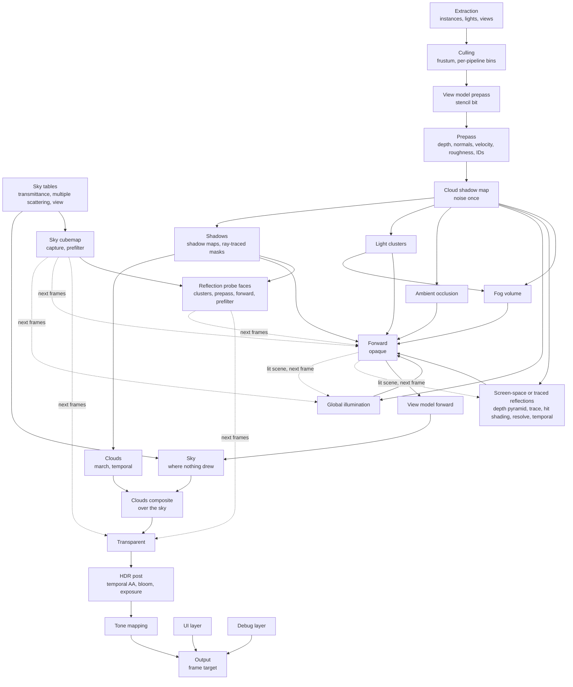

# Frame

How a frame is assembled: the passes and their order, the `Renderer` and `Frame_Desc`, the hooks a game adds its own work with, the settings that come from volumes, views, and extra views.

- The render graph culls every pass whose result nothing reads. A feature that is off adds no passes, and the passes that read its result read a default texture instead, for example a white ambient occlusion texture.
- With a feature that traces, such as traced shadows, the frame builds the ray scene's acceleration structures after the culling and before the prepass, so every pass after can trace them (see [Ray scene](ray-scene.md#ray-scene)). The global illumination's [world probes](global-illumination.md#world-probes) update after the prepass, on the compute queue, before the cascades, which read them.
- The ambient occlusion, the global illumination and the [screen-space](lighting-and-shadows.md#screen-space-reflections) or [traced](lighting-and-shadows.md#ray-traced-reflections) reflections run on the compute queue (see [GPU](../gpu/queues-streaming-readback.md#queues)). They depend only on the prepass and on textures from last frame, so they overlap with the light clusters and the shadow maps. The clusters, the fog volume and the exposure run on the graphics queue: the fog reads the shadow maps, which are drawn just before it, after the [virtual shadow map](lighting-and-shadows.md#virtual-shadow-maps)'s marking and allocation, which read the prepass's depth, and the exposure is explained in [Post-processing](post-processing.md#post-processing).
- The sky's [cubemap](sky.md#specular-light) is captured and prefiltered after the sky's tables, on the graphics queue. The global illumination, the forward pass and the transparent surfaces sample only cubes that earlier frames finished, so they do not wait for it.
- The [clouds](clouds.md#passes) run on the compute queue: their shadow map right after the prepass, before every pass that lights the world, since the light loop reads it, with their noise in the first frame; their march and temporal pass after the shadow maps and before the fog. Their composite runs on the graphics queue after the sky's background and before the fog's, so the fog dims the clouds with the sky.
- A [reflection probe](lighting-and-shadows.md#reflection-probes)'s capture draws its share of faces after the shadow maps and the sky's cubemap, which its faces read, and before the world pass, on the graphics queue. The forward pass and the transparent surfaces sample only probes' cubes that earlier frames finished.
- The renderer is a `render.Renderer` in `Game_State`: the residency table, the transient texture cache, the debug lines, the mesh extractor, the materials, the GPU scene, the lights' extractors and clusters, the ray scene's acceleration structure (`render.Ray_Scene`, see [Ray scene](ray-scene.md#ray-scene)), the volumes' query, the ambient occlusion's, the global illumination's, the screen-space reflections', the traced reflections', the fog's and the clouds' pipelines (`render.Ao_Passes`, `render.Gi_Passes`, `render.Screen_Reflections`, `render.Traced_Reflections`, `render.Volumetric_Fog`, `render.Volumetric_Clouds`, with the clouds' noise textures and shadow map), and post-processing's pipelines, exposure and lookup table (`render.Post`). It holds handles only, so a code reload keeps it (see [Hot reload](../overview/hot-reload.md#rules)). A game calls `renderer_init` after its world and asset runtime, `renderer_reload` in `on_reload`, which makes its registrations again and updates every pipeline at the next frame, and `renderer_destroy` at shutdown.
- A game calls `render.draw_frame(&renderer, &world, frame_desc)` once a frame. `Frame_Desc` is in frame memory: the view, the size, whether to keep the IDs and the depth for the editor, whether the frame has no debug layer (`no_debug`, the editor's outside Edit, see [Layers and output](layers-and-output.md#debug)), the entity slots not to draw (the editor's hidden ones), the frame's settings or nil for the volumes' (see [Settings](#settings)), the hooks, the editor's material previews to draw (see [Material previews](materials.md#material-previews)), the sprites to draw (see [Sprites](transparency.md#sprites)), the time that the particles step and the systems that play while it is 0 (see [Particles](particles.md#time)), and the extra views to draw (see [Extra views](#extra-views)). The lights are components (see [Lights and clusters](lighting-and-shadows.md#lights-and-clusters)).
- `draw_frame` returns false when the graph could not execute. The renderer's state from the frame's GPU work changes only when the frame executes (see [Render graph](../gpu/render-graph.md#commits)). This state includes the built acceleration structures, the baked lookup table, the adapted exposure, the sky's cubemap and the reflection probes' captures, the split cascades' storage and windows, the voxel cones' levels, the clouds' noise (`Cloud_Noise_State`, Ready once the frame that bakes it executes), new particle systems and the histories. After a frame that failed, the next frame does that work again, so a game can draw the next frame as usual. A game's own state follows the same rule: the sample in `samples/mygame` marks its triangle's structure as built only when `draw_frame` returns true.
- **Hooks** add a game's own work, in the order of the frame. Each is optional, and each gets the `render.Frame`, which holds the graph, the view and its projection, the targets, and the hooks' `data`:

| Hook | When | What it does |
|---|---|---|
| `before_world` | Before the prepass | Adds passes, such as culling on the compute queue |
| `after_prepass` | After the prepass, before the ambient occlusion and the global illumination | Adds passes that read `Frame.depth`, `Frame.normals`, `Frame.velocity` and `Frame.roughness` |
| `world_uses` | When the world pass is declared | Declares what `world_draw` reads |
| `world_draw` | In the world pass, the forward pass, `world_pieces` pieces, after the meshes in piece 0 | Records draws into the world's targets |
| `after_world` | After the world pass | Adds passes; a pass that makes a new scene color sets `Frame.scene` to it |
| `before_post` | Just before post-processing | Adds passes, such as a layer of the game's own that it composites into `Frame.scene` in linear HDR; post-processing then reads `Frame.scene` |
| `ui` | After a pass that clears the UI target | Adds passes that draw the UI; they load it |
| `debug` | After the debug lines | Adds passes that draw into the debug layer, such as the editor's tools. With `no_debug` it still runs, with `Frame.debug` 0, for passes that need no layer, such as the editor's picks |

- The hooks are procedures in the game DLL, so they are never stored in `Game_State`.
- **A game's own draws** in `world_draw` are not in the prepass. They test and write the depth that the prepass left, write the scene color and their IDs, and have no normals, velocities or roughness, no shadows from the renderer, no clusters' lights, no ambient occlusion, no global illumination and no fog unless their shaders read them. They are in the lit scene that the global illumination's rays read, but not in the depth that the rays test, so their light reaches only the surfaces that the rays find behind them. They place vertices with `render.jittered_view_projection(f)`, so they cover the same pixels as the renderer's draws, and scale their colors by the exposure in `Frame.exposure`, because the scene is pre-exposed (see [Post-processing](post-processing.md#post-processing)). The sample's draws do both. Temporal AA moves their pixels with the camera, since they have no velocities, so a moving draw of a game's own leaves a short trail that the history's clipping limits.
- **Missing shaders:** a pass whose pipeline does not exist, because its shader is not cooked, records nothing, so the frame still validates.

## Settings

The settings that make the scene's look are settings components on [volumes](../world/volumes.md#volumes) (`lib/engine/render/settings.odin`). The frame takes each from the volumes at the camera, so a box volume can change the look of one room. Each field is a `volume.Value`, which a volume overrides or leaves to the volumes below it. An overridden value is used as it is: a saturation of 0 is grey.

| Component | Stable ID | Settings |
|---|---|---|
| `Anti_Aliasing` | 43 | `off`: no anti-aliasing, of any technique |
| `Exposure` | 44 | `mode` (Auto or Manual), the manual `exposure`, the `compensation` in stops, and the auto exposure's `range` and `adaptation_speed` |
| `Tone_Mapping` | 45 | The `tone_mapper`, the grading's `contrast`, `saturation` and `tint`, and HDR output's `paper_white` and `peak` |
| `Bloom` | 46 | `off`, `intensity` |
| `Ambient_Occlusion` | 47 | `off`, `radius`, `power` |
| `Global_Illumination` | 48 | `off` |
| `Environment` | 49 | The `mode`: Flat's `background`, which the world pass clears the scene to and which is not pre-exposed, and its ambient light's `sky` and `ground`; the atmosphere's sky, with its sun, moon and stars; or a texture's. The `ambient_intensity` in each. See [Sky](sky.md#sky) |
| `Fog` | 38 | See [Volumetric fog](fog.md#volumetric-fog) |
| `Shadows` | 50 | The directional cascades' `distance` (`SHADOW_DISTANCE`, 100 m) and `split_lambda` between even and exponential (`SHADOW_SPLIT_LAMBDA`, 0.75) |
| `Clouds` | 55 | The cloud layer's `density`, its weather from scalars or a map, its wind, its heights, its far clouds, its ambient light and its shadow's strength. See [Clouds](clouds.md#clouds) |

- **Resolving:** `resolve_settings(&renderer, &world, position, hidden)` gives a `Frame_Settings` with the volumes' settings blended and the rest at their defaults: `Post_Settings`, `Ao_Settings`, `Gi_Settings`, `Reflection_Settings`, which no volume sets, `Fog_Settings`, `Sky_Settings`, from which `begin_sky` gives the frame's `Ambient`, and `Cloud_Settings`. `draw_frame` calls it at the view's position when `Frame_Desc.settings` is nil. A game can call it, change a value, and pass the result.
- **Quality:** the settings are the look, the same at every quality. `draw_frame` then gives them the frame's [quality](quality.md#order-in-the-frame), which sets each feature's level and can turn a feature off but never on, and then the editor's debug flags.
- **Defaults:** each component registers its `DEFAULT_*` value (see [Volumes](../world/volumes.md#volumes)). Volumes blend from it, so a volume that reaches halfway sets a value halfway from the default, and a component added in the editor starts from it. Paper white and the peak have no fixed default, the display's, so their default is 0, which gives the display's. The exposure, the exposure range, the adaptation speed, the shadow distance and the ambient occlusion's radius and power also take their defaults at 0 in `Frame_Settings`, where 0 would mean nothing.
- **The sample's scene** has a Global Volume with its background. The glass scene's has an atmosphere whose sun is the scene's directional light, with stars and a moon.

## Views

- A `render.View` is a camera: its pose, its projection, its viewport, and its layers. The editor's camera and the game's camera both give one (see [Editor](../editor/viewport.md#viewport)).
- A frame has one main view, and in the editor the [material previews](materials.md#material-previews) and the [extra views](#extra-views). Every view uses the same [GPU scene](gpu-scene.md#gpu-scene), because its poses have no camera rotation (see [World](../world/render-extraction.md#render-extraction)).
- A view's constants hold its offset from the render origin as an `f32` vector, with its rotation and projection.
- **The culling's views** are the GPU scene's views of one frame, each with its own `Frame_Constants` and draws: the camera, the view model, the shadow views, the voxel cones' views, and the faces of a [reflection probe](lighting-and-shadows.md#reflection-probes)'s capture, with the late view of occlusion culling last. A capture face is a square 90° view from the probe. It draws the opaque surfaces in a prepass and a forward pass of its own, after the shadow maps and before the world pass, with its own clusters, and it takes the camera's level of detail.

## Extra views

- **What they are:** `Frame_Desc.extra_views` holds other cameras on the frame's world, which `draw_frame` also draws, in its call, after the frame's own view. An `Extra_View` has a `View`, a `size`, a `target` and the frame's per-view fields: `keep_ids`, `no_debug`, `debug_view`, `disable` and `hooks`. The target is in `gpu.FRAME_TARGET_FORMAT`, which is always SDR, and in the render target layout, which the view leaves it in (see [Viewports](../editor/viewport.md#several-viewports) for the editor's, which are shared textures). A view with no target or no size is not drawn, and views past `MAX_EXTRA_VIEWS` (3) are not drawn either.
- **Order:** the frame's own view builds its graph and executes first. Each extra view then builds and executes a graph of its own (`begin_extra`), in order, so it reads what the frame's own view committed: the exposure, the lookup table, the sky's cubemap and the reflection probes' cubes. The first submission of an extra view's graph on each queue waits for the earlier work of the other queue, which the frame's own view and the views before it did. A view that fails does not fail the others, and `draw_frame` returns the result of the frame's own view.
- **Stateless:** an extra view changes no state that lasts between frames, so a frame with extra views leaves the renderer as a frame without them would. The frame's own view alone keeps the GPU scene's frame, origin, slots, records, cells and previous camera, the texture cache's frame and histories, the jitter, the adapted exposure, the lookup table's bake, the sky's cached ambient light, the cubemap's ring, the probes' slots and captures, the ray scene, the virtual shadow map's pool, the particles, the sprites and the stats. A frame whose own view fails marks no history as written, though its extra views executed.
- **What it draws:** the world's meshes, instanced meshes and surfaces from its own culling and its own bins, with the cascaded shadow maps of its own atlas, the ambient occlusion, the clusters and the reflection probes, the sky, the bloom, FXAA or SMAA, its debug lines, and its hooks. Its output pass encodes in the SDR mode into its target, with the frame's lookup table, whatever the frame's output mode is. Its scene is pre-exposed with the frame's exposure as it is, since it adds no pass that measures one.
- **What it leaves out:** whatever needs a history or the ray scene. Its quality is the frame's with temporal AA and FSR replaced by SMAA, the global illumination off, the reflections the probes alone, which it only reads, the shadows in the atlas and traced by nothing (`extra_view_quality`), and the features it turns off are those of `Extra_View.disable` and always fog, clouds, global illumination, occlusion culling and the game's post effects (`EXTRA_VIEW_DISABLED`). The frame's own `disable` is not its. It draws no particles, ribbons, mesh particles, sprites or material previews, and no view model, whose records are relative to the frame's own camera. It takes no readback: the cull, shading, virtual shadow and split cascade stats are the frame's own view's. It starts no capture of the sky's cubemap or of a probe, and it asks for no integral of a sky texture. Its sky tables are its own, and the sky's cached ambient light is left as the frame's own view set it.
- **Skinned meshes:** an entity that the frame's own view posed this frame (see [Skinned meshes](gpu-scene.md#skinned-meshes)) draws with the same posed buffers. One that it did not pose, such as a hidden one, draws at rest.
- **Hooks:** an extra view runs its own hooks at the points of the frame's, with a `Frame` whose `extra` is true, and whose `view`, `size`, `output_size`, `scene`, `ids`, `depth`, `debug`, `graph` and `data` are its own. It has no histories: `history_texture` gives the zero `History` in its graph. It has no `Frame.particles`, `Frame.sprites`, `Frame.gi`, `Frame.fog`, `Frame.clouds` or `Frame.ssr`.
- **Settings:** its settings come from the volumes at its position, as `resolve_settings` gives them, unless `Frame_Desc.settings` is given, which it uses too. The quality it starts from, the `hidden` entities and the `skins` are the frame's.
- **Debug lines:** the frame's debug lines reach each view that has a debug layer, relative to its own camera, and are dropped after the last view, so the lines of one frame are in all of them.
- **Cost and limits:** each view makes its own transient textures, about as many as a frame at the same quality without the features above, so `MAX_CACHED_TEXTURES` holds the frame's own view and `MAX_EXTRA_VIEWS` more. An extra view uses the GPU scene's render origin, which the frame's own view moved, so a view far from the frame's own camera has the precision of a camera that far from the origin (see [GPU scene](gpu-scene.md#gpu-scene)).
