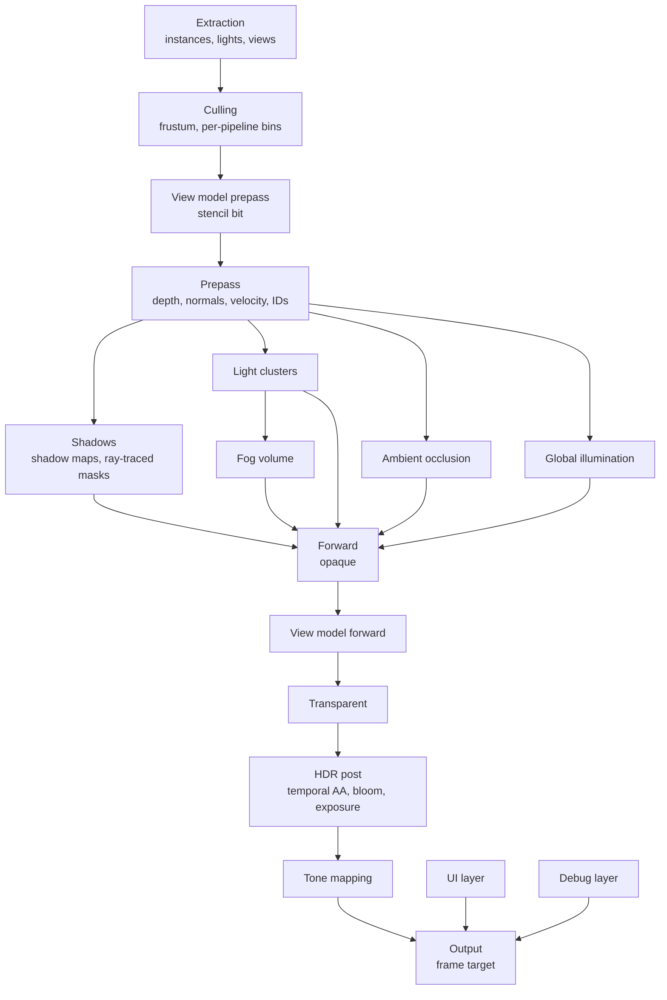

# Frame

How a frame is assembled: the passes and their order, the `Renderer` and `Frame_Desc`, the hooks a game adds its own work with, the settings that come from volumes, and views.

- The render graph culls every pass whose result nothing reads. A feature that is off adds no passes, and the passes that read its result read a default texture instead, for example a white ambient occlusion texture.
- The ambient occlusion and the global illumination run on the compute queue (see [GPU](../gpu/queues-streaming-readback.md#queues)). They depend only on the prepass and on textures from last frame, so they overlap with the light clusters and the shadow maps. The clusters, the fog volume and the exposure run on the graphics queue: the fog reads the shadow maps, which are drawn just before it, and the exposure is explained in [Post-processing](post-processing.md#post-processing).
- The renderer is a `render.Renderer` in `Game_State`: the residency table, the transient texture cache, the debug lines, the mesh extractor, the materials, the GPU scene, the lights' extractors and clusters, the shadows' acceleration structure, the volumes' query, the ambient occlusion's, the global illumination's and the fog's pipelines (`render.Ao_Passes`, `render.Gi_Passes`, `render.Volumetric_Fog`), and post-processing's pipelines, exposure and lookup table (`render.Post`). It holds handles only, so a code reload keeps it (see [Hot reload](../overview/hot-reload.md#rules)). A game calls `renderer_init` after its world and asset runtime, `renderer_reload` in `on_reload`, which makes its registrations again and updates every pipeline at the next frame, and `renderer_destroy` at shutdown.
- A game calls `render.draw_frame(&renderer, &world, frame_desc)` once a frame. `Frame_Desc` is in frame memory: the view, the size, whether to keep the IDs and the depth for the editor, whether the frame has no debug layer (`no_debug`, the editor's outside Edit, see [Layers and output](layers-and-output.md#debug)), the entity slots not to draw (the editor's hidden ones), the frame's settings or nil for the volumes' (see [Settings](#settings)), the hooks, the editor's material previews to draw (see [Material previews](materials.md#material-previews)), the sprites to draw (see [Sprites](transparency.md#sprites)), the time that the particles step and the systems that play while it is 0 (see [Particles](particles.md#time)). The lights are components (see [Lights and clusters](lighting-and-shadows.md#lights-and-clusters)).
- **Hooks** add a game's own work, in the order of the frame. Each is optional, and each gets the `render.Frame`, which holds the graph, the view and its projection, the targets, and the hooks' `data`:

| Hook | When | What it does |
|---|---|---|
| `before_world` | Before the prepass | Adds passes, such as culling on the compute queue |
| `after_prepass` | After the prepass, before the ambient occlusion and the global illumination | Adds passes that read `Frame.depth`, `Frame.normals` and `Frame.velocity` |
| `world_uses` | When the world pass is declared | Declares what `world_draw` reads |
| `world_draw` | In the world pass, the forward pass, `world_pieces` pieces, after the meshes in piece 0 | Records draws into the world's targets |
| `after_world` | After the world pass | Adds passes; a pass that makes a new scene color sets `Frame.scene` to it |
| `before_post` | Just before post-processing | Adds passes, such as a layer of the game's own that it composites into `Frame.scene` in linear HDR; post-processing then reads `Frame.scene` |
| `ui` | After a pass that clears the UI target | Adds passes that draw the UI; they load it |
| `debug` | After the debug lines | Adds passes that draw into the debug layer, such as the editor's tools. With `no_debug` it still runs, with `Frame.debug` 0, for passes that need no layer, such as the editor's picks |

- The hooks are procedures in the game DLL, so they are never stored in `Game_State`.
- **A game's own draws** in `world_draw` are not in the prepass. They test and write the depth that the prepass left, write the scene color and their IDs, and have no normals or velocities, no shadows from the renderer, no clusters' lights, no ambient occlusion, no global illumination and no fog unless their shaders read them. They are in the lit scene that the global illumination's rays read, but not in the depth that the rays test, so their light reaches only the surfaces that the rays find behind them. They place vertices with `render.jittered_view_projection(f)`, so they cover the same pixels as the renderer's draws, and scale their colors by the exposure in `Frame.exposure`, because the scene is pre-exposed (see [Post-processing](post-processing.md#post-processing)). The sample's draws do both. Temporal AA moves their pixels with the camera, since they have no velocities, so a moving draw of a game's own leaves a short trail that the history's clipping limits.
- **Missing shaders:** a pass whose pipeline does not exist, because its shader is not cooked, records nothing, so the frame still validates.

## Settings

The settings that make the scene's look are settings components on [volumes](../world/volumes.md#volumes) (`lib/engine/render/settings.odin`). The frame takes each from the volumes at the camera, so a box volume can change the look of one room. Each field is a `volume.Value`, which a volume overrides or leaves to the volumes below it. An overridden value is used as it is: a saturation of 0 is grey.

| Component | Stable ID | Settings |
|---|---|---|
| `Anti_Aliasing` | 43 | `off`: no anti-aliasing, of any technique |
| `Exposure` | 44 | `mode` (Auto or Manual), the manual `exposure`, the `compensation` in stops, and the auto exposure's `range` and `adaptation_speed` |
| `Tone_Mapping` | 45 | The `tone_mapper`, the grading's `contrast`, `saturation` and `tint`, and HDR output's `paper_white` and `peak` |
| `Bloom` | 46 | `off`, `intensity` |
| `Ambient_Occlusion` | 47 | `off`, `radius`, `power` |
| `Global_Illumination` | 48 | `off` |
| `Environment` | 49 | The `background`, which the world pass clears the scene to and which is not pre-exposed, and the ambient light's `sky` and `ground` (`DEFAULT_AMBIENT` by default) |
| `Fog` | 38 | See [Volumetric fog](fog.md#volumetric-fog) |
| `Shadows` | 50 | The directional cascades' `distance` (`SHADOW_DISTANCE`, 100 m) and `split_lambda` between even and exponential (`SHADOW_SPLIT_LAMBDA`, 0.75) |

- **Resolving:** `resolve_settings(&renderer, &world, position, hidden)` gives a `Frame_Settings` with the volumes' settings blended and the rest at their defaults: `Post_Settings`, `Ao_Settings`, `Gi_Settings`, `Fog_Settings`, the background and the `Ambient`. `draw_frame` calls it at the view's position when `Frame_Desc.settings` is nil. A game can call it, change a value, and pass the result.
- **Quality:** the settings are the look, the same at every quality. `draw_frame` then gives them the frame's [quality](quality.md#order-in-the-frame), which sets each feature's level and can turn a feature off but never on, and then the editor's debug flags.
- **Defaults:** each component registers its `DEFAULT_*` value (see [Volumes](../world/volumes.md#volumes)). Volumes blend from it, so a volume that reaches halfway sets a value halfway from the default, and a component added in the editor starts from it. Paper white and the peak have no fixed default, the display's, so their default is 0, which gives the display's. The exposure, the exposure range, the adaptation speed, the shadow distance and the ambient occlusion's radius and power also take their defaults at 0 in `Frame_Settings`, where 0 would mean nothing.
- **The sample's scene** has a Global Volume with its background.

## Views

- A `render.View` is a camera: its pose, its projection, its viewport, and its layers. The editor's camera and the game's camera both give one (see [Editor](../editor/viewport.md#viewport)).
- A frame has one main view, and in the editor the [material previews](materials.md#material-previews). Every view uses the same [GPU scene](gpu-scene.md#gpu-scene), because its poses have no camera rotation (see [World](../world/render-extraction.md#render-extraction)).
- A view's constants hold its offset from the render origin as an `f32` vector, with its rotation and projection.
