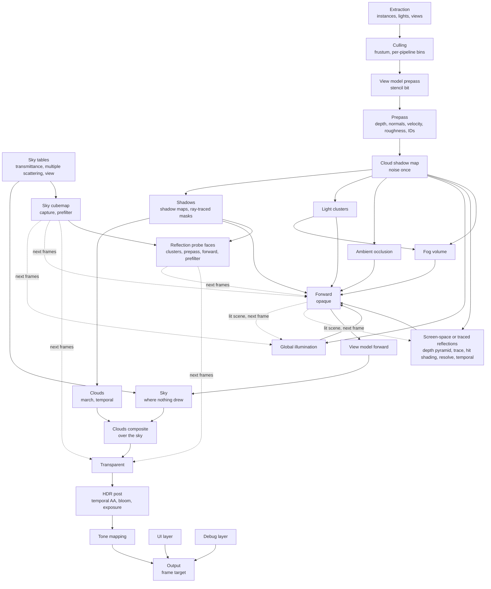

# Frame

How a frame is assembled: the passes and their order, the `Renderer` and `Frame_Desc`, the hooks a game adds its own work with, the settings that come from volumes, and views.

- The render graph culls every pass whose result nothing reads. A feature that is off adds no passes, and the passes that read its result read a default texture instead, for example a white ambient occlusion texture.
- With a feature that traces, such as traced shadows, the frame builds the ray scene's acceleration structures after the culling and before the prepass, so every pass after can trace them (see [Ray scene](ray-scene.md#ray-scene)). The global illumination's [world probes](global-illumination.md#world-probes) update after the prepass, on the compute queue, before the cascades, which read them.
- The ambient occlusion, the global illumination and the [screen-space](lighting-and-shadows.md#screen-space-reflections) or [traced](lighting-and-shadows.md#ray-traced-reflections) reflections run on the compute queue (see [GPU](../gpu/queues-streaming-readback.md#queues)). They depend only on the prepass and on textures from last frame, so they overlap with the light clusters and the shadow maps. The clusters, the fog volume and the exposure run on the graphics queue: the fog reads the shadow maps, which are drawn just before it, after the [virtual shadow map](lighting-and-shadows.md#virtual-shadow-maps)'s marking and allocation, which read the prepass's depth, and the exposure is explained in [Post-processing](post-processing.md#post-processing).
- The sky's [cubemap](sky.md#specular-light) is captured and prefiltered after the sky's tables, on the graphics queue. The global illumination, the forward pass and the transparent surfaces sample only cubes that earlier frames finished, so they do not wait for it.
- The [clouds](clouds.md#passes) run on the compute queue: their shadow map right after the prepass, before every pass that lights the world, since the light loop reads it, with their noise in the first frame; their march and temporal pass after the shadow maps and before the fog. Their composite runs on the graphics queue after the sky's background and before the fog's, so the fog dims the clouds with the sky.
- A [reflection probe](lighting-and-shadows.md#reflection-probes)'s capture draws its share of faces after the shadow maps and the sky's cubemap, which its faces read, and before the world pass, on the graphics queue. The forward pass and the transparent surfaces sample only probes' cubes that earlier frames finished.
- The renderer is a `render.Renderer` in `Game_State`: the residency table, the transient texture cache, the debug lines, the mesh extractor, the materials, the GPU scene, the lights' extractors and clusters, the ray scene's acceleration structure (`render.Ray_Scene`, see [Ray scene](ray-scene.md#ray-scene)), the volumes' query, the ambient occlusion's, the global illumination's, the screen-space reflections', the traced reflections', the fog's and the clouds' pipelines (`render.Ao_Passes`, `render.Gi_Passes`, `render.Screen_Reflections`, `render.Traced_Reflections`, `render.Volumetric_Fog`, `render.Volumetric_Clouds`, with the clouds' noise textures and shadow map), and post-processing's pipelines, exposure and lookup table (`render.Post`). It holds handles only, so a code reload keeps it (see [Hot reload](../overview/hot-reload.md#rules)). A game calls `renderer_init` after its world and asset runtime, `renderer_reload` in `on_reload`, which makes its registrations again and updates every pipeline at the next frame, and `renderer_destroy` at shutdown.
- A game calls `render.draw_frame(&renderer, &world, frame_desc)` once a frame. `Frame_Desc` is in frame memory: the view, the size, the own view's target and state (see [Views](#views)), whether to keep the IDs and the depth for the editor, whether the frame has no debug layer (`no_debug`, the editor's outside Edit, see [Layers and output](layers-and-output.md#debug)), the entity slots not to draw (the editor's hidden ones), the frame's settings or nil for the volumes' (see [Settings](#settings)), the hooks, the editor's material previews to draw (see [Material previews](materials.md#material-previews)), the sprites to draw (see [Sprites](transparency.md#sprites)), the time that the particles step and the systems that play while it is 0 (see [Particles](particles.md#time)), and the extra views to draw (see [Views](#views)). The lights are components (see [Lights and clusters](lighting-and-shadows.md#lights-and-clusters)).
- `draw_frame` returns false when the graph could not execute. The renderer's state from the frame's GPU work changes only when the frame executes (see [Render graph](../gpu/render-graph.md#commits)). This state includes the built acceleration structures, the baked lookup table, the adapted exposure, the sky's cubemap and the reflection probes' captures, the split cascades' storage and windows, the voxel cones' levels, the clouds' noise (`Cloud_Noise_State`, Ready once the frame that bakes it executes), new particle systems and the histories. After a frame that failed, the next frame does that work again, so a game can draw the next frame as usual. A game's own state follows the same rule: the sample in `samples/mygame` marks its triangle's structure as built only when `draw_frame` returns true.
- **Hooks** add a game's own work, in the order of the frame. Each is optional, and each gets the `render.Frame`, which holds the graph, the view and its projection, the targets, and the hooks' `data`:

| Hook | When | What it does |
|---|---|---|
| `before_world` | Before the prepass | Adds passes, such as culling on the compute queue |
| `after_prepass` | After the prepass, before the ambient occlusion and the global illumination | Adds passes that read `Frame.depth`, `Frame.normals`, `Frame.velocity` and `Frame.roughness` |
| `world_uses` | When the world pass is declared | Declares what `world_draw` reads |
| `world_draw` | In the world pass, the forward pass, `world_pieces` pieces, after the meshes in piece 0 | Records draws into the world's targets |
| `after_world` | After the world pass | Adds passes; a pass that makes a new scene color sets `Frame.scene` to it |
| `before_post` | Just before post-processing | Adds passes, such as a layer of the game's own that it composites into `Frame.scene` in linear HDR; post-processing then reads `Frame.scene` |
| `ui` | After a pass that clears the UI target | Adds passes that draw the UI; they load it |
| `debug` | After the debug lines | Adds passes that draw into the debug layer. With `no_debug` it still runs, with `Frame.debug` 0, for passes that need no layer |

- The hooks are procedures in the game DLL, so they are never stored in `Game_State`.
- **Hooks run once for each view** (see [Views](#views)), with the same `data`, each time with the `Frame` of that view: its `view`, `size`, `output_size` and `extra`. A game that keeps data for each view, such as the constants of its own passes or the textures that its passes make, builds it in its first hook of the view and keeps it in `Frame.user`. `user` is nil when a view begins, belongs to the view, and the renderer never touches it; its memory is frame memory. The game derives its per-view data from the `Frame` alone and never needs to know how many views there are or why. `Frame.hidden` is the frame's `Frame_Desc.hidden`, which a game that draws its own geometry tests with `is_hidden`.
- **The overlay** is a second hook, `Frame_Desc.overlay` and `Extra_View.overlay`, a `Frame_Overlay` of a `draw` procedure and a `data` pointer of its own. It runs in its view after the `debug` hook, with the same debug layer, and also when the view has no layer (`no_debug`), when `Frame.debug` is 0 and nothing may draw into it. A view with an overlay has a debug layer unless it has `no_debug`, as a view with a `debug` hook does. It exists for a caller that adds passes to the game's frame without owning `Frame_Hooks.data`, which is the game's: the editor package's tools are added this way to the scene views (see [Editor](../editor/viewport.md#viewport)). A game does not set it.
- **A game's own draws** in `world_draw` are not in the prepass. They test and write the depth that the prepass left, write the scene color and their IDs, and have no normals, velocities or roughness, no shadows from the renderer, no clusters' lights, no ambient occlusion, no global illumination and no fog unless their shaders read them. They are in the lit scene that the global illumination's rays read, but not in the depth that the rays test, so their light reaches only the surfaces that the rays find behind them. They place vertices with `render.jittered_view_projection(f)`, so they cover the same pixels as the renderer's draws, and scale their colors by the exposure in `Frame.exposure`, because the scene is pre-exposed (see [Post-processing](post-processing.md#post-processing)). The sample's draws do both. Temporal AA moves their pixels with the camera, since they have no velocities, so a moving draw of a game's own leaves a short trail that the history's clipping limits.
- **Missing shaders:** a pass whose pipeline does not exist, because its shader is not cooked, records nothing, so the frame still validates.

## Settings

The settings that make the scene's look are settings components on [volumes](../world/volumes.md#volumes) (`lib/engine/render/settings.odin`). The frame takes each from the volumes at the camera, so a box volume can change the look of one room. Each field is a `volume.Value`, which a volume overrides or leaves to the volumes below it. An overridden value is used as it is: a saturation of 0 is grey.

| Component | Stable ID | Settings |
|---|---|---|
| `Anti_Aliasing` | 43 | `off`: no anti-aliasing, of any technique |
| `Exposure` | 44 | `mode` (Auto or Manual), the manual `exposure`, the `compensation` in stops, and the auto exposure's `range` and `adaptation_speed` |
| `Tone_Mapping` | 45 | The `tone_mapper`, the grading's `contrast`, `saturation` and `tint`, and HDR output's `paper_white` and `peak` |
| `Bloom` | 46 | `off`, `intensity` |
| `Ambient_Occlusion` | 47 | `off`, `radius`, `power` |
| `Global_Illumination` | 48 | `off` |
| `Environment` | 49 | The `mode`: Flat's `background`, which the world pass clears the scene to and which is not pre-exposed, and its ambient light's `sky` and `ground`; the atmosphere's sky, with its sun, moon and stars; or a texture's. The `ambient_intensity` in each. See [Sky](sky.md#sky) |
| `Fog` | 38 | See [Volumetric fog](fog.md#volumetric-fog) |
| `Shadows` | 50 | The directional cascades' `distance` (`SHADOW_DISTANCE`, 100 m) and `split_lambda` between even and exponential (`SHADOW_SPLIT_LAMBDA`, 0.75) |
| `Clouds` | 55 | The cloud layer's `density`, its weather from scalars or a map, its wind, its heights, its far clouds, its ambient light and its shadow's strength. See [Clouds](clouds.md#clouds) |

- **Resolving:** `resolve_settings(&renderer, &world, position, hidden)` gives a `Frame_Settings` with the volumes' settings blended and the rest at their defaults: `Post_Settings`, `Ao_Settings`, `Gi_Settings`, `Reflection_Settings`, which no volume sets, `Fog_Settings`, `Sky_Settings`, from which `begin_sky` gives the frame's `Ambient`, and `Cloud_Settings`. `draw_frame` calls it at the view's position when `Frame_Desc.settings` is nil. A game can call it, change a value, and pass the result.
- **Quality:** the settings are the look, the same at every quality. `draw_frame` then gives them the frame's [quality](quality.md#order-in-the-frame), which sets each feature's level and can turn a feature off but never on, and then the editor's debug flags.
- **Defaults:** each component registers its `DEFAULT_*` value (see [Volumes](../world/volumes.md#volumes)). Volumes blend from it, so a volume that reaches halfway sets a value halfway from the default, and a component added in the editor starts from it. Paper white and the peak have no fixed default, the display's, so their default is 0, which gives the display's. The exposure, the exposure range, the adaptation speed, the shadow distance and the ambient occlusion's radius and power also take their defaults at 0 in `Frame_Settings`, where 0 would mean nothing.
- **The sample's scene** has a Global Volume with its background. The glass scene's has an atmosphere whose sun is the scene's directional light, with stars and a moon.

## Views

- **A view** is a camera: a `render.View` with its pose and its projection, which is a perspective or an [orthographic](#orthographic-views) one. The editor's camera and the game's camera both give one (see [Editor](../editor/viewport.md#viewport)). A frame has one **own view**, `Frame_Desc.view`, and up to `MAX_EXTRA_VIEWS` (4) **extra views** in `Frame_Desc.extra_views`: other cameras on the same world, drawn in the same `draw_frame` call, each into a target of its own. A split screen is an own view and an extra view; the editor's viewports are too, all of them, with one of them as the own view (see [the own view's target and state](#views)). The [material previews](materials.md#material-previews) are not views: they draw in the own view's graph.
- **Every view draws the full pipeline.** An extra view draws exactly what the own view would draw from its camera, at its quality: the same passes in the same order, with the same techniques, the global illumination, the reflections, the fog, the clouds, the particles, the temporal anti-aliasing and the game's post effects. Its hooks run at the same points, with a `Frame` of its own whose `extra` is true. Each view builds and executes a graph of its own, the own view first (`begin` and `begin_extra`), so a view that fails does not fail the others, and `draw_frame` returns the own view's result.
- **An `Extra_View`** has a `View`, a `size`, a `target`, a `state`, and the fields that `Frame_Desc` has for the own view: `quality` (nil takes the frame's), `settings` (nil resolves them at its position, as `resolve_settings` does), `keep_ids`, `no_debug`, `debug_view`, `disable`, `exposure_offset` and `hooks`. The target is in `gpu.FRAME_TARGET_FORMAT`, which is always SDR, and in the render target layout, which the view leaves it in. A view with no target or no size is not drawn. A view without a `state` is a mistake, and asserts.
- **The own view's target and state.** `Frame_Desc.target` makes the own view draw into a texture of its own and not into the frame target (`gpu_frame_target()`, which the frame leaves as it found it): the texture is in `gpu.FRAME_TARGET_FORMAT`, always SDR whatever the frame's output mode, and in the render target layout, which the view leaves it in, as an extra view's target is. `size` is its size. `Frame_Desc.state` is the `View_State` that the own view uses, or nil for `Renderer.view`. `use_view(&desc, extra_view)` sets the own view's fields from an `Extra_View`, so a caller that describes each camera as an `Extra_View` gives the first to the frame and the rest to `extra_views`. The editor package does this for the game: the game describes one frame, with its own camera, its window's size and its hooks, and calls `editor.draw_frame` in place of `render.draw_frame` (see [Editor](../editor/viewport.md#views)). With no editor linked, or no viewport open, that is `render.draw_frame` with the same description, as the game would call it. With viewports, the Game view is the own view, drawn from the game's description at the viewport's size, and each scene view is an extra view of the same description from the editor's camera: the game's hooks, which run once in each, minus its UI hook, with the editor's tools as the overlay, the editor's settings for the view over the game's, and the entity slots that the editor hides added to `Frame_Desc.hidden`. The game never sees a viewport, its number or its size, except as the `size` of the `Frame` its hooks are given. The state must not be an extra view's.
- **View state** is what the renderer keeps for one camera from frame to frame, in a `View_State` (`lib/engine/render/view_state.odin`). The renderer has one built in, `Renderer.view`, which the own view uses unless `Frame_Desc.state` names another, so a game with one camera does nothing. The caller owns the `View_State` of each extra view, and of an own view that it gives a state: it makes it with `view_state_init`, keeps it in `Game_State` (it holds handles and values only, so a code reload keeps it), and frees its GPU objects at once with `view_state_destroy`, which is safe on a zero value. A view draws exactly as it would if it were the only one: a view drawn every frame has valid histories from its second frame, and a view that is not drawn in a frame has none in the next.
- **World state** is kept once, in the `Renderer`, whatever the views. The table shows where each piece is.

| View state, in `View_State` | World state, in the `Renderer` |
|---|---|
| The histories of the temporal anti-aliasing, the upscaler, the global illumination, the reflections, the fog, the clouds, the particles' collision depth and the game's post effects (`History_Set`) | The texture cache's transient textures, its frame count, and every pipeline |
| The last frame's camera and projections, and the count of frames drawn | Residency, the materials, the debug lines |
| The exposure, its adaptation and the jitter, and the upscaler | The tone mapping lookup table and its bake |
| The occlusion culling's pyramid, the visibility bits of its last frame, and the tally | The GPU scene's instances, slots, records, cells and render origin, and the skinned entities' buffers |
| The ambient occlusion's, the fog's and the clouds' frame counts, the clouds' shadow map, and the sky's cached ambient light | The clouds' noise and wind, and the sky's cubemap, its ring and the texture sky's integral |
| The screen-space reflections' frame and memory | The reflection probes' cubes, slots and captures, and the ray scene |
| The global illumination's storage, cursors and levels: the screen cascades, the world probes, the split cascades and the voxel cones | The ray buffers that the global illumination shares |
| The virtual shadow map's pool and the stats of the cull, the shading, the split cascades and the virtual shadow map | The particles' pool, systems and clock |

- **What views share, and why.** The GPU scene's render origin is the own view's, and the extra views draw relative to it, so a view far from the own camera has the precision of a camera that far from the origin (see [GPU scene](gpu-scene.md#gpu-scene)). The view model is the own view's: its records are relative to its camera, and the extra views draw none. The particles step once a frame, in the own view, and collide with the depth that it saw; every view draws them (see [Particles](particles.md#views)). The reflection probes' slots and captures are made once a frame, and rank by the nearest of the frame's views, so no camera evicts the probes of another; each view bins the probes for itself. The sky's cubemap and the lookup table's bake are the own view's, and the others read them, so the table is baked in the own view's output mode and an extra view encodes with it in SDR. The clouds' wind advances once a frame. The skinned entities are posed once, by the own view, and the other views draw them as posed; an entity that it did not pose draws at rest. The sprites in `Frame_Desc.sprites` draw in every view.
- **Order.** The own view builds and executes first and commits what it did, so the extra views read the world as it left it: the sky's cubemap, the probes' cubes, the lookup table, the posed skins and the particles' pool. The first submission of an extra view's graph on each queue waits for the earlier work of the other queue, which the views before it did. The upload ring and the render graph's scratch (the draw lists, the light clusters, the ray buffers) are reused by each view in turn.
- **Cost.** Each view pays the full pipeline for its size, its quality and its features, and its transient textures are its own, so `MAX_CACHED_TEXTURES` holds the own view and four extra ones with every feature on. A view that draws the global illumination keeps its own storage: a view with the split cascades holds the cascades' tables, bins and atlas, one with the voxel cones the levels' textures, and one with the world probes their textures, each at its own quality level. The own view and each extra view have their own virtual shadow map pool too.
- **Settings and quality.** An extra view resolves its settings from the volumes at its position, unless it is given settings, and uses the frame's quality unless it is given its own. `Frame_Desc.settings` and `Frame_Desc.quality` are the own view's.
- **Debug lines** reach every view that has a debug layer, relative to its own camera. The frame drops them after the last view, so the lines of one frame are in all of them.
- **When the own view moves.** The own view is a role, not a state: a game may give it a different `View_State` from one frame to the next, as the editor's does when a viewport opens or closes. Each state keeps its histories, whichever role it has, and a state that is drawn every frame has valid histories from its second frame. What belongs to the own view alone follows the role. The particles' collision depth is a history in the own view's state, so when the role moves to a state that did not keep it, the particles do not collide in that frame, and collide from the next, as for a view that missed a frame. The particles' pool, clock and previous anchors are the renderer's and go on, so an anchored system's velocity is off for the frame in which the role moves. The GPU scene's render origin follows the own view's camera: it rebases when that camera is far from it, which writes every instance again, and then the extra views draw relative to the new origin. The view model is drawn in the own view alone, so a game that wants it in a view makes that view the own one, as the editor does with the Game view. The sky's cubemap and the lookup table's bake are made for whichever view is the own one in that frame.
- **Stats** (`cull_stats`, `shading_stats`, `gi_split_stats`, `virtual_shadow_stats` and `reflection_memory`) are the own view's, from whichever state that is: `Renderer.stats_view` names the last own view's state when it is not `Renderer.view`, and `view_state_destroy` clears it, so a state that the caller frees is never read. The extra views tally into their own `View_State`, so none wipes another's.
- **The culling's views** are the GPU scene's views of one frame, each with its own `Frame_Constants` and draws: the camera, the view model, the shadow views, the voxel cones' views, and the faces of a [reflection probe](lighting-and-shadows.md#reflection-probes)'s capture, with the late view of occlusion culling last. A capture face is a square 90° view from the probe. It draws the opaque surfaces in a prepass and a forward pass of its own, after the shadow maps and before the world pass, with its own clusters, and it takes the camera's level of detail. Each view of a frame has its own.
- A view's constants hold its offset from the render origin as an `f32` vector, with its rotation and projection.

## Orthographic views

- **A view's projection** is `View.projection`, a `Projection`: `Perspective` with a vertical field of view and a near plane, or `Orthographic` with a `height`, a `near` and a `far` plane. An orthographic view shows `height` meters from its bottom to its top at every distance, so nothing gets smaller with distance. A 2D game uses one, and so do the editor's Top, Front and Side views. `perspective_view` and `orthographic_view` make a view of each kind, and `is_orthographic` tells them apart.
- **Depth stays reversed.** `view_projection` gives an orthographic view a depth of `(far - z) / (far - near)`: 1 at the near plane and 0 at the far plane, with a clip `w` of 1. So the depth test, the clear, the occlusion pyramid, the jitter and the temporal reprojection are the same for both projections. The near plane is 0 or more. `view_depth(projection, depth)` gives the view-space z back for either.
- **The shaders take one description.** `projection_constants` gives a `View_Projection`, a `float4`: the x and y scales, the near plane and the far plane, where a far plane of 0 means a perspective projection. `Frame.projection` holds the view's and `Frame.view_model_projection` the view model's, and `Frame_Constants.projection` gives it to the material shaders. `view_projection.hlsli` has the functions that read it: `view_z`, `clip_view_z`, `view_position`, `view_ndc`, `view_pixel_meters`, `view_to_camera`, `slice_of` and `slice_z`. A shader that rebuilds a position from the depth, or measures a pixel, calls these. `view_corner` and `pixel_meters` are the same on the CPU.
- **The direction to the camera** is the same at every point of an orthographic view: against the way it looks. `to_camera` in `material_common.hlsli` gives it to the materials, so the specular light, the parallax and the reflections use it, and an axis billboard turns to it.
- **What changes with the projection:**

| Part | In an orthographic view |
|---|---|
| Culling | The frustum is a box with a far plane. `cull_eye` is the view's direction, so the meshlets' cone test and the impostors use a direction and not a point. |
| Level of detail | A pixel is the same size at every distance. `lod_scale` gives a scale for a distance of `LOD_FLAT_NEAR` (1e9), which every distance is clamped to, as the voxel cones' views do. A patch surface still takes its detail from the distance to the camera's position. |
| Light clusters | The slices are even between the near and the far plane (`slice_constants`), and a cluster is a box. |
| Shadow cascades | The splits are even from the near plane to the shadows' distance past it, or to the far plane if that is nearer, and each slice is a box. |
| Fog | The froxels use the clusters' even slices, and a ray through a tile is as long as its depth. |
| Transparency | The moments' depth is even from the near to the far plane. The sorted items sort by their depth along the view, not by their distance. |
| Ambient occlusion, screen cascades, compute sprites, particles | They rebuild positions and pixel sizes through `view_projection.hlsli`. |
| Depth debug view | It shows the depth as it is: white at the near plane, black at the far plane. |

- **What an orthographic view does not draw.** These take a perspective projection, so `limit_quality` and `apply_view_limits` change them for an orthographic view, and nothing else tests the projection to turn a feature off:

| Feature | In an orthographic view |
|---|---|
| FSR | Temporal AA. FSR has no orthographic mode. |
| Virtual shadow map | The cascades' shadow maps. |
| Screen-space and ray-traced reflections | The reflection probes and the sky's cubemap. |
| Clouds, and their shadows | Off. |
| Sky | No sky draws behind the world: every pixel looks the same way. The background is the Environment's color. The ambient light, the sun's tint and the sky's cubemap stay. |
| View model's own projection | The view model draws with the view's projection. |

- **A `Camera`** is orthographic when its `projection` is `Orthographic`. Its `orthographic_height` and `far` are in meters, and 0 means `DEFAULT_ORTHOGRAPHIC_HEIGHT` (10) and `DEFAULT_ORTHOGRAPHIC_FAR` (1000).
