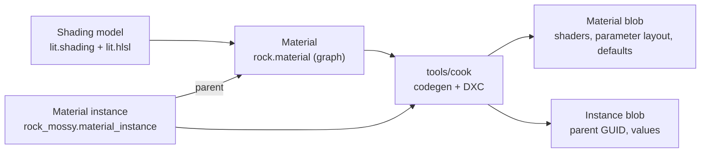

# Materials

Shading models, materials as node graphs or HLSL, their permutations, instances, the runtime's material table and pipelines, and the editor's previews. The cooker's side is in [Content pipeline](../content/kinds/materials.md).

**In this document:** [Shading models](#shading-models) · [Material](#material) · [Permutations](#permutations) · [Material instance](#material-instance) · [Runtime](#runtime) · [Material previews](#material-previews) · [Future work](README.md#future-work)



A material is content from end to end: a shading model is two files, a material is a text file that the editor's graph editor writes, the cooker generates and compiles the HLSL, and the renderer loads the blob and makes pipelines from it. [Content pipeline](../content/kinds/materials.md#materials) has the file formats and the cook; this section has the design and the runtime.

## Shading models

A shading model is a lighting model: `Unlit`, `Lit` (metallic and roughness), later `Subsurface`, `Cloth`, `Toon`. It is two content files, so a game adds its own in its content root:

- `<name>.shading` declares it (see [Content pipeline](../content/kinds/materials.md#materials)): its surface inputs with their types and defaults, and flags: `no_lighting` (skip the light loop), later `needs_shadow_mask`. Its name is the file's, such as `lit`.
- `<name>.hlsli`, beside it, implements it. It is an include, not an asset. The cooker generates the `Surface` struct and `default_surface()` from the declaration, and the file defines:

```hlsl
float3 shade_emission(Surface s);
float shade_opacity(Surface s);
// Unless no_lighting:
float3 shade_direct(Surface s, Shading_Point p, Light light);
float3 shade_area(Surface s, Shading_Point p, Area_Light light);
float3 shade_indirect(Surface s, Shading_Point p, Indirect indirect);
```

- **The engine's:** `lib/engine/content/shading/lit` (GGX specular with Smith visibility and Schlick's Fresnel, Lambert diffuse, linearly transformed cosines for area lights, and Karis's fit of the environment BRDF for indirect specular) and `unlit` (its color, as it is).
- **Area lights:** `shade_area` multiplies the light's radiance by `ltc_integral` of each of its lobes. A lobe is given by a 3x3 matrix's inverse: the identity for Lambert's diffuse, or `ltc_ggx`'s for Lit's specular (see [Area lights](lighting-and-shadows.md#area-lights)). A shading model with another specular fits its own tables as `tools/ltc_fit` does.
- **A tangent-space normal:** a shading model whose inputs include a `float3 normal` takes it in tangent space, as a normal map gives it, and the template maps it to the world before shading.
- The engine's forward template owns the light loop. For each directional light and each light in the pixel's cluster, it calls `shade_direct` with the light's color after its falloff and its shadow, or `shade_area` for an area light (see [Lights and clusters](lighting-and-shadows.md#lights-and-clusters)). Then it calls `shade_indirect`, and adds the emission. `Unlit` has `No_Lighting` and only emits.
- The indirect light is the [global illumination](global-illumination.md#global-illumination)'s diffuse and specular light, or without it the ambient light: the sky's color from above and the ground's from below (`Environment`). The template scales both by the [ambient occlusion](ambient-occlusion.md#ambient-occlusion) before it calls `shade_indirect`.
- The material graph's output node has one input for each surface input of its shading model. The cook link sends the shading models to the editor with the importers, so the editor shows the right inputs.
- Fog, exposure, the ambient occlusion and the shadow mask are applied by the template, not by shading models.

## Material

A material is a `.material` text file (see [Content pipeline](../content/kinds/materials.md#materials)). The editor's material editor writes its graph, as the editor writes scenes (see [Editor](../editor/material-editor.md#material-editor)). It has:

- **Settings:** the shading model, the blend mode (`Opaque`, `Masked`, `Transparent` or `Additive`, see [Transparency](transparency.md#transparency)), a transparent material's transparency (moment-based or sorted), the domain (`Surface`, later `Decal`, `Post_Process`, `UI`), two-sided, casts shadows.
- **Parameters:** scalars, vectors, colors, textures and static switches, each with a name, a default and a group for the editor.
- **The graph:** nodes and links (see [Content pipeline](../content/kinds/materials.md#material-graphs)). Nodes include math, texture samples, parameters, time, world position (relative to the render origin, see below), object position (in the mesh's own space), vertex attributes, static switches, material functions (`.material_function` assets, graphs that a node calls) and a custom HLSL node.

The cooker turns the graph into an HLSL function, `Surface evaluate(Material_Inputs inputs)`, and compiles it into each pass's template. A material's `evaluate` can also be HLSL written after a `---` line of the file, which is how the built-in materials exist. `evaluate` reads its parameters from the generated `params`, and its static switches as defines; a graph's switch nodes are decided when each variant generates its source, so they need no defines.

**World position.** `Material_Inputs.position` is relative to the camera, which is what the passes need, but a pattern made from it would slide with the camera. The World Position node gives `world_position(inputs)`: the position relative to the render origin, `inputs.position + frame.origin_offset`, which stays put while the camera moves and keeps `f32`'s precision, because the origin is within 1.5 cells of the camera. The origin snaps to 1024 m, so a pattern whose period divides 1024 m has no seam when it moves; any other pattern jumps there. In a preview, the origin is the mesh's middle.

**No raw stage inputs.** Generated code reads attributes only through `Material_Inputs`, and samples textures only through `cn_sample`, which takes the derivatives from the inputs. A later visibility buffer path can then fill the inputs from barycentrics and analytic derivatives without changing a material (see [Open questions](README.md#open-questions)).

## Permutations

The cooker compiles each material for each pass and each vertex path:

| Axis | Values |
|---|---|
| Pass | `Forward`, `Prepass` (depth, normals, velocity), `Depth` (shadow maps) |
| Vertex path | Vertex pulling; the mesh shader path and skinning later (see [GPU](../gpu/gpu-driven-and-mesh-shaders.md#mesh-shaders)) |
| Static switches | Each combination that the material or an instance uses |

- One generated source holds every pass, each by its entry points (see [Content pipeline](../content/kinds/materials.md#materials)). DXC keeps only what each pass's outputs need: the depth pass of an opaque material has no pixel shader and no material code. *Later,* such materials share one depth pipeline.
- The cooker names each generated source by its hash, which covers what it includes, so identical permutations compile once, and a source that an earlier cook compiled is not compiled again. *Later, the renderer shares one pipeline among the identical permutations of a material and of materials, which needs the blob to give each variant's hash, and an update in place to move a changed material to its new pipeline without a frame of nothing.*

## Material instance

A `.material_instance` names its parent (a material or another instance) and overrides parameters. Changing a parameter changes data, never shaders.

- **Static switches** can be overridden in an instance. The override selects another permutation of the parent material. The cooker compiles each permutation that some instance uses, once, under the hash of its generated HLSL, so instances that set the same switches share it.
- A material's blob holds every permutation that its instances use. A new instance that sets switches no other instance set cooks the material again.
- A dynamic instance cannot change static switches at runtime, because that would need a permutation that was never cooked.
- The editor shows how many permutations each material has, so a material whose instances set many combinations of switches is easy to see.

At runtime, `render.material_instance(parent)` makes a dynamic instance whose parameters a game or a script sets every frame.

## Runtime

- **One table.** Each frame uploads a table with a block for each material or instance that it draws (`Material_Table`, in `lib/engine/render/materials.odin`). A block holds the parameters in the layout that the material's blob gives, with each texture's bindless index written: the resident texture, or the default for its parameter (white, black or a flat normal) until it is resident. Each draw record holds its block's offset. *A persistent table that writes only what changed comes with larger scenes.*
- **Pipelines by material.** The renderer creates the pipelines of each material and switch combination that a draw needs, one for each pass, from the material's blob, at most `MAX_MATERIAL_PIPELINES` combinations. Instances with the same switches share them. A two-sided material culls no faces. The forward pipeline tests depth `Equal` and does not write it.
- **The default material.** A submesh without a material, or whose material cannot draw (not cooked, or without the variant that its instance needs), draws with the engine's default material, `lib/engine/content/materials/default.material`.
- **Bins.** Culling writes each visible draw into the bin of its pipeline. Each bin is one indirect draw with a count buffer (see [GPU](../gpu/gpu-driven-and-mesh-shaders.md#gpu-driven-rendering)).
- **Hot reload.** A new material blob updates its pipelines with `update_graphics_pipeline`, so the old shaders draw until the new ones compile. A new instance blob rewrites its parameter block. Both come through `asset.poll` (see [Content pipeline](../content/blobs-and-loading.md#loading)).
- **Missing pipelines.** A bin whose pipeline is not compiled yet draws nothing until it is, which is the backend's rule for every pipeline. *Later, it draws with the default material in the same blend mode, so nothing pops in as a hole.*

## Material previews

The editor's material editor shows the material on a mesh. The game renders it with the renderer, as a second kind of view, into a second shared target. The preview therefore uses the same shaders, shading models and passes as the game.

- **Its own scene.** A preview does not draw the world. It draws one preview mesh with the material, lit by one directional light from over the camera's shoulder and the default ambient light, with the material's prepass and forward pipelines, then tone maps it with the output pass, through the frame's lookup table. It is not pre-exposed (`Post.unit_exposure`) and has no bloom. The mesh is one of the engine's, a sphere, a cube or a plane, each 1 m across (`lib/engine/content/models/preview.gltf`, `render.preview_mesh`), or a mesh asset. Its records are relative to its camera, which orbits the mesh's middle. It has no shadows, no clusters, no fog, no GI and no temporal passes, so it keeps no history.
- **In the frame's graph.** `Frame_Desc.previews` gives the previews that a frame draws (`render.Preview_Desc`): the target, the material, the mesh and the camera. `draw_frame` adds each one's passes to its graph: a copy of its records into the renderer's preview buffers, which the shaders read from their starts, its prepass, its forward pass and its output pass. A preview without its mesh or its material clears its target to the background.
- **Complete.** `draw_frame` sets a preview's `complete` when its mesh was resident, its pipelines were compiled (`gpu_pipeline_ready`), its textures were resident and the lookup table was baked, so the game draws it again until it shows the material as it is.
- **Its own shared target.** Each preview has a set of shared textures and a fence, named and paced as the viewport's are (see [GPU](../gpu/presentation.md#presentation) and [Editor](../editor/viewport.md#viewport)): `<name>.preview<id>.g<generation>.texture0..2`, with IDs below `gpu.MAX_PREVIEW_TARGETS` (4). `gpu_preview_target` gives the game a target's texture for a frame, at most `gpu.MAX_PREVIEW_SIZE` (1024) on each side, and `gpu_release_preview_target` releases it.
- **Only when needed.** The game's editor package (`editor.previews`, which the game's frame puts in `Frame_Desc.previews`) draws a preview when its material, its mesh, its camera or its size changes, until it is complete, and every frame while its material reads the time (the blob's `Reads_Time`). It draws at most one in each frame, in turn, and none whose target the editor may still be reading.
- **Editor link messages:** `Open_Preview` with the preview's ID, the material or instance GUID and whether to load the unsaved blob, `Preview_Settings` with the mesh, the orbit camera and the size, `Close_Preview`, and `Preview_Target` from the game with the shared target's name and generation. The editor acknowledges each frame that it copies with `Preview_Acknowledged`, which the host handles. The editor's side is in [Editor](../editor/material-editor.md#material-editor).
- **Unsaved changes.** The preview shows a graph that the user has not saved. The editor sends the graph's text to the cook daemon in a `Cook_Preview` message on the cook link. The daemon cooks it under the material's GUID into a separate preview area of the cache, `build/cache/dev/preview/<guid>.blob`, and once a cook has succeeded, the editor opens the preview again with `unsaved`, so the game loads the preview's material from there (`asset.preview_blob`). The game checks the blob's time each frame while the preview is open, and a new one makes the renderer update the preview's own pipelines, which draw the old shaders until the new ones compile. The game's material changes only when the file is saved. A preview of an instance shows its cooked blob.
- **Time:** materials read the frame's time as `Frame_Constants.time`: seconds since the host started, wrapped every hour so that a float keeps its precision.
- **Thumbnails.** The content browser's thumbnails for materials, meshes and textures can come from the same view: the game renders a preview at a fixed size and reads it back (see [Content pipeline](../history.md#content-pipeline), phase 4).

## Future work

- **The default material for missing pipelines.** A bin whose pipeline is not compiled yet draws with the default material in the same blend mode, so nothing pops in as a hole.
- **A persistent material table.** The table writes only the blocks that changed, instead of every drawn block each frame. Comes with larger scenes.
- **More shading models and domains:** `Subsurface`, `Cloth`, `Toon`; the `Decal`, `Post_Process` and `UI` domains; `needs_shadow_mask`. Each shading model is one declaration and one HLSL file, by design.
- **Skinning** as a vertex path permutation, beside vertex pulling and the mesh shader path.
- **Asset fields in behaviours and scripts.** Scripts skip asset fields as they skip any field type they do not know ([Asset fields](assets.md#asset-fields), [Scripting](../scripting/README.md#future-work)).
- **Unloading and streaming.** Unused assets stay resident. Unloading by use, and streaming mips by distance, come with larger scenes.
