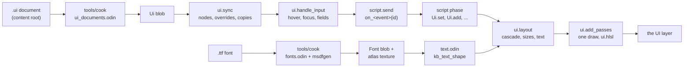

# UI

Menus and HUDs: documents of boxes, text and images that the UI lays out each frame, draws in one batch into the UI layer, and that the player drives with a mouse, keys or a gamepad, and scripts with the `Ui` library. Read [Rendering: Layers and output](../rendering/layers-and-output.md#ui) for the layer that it draws into, and [Content: UI documents](../content/kinds/ui-documents.md#ui-documents) and [Fonts](../content/kinds/fonts.md#fonts) for the assets that it reads.

## Documents

| Document | What it covers |
|---|---|
| [Design](design.md) | Documents on entities, the cascade, layout and the scale, text, the batch and its shader, input and focus, scrolling, scripts, and hot reload. |

## Overview

A UI is UI document assets, each put on the screen by a `Ui_Document` component on an entity. The entity's behaviours get the document's events, and reach its elements through the `Ui` library by the entity and the elements' ids.

The package is `lib/engine/ui`, on the game side:

| File | What it holds |
|---|---|
| `ui.odin` | `State`, documents and their nodes, building a document from its blob, templates' copies, fonts |
| `components.odin` | `Ui_Document` |
| `style.odin` | `Style`, an element's defaults, and the cascade |
| `layout.odin` | The layout: sizes along each axis, fills, placing, clipping, the scale |
| `text.odin` | Fonts placed for kb_text_shape, shaping, line breaks, bindings, carets |
| `input.odin` | Hover, clicks, focus, navigation, modal documents, fields, events |
| `scroll.odin` | Scroll boxes: their bars, the wheel, the right stick, Page Up and Page Down, and scrolling the focus into view |
| `edit.odin` | What scripts do to a document: attributes, bindings, copies, removals |
| `batch.odin`, `render.odin` | The instances of a frame, and the pass that draws them |
| `scripts.odin` | The `Ui` library |

The shader is `lib/engine/content/shaders/ui.hlsl`, an engine asset.

## References

- Viktor Chlumsky, [msdfgen](https://github.com/Chlumsky/msdfgen) and *Shape Decomposition for Multi-channel Distance Fields* (2015): the fonts' distance fields, and the median that the shader draws them with.
- Jimmy Lefevre, [kb_text_shape](https://github.com/JimmyLefevre/kb), in Odin's `vendor:kb_text_shape`: OpenType shaping, its kerning and ligatures.
- Inigo Quilez, [2D distance functions](https://iquilezles.org/articles/distfunctions2d/): the rounded box with a radius at each corner.
- The W3C's [CSS Flexible Box Layout](https://www.w3.org/TR/css-flexbox-1/#resolve-flexible-lengths): sharing what is left among fills, and freezing those that their limits stop.
- Unity's [UI Toolkit](https://docs.unity3d.com/Manual/UIElements.html) and its UXML: a UI as a document of elements with styles, which scripts find by name.
